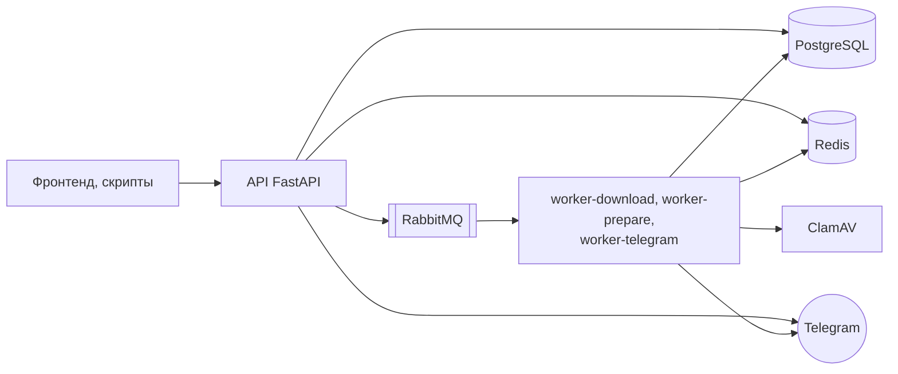

# tcloud

Файловое хранилище поверх Telegram с REST API: фото, видео, аудио, GIF и документы уходят в приватные каналы (хранилища)
через Telethon, у каждого файла свой UUID и путь `tcloud/{хранилище}/{папки}/{файл}`.

- Лимит файла по аккаунту: 2 ГБ, с Premium 4 ГБ. Отправка оригиналом или сжатым медиа.
- Загрузка с устройства одним запросом, по ссылке и пачками до 100 ссылок; прогресс, номер в очереди, вебхуки.
- Очереди Celery на RabbitMQ с приоритетом `low/normal/high`: скачивание, проверка и отправка в Telegram — отдельные
  воркеры, статусы в Redis. Отмена, смена приоритета, повтор, без дублей при падении воркера, Flower и health по воркерам.
- Проверка типа по содержимому, запрет исполняемых файлов (и внутри zip), строгий ClamAV, защита от SSRF.
- Архивы папки или выбранных файлов и папок (zip, 7z, tar.gz/bz2/xz) фоновой задачей.
- Поиск файлов по имени (без учёта регистра, кириллица; сортировка по имени на языке интерфейса, `lang=ru|en`) и фильтрам: тип, MIME, размер, дата, шифрование; в папке, хранилище или везде (`GET /api/files/search`).
- Карта активности загрузок по дням (`GET /api/files/activity`).
- Настройки пользователя на сервере (`GET/PATCH/DELETE /api/account/settings`): значения по умолчанию для загрузок и архивов действуют на любом устройстве и для API-ключей, плюс настройки интерфейса и папка чатов «TCloud» в Telegram для всех каналов хранилищ ([docs/flows/settings.md](docs/flows/settings.md)).
- Листинг папки постранично (`GET /api/folders`: серверная сортировка по имени/типу/размеру/датам с ICU-правилами ru/en, keyset-курсор, по 20 элементов); размеры и число файлов папок в листинге, число каналов аккаунта в `GET /api/account`.
- Индикаторы чтения и записи по хранилищам для всех клиентов сразу (`GET /api/storages/activity`, метки в Redis на 5 с).
- Превью фото и видео (`GET /api/files/{id}/thumb`, JPEG ≤ 320 px, с `ETag`): из Telegram, у зашифрованных файлов — своё, зашифрованное в БД; старые файлы без превью дозаполняет фоновая задача root (`POST /api/files/previews/backfill`); root может выключить превью для всех (`uploads.previews`) и стереть сохранённые (`DELETE /api/files/previews`).
- Шифрование по умолчанию (AES-256-GCM, ключ сервера `APP_ENCRYPTION_KEY`) для всех файлов, кроме `send_as=media`; `encrypt=false` выключает. В Telegram только шифротекст.
- Вход в Telegram через API: QR или код, двухэтапная проверка, старые сессии tcloud отзываются сами.
- Удалили файл руками в Telegram — запись в БД пропадает сама (события Telethon, плюс проверка при скачивании).
- FastAPI, PostgreSQL, RabbitMQ, Redis, Celery, Python 3.14 (uv), всё в Docker.



Подробная схема — [docs/architecture.md](docs/architecture.md).

## Быстрый старт (прод-compose)

```bash
make env          # .env + сгенерированные секреты и ключи JWT в certs/; заполнить TELEGRAM_API_ID / TELEGRAM_API_HASH
make up           # API на 127.0.0.1:8000, Swagger — /docs; Flower — 127.0.0.1:5555
make logs
```

Сначала войдите как root (`ROOT_LOGIN` / `ROOT_PASSWORD` из `.env`): `POST /api/auth/signin`, токены придут в HttpOnly-куках.
Потом войдите в Telegram (Swagger, раздел **Telegram**, по QR или по коду с 2FA) отдельно для сессий `api`, `upload` и `download`:
`POST /api/telegram/api/qr`, `POST /api/telegram/upload/qr`, `POST /api/telegram/download/qr` ([docs/flows/auth.md](docs/flows/auth.md)).

Пользователи, роли и гранты на папки описаны в [docs/flows/users.md](docs/flows/users.md). Для скриптов удобнее API-ключ:
`POST /api/users/{id}/api-keys`.

```bash
curl -H "X-API-Key: $TCLOUD_KEY" -H 'Content-Type: application/json' \
  -d '{"name":"Фото"}' http://127.0.0.1:8000/api/storages
curl -H "X-API-Key: $TCLOUD_KEY" --data-binary @photo.jpg \
  "http://127.0.0.1:8000/api/uploads?path=tcloud/<uuid>/отпуск/photo.jpg&priority=high"
```

## Разработка

| Вариант | Команды | Что запущено |
|---|---|---|
| Всё в Docker из исходников | `make dev-up-all` (`make dev-down` — остановить) | `docker-compose.dev.yml`, профиль `app`: API, три воркера, Postgres, RabbitMQ (панель `:15672`), Redis, ClamAV. Исходники не монтируются: после правок `docker compose -f docker-compose.dev.yml --profile app up -d --build app worker-download worker-prepare worker-telegram` |
| Код локально с перезагрузкой | `make dev-up`, ClamAV — `docker compose -f docker-compose.dev.yml up -d clamav`; затем `make app`, `make worker-download`, `make worker-prepare`, `make worker-telegram`, `make flower` | в Docker только инфраструктура; в `.env` хосты `127.0.0.1` (`POSTGRES_HOST`, `CLAMAV_HOST`, `RABBITMQ_HOST`, `REDIS_HOST`) |
| Прод | `make up`, `make logs`, `make down` | `docker-compose.prod.yml` |

Логи dev-стенда: `docker compose -f docker-compose.dev.yml logs -f app worker-download worker-prepare worker-telegram`.
Прочие цели: `make install` (`uv sync`), `make format` (black + isort), `make check` (pip-audit + проверка миграций).
Подробно — [docs/development.md](docs/development.md), прод — [docs/deployment.md](docs/deployment.md).

## Настройки

`.env` (шаблон `.env.exemple`, путь меняет `ENV_FILE`), переменные окружения важнее. Классы — `src/config/models/*`,
по одному на префикс. Главное:

| Переменная | По умолчанию | Что |
|---|---|---|
| `APP_SECRET_KEY` | — (обязательно, `make env`) | HMAC refresh-токенов, API-ключей и подписи вебхуков |
| `APP_ENCRYPTION_KEY` | пусто — шифрование выключено | 32 байта base64, ключ шифрования файлов; потеря = потеря зашифрованных файлов |
| `APP_ALLOWED_ORIGINS` | `[]` | CORS и проверка `Origin` для фронтенда на другом origin |
| `ROOT_LOGIN`, `ROOT_PASSWORD` | — | root, синхронизируется при каждом старте API |
| `JWT_SECURE` | `true` | куки только по HTTPS; `false` для http без TLS |
| `JWT_PRIVATE_KEY_PATH`, `JWT_PUBLIC_KEY_PATH` | `certs/jwt-*.pem` | ключи RS256 |
| `JWT_ACCESS_TOKEN_EXPIRATION_MINUTES` / `JWT_REFRESH_TOKEN_EXPIRATION_DAYS` | `15` / `30` | сроки токенов |
| `JWT_MAX_FAILED_LOGINS`, `JWT_LOCK_MINUTES` | `5`, `15` | блокировка аккаунта после неверных паролей |
| `RATE_LIMIT_ENABLED` | `true` | rate limiting (`429 rate_limited` + `Retry-After`), docs/security.md |
| `RATE_LIMIT_<ПРАВИЛО>__LIMIT`, `RATE_LIMIT_<ПРАВИЛО>__WINDOW` | см. docs/security.md | правило парой; `JWT_SIGNIN_IP_LIMIT`/`JWT_SIGNIN_IP_WINDOW` переименованы в `RATE_LIMIT_SIGNIN_IP__LIMIT`/`__WINDOW` |
| `FORWARDED_ALLOW_IPS` | `127.0.0.1` | IP/подсеть reverse proxy, которому uvicorn верит в `X-Forwarded-For`; никогда `*` |
| `POSTGRES_HOST`, `POSTGRES_DB`, `POSTGRES_USER`, `POSTGRES_PASSWORD` | `tcloud` для БД | PostgreSQL |
| `POSTGRES_POOL_RECYCLE` | `1800` | через сколько секунд пул API пересоздаёт соединение (`POSTGRES_POOL_PRE_PING` убран, docs/architecture.md) |
| `RABBITMQ_HOST`, `RABBITMQ_USER`, `RABBITMQ_PASSWORD` | `rabbitmq`, `tcloud` | брокер |
| `REDIS_HOST`, `REDIS_PASSWORD`, `REDIS_PREFIX` | `redis`, пусто, `tcloud` | Redis ([docs/redis.md](docs/redis.md)) |
| `REDIS_CACHE_TTL` | `180` | срок кешей сведений из Telegram в Redis, с (каналы, аккаунт, аватарки, превью; docs/redis.md) |
| `REDIS_THUMB_CACHE_MB` | `64` | потолок памяти кеша превью открытых файлов в Redis (base64), `0` — без кеша |
| `CLAMAV_HOST`, `CLAMAV_PORT`, `CLAMAV_TIMEOUT` | `clamav`, `3310`, `900` | антивирус |
| `TELEGRAM_API_ID`, `TELEGRAM_API_HASH` | — | приложение на my.telegram.org |
| `TELEGRAM_SESSION`, `TELEGRAM_UPLOAD_SESSION`, `TELEGRAM_DOWNLOAD_SESSION` | `data/session/tcloud*` (compose — `/data/session/...`) | файлы сессий `api`, `upload`, `download` |
| `TELEGRAM_CHATS` | пусто | существующие каналы, подключаемые как хранилища при старте |
| `TELEGRAM_CONCURRENCY`, `TELEGRAM_UPLOAD_WORKERS`, `TELEGRAM_FLOOD_MAX_WAIT` | `2`, `4`, `3600` | потоки `worker-telegram` (прод-compose), параллельные куски, предел FloodWait |
| `UPLOAD_DOWNLOAD_CONCURRENCY`, `UPLOAD_PREPARE_CONCURRENCY` | `4`, `4` | потоки воркеров (только прод-compose) |
| `UPLOAD_TMP_DIR` | `data/tmp` (compose — `/data/tmp`) | общий том тел загрузок и архивов |
| `UPLOAD_MAX_ACTIVE_TASKS`, `UPLOAD_MAX_FILES_ON_DISK` | `0`, `0` (без лимита) | лимиты задач и файлов в `tmp` |
| `UPLOAD_MIN_FREE_DISK_MB` | `1024` | резерв диска, иначе `507` |
| `UPLOAD_TASK_TTL`, `UPLOAD_ARCHIVE_TTL` | 7 дней, 24 ч | жизнь задач и готовых архивов |
| `UPLOAD_ARCHIVE_MAX_ITEMS` | `1000` | выбранных элементов в архиве |
| `LOG_LEVEL` | `INFO` | loguru |

Полный список с остальными интервалами (`UPLOAD_HEARTBEAT_INTERVAL`, `UPLOAD_SWEEP_INTERVAL`, `UPLOAD_RETRIES`, …) —
`src/config/models/upload.py` и соседние файлы.

## Тесты

```bash
make test-all       # uv run pytest: unit, integration, api (Postgres, Redis, RabbitMQ через testcontainers)
make test | make test-integration | make test-api | make test-cov
make test-docker    # всё в Docker, с ffmpeg (docker-compose.test.yml)
make load-up        # нагрузка: стенд; затем в отдельных терминалах make load-app и make load-workers
make load           # locust headless, отчёт в logs/load/; make load-down — убрать стенд
```

Если `uv run pytest` падает из-за старых путей в `.venv`, запускайте `.venv/bin/python -m pytest` или пересоздайте
окружение (`rm -rf .venv && uv sync`). Подробно — [docs/testing.md](docs/testing.md).

## Миграции

Alembic, `src/infrastructure/database/migrations/` (ревизии `0001`–`0010`, список — [docs/database.md](docs/database.md)).
В Docker их применяет `scripts/docker-entrypoint.sh` при старте `app` (у воркеров `RUN_MIGRATIONS=0`), локально —
`uv run alembic upgrade head`. Новая ревизия: `uv run alembic revision --autogenerate -m "msg"`; существующие не правим.

## Структура

```
main.py              FastAPI-приложение и lifespan
src/api/             роуты /api, HTTP-схемы, middleware, коды ошибок → HTTP
src/application/     сервисы, стадии воркеров (UploadPipeline), Celery-задачи, DTO, фабрики зависимостей
src/infrastructure/  БД и миграции, Redis, Celery, Telegram, ClamAV, исходящий HTTP, медиа, шифрование
src/utilities/       базовая ошибка, разбор путей и Range
src/config/          настройки pydantic-settings
tests/               unit, integration, api, load
docker/, scripts/    clamd.conf, entrypoint, генерация секретов
```

## Документация

Всё подробно и со схемами — в [`docs/`](docs/README.md):

- [architecture.md](docs/architecture.md) — компоненты и слои; [database.md](docs/database.md) — ER-схема и индексы;
  [redis.md](docs/redis.md) — ключи Redis;
- [background-tasks.md](docs/background-tasks.md) — очереди, путь загрузки, статусы и ожидания;
- [flows/](docs/flows) — [пользователи и вход](docs/flows/users.md), [вход в Telegram](docs/flows/auth.md),
  [хранилища](docs/flows/storages.md), [папки, файлы, скачивание и архивы](docs/flows/folders-and-files.md),
  [загрузки](docs/flows/uploads.md), [настройки](docs/flows/settings.md);
- [security.md](docs/security.md), [integrations.md](docs/integrations.md), [deployment.md](docs/deployment.md),
  [development.md](docs/development.md), [testing.md](docs/testing.md).

Изменение кода, которое меняет поток со схемы в `docs/`, обновляет документ и схему в том же коммите.
