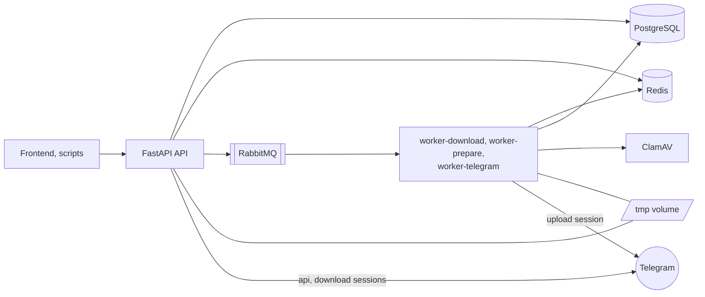
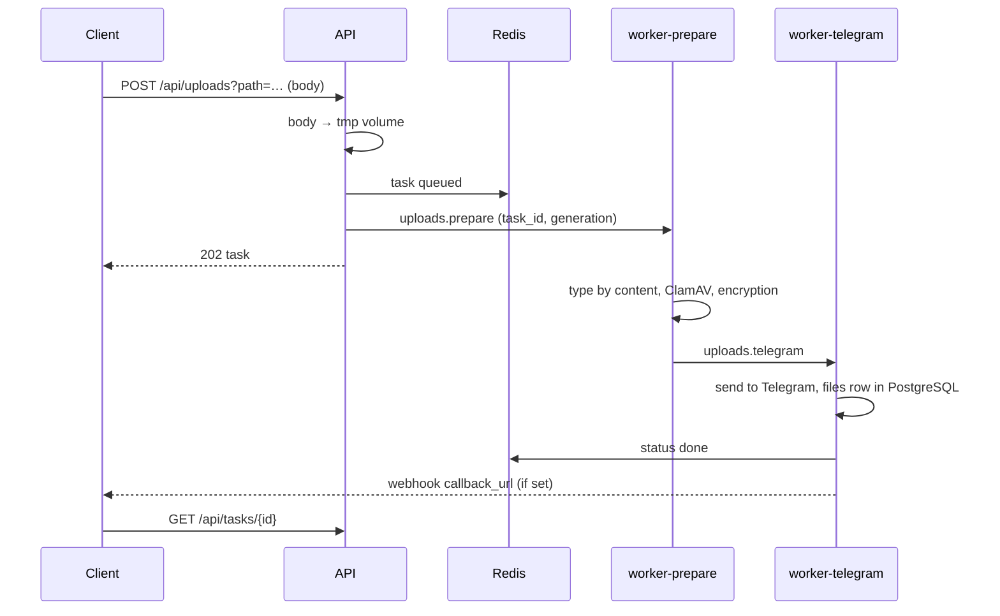

# tcloud-backend

[](https://github.com/NikitkaZXC/tcloud-backend/actions/workflows/ci.yml)
[](https://github.com/NikitkaZXC/tcloud-backend/releases)
[](LICENSE)

**English** | [Русский](README.ru.md)

File storage on top of Telegram with a REST API. Files of any type go to private channels (storages) through a
Telegram user account (Telethon). Every file has its own UUID and a path `tcloud/{storage}/{folders}/{file}`; the index lives in PostgreSQL.

- Uploads from a device (whole or in resumable chunks), from a URL or in batches of up to 100 URLs. Priority queues, progress, cancel and webhooks.
- Content-based type detection and ClamAV. AES-256-GCM encryption is on by default; files over the Telegram limit are stored in parts.
- Folders, search, previews, archives (zip, 7z, tar.*), users with roles, folder grants and API keys.

All features are described in [docs/overview.md](docs/overview.md).



Upload from a device. A URL upload runs `uploads.download` on `worker-download` before `uploads.prepare`.



More in [docs/architecture.md](docs/architecture.md) and [docs/background-tasks.md](docs/background-tasks.md).

## Main endpoints

All endpoints are under `/api`. Auth is the `access` cookie or `X-API-Key`. The full list is in Swagger `/docs`; flows are described in [docs/flows/](docs/flows).

| Group | Endpoints | What they do |
|---|---|---|
| Sign-in | `POST /auth/signin`, `/auth/refresh`, `/auth/logout` | JWT in HttpOnly cookies |
| Telegram (root) | `POST /telegram/{api\|upload\|download}/qr\|code\|sign-in\|password` | sign in to Telegram sessions |
| Users | `GET\|POST /users`, `PUT /users/{id}/grants`, `POST /users/{id}/api-keys` | users, grants, API keys |
| Storages | `GET\|POST /storages`, `PATCH\|DELETE /storages/{id}`, `GET /storages/activity` | Telegram channels, read and write indicators |
| Folders | `GET\|POST\|DELETE /folders?path=`, `POST /folders/archive[/selection]` | listing, create, delete, archive |
| Files | `GET /files/{id}`, `/files/{id}/download`, `/files/{id}/thumb`, `/files/search`, `DELETE /files/{id}` | metadata, download with `Range`, previews, search |
| Uploads | `POST /uploads`, `/uploads/sessions`, `/uploads/from-url`, `/uploads/batch` | whole, chunked, from a URL, in batches |
| Tasks | `GET /tasks[/{id}]`, `POST /tasks/{id}/cancel\|priority\|retry`, `GET /tasks/{id}/archive` | status, control, finished archive |
| Settings | `GET\|PATCH\|DELETE /account/settings`, `GET /account`, `GET /account/webhook-secret` | user settings, Telegram account info, webhook signing key |
| Health | `GET /health` | DB, broker, workers, Telegram, ClamAV, Redis |

## Quick start

```bash
make env                # .env from .env.exemple plus secrets; fill in TELEGRAM_API_ID / TELEGRAM_API_HASH
make dev-up-all         # everything in Docker: API http://127.0.0.1:8000 (Swagger /docs), Flower 127.0.0.1:5555
docker compose -f docker-compose.dev.yml logs -f app worker-download worker-prepare worker-telegram
# sources are not mounted: rebuild after changes
docker compose -f docker-compose.dev.yml --profile app up -d --build app worker-download worker-prepare worker-telegram flower
make install && make test-all   # tests (uv sync, then pytest)
```

Sign in as root (`ROOT_LOGIN` / `ROOT_PASSWORD` from `.env`), then sign in to Telegram for the `api`, `upload` and
`download` sessions in `/docs`, section **Telegram** ([docs/flows/auth.md](docs/flows/auth.md)). Flower: `FLOWER_USER` / `FLOWER_PASSWORD`.

Production: `make up && make logs` builds the image locally. To run the published image instead:

```bash
export TCLOUD_IMAGE=ghcr.io/nikitkazxc/tcloud-backend:1.0.0
docker compose -f docker-compose.prod.yml pull
docker compose -f docker-compose.prod.yml up -d --no-build
```

Swagger is disabled there; Telegram sign-in happens on the frontend `/telegram` page
([docs/deployment.md](docs/deployment.md)). Local run without Docker: `make dev-up` + `make app` + `make worker-*`.

`.env`, CI, releases and migrations are described in [docs/development.md](docs/development.md). Tests and load testing are in [docs/testing.md](docs/testing.md), production in [docs/deployment.md](docs/deployment.md). Docs index: [docs/README.md](docs/README.md).

## License

[MIT](LICENSE). Security issues: see [SECURITY.md](SECURITY.md).
