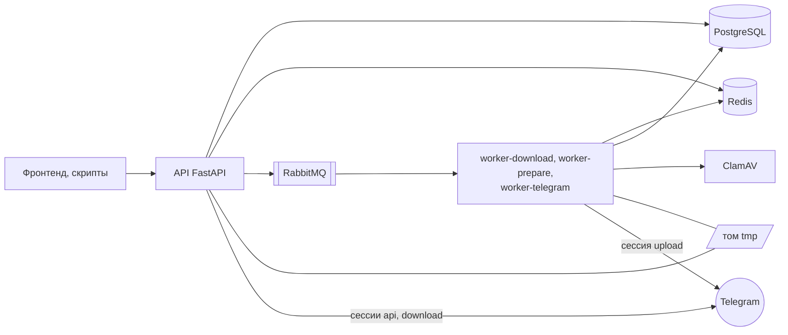
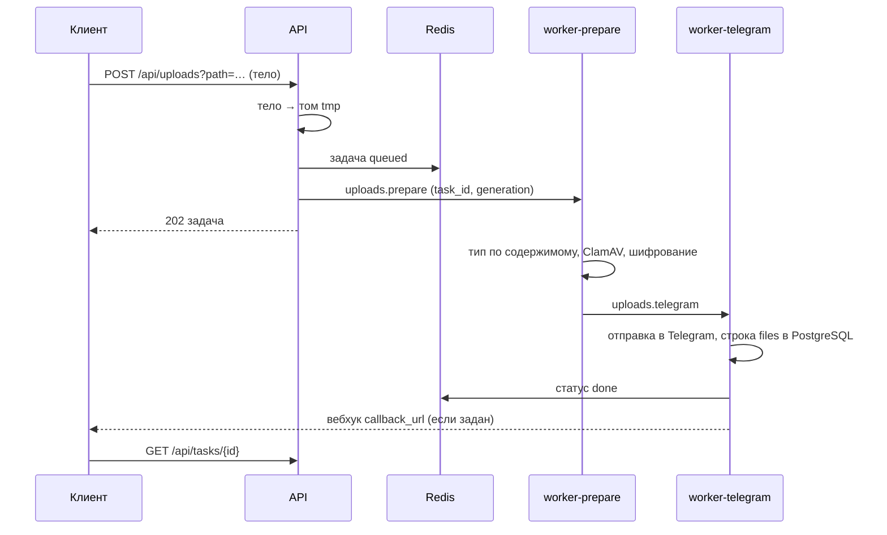

# tcloud-backend

[English](README.md) | **Русский**

Файловое хранилище поверх Telegram с REST API. Файлы любых типов уходят в приватные каналы (хранилища) через
пользовательский аккаунт (Telethon). У каждого файла свой UUID и путь `tcloud/{хранилище}/{папки}/{файл}`, индекс хранится в PostgreSQL.

- Загрузка с устройства (целиком или частями с докачкой), по ссылке или пачкой до 100 ссылок. Работают очереди с приоритетом, прогресс, отмена и вебхуки.
- Проверка типа по содержимому и ClamAV. Шифрование AES-256-GCM включено по умолчанию, файлы больше лимита Telegram уходят частями.
- Папки, поиск, превью, архивы (zip, 7z, tar.*), пользователи с ролями, гранты на папки и API-ключи.

Все возможности описаны в [docs/overview.md](docs/overview.md). Подробная документация в `docs/` — на английском.



Загрузка с устройства. При загрузке по ссылке перед `uploads.prepare` идёт `uploads.download` → `worker-download`.



Подробности — в [docs/architecture.md](docs/architecture.md) и [docs/background-tasks.md](docs/background-tasks.md).

## Основные ручки

Все ручки находятся под `/api`. Авторизация — кука `access` или `X-API-Key`. Полный список — в Swagger `/docs`, сценарии описаны в [docs/flows/](docs/flows).

| Группа | Ручки | Что делают |
|---|---|---|
| Вход | `POST /auth/signin`, `/auth/refresh`, `/auth/logout` | JWT в HttpOnly-куках |
| Telegram (root) | `POST /telegram/{api\|upload\|download}/qr\|code\|sign-in\|password` | вход в сессии Telegram |
| Пользователи | `GET\|POST /users`, `PUT /users/{id}/grants`, `POST /users/{id}/api-keys` | пользователи, гранты, API-ключи |
| Хранилища | `GET\|POST /storages`, `PATCH\|DELETE /storages/{id}`, `GET /storages/activity` | каналы Telegram, индикаторы чтения и записи |
| Папки | `GET\|POST\|DELETE /folders?path=`, `POST /folders/archive[/selection]` | листинг, создание, удаление, архив |
| Файлы | `GET /files/{id}`, `/files/{id}/download`, `/files/{id}/thumb`, `/files/search`, `DELETE /files/{id}` | метаданные, скачивание с `Range`, превью, поиск |
| Загрузки | `POST /uploads`, `/uploads/sessions`, `/uploads/from-url`, `/uploads/batch` | загрузка целиком, частями, по ссылке, пачкой |
| Задачи | `GET /tasks[/{id}]`, `POST /tasks/{id}/cancel\|priority\|retry`, `GET /tasks/{id}/archive` | статус, управление, готовый архив |
| Настройки | `GET\|PATCH\|DELETE /account/settings`, `GET /account`, `GET /account/webhook-secret` | настройки пользователя, сведения об аккаунте Telegram, ключ подписи вебхуков |
| Здоровье | `GET /health` | БД, брокер, воркеры, Telegram, ClamAV, Redis |

## Быстрый старт

```bash
make env                # .env из .env.exemple и секреты; заполните TELEGRAM_API_ID / TELEGRAM_API_HASH
make dev-up-all         # всё в Docker: API http://127.0.0.1:8000 (Swagger /docs), Flower 127.0.0.1:5555
docker compose -f docker-compose.dev.yml logs -f app worker-download worker-prepare worker-telegram
# исходники не монтируются: после правок пересоберите
docker compose -f docker-compose.dev.yml --profile app up -d --build app worker-download worker-prepare worker-telegram flower
make install && make test-all   # тесты (uv sync, затем pytest)
```

Войдите как root (`ROOT_LOGIN` / `ROOT_PASSWORD` из `.env`), затем войдите в Telegram для сессий `api`, `upload` и
`download` на `/docs`, раздел **Telegram** ([docs/flows/auth.md](docs/flows/auth.md)). Flower: `FLOWER_USER` / `FLOWER_PASSWORD`.

Прод: `make up && make logs` (или готовый образ `ghcr.io/nikitkazxc/tcloud-backend:1.0.0` через `TCLOUD_IMAGE`, [docs/deployment.md](docs/deployment.md)). Swagger там выключен, вход в Telegram делается на странице `/telegram` фронтенда
([docs/deployment.md](docs/deployment.md)). Локальный запуск без Docker: `make dev-up` + `make app` + `make worker-*`.

Описание `.env`, CI и миграций — в [docs/development.md](docs/development.md). Тесты и нагрузка — в [docs/testing.md](docs/testing.md), прод — в [docs/deployment.md](docs/deployment.md). Указатель документации — [docs/README.md](docs/README.md).
