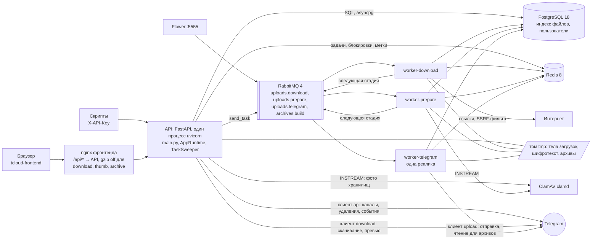
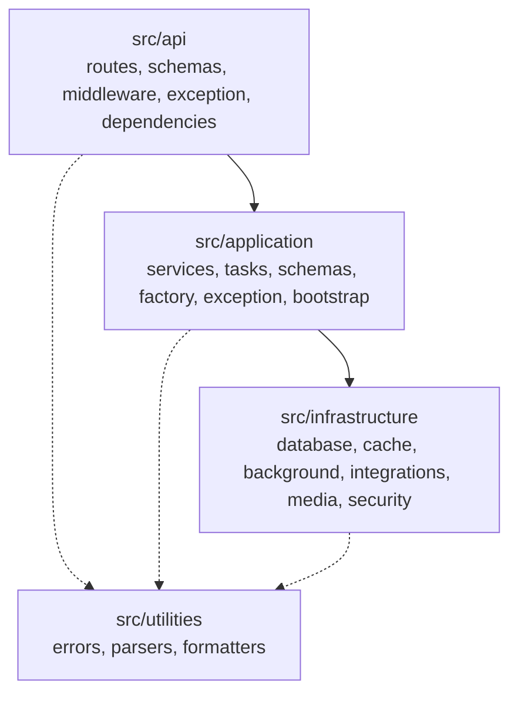

# Архитектура

## Компоненты



- **API** (`main.py`): HTTP, приём тел загрузок в `tmp`, постановка задач, отдача файлов из Telegram с `Range`,
  вход в Telegram, `TaskSweeper` (потерянные задачи, уборка `tmp`) и чистка старых Telegram-сессий в фоне.
  Состояние процесса — `AppRuntime` (`src/infrastructure/background/runtime.py`): клиенты Telegram `telegram` (сессия
  `api`, `receive_updates=True`) и `download`, сканер, `TaskStore`, кеш сообщений Telegram `media` (`MediaCache`), логины в процессе (Premium и число каналов — в Redis).
- **Воркеры** (`src/application/tasks/upload.py`): один образ, Celery `--pool threads`; `WorkerRuntime`
  (`background/worker.py`) — свой event loop, движок БД с `NullPool`, Redis и ленивый клиент Telegram сессии `upload`
  (его открывает только `worker-telegram`). Подробно — background-tasks.md.
- **Пул PostgreSQL API** (`database/engine.py`): без `pool_pre_ping` (лишний `SELECT 1` на каждую выдачу
  соединения), `pool_recycle` = `POSTGRES_POOL_RECYCLE` (1800 с). Если первый запрос транзакции падает на
  разорванном соединении (Postgres перезапущен), SQLAlchemy помечает весь пул недействительным, а
  `ReconnectingSession` (`database/session.py`, `sync_session_class` у `session_factory`) откатывает сессию и
  повторяет этот запрос один раз на новом соединении — первый запрос после рестарта БД не отвечает `500`. Внутри уже
  начатой транзакции повтора нет (ошибка уходит как раньше).
- **Хранилища данных**: PostgreSQL — database.md, Redis — redis.md, RabbitMQ — очереди с `x-max-priority=9`.
- **Telegram**: три сессии одного аккаунта (integrations.md, flows/auth.md).
- **ClamAV**: `clamav/clamav:*-debian`, строгий `docker/clamd.conf` (security.md).

## Слои



Зависимости идут только вниз: `api → application → infrastructure`; `utilities` доступны всем.
`src/application` никогда не импортирует `src/api`, `src/infrastructure` — ни то, ни другое.

```
main.py                    FastAPI-приложение, lifespan: БД, клиенты Telegram api и download, ClamAV, Redis, AppRuntime,
                           startup, TaskSweeper и чистка старых Telegram-сессий
src/
  config/                  настройки (pydantic-settings), по классу на группу: APP_, POSTGRES_, JWT_, ROOT_, TELEGRAM_, CLAMAV_, UPLOAD_, RABBITMQ_,
                           REDIS_, LOG_
  api/
    endpoints.py           все роутеры под /api; /api/telegram только для root
    middleware/            заголовки безопасности, проверка Origin (CSRF), см. security.md; CORS подключён в main.py
    routes/                auth, user, system (health, account), telegram, settings, storage, folder, upload (и задачи), file
    schemas/               HTTP-схемы запросов и ответов
    exception/             код ошибки → HTTP-статус, обработчики, единый формат {"error": {...}}
    dependencies/          get_actor (кука access или X-API-Key → Actor), get_optional_actor, get_root
  application/
    services/              бизнес-логика: Account, Auth (вход в Telegram, чистка старых сессий), UserAuth (вход
                           пользователей, токены, Actor), User, Grant, ApiKey, Health, Storage, Folder, File, Task,
                           Upload, Settings (flows/settings.md), access (проверки прав), UploadPipeline (стадии
                           воркеров), archive, webhook, TaskSweeper (потерянные задачи и уборка tmp, крутится в API)
    tasks/                 Celery-задачи uploads.download, uploads.prepare, uploads.telegram, archives.build; запуск WorkerRuntime и Heartbeat по сигналам Celery
    schemas/               DTO сервисов (*ServiceRead, *ServiceCreate, *ServiceUpdate)
    factory/               FastAPI-зависимости get_service_*: сервисы роуты получают только через них
    exception/             доменные ошибки
    bootstrap/             startup (старые файлы tmp, ключи JWT, строка root; если API-сессия вошла — каналы из .env,
                           папка TCloud и события удалений)
  infrastructure/
    database/              модели *DB, миксины (UUIDv7 id, created_at, updated_at), репозитории, миграции
    integrations/          telegram (Telethon), antivirus (clamd), web (безопасные исходящие запросы)
    security/              JWT, argon2, HMAC секретов, шифрование файлов (encryption.py)
    media/                 определение типа, Pillow/ffprobe, превью, перевод в JPEG
    background/            Celery-приложение и очереди, enqueue, queue_sizes, DiskBudget (резерв места), AppRuntime (состояние API),
                           WorkerRuntime (event loop, Telethon, БД и Redis воркера), Heartbeat
    cache/                 Redis: TaskStore (задачи, пачки, блокировки, очереди, активность; Lua CLAIM/REQUEUE/CANCEL),
                           TokenBlacklist, RateLimitStore — карта ключей в redis.md
    archive.py             ArchiveWriter: zip, 7z, tar.*
    enums/, logger/, limits.py
  utilities/
    errors.py              TCloudError: базовая ошибка с кодом
    parsers/               пути tcloud/..., заголовок Range
    formatters/            ограниченные pydantic-типы для запросов
```

## Сервисы, репозитории, транзакции

- Сервис получает `AsyncSession` и `AppRuntime`, репозитории создаёт сам в `__init__`.
  Другие сервисы передаются в конструктор (`FolderService(storage_service=...)`).
- Репозитории только `flush()`; **коммитит сервис**.
- `UploadPipeline` работает в воркере Celery и открывает короткие сессии через `WorkerRuntime.session_factory`
  (свой движок с `NullPool` в event loop воркера). API ставит задачи через `enqueue` по имени — без импорта задач.
- После ORM-`UPDATE` c `onupdate=func.now()` SQLAlchemy помечает `updated_at` устаревшим; `get_by_id` в репозиториях
  читают с `populate_existing=True`, иначе ленивая подгрузка в async-коде падает с `MissingGreenlet`.

## Схемы запросов

JSON-тела (`POST`/`PUT`/`PATCH`) наследуют `api/schemas/base.RequestBody` с `extra="forbid"`: незнакомое поле — `422
validation_error` (`type: extra_forbidden`, `loc` — путь к полю), а не тихий пропуск опечатки (`{"blocked": true,
"admn": true}` больше не «проходит»). Модели query-параметров (`UploadParams` у `POST /api/uploads`, поиск, листинг) так
не делаются: лишний параметр строки запроса по-прежнему игнорируется. Настройки (`PATCH /api/account/settings`) были
строгими и раньше.

## Ошибки

Каждая ошибка — подкласс `TCloudError` со стабильным `code` (`storage_not_found`, `too_large`, `flood_wait`…).
Инфраструктура бросает свои (`UnsupportedMediaError`, `UnsafeUrlError`, `TelegramFloodWaitError`), приложение — доменные
(`PathConflictError`, `UploadInProgressError`). HTTP-статус выбирает только слой API — по коду, в `api/exception/errors.py`.
Telethon-исключения наружу не выходят: `translate_errors` превращает их в `TelegramFloodWaitError`,
`TelegramUnavailableError` (можно повторить) и `TelegramError`. Декоратор работает и с асинхронными генераторами
(`iter_media`): ошибка посреди потока тоже переводится, а внутренний генератор Telethon закрывается (`aclosing`).

## Соглашения

- Комментарии и docstrings в коде не пишем; исключение — однострочный docstring у класса исключения.
  Всё «почему» — здесь, в `docs/`.
- Логи — loguru: info на ключевые действия, warning на пропуски и проглоченные ошибки, exception на сбои. Секреты не логируем.
- Миграции не редактируем, изменения схемы — новой ревизией; `alembic check` в тестах ловит расхождение моделей и миграций.
- Пакеты реэкспортируют публичные имена через `__init__.py` с `__all__`.
- Форматирование — black + isort (`make format`).
- Коммиты — одна строка на английском (`feat: ...`, `fix: ...`, `refactor: ...`), без push.
