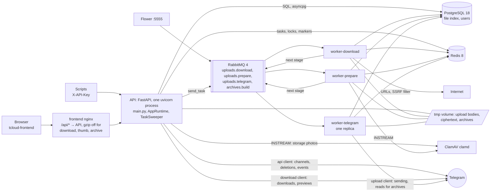
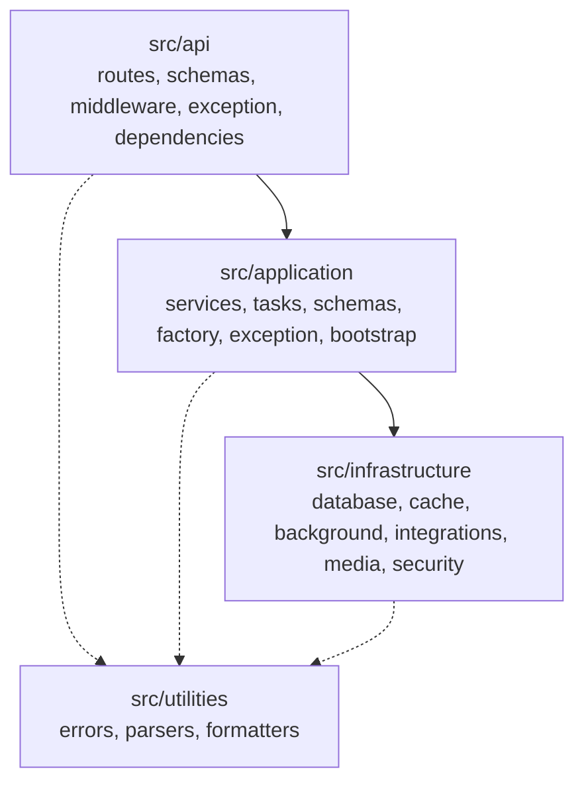

# Architecture

## Components



- **API** (`main.py`): HTTP, receiving upload bodies into `tmp`, queueing tasks, serving files from Telegram with `Range`,
  Telegram sign-in, `TaskSweeper` (lost tasks, `tmp` cleanup) and cleanup of old Telegram sessions in the background.
  Process state is `AppRuntime` (`src/infrastructure/background/runtime.py`): Telegram clients `telegram` (session
  `api`, `receive_updates=True`) and `download`, the scanner, `TaskStore`, the Telegram message cache `media` (`MediaCache`), in-process logins (Premium and the channel count are in Redis).
- **Workers** (`src/application/tasks/upload.py`): one image, Celery `--pool threads`; `WorkerRuntime`
  (`background/worker.py`) has its own event loop, a DB engine with `NullPool`, Redis and a lazy Telegram client for the `upload` session
  (only `worker-telegram` opens it). Details in background-tasks.md.
- **API PostgreSQL pool** (`database/engine.py`): no `pool_pre_ping` (an extra `SELECT 1` on every connection
  checkout), `pool_recycle` = `POSTGRES_POOL_RECYCLE` (1800 s). If the first statement of a transaction fails on a
  broken connection (Postgres restarted), SQLAlchemy invalidates the whole pool, and
  `ReconnectingSession` (`database/session.py`, `sync_session_class` of `session_factory`) rolls the session back and
  retries that statement once on a new connection, so the first request after a DB restart does not answer `500`. Inside an
  already started transaction there is no retry (the error propagates as before).
- **Data stores**: PostgreSQL in database.md, Redis in redis.md, RabbitMQ queues with `x-max-priority=9`.
- **Telegram**: three sessions of one account (integrations.md, flows/auth.md).
- **ClamAV**: `clamav/clamav:*-debian`, strict `docker/clamd.conf` (security.md).

## Layers



Dependencies go only downwards: `api → application → infrastructure`; `utilities` are available to all.
`src/application` never imports `src/api`, `src/infrastructure` imports neither.

```
main.py                    FastAPI app, lifespan: DB, Telegram clients api and download, ClamAV, Redis, AppRuntime,
                           startup, TaskSweeper and cleanup of old Telegram sessions
src/
  config/                  settings (pydantic-settings), one class per group: APP_, POSTGRES_, JWT_, ROOT_, TELEGRAM_, CLAMAV_, UPLOAD_, RABBITMQ_,
                           REDIS_, LOG_
  api/
    endpoints.py           all routers under /api; /api/telegram is root-only
    middleware/            security headers, Origin check (CSRF), see security.md; CORS is wired in main.py
    routes/                auth, user, system (health, account), telegram, settings, storage, folder, upload (and tasks), file
    schemas/               HTTP request and response schemas
    exception/             error code → HTTP status, handlers, one format {"error": {...}}
    dependencies/          get_actor (access cookie or X-API-Key → Actor), get_optional_actor, get_root
  application/
    services/              business logic: Account, Auth (Telegram sign-in, cleanup of old sessions), UserAuth (user
                           sign-in, tokens, Actor), User, Grant, ApiKey, Health, Storage, Folder, File, Task,
                           Upload, Settings (flows/settings.md), access (permission checks), UploadPipeline (worker
                           stages), archive, webhook, TaskSweeper (lost tasks and tmp cleanup, runs in the API)
    tasks/                 Celery tasks uploads.download, uploads.prepare, uploads.telegram, archives.build; start of WorkerRuntime and Heartbeat on Celery signals
    schemas/               service DTOs (*ServiceRead, *ServiceCreate, *ServiceUpdate)
    factory/               FastAPI dependencies get_service_*: routes get services only through them
    exception/             domain errors
    bootstrap/             startup (old tmp files, JWT keys, the root row; if the API session is signed in: channels from .env,
                           the TCloud folder and deletion events)
  infrastructure/
    database/              *DB models, mixins (UUIDv7 id, created_at, updated_at), repositories, migrations
    integrations/          telegram (Telethon), antivirus (clamd), web (safe outgoing requests)
    security/              JWT, argon2, secret HMAC, file encryption (encryption.py)
    media/                 type detection, Pillow/ffprobe, previews, conversion to JPEG
    background/            Celery app and queues, enqueue, queue_sizes, DiskBudget (disk reservation), AppRuntime (API state),
                           WorkerRuntime (worker event loop, Telethon, DB and Redis), Heartbeat
    cache/                 Redis: TaskStore (tasks, batches, locks, queues, activity; Lua CLAIM/REQUEUE/CANCEL),
                           TokenBlacklist, RateLimitStore; key map in redis.md
    archive.py             ArchiveWriter: zip, 7z, tar.*
    enums/, logger/, limits.py
  utilities/
    errors.py              TCloudError: base error with a code
    parsers/               tcloud/... paths, the Range header
    formatters/            constrained pydantic types for requests
```

## Services, repositories, transactions

- A service gets an `AsyncSession` and `AppRuntime` and creates its repositories in `__init__`.
  Other services are passed to the constructor (`FolderService(storage_service=...)`).
- Repositories only `flush()`; **the service commits**.
- `UploadPipeline` runs in a Celery worker and opens short sessions through `WorkerRuntime.session_factory`
  (its own engine with `NullPool` in the worker event loop). The API queues tasks through `enqueue` by name, without importing the tasks.
- After an ORM `UPDATE` with `onupdate=func.now()` SQLAlchemy marks `updated_at` as expired; `get_by_id` in repositories
  reads with `populate_existing=True`, otherwise lazy loading in async code fails with `MissingGreenlet`.

## Request schemas

JSON bodies (`POST`/`PUT`/`PATCH`) subclass `api/schemas/base.RequestBody` with `extra="forbid"`: an unknown field is `422
validation_error` (`type: extra_forbidden`, `loc` is the field path) instead of silently skipping a typo (`{"blocked": true,
"admn": true}` no longer "passes"). Query parameter models (`UploadParams` of `POST /api/uploads`, search, listing) are not
built that way: an extra query string parameter is still ignored. Settings (`PATCH /api/account/settings`) were
strict before as well.

## Errors

Every error is a subclass of `TCloudError` with a stable `code` (`storage_not_found`, `too_large`, `flood_wait`…).
Infrastructure raises its own (`UnsupportedMediaError`, `UnsafeUrlError`, `TelegramFloodWaitError`), the application raises domain ones
(`PathConflictError`, `UploadInProgressError`). Only the API layer picks the HTTP status, by code, in `api/exception/errors.py`.
Telethon exceptions never leave: `translate_errors` turns them into `TelegramFloodWaitError`,
`TelegramUnavailableError` (retryable) and `TelegramError`. The decorator also works with async generators
(`iter_media`): an error in the middle of a stream is translated too, and the inner Telethon generator is closed (`aclosing`).

## Conventions

- No comments or docstrings in code; the exception is a one-line docstring on an exception class.
  Every "why" goes here, into `docs/`.
- Logs use loguru: info for key actions, warning for skips and swallowed errors, exception for failures. Secrets are never logged.
- Migrations are never edited; schema changes go into a new revision; `alembic check` in the tests catches drift between models and migrations.
- Packages re-export public names through `__init__.py` with `__all__`.
- Formatting is black + isort (`make format`).
- Commits are one line in English (`feat: ...`, `fix: ...`, `refactor: ...`), no push.
