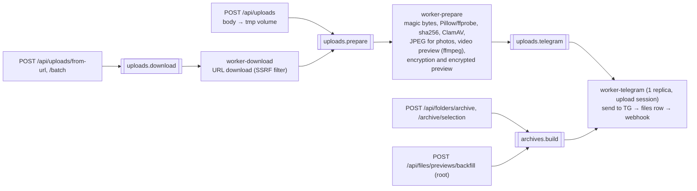
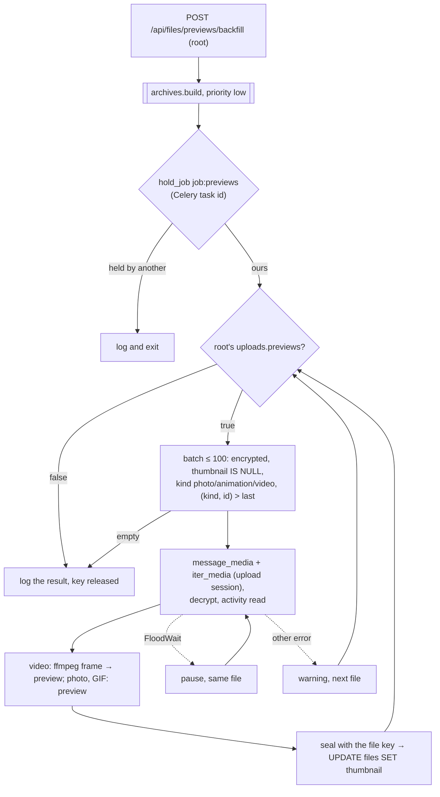
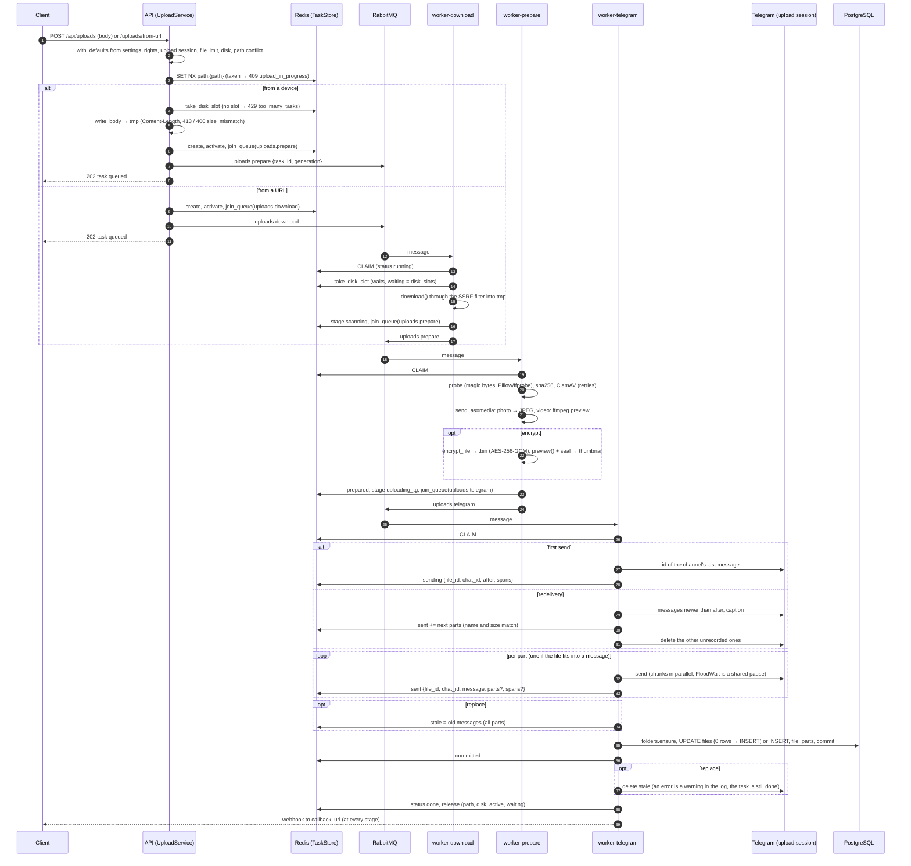
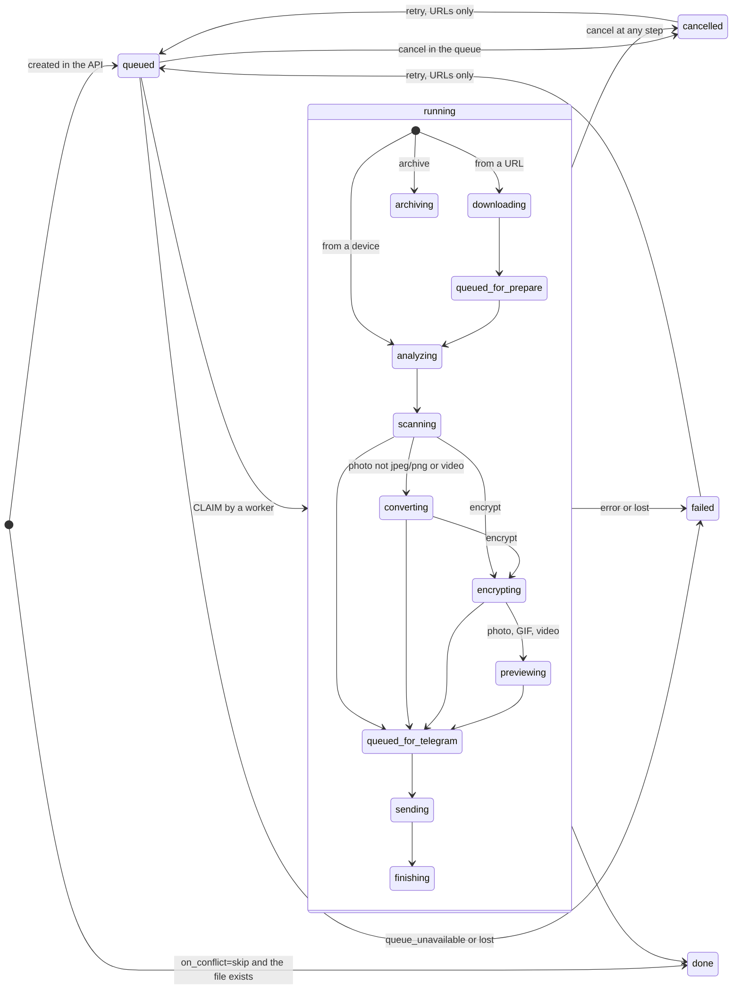
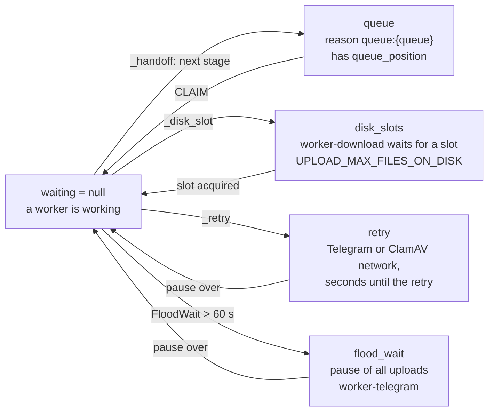
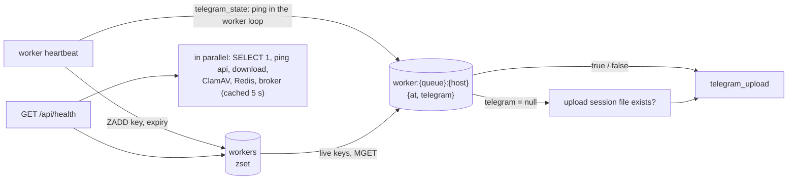
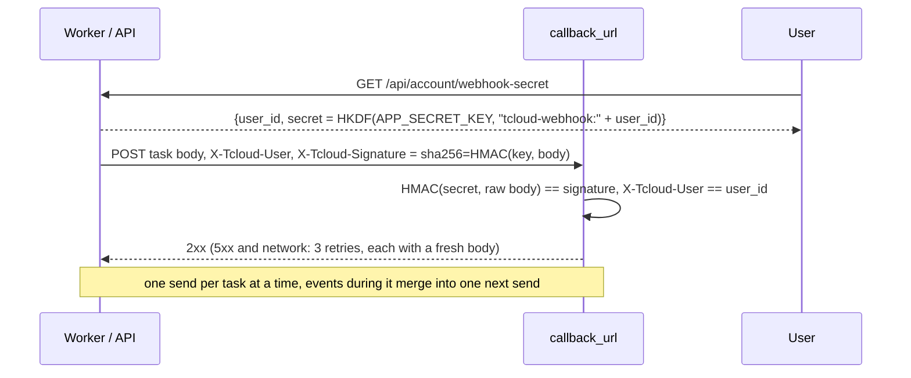

# Background processing of uploads and archives

Uploads and folder archive builds are processed by Celery workers. The broker is RabbitMQ, task state is kept in Redis. There is no tasks table in PostgreSQL.

| Queue | Worker | Threads | Replicas |
|---|---|---|---|
| `uploads.download` | `worker-download` | `UPLOAD_DOWNLOAD_CONCURRENCY` (4) | any number |
| `uploads.prepare` | `worker-prepare` | `UPLOAD_PREPARE_CONCURRENCY` (4) | any number |
| `uploads.telegram` | `worker-telegram` | `TELEGRAM_CONCURRENCY` (2) | **one**: a shared FloodWait pause and one session |
| `archives.build` | `worker-telegram` | the same threads | the same replica: an archive reads files from Telegram with the `upload` session |

An archive build (`POST /api/folders/archive` and `POST /api/folders/archive/selection`, flows/folders-and-files.md) is a task of the same kind as an upload (status,
priority, cancel, queue position, heartbeat, `TaskSweeper`), with the stage `archiving` and `params.source = archive`.
It takes a `worker-telegram` thread: with two threads two big archives delay uploads to Telegram, so raise
`TELEGRAM_CONCURRENCY` if that gets in the way. A ready archive stays in `tmp` for `UPLOAD_ARCHIVE_TTL` (24 h): the path and the expiry are in
Redis (`archives`), the `TaskSweeper` cleanup leaves them until then and deletes them after. An error or a cancel in the middle of a build closes
the archiver (`ArchiveWriter.abort`) before the file is closed, so `ZipFile`/`TarFile` do not try to write the central directory into
an already closed file during garbage collection.

## Preview backfill

`POST /api/files/previews/backfill` (root only, `202 {"status": "queued"}`; with root's `uploads.previews` setting off,
`409 previews_disabled`) puts a low-priority message of the Celery task
`previews.backfill` (`FileService.backfill_previews`) into `archives.build`; `worker-telegram` runs it
(`PreviewBackfill` in `services/previews.py`). It has no task record in Redis: progress goes to the worker logs. The task looks for
encrypted photos, GIFs and videos without `files.thumbnail` (the partial index `ix_files_missing_preview`), in batches of 100 in
`(kind, id)` order, one file at a time: it reads the file from Telegram with the `upload` session (like an archive), decrypts it
(`file_body`), makes the preview with the same code as at upload time (video: an ffmpeg frame, then `preview`), encrypts it with the
file key (`seal`) and writes `UPDATE … WHERE thumbnail IS NULL AND encryption_header = the one read` without changing
`updated_at`: a file that was replaced meanwhile (`replace`, a new key) does not get someone else's preview. While reading, the storage's `read`
indicator is lit (`tracked`). FloodWait: wait and retry the same file, also setting the shared pause `telegram_resume_at`
for uploads; any other error (no message, file changed, no space, broken file) is a warning and the next file;
`telegram_unauthorized` stops the task; before each batch the task re-reads root's settings and, if
`uploads.previews` was switched off, finishes. A repeated run is idempotent: only files without previews are taken, so
the ones skipped last time are tried again. Only one task runs at a time: the Redis key `job:previews` with the
Celery task id as value (`TaskStore.hold_job`, `SET NX EX 120`, renewed every 30 s); a second run with a live key
finishes at once, while a redelivery of the same message after a worker crash (`acks_late`) has the same id and so
continues the work.

Downloading has its own queue, so slow URLs do not take the checking threads. Checking, in turn,
does not take the Telegram slots. Reading from Telegram (downloads, previews, channels) stays in the API: a queue does not fit
streaming responses with Range.

## The whole upload path

API: `UploadService` (`src/application/services/upload.py`), worker stages: `UploadPipeline`
(`src/application/services/pipeline.py`, entry point `src/application/tasks/upload.py`), state: `TaskStore`
(`src/infrastructure/cache/tasks.py`, key map in redis.md).

Moving between stages is `UploadPipeline._handoff`: a cancel check, a new stage with
`waiting = queue:{next queue}`, then under `handoff_lock` the write to `waiting:{queue}` and the publish to RabbitMQ.
An archive uses the same mechanism with one stage: `FolderService._queue_archive` → `archives.build` →
`UploadPipeline._archive` (flows/folders-and-files.md).

## Worker internals

A Celery task is synchronous, while Telethon, asyncpg and redis are asynchronous. `WorkerRuntime` keeps one
event loop in a separate thread of the worker process. Tasks of the `threads` pool hand it coroutines and wait for the result. That gives one
Telethon client and one connection to the database and Redis per process.

Background coroutines of the worker (task heartbeat, activity markers, progress saves, webhooks) are started through
`WorkerRuntime.spawn` and kept in the `_tasks` set; a task is removed from it by a done callback that the loop runs
only on its next iteration. So `drain()` (worker shutdown, tests) waits while there are **unfinished** tasks, not
while the set is non-empty: `asyncio.gather` over already finished tasks returns at once without yielding to the loop,
and a "while the set is non-empty" loop would spin forever, never letting the callback remove the task (that is how the test finalizer used to hang).

Celery settings (`src/infrastructure/background/celery/app.py`):
- `acks_late` and `reject_on_worker_lost`: if a worker dies, the task returns to the queue;
- `prefetch_multiplier=1`: a worker does not grab tasks in advance, otherwise priority would not hold;
- task events are enabled for Flower.
- the worker remote control queue (`{host}.celery.pidbox`: `celery inspect`, Flower) is non-exclusive and durable
  with `x-expires` 10 s (`control_queue_exclusive=False`, `control_queue_durable=True`). An exclusive queue (the
  default) after a network drop belongs to the old connection until the broker notices its death by heartbeat;
  the reconnecting worker got `ResourceLocked (405)` and Celery terminated the process. RabbitMQ 4 forbids transient non-exclusive
  queues (`transient_nonexcl_queues`), hence durable; without consumers the queue deletes itself
  after 10 s. The kombu warning `A node named … is already using this process mailbox` after a
  reconnect is the old connection, it goes away by itself. A message handed to the old connection before the drop
  returns to the queue once the broker closes it (up to ~2 min by heartbeat) and runs again.

By default RabbitMQ closes the channel if a task is not acknowledged within 30 minutes. A 4 GB upload can take longer,
so `consumer_timeout` is raised to 24 hours (`RABBITMQ_SERVER_ADDITIONAL_ERL_ARGS` in compose).

## Task claims and generations

A queue message carries only `task_id` and `generation`, everything else lives in Redis. Before working, the worker atomically
claims the task with the Lua script `CLAIM`. The claim fails if:
- the `generation` in the message differs from the current one: the message became stale after a priority change or a retry;
- the task is already finished or cancelled;
- the same stage is already claimed and RabbitMQ did not mark the message as redelivered (`redelivered`).

So a duplicate message (for example, after a crash between the publish to the next queue and the ack) is simply skipped,
while a real redelivery after a worker crash goes through.

Redelivery also happens with a live worker: when the connection to RabbitMQ drops, the unacknowledged message returns to
the queue while the first run keeps working (the ack then fails: `Couldn't ack … connection already closed` in the log).
So `CLAIM` for a `redelivered` message of the same stage looks at `beat_at`: if the heartbeat is fresher than
`3 × UPLOAD_HEARTBEAT_INTERVAL` (30 s), the answer is "busy" (`CLAIM_BUSY`), and the second run waits, checking every
`UPLOAD_HEARTBEAT_INTERVAL` (log `Task … redelivered to … while still running`). Once done waiting, it takes the task only
if its stage is still its own and it is not waiting for another queue, meaning the first run died without finishing; if the task
finished or moved on, the message is skipped. Without this (verified live), after a 20-second broker stop
a second copy of `uploads.telegram` uploaded the same file in parallel and then overwrote `done` with the error
`internal` on the unique index of `files`. In exchange, a worker crash costs up to 30 s of delay before the stage is retried.

## No duplicates in Telegram

Right after sending, the worker writes `sent` (file_id, chat_id, message_id) to the task, and after the commit to `files`,
`committed`. A multi-part file (flows/uploads.md, "Big files in parts"): `sent` is rewritten after
every part: `message` (part 0), `parts` (all sent ones) and `spans` (`[offset, size]` of every part, computed once
before the first send: `file_limit` from `account:premium` in Redis or `get_me()`, so a Premium change in the middle of
an upload does not change the split). Parts go one after another, with a cancel check before each. On redelivery:
- `sent` exists but not with all parts: sending continues from the next part, sent parts are not repeated;
- `sent` exists but there is no row in `files`: sending is skipped, the row is written right away;
- the row already exists with the same message_id: the task simply finishes;
- the task failed or was cancelled after sending but before the commit: the message (all parts sent so far) is deleted from the channel.

The window between "Telegram accepted the message" and the `sent` write (the worker killed in between) is closed by `sending` (the
owner's decision). Before the first send the worker stores `sending = {file_id, chat_id, after, spans}` in the task: `after` is the
id of the channel's last message (`TelegramClient.last_message_id`, one `GetHistory limit=1`), `file_id` is chosen in advance and
does not change on a retry, so the caption `#tc{file_id}` is the same for all parts. On redelivery (`sent` or
`sending` exists), before sending the next part `find_sent` reads the channel history after `after` (`iter_messages(min_id=after,
reverse=True)`, only messages that arrived after this task started sending) and takes the messages with our caption
that are not in `sent`: in id order, a message whose file name and size match the next expected part
(`{uuid}.part{N}.bin` / `{name}.part{N}` / the single name, size `spans[N]`) is adopted into `sent` without sending it
again; the rest (duplicates, a different size, a compressed photo whose size differs) is deleted and sent again.
The old messages of a replaced file are written to the task (`stale`) before the commit and deleted after it without a guarantee:
a Telegram error is only logged, the task stays `done`. If the worker is killed after the commit, the redelivery sees
that the row already points to `sent`, deletes `stale` and only closes the task.
Single files work the same way (one part). The old messages of a replaced file (`replace`, the same `file_id`) are not
touched: their ids are ≤ `after`. Tasks without `sending` (created before this field) take `after` = the last id from `sent`.
`fail` (error, cancel) and `on_conflict=skip` find unrecorded messages the same way and delete them together with `sent`; if that
fails (Telegram unavailable, session signed out), a warning goes to the log and the task is closed anyway.
- `prepare` with `encrypt=true` redelivered after encryption (the plaintext file is already deleted): the checks and encryption
  are not repeated, the ready ciphertext from `prepared` is passed to `uploads.telegram` again.

## Priority

`priority`: `low` (1), `normal` (5, the default), `high` (9; admin and root only, lowered to `normal` for `user`,
flows/uploads.md). All queues are declared with `x-max-priority=9`, the priority
is passed from stage to stage. A `high` task overtakes `low` ones already waiting in the queue but does not interrupt running ones.
Test: `tests/integration/test_queue_priority.py` on a real RabbitMQ.

`POST /api/tasks/{id}/priority {"priority": "high"}` changes the priority of a task waiting in a queue. RabbitMQ cannot
reorder messages, so `REQUEUE` increments `generation` and the task is published to the same queue again. The worker
skips the old message. If the task is not waiting in a queue (running, waiting for FloodWait, finished), the answer is
`409 task_not_queued`.

## Cancel

`POST /api/tasks/{id}/cancel`:
- the task waits in a queue: `cancelled` at once, the path is released, temp files are deleted; the worker skips the message
  in the queue;
- the task is running: the `cancel` flag is set, the answer is `running` with `cancel_requested: true`. The worker notices it within
  `CANCEL_POLL` (1 s): `UploadPipeline._watch` reads `cancel` (`HGET`) every second and marks the task, and
  every progress callback (`progress`: download, SHA-256, sending to ClamAV, encryption, sending to Telegram,
  archive build) and every wait (`_disk_slot`, `_retry`, the FloodWait pause sleeping in `CANCEL_POLL` slices) raises
  `TaskCancelledError`. Work in a thread (SHA-256, encryption) stops at the next block. Then `fail` deletes
  a Telegram message that was already sent but not committed (`sent`), releases the path and the disk slot, deletes the task's temp
  files (`params.file`, `prepared.send_path`, `prepared.thumb`) and sets `cancelled`. A cancel in the middle of
  sending a file breaks the chunk upload: there is no message yet, nothing to delete (for a multi-part file the
  parts already sent from `sent.parts` and unrecorded messages with the task's caption after `sending.after` are deleted);
- the task is finished: `409 task_finished`.

The body of `POST /api/uploads` is written to a temp file before the task is created, so a browser that drops the stream
in the middle of the body leaves no task, no file and no taken disk slot (`UploadService.upload` deletes the file and releases
the path lock on any exception).

| Where the task was | How it stops | What is cleaned up |
|---|---|---|
| in a queue (`queued_for_*`) | at once in the API (`CANCEL`) | path, temp files, the queue index entry |
| `downloading`, waiting for `disk_slots` | progress callback / slot poll | the partly downloaded file, the disk slot |
| `analyzing`, `scanning`, waiting for `retry` | SHA-256 / ClamAV callback, sliced sleep | file, video preview |
| `encrypting`, `previewing`, `converting` | encryption callback / check before the next step | source and partial ciphertext |
| `sending`, `flood_wait` pause | Telethon part callback / sliced sleep | files; a sent message is deleted |
| `finishing` | check after sending | the Telegram message if the DB commit has not happened yet |

The `cancelled` webhook is sent in both cases: from a queue the API sends it in the background (on shutdown the API waits for it),
while running the worker sends it.

## Retry

`POST /api/tasks/{id}/retry` works only for URL uploads in status `failed` or `cancelled`: the file is downloaded again,
`generation` is incremented, the task id and the batch are kept. Device uploads are not kept after an error:
`409 task_not_retryable`, upload again. A retry checks the active task limit and whether the path is taken again.

## Statuses and stages

`status` is `queued → running → done | failed | cancelled` (`TaskStatus`), `stage` is `downloading` (URLs only)
`→ scanning → uploading_tg → done`, for an archive `archiving → done` (`TaskStage`, `src/infrastructure/enums`). `queued`
happens only before the first `CLAIM`: between stages the task stays `running`, and in a queue it is visible through `waiting`.

`step` (`TaskStep`) is the step within a stage, for a UI label; the codes are stable, the table is in flows/uploads.md
("Steps"). `step_progress` (0..1) is `bytes_done / bytes_total` for measurable steps while `running`, otherwise `null`.
Every measurable step resets `bytes_done`, `bytes_total` and `stage_started`, so `progress`, `speed` and `eta`
refer to the current step. The step is written to Redis once on change, progress at most once per `UPLOAD_WEBHOOK_INTERVAL`
(the same throttling progress had). For a finished task `step` is the last step passed (it shows where it was
cancelled or where it failed).

`waiting` is why the task is standing right now. In Redis it is `{"reason", "until"?}`; the API returns `{reason, code, params, seconds}`,
where `code` is the part of `reason` before `:` and `params.queue` the part after it (`TaskService.render`). All waiting and warning codes
with their parameters are in flows/uploads.md.

While a task waits for a worker, `waiting = {"reason": "queue:{queue}", "code": "queue", "params": {"queue": ...}}`
(the queue is `uploads.download`, `uploads.prepare`, `uploads.telegram` or `archives.build`), and `queue_position` is its
number in that queue: 1 is the next one to be taken, running tasks are not counted.

RabbitMQ does not report the position, so our index computes it: the sorted set `tcloud:waiting:{queue}` with the score
`(10 − priority level) × 10¹³ + enqueue time in µs`, the same order as RabbitMQ (higher priority first,
FIFO within a priority). A task enters the index before the publish (creation, moving to the next stage, retry,
priority change with a new score) and leaves it atomically in `CLAIM`, and also on cancel, error and `lost`.
The index write and the publish go under one process-wide `asyncio.Lock` (`handoff_lock`), otherwise two threads could enter
the index in one order and reach RabbitMQ in another. Between `worker-prepare` replicas (or the API) such a race is
possible: tasks of the same priority handed over in the same millisecond can swap places by 1.
`tests/integration/test_workers_e2e.py::test_queue_positions_match_real_order` compares a snapshot of positions with the actual
send order of real workers on RabbitMQ. The snapshot is taken when all tasks are in `uploads.telegram`, and only
then is `worker-telegram` started: otherwise under load a slow `prepare` makes it impossible to catch all tasks in the queue
at once, and a task already handed to a worker by RabbitMQ but not yet claimed by `CLAIM` stays in the index for milliseconds. While working, `bytes_done`, `progress`, `speed`, `eta` are visible.
Progress is written to Redis at most once per `UPLOAD_WEBHOOK_INTERVAL`.

## Redis

Tasks, batches, path locks, disk slots, queue indexes, archives and heartbeats: the full map of keys and task
fields is in redis.md. After `UPLOAD_TASK_TTL` (7 days) a task disappears from Redis, and `GET /api/tasks/{id}` answers
`404`. The file itself stays in `files`.

## Lost tasks

If a message vanished from RabbitMQ (the queue was purged, the broker lost its data), the task would stay `queued` forever
and hold the path. `TaskSweeper` in the API walks the active tasks every `UPLOAD_SWEEP_INTERVAL` (60 s):
- a task a worker is running updates `beat_at` every `UPLOAD_HEARTBEAT_INTERVAL`; a Redis error in the heartbeat
  or in the cancel check (`UploadPipeline._beat`/`_watch`) goes to the log, the loop continues on the next tick;
- a task counts as lost if it has been silent longer than `UPLOAD_STALE_AFTER` (120 s), its queue is empty, and that holds on
  two passes in a row (the second pass guards against a message the worker is just taking);
- a lost task gets `failed: lost`, the path is released, temp files are deleted.

While a queue is not empty, its tasks are not touched: a lost message will show up once the queue drains.
If the broker is unavailable, the pass is skipped.

## Resource protection

- **Disk.** `DiskBudget` is the single point of all disk checks. If less than
  `UPLOAD_MIN_FREE_DISK_MB` would remain after the upload, the answer is `507 insufficient_storage` (for a worker, `failed` with the same code). With encryption
  2× the size is needed (plaintext file + ciphertext). Bytes not yet written by any
  process are subtracted from the free space: live chunked sessions and the shared reservation ledger in Redis `disk:reserved` (the `POST /api/uploads` body,
  a URL with a known size and an archive from queueing, the download, ciphertext, archive build, previews in workers).
  A holder refreshes its entry every second (30 s expiry), an entry between stages lives `UPLOAD_LOCK_TTL`, any
  end of the task (`release` → `deactivate`) erases it, a dead holder drops out by expiry. The check and the reservation write in
  the API are atomic under the Redis lock `job:disk`. Details in flows/uploads.md, "Disk space".
- **File size.** Only root's `uploads.max_file_size` (`0` means unlimited, `413 too_large`); the Telegram message limit
  does not restrict it, big files go in parts (flows/uploads.md).
- **Number of tasks.** Unlimited by default (`UPLOAD_MAX_ACTIVE_TASKS=0`). If a number is set and that many tasks
  are active, the answer is `429 too_many_tasks` with `retry_after`.
- **Files on the server.** Unlimited by default (`UPLOAD_MAX_FILES_ON_DISK=0`): only disk space holds it back
  (`UPLOAD_MIN_FREE_DISK_MB`). If a number is set, at most that many files are in `tmp` at once: the slot is taken before the first
  byte is written (for a chunked session, when the session is created) and released together with the task (done, error, cancel,
  lost) or the session (`DELETE`, expiry). A device upload without a free
  slot gets `429 too_many_tasks` with `retry_after`. A URL is not rejected: `worker-download` waits for a slot
  (`waiting.reason = disk_slots`, cancel works), the other URLs wait in the queue. Slots are the sorted set
  `tcloud:disk` (Lua: check and acquire atomically), a redelivery of the same task does not double the slot, stuck ones
  older than `UPLOAD_LOCK_TTL` are dropped.
- **One path, one upload.** `SET NX` on the path: a second upload to the same path gets `409 upload_in_progress` at once.
  `keep_both` looks for a free name (`a-2.jpg`, `a-3.jpg`) among files and taken paths.

## Failures

- **FloodWait.** A short one (≤ 60 s) Telethon waits out by itself. If the wait is longer but not above `TELEGRAM_FLOOD_MAX_WAIT`,
  all `worker-telegram` uploads pause (`waiting.reason = flood_wait`). If it is longer still, the task fails with `retry_after`.
- **Telegram and ClamAV network.** `UPLOAD_RETRIES` retries with a pause of `UPLOAD_RETRY_DELAY × 2^n` (`waiting.reason = retry`).
- **The DB write failed** after sending: the Telegram message is deleted.
- **An API restart** does not touch tasks: they are in RabbitMQ and Redis. Temp files older than `UPLOAD_LOCK_TTL` are deleted at
  startup, except the files of active tasks, live sessions and ready archives (`temp.used_files`).
- **Tasks longer than `UPLOAD_LOCK_TTL`** (a long queue, a huge file): the worker heartbeat and every `TaskSweeper` pass
  over unfinished tasks call `TaskStore.renew` (Lua `RENEW_TASK`): it extends the path lock (only its own
  task's), the score in `active` and `disk` (so their cleanup by age does not drop a live task), the parked reservation
  `disk:reserved` (only an entry "between stages" with an expiry beyond 60 s; a live 30-second one is not touched) and the quota entry
  `disk:usage`.
- **Orphans in `tmp`.** A finished, failed or cancelled task deletes its files at once. Leftovers (the API killed in the middle of receiving
  a body, a failure during deletion) are cleaned up by `TaskSweeper` every `UPLOAD_SWEEP_INTERVAL`: a file that belongs to no
  active task and has not changed for longer than `UPLOAD_ORPHAN_AGE` (1 h) is deleted. A file being received is updated constantly,
  so it is never cleaned up. Ready archives live until `UPLOAD_ARCHIVE_TTL` and are deleted by the same cleanup.
- **Chunked upload sessions** (flows/uploads.md). The cleanup does not touch the file of a live session, however long it sits without
  changes. A session that got no chunks for `UPLOAD_SESSION_IDLE_TTL` (1 h) or is older than `UPLOAD_SESSION_TTL` (24 h) is deleted by the same `clean_tmp`: under
  the lock `job:upload:{id}` (a chunk is being received: skip until the next pass) the expiry is re-read, then the
  file and the session keys are deleted, the path and the disk slot are released. It works without the broker too (unlike `sweep`).
- **A worker crashed**: the task returns to the queue, the stage starts again, there will be no duplicates in the channel (see above).
- **The broker is unavailable** when the API enqueues: `503 queue_unavailable` after about 5–7 s (Celery publish
  retries), the task is `failed` at once, the path and the temp file are released. A worker that finished a stage while
  the broker is down does not drop the task: the handoff to the next queue is retried every 5 s (`waiting.reason = broker`,
  log `broker unavailable, handoff to … retried`), cancel works; only if the broker does not come back within 10 minutes
  (`BROKER_WAIT` in `pipeline.py`) does the task fail with `queue_unavailable`.

### RabbitMQ outage

Queues are durable, messages persistent, `task_acks_late` + `task_reject_on_worker_lost`, `prefetch_multiplier=1`,
publishing with broker confirms (`broker_transport_options = {"confirm_publish": True}`: `send_task` returns
only once RabbitMQ has written the message to disk). A message not acknowledged by a worker returns to the
queue after a drop, and messages waiting in the queue survive both `docker stop` and `docker kill -s KILL` of the broker (in dev the container has
an anonymous volume `/var/lib/rabbitmq` and a fixed `hostname`, so the node name and data stay the same). Without `confirm_publish`,
`kill -9` ~3 s after a publish lost 2 of 5 waiting messages: `TaskSweeper` marked such tasks `failed: lost` after ~4 min.
Verified live with uploads in flight:
- the API does not crash, `/api/health` shows `queue: false` for the whole downtime and turns green ~5 s after the broker starts;
- workers reconnect by themselves (`Connection to broker lost` → `Cannot connect … ` with a growing pause → `Connected`),
  no restart needed, the pidbox does not get in the way (see "Worker internals");
- uploads that were going to Telegram during the downtime reach `done`; their redelivery after recovery
  is skipped (`skipped … stale or cancelled`) or waits for the first run (see "Task claims");
- tasks that waited in queues are delivered after recovery;
- Flower reconnects its event receiver by itself, but its pause between attempts doubles without a cap (1, 2, 4 … s),
  so after a 90 s downtime events may come back with up to a minute of delay; the worker and task lists are live again.

## Monitoring

- `GET /api/health`: `queue` means the broker answers; `workers` says for every queue whether there is a live worker (heartbeat in Redis).
  `ok` is everything together with the DB, Telegram, ClamAV and Redis. `details` uses the same keys (`db`, `telegram`, `telegram_upload`,
  `telegram_download`, `antivirus`, `redis`, `queue` and the queue names): `latency_ms` is how long the check itself took
  (measured around the existing `SELECT 1`, Redis ping, broker check, ClamAV ping, Telegram client checks),
  `last_seen_s` is the seconds since the last heartbeat of the queue's freshest worker; `null` where not applicable. Without sign-in
  the answer is still only `{status}`. The checks of the DB, both Telegram clients, ClamAV, Redis and the broker run
  in parallel (`asyncio.gather`), the answer waits for the slowest one, not their sum. The broker (`broker_alive`: a connection to
  RabbitMQ and a passive `queue_declare`) and ClamAV (`zPING`) cache their answer for 5 s, like Telegram. Workers are not looked up with
  `SCAN` over the whole Redis: the heartbeat writes its key into the zset `workers` together with the key itself (score: when the key expires),
  `TaskStore.workers` drops expired ones and reads live ones with one `MGET`.
- Telegram checks are a real request, not `is_connected()`: `TelegramClient.ping` sends `updates.GetState`
  (5 s timeout, `PING_TIMEOUT`; preceded by `ensure_connected`, so the check also reconnects a dropped client)
  and caches the answer for 5 s (`PING_TTL`), so frequent `/health` polling does not load Telegram. `telegram` and
  `telegram_download` are pings of the API clients. `telegram_upload` is the state of worker-telegram's own client: the
  heartbeat thread calls `WorkerRuntime.telegram_state` every `UPLOAD_HEARTBEAT_INTERVAL` (the same `ping` in the worker
  event loop, ≤ 10 s) and writes it into the heartbeat (`{"at", "telegram"}`); `null` means the worker has not created a client yet (there was
  not a single Telegram task), then, as before, the presence of the `upload` session file is checked.

- Flower is `http://127.0.0.1:5555`, login and password `FLOWER_USER` / `FLOWER_PASSWORD`: workers, tasks, queues. It is in
  `docker-compose.prod.yml` and in `docker-compose.dev.yml` (profile `app`, in dev without variables `tcloud` / `tcloud`), locally `make flower`. In compose Flower runs without `--app`, only with `--broker` and
  without `.env` (deployment.md).

## Webhooks

On every stage change and at most once per `UPLOAD_WEBHOOK_INTERVAL` during progress the worker (and the API on cancel from a queue,
the code is shared: `services/webhook.py`) sends a POST with the task body to `callback_url`.
The signature is `X-Tcloud-Signature`, the task owner is `X-Tcloud-User` (below). On network errors and
5xx there are 3 retries. The address goes through the same check as URLs. A missing `callback_url` is taken from the `uploads.webhook_url` setting (flows/settings.md).

Order: within a process at most one webhook per task is in flight (`webhook.notify`: a "new state available" slot
`pending[task]` and one sender `sending[task]`). A new event while a send is running only marks the slot; however many
there are, one more is sent after the current send. The task body is read from Redis before **every** attempt, a retry
after a 5xx also sends the fresh state. So a stale `running` never arrives after `done` from the same process.
The stages of one task run in different processes (prepare and telegram), they have their own slots, but each reads the current
state at send time; a receiver that needs strict ordering should compare `updated_at`.
When a task is created and when the setting is saved, `check_webhook` rejects non-`http(s)` and non-public IP literals at once
(`422 unsafe_url`), names are checked through DNS at send time.

### Verifying the signature

Every user has their own signing key: `key = HKDF-SHA256(ikm = APP_SECRET_KEY, salt = none (32 zero bytes),
info = "tcloud-webhook:{user_id}", length = 32)` (`security/hashing.webhook_key`, the `cryptography` library). Request
headers:

| Header | Value |
|---|---|
| `X-Tcloud-User` | uuid of the task owner (the same as `user_id` in the body) |
| `X-Tcloud-Signature` | `sha256=` + hex `HMAC-SHA256(key, raw request body)` |

The receiver fetches its key once: `GET /api/account/webhook-secret` → `{"user_id": uuid, "secret": "<64 hex>"}`
(only one's own, with cookies or `X-API-Key`). Verification: `hmac.compare_digest(header, "sha256=" + HMAC(bytes.fromhex(secret),
body).hexdigest())` over the raw body before parsing JSON, plus `X-Tcloud-User == user_id`. One user's key does not
fit another user's webhooks, and `APP_SECRET_KEY` is never handed out.

**Change**: the signature used to be `HMAC(APP_SECRET_KEY, body)` with one key for everyone. Receivers must switch to
the key from `/api/account/webhook-secret`; the old signature is no longer sent. Changing `APP_SECRET_KEY` changes the keys of all
users (deployment.md, "Backups and restore").

## Batches

`POST /api/uploads/batch`: up to 100 URL uploads, each created separately, an error in one does not affect the others.
`GET /api/tasks?batch_id=...` returns the batch's tasks and a summary: counts per status, bytes, how many finished and the overall percentage.
