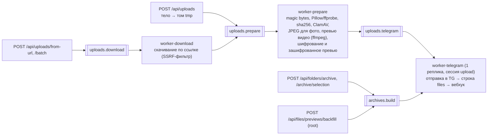
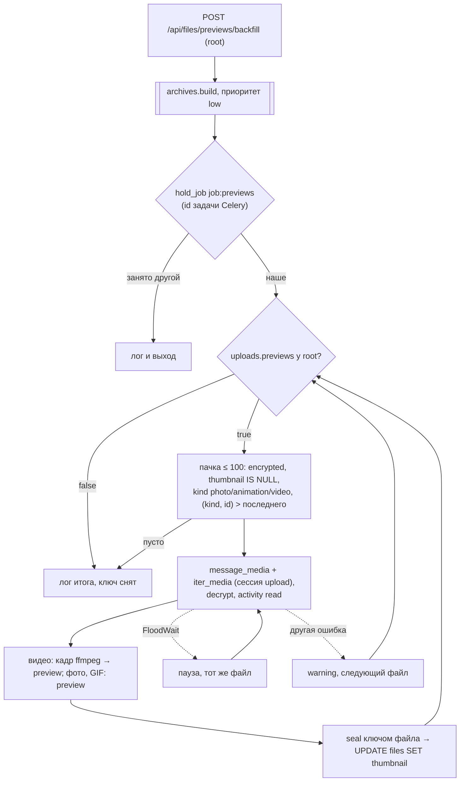
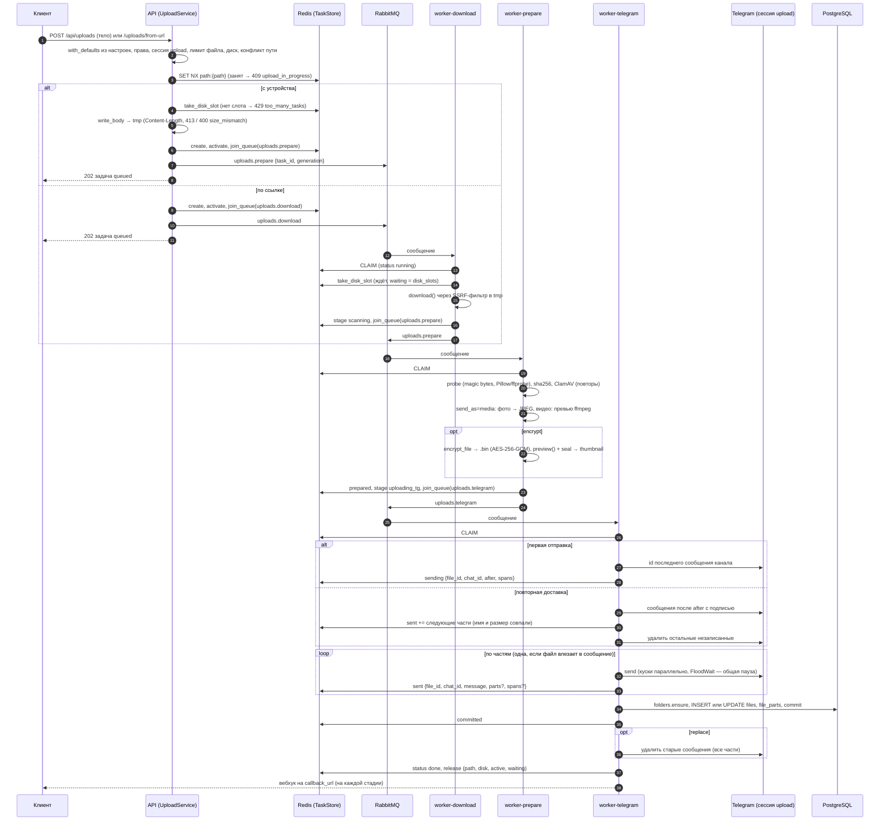
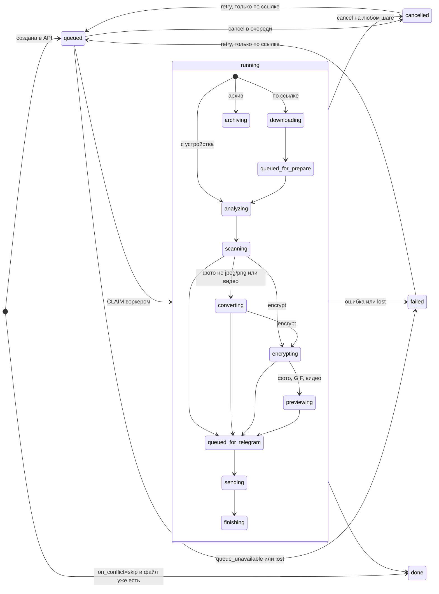
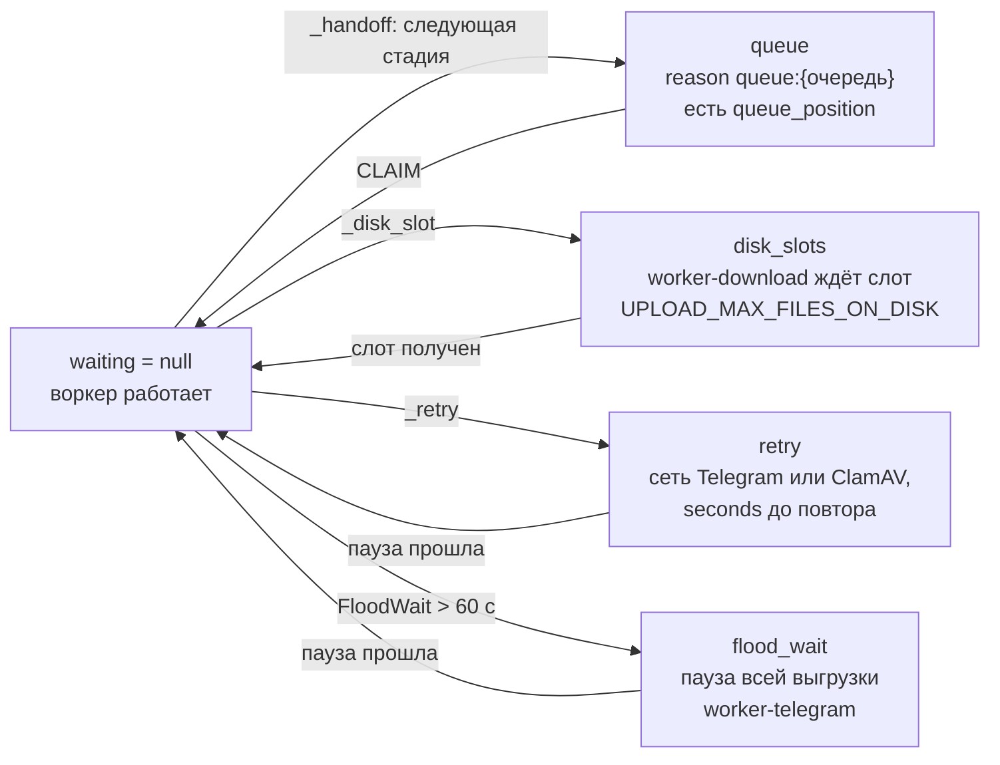
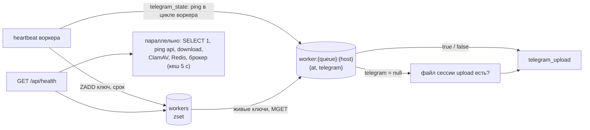
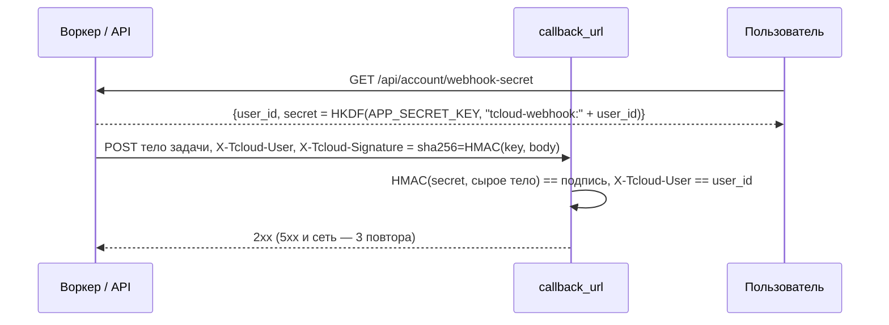

# Фоновая обработка загрузок и архивов

Загрузки и сборку архивов папок обрабатывают воркеры Celery. Брокер — RabbitMQ, состояние задач хранится в Redis. Таблицы задач в PostgreSQL нет.

| Очередь | Воркер | Потоков | Реплики |
|---|---|---|---|
| `uploads.download` | `worker-download` | `UPLOAD_DOWNLOAD_CONCURRENCY` (4) | сколько угодно |
| `uploads.prepare` | `worker-prepare` | `UPLOAD_PREPARE_CONCURRENCY` (4) | сколько угодно |
| `uploads.telegram` | `worker-telegram` | `TELEGRAM_CONCURRENCY` (2) | **одна**: общая пауза FloodWait и одна сессия |
| `archives.build` | `worker-telegram` | те же потоки | та же реплика: архив читает файлы из Telegram сессией `upload` |

Сборка архива (`POST /api/folders/archive` и `POST /api/folders/archive/selection`, flows/folders-and-files.md) — задача того же вида, что и загрузка (статус,
приоритет, отмена, место в очереди, heartbeat, `TaskSweeper`), со стадией `archiving` и `params.source = archive`.
Она занимает поток `worker-telegram`: при двух потоках два больших архива задержат выгрузку в Telegram, поднимите
`TELEGRAM_CONCURRENCY`, если это мешает. Готовый архив лежит в `tmp` `UPLOAD_ARCHIVE_TTL` (24 ч): путь и срок — в
Redis (`archives`), уборка `TaskSweeper` их не трогает до срока и удаляет после. Ошибка или отмена посреди сборки закрывает
архиватор (`ArchiveWriter.abort`) до закрытия файла, поэтому `ZipFile`/`TarFile` не пытаются дописать оглавление в
уже закрытый файл при сборке мусора.

## Дозаполнение превью

`POST /api/files/previews/backfill` (только root, `202 {"status": "queued"}`; при выключенной у root настройке `uploads.previews` —
`409 previews_disabled`) кладёт в `archives.build` с низким приоритетом сообщение
задачи Celery `previews.backfill` (`FileService.backfill_previews`); его выполняет `worker-telegram`
(`PreviewBackfill` в `services/previews.py`). Записи задачи в Redis у неё нет: прогресс — в логах воркера. Задача ищет
зашифрованные фото, GIF и видео без `files.thumbnail` (частичный индекс `ix_files_missing_preview`), пачками по 100 в
порядке `(kind, id)`, и по одному файлу: читает его из Telegram сессией `upload` (как архив), расшифровывает
(`file_body`), делает превью тем же кодом, что и при загрузке (видео — кадр ffmpeg, затем `preview`), шифрует ключом
файла (`seal`) и пишет `UPDATE … WHERE thumbnail IS NULL` без смены `updated_at`. Во время чтения горит `read` у
хранилища (`tracked`). FloodWait — ждём и повторяем тот же файл, заодно ставим общую паузу `telegram_resume_at`
для загрузок; любая другая ошибка (сообщения нет, файл изменён, нет места, битый файл) — warning и следующий файл;
`telegram_unauthorized` останавливает задачу; перед каждой пачкой задача перечитывает настройки root и, если
`uploads.previews` выключили, завершается. Повторный запуск идемпотентен: берутся только файлы без превью, так что
пропущенные в прошлый раз пробуются снова. Одновременно работает одна задача: Redis-ключ `job:previews` со значением
id задачи Celery (`TaskStore.hold_job`, `SET NX EX 120`, продлевается каждые 30 с); второй запуск при живом ключе
сразу завершается, а повторная доставка того же сообщения после падения воркера (`acks_late`) — то же id, поэтому
продолжает работу.

Скачивание вынесено в отдельную очередь, поэтому медленные ссылки не занимают потоки проверки. Проверка, в свою
очередь, не занимает слоты Telegram. Чтение из Telegram (скачивание, превью, каналы) остаётся в API: очередь не подходит
для потоковой отдачи с Range.

## Путь загрузки целиком

API — `UploadService` (`src/application/services/upload.py`), стадии воркеров — `UploadPipeline`
(`src/application/services/pipeline.py`, вход — `src/application/tasks/upload.py`), состояние — `TaskStore`
(`src/infrastructure/cache/tasks.py`, карта ключей — redis.md).

Переход между стадиями — `UploadPipeline._handoff`: проверка отмены, новая стадия с
`waiting = queue:{следующая очередь}`, затем под `handoff_lock` запись в `waiting:{queue}` и публикация в RabbitMQ.
Архив — тот же механизм с одной стадией: `FolderService._queue_archive` → `archives.build` →
`UploadPipeline._archive` (flows/folders-and-files.md).

## Воркер изнутри

Celery-задача синхронная, а Telethon, asyncpg и redis — асинхронные. `WorkerRuntime` держит в процессе воркера один
event loop в отдельном потоке. Задачи пула `threads` отдают ему корутины и ждут результат. Так на процесс получается
один клиент Telethon и одно соединение с базой и Redis.

Фоновые корутины воркера (heartbeat задачи, метки активности, сохранение прогресса, вебхуки) запускаются через
`WorkerRuntime.spawn` и лежат в множестве `_tasks`; задача удаляется из него done-callback'ом, который loop выполняет
только на следующей итерации. `drain()` (остановка воркера, тесты) поэтому ждёт, пока есть **незавершённые** задачи, а
не пока множество непусто: `asyncio.gather` по уже завершённым задачам завершается сразу, без передачи управления loop,
и цикл «пока множество непусто» крутился бы вечно, не давая callback'у удалить задачу (так зависал финализатор тестов).

Настройки Celery (`src/infrastructure/background/celery/app.py`):
- `acks_late` и `reject_on_worker_lost`: если воркер упал, задача вернётся в очередь;
- `prefetch_multiplier=1`: воркер не набирает задачи впрок, иначе приоритет бы не соблюдался;
- события задач включены для Flower.
- очередь удалённого управления воркера (`{host}.celery.pidbox`: `celery inspect`, Flower) не эксклюзивная и durable
  с `x-expires` 10 с (`control_queue_exclusive=False`, `control_queue_durable=True`). Эксклюзивная очередь (по
  умолчанию) после обрыва сети принадлежит старому соединению, пока брокер не заметит его смерть по heartbeat;
  переподключившийся воркер получал `ResourceLocked (405)` и Celery завершал процесс. Транзиентные неэксклюзивные
  очереди RabbitMQ 4 запрещает (`transient_nonexcl_queues`), поэтому durable; без потребителей очередь сама
  удаляется через 10 с. Предупреждение kombu `A node named … is already using this process mailbox` после
  переподключения — это старое соединение, оно уходит само. Сообщение, выданное старому соединению до обрыва,
  возвращается в очередь, когда брокер его закроет (до ~2 мин по heartbeat), и выполняется заново.

RabbitMQ по умолчанию закрывает канал, если задача не подтверждена за 30 минут. Выгрузка 4 ГБ может идти дольше,
поэтому `consumer_timeout` поднят до 24 часов (`RABBITMQ_SERVER_ADDITIONAL_ERL_ARGS` в compose).

## Захват задачи и поколения

В сообщении очереди только `task_id` и `generation`, всё остальное лежит в Redis. Перед работой воркер атомарно
захватывает задачу Lua-скриптом `CLAIM`. Захват не удаётся, если:
- `generation` в сообщении не совпадает с текущим: сообщение устарело после смены приоритета или повтора;
- задача уже завершена или отменена;
- эту же стадию уже захватили, а сообщение не помечено RabbitMQ как повторная доставка (`redelivered`).

Так дубль сообщения (например, при падении между отправкой в следующую очередь и подтверждением) просто пропускается,
а настоящая повторная доставка после падения воркера проходит.

Повторная доставка бывает и при живом воркере: при обрыве связи с RabbitMQ неподтверждённое сообщение возвращается в
очередь, а первый запуск продолжает работать (ack потом не проходит: `Couldn't ack … connection already closed` в логе).
Поэтому `CLAIM` для `redelivered` той же стадии смотрит на `beat_at`: если heartbeat свежее
`3 × UPLOAD_HEARTBEAT_INTERVAL` (30 с), ответ — «занято» (`CLAIM_BUSY`), и второй запуск ждёт, проверяя раз в
`UPLOAD_HEARTBEAT_INTERVAL` (лог `Task … redelivered to … while still running`). Дождавшись, он берёт задачу, только
если её стадия всё ещё его и она не ждёт другую очередь, то есть первый запуск умер, не закончив; если задача
завершилась или ушла дальше — сообщение пропускается. Без этого (проверено вживую) после 20-секундной остановки брокера
вторая копия `uploads.telegram` выгружала тот же файл параллельно, а потом затирала `done` ошибкой
`internal` на уникальном индексе `files`. Падение воркера при этом стоит до 30 с задержки перед повтором стадии.

## Без дублей в Telegram

Сразу после отправки воркер записывает в задачу `sent` (file_id, chat_id, message_id), а после коммита в `files` —
`committed`. Файл из нескольких частей (flows/uploads.md, «Большие файлы частями»): `sent` перезаписывается после
каждой части — `message` (часть 0), `parts` (все отправленные) и `spans` (`[offset, size]` каждой части, считаются один
раз перед первой отправкой: `file_limit` из `account:premium` в Redis или `get_me()`, поэтому смена Premium посреди
загрузки разбиение не меняет). Части уходят по очереди, перед каждой — проверка отмены. При повторной доставке:
- есть `sent` не со всеми частями — отправка продолжается со следующей части, отправленные не повторяются;
- есть `sent`, но строки в `files` нет — отправка пропускается, сразу пишется строка;
- строка уже есть с тем же message_id — задача просто завершается;
- задача упала или отменена после отправки, но до коммита — сообщение (все уже отправленные части) удаляется из канала.

Окно между «Telegram принял сообщение» и записью `sent` (воркер убит между ними) закрывает `sending` (решение
владельца). Перед первой отправкой воркер запоминает в задаче `sending = {file_id, chat_id, after, spans}`: `after` —
id последнего сообщения канала (`TelegramClient.last_message_id`, один `GetHistory limit=1`), `file_id` выбран заранее и
не меняется при повторе, поэтому подпись `#tc{file_id}` у всех частей одна. При повторной доставке (есть `sent` или
`sending`) до отправки следующей части `find_sent` читает историю канала после `after` (`iter_messages(min_id=after,
reverse=True)` — только сообщения, пришедшие после начала отправки этой задачи) и берёт сообщения с нашей подписью,
которых нет в `sent`: по порядку id сообщение, у которого имя файла и размер совпадают со следующей ожидаемой частью
(`{uuid}.part{N}.bin` / `{name}.part{N}` / одиночное имя, размер `spans[N]`), принимается в `sent` без повторной
отправки; остальное (дубли, другой размер, сжатое фото, у которого размер другой) удаляется и отправляется заново.
У одиночных файлов то же самое (одна часть). Старые сообщения заменяемого файла (`replace`, тот же `file_id`) не
задеваются — у них id ≤ `after`. Задачи без `sending` (созданные до этого поля) берут `after` = последний id из `sent`.
`fail` (ошибка, отмена) и `on_conflict=skip` так же находят незаписанные сообщения и удаляют их вместе с `sent`; не
удалось (Telegram недоступен, сессия разлогинена) — предупреждение в лог, задача всё равно закрывается.
- `prepare` с `encrypt=true` доставлен повторно после шифрования (открытый файл уже удалён) — проверка и шифрование
  не повторяются, готовый шифротекст из `prepared` снова передаётся в `uploads.telegram`.

## Приоритет

`priority`: `low` (1), `normal` (5, по умолчанию), `high` (9). Все очереди объявлены с `x-max-priority=9`, приоритет
передаётся от стадии к стадии. Задача `high` обгоняет уже стоящие в очереди `low`, но не прерывает те, что выполняются.
Тест — `tests/integration/test_queue_priority.py` на настоящем RabbitMQ.

`POST /api/tasks/{id}/priority {"priority": "high"}` меняет приоритет задачи, которая ждёт в очереди. RabbitMQ не умеет
переставлять сообщения, поэтому `REQUEUE` увеличивает `generation`, и задача ставится в ту же очередь заново. Старое
сообщение воркер пропустит. Если задача не ждёт в очереди (выполняется, ждёт FloodWait, завершена), ответ
`409 task_not_queued`.

## Отмена

`POST /api/tasks/{id}/cancel`:
- задача ждёт в очереди — сразу `cancelled`, путь освобождается, временные файлы удаляются; сообщение в очереди воркер
  пропустит;
- задача выполняется — ставится флаг `cancel`, ответ `running` с `cancel_requested: true`. Воркер замечает его не позже
  чем через `CANCEL_POLL` (1 с): `UploadPipeline._watch` раз в секунду читает `cancel` (`HGET`) и помечает задачу, а
  каждый колбэк прогресса (`progress` — скачивание, SHA-256, отправка в ClamAV, шифрование, отправка в Telegram,
  сборка архива) и каждое ожидание (`_disk_slot`, `_retry`, пауза FloodWait — сон кусками по `CANCEL_POLL`) бросает
  `TaskCancelledError`. Работа в потоке (SHA-256, шифрование) прерывается на следующем блоке. Дальше `fail` удаляет
  уже ушедшее, но не закоммиченное сообщение Telegram (`sent`), освобождает путь и слот диска, удаляет временные
  файлы задачи (`params.file`, `prepared.send_path`, `prepared.thumb`) и ставит `cancelled`. Отмена посреди
  отправки файла рвёт загрузку кусков: сообщения ещё нет, удалять нечего (у файла из нескольких частей удаляются
  уже отправленные части из `sent.parts` и незаписанные сообщения с подписью задачи после `sending.after`);
- задача завершена — `409 task_finished`.

Тело запроса `POST /api/uploads` пишется во временный файл до создания задачи, поэтому браузер, оборвавший поток
посреди тела, не оставляет ни задачи, ни файла, ни занятого слота диска (`UploadService.upload` удаляет файл и снимает
блокировку пути на любом исключении).

| Где была задача | Как останавливается | Что убирается |
|---|---|---|
| в очереди (`queued_for_*`) | сразу в API (`CANCEL`) | путь, временные файлы, место в индексе очереди |
| `downloading`, ожидание `disk_slots` | колбэк прогресса / опрос слота | недокачанный файл, слот диска |
| `analyzing`, `scanning`, ожидание `retry` | колбэк SHA-256 / ClamAV, сон кусками | файл, превью видео |
| `encrypting`, `previewing`, `converting` | колбэк шифрования / проверка перед следующим шагом | исходник и частичный шифротекст |
| `sending`, пауза `flood_wait` | колбэк частей Telethon / сон кусками | файлы; отправленное сообщение удаляется |
| `finishing` | проверка после отправки | сообщение в Telegram, если коммита в БД ещё не было |

Вебхук `cancelled` уходит в обоих случаях: из очереди его отправляет API в фоне (при остановке API дожидается отправки),
во время работы — воркер.

## Повтор

`POST /api/tasks/{id}/retry` — только для загрузок по ссылке в статусе `failed` или `cancelled`: файл скачивается заново,
`generation` увеличивается, id задачи и пачка сохраняются. Файлы с устройства после ошибки не хранятся —
`409 task_not_retryable`, загрузите заново. Повтор снова проверяет лимит активных задач и занятость пути.

## Статусы и стадии

`status` — `queued → running → done | failed | cancelled` (`TaskStatus`), `stage` — `downloading` (только по ссылке)
`→ scanning → uploading_tg → done`, у архива `archiving → done` (`TaskStage`, `src/infrastructure/enums`). `queued`
бывает только до первого `CLAIM`: между стадиями задача остаётся `running`, а в очереди её видно по `waiting`.

`step` (`TaskStep`) — шаг внутри стадии, для подписи в UI; коды стабильны, таблица — в flows/uploads.md
(«Шаги»). `step_progress` (0..1) — `bytes_done / bytes_total` у измеряемых шагов во время `running`, иначе `null`.
Каждый измеряемый шаг сбрасывает `bytes_done`, `bytes_total` и `stage_started`, так что `progress`, `speed` и `eta`
относятся к текущему шагу. Шаг пишется в Redis один раз при смене, прогресс — не чаще раза в `UPLOAD_WEBHOOK_INTERVAL`
(тот же троттлинг, что был у прогресса). У завершённой задачи `step` — последний пройденный шаг (видно, где её
отменили или где она упала).

`waiting` — почему задача сейчас стоит. В Redis — `{"reason", "until"?}`; API отдаёт `{reason, code, params, seconds}`,
где `code` — часть `reason` до `:`, а `params.queue` — после (`TaskService.render`). Все коды ожидания и предупреждений
с параметрами — в flows/uploads.md.

Пока задача ждёт воркера, `waiting = {"reason": "queue:{очередь}", "code": "queue", "params": {"queue": ...}}`
(очередь — `uploads.download`, `uploads.prepare`, `uploads.telegram` или `archives.build`), а `queue_position` — её
номер в этой очереди: 1 — следующая на взятие, выполняющиеся задачи не считаются.

RabbitMQ позицию не сообщает, поэтому её считает наш индекс: sorted set `tcloud:waiting:{queue}` со счётом
`(10 − уровень приоритета) × 10¹³ + время постановки в мкс` — тот же порядок, что у RabbitMQ (выше приоритет — раньше,
внутри приоритета FIFO). Задача попадает в индекс перед публикацией (создание, переход на следующую стадию, повтор,
смена приоритета — с новым счётом) и выходит из него атомарно в `CLAIM`, а также при отмене, ошибке и `lost`.
Запись в индекс и публикация идут под одним `asyncio.Lock` процесса (`handoff_lock`), иначе два потока могли бы встать
в индекс в одном порядке, а в RabbitMQ попасть в другом. Между репликами `worker-prepare` (или API) такая гонка
возможна: задачи одного приоритета, переданные в одну и ту же миллисекунду, могут поменяться местами на 1.
`tests/integration/test_workers_e2e.py::test_queue_positions_match_real_order` сверяет снимок позиций с фактическим
порядком отправки настоящих воркеров на RabbitMQ. Снимок берётся, когда все задачи встали в `uploads.telegram`, и только
потом запускается `worker-telegram`: иначе под нагрузкой медленный `prepare` не даёт застать все задачи в очереди
одновременно, а задача, уже выданная RabbitMQ воркеру, но ещё не взятая `CLAIM`, на миллисекунды остаётся в индексе. Во время работы видны `bytes_done`, `progress`, `speed`, `eta`.
Прогресс пишется в Redis не чаще раза в `UPLOAD_WEBHOOK_INTERVAL`.

## Redis

Задачи, пачки, блокировки путей, слоты диска, индексы очередей, архивы и heartbeat — полная карта ключей и полей
задачи в redis.md. Через `UPLOAD_TASK_TTL` (7 дней) задача пропадает из Redis, и `GET /api/tasks/{id}` отвечает
`404`. Сам файл остаётся в `files`.

## Потерянные задачи

Если сообщение пропало из RabbitMQ (очистили очередь, потеряли данные брокера), задача навсегда осталась бы `queued`
и держала путь. `TaskSweeper` в API раз в `UPLOAD_SWEEP_INTERVAL` (60 с) проходит по активным задачам:
- задача, которую выполняет воркер, раз в `UPLOAD_HEARTBEAT_INTERVAL` обновляет `beat_at`;
- задача считается потерянной, если она молчит дольше `UPLOAD_STALE_AFTER` (120 с), её очередь пуста и так подряд на
  двух проходах (второй проход страхует от сообщения, которое воркер как раз взял);
- потерянная задача получает `failed: lost`, путь освобождается, временные файлы удаляются.

Пока очередь не пуста, задачи в ней не трогаются: потерянное сообщение обнаружится, когда очередь разберётся.
Если брокер недоступен, проход пропускается.

## Защита ресурсов

- **Диск.** `DiskBudget` — единая точка всех проверок места. Если после загрузки останется меньше
  `UPLOAD_MIN_FREE_DISK_MB`, ответ `507 insufficient_storage` (у воркера — `failed` с тем же кодом). С шифрованием
  нужно 2× размер (открытый файл + шифротекст). Из свободного места вычитаются ещё не записанные байты всех
  процессов: живые сессии частями и общий журнал резервов в Redis `disk:reserved` (тело `POST /api/uploads`,
  ссылка с известным размером и архив — с постановки, скачивание, шифротекст, сборка архива, превью в воркерах).
  Держатель продлевает свою запись раз в секунду (срок 30 с), запись между этапами живёт `UPLOAD_LOCK_TTL`, любой
  конец задачи (`release` → `deactivate`) её стирает, упавший держатель выпадает по сроку. Проверка и запись резерва в
  API атомарны под Redis-локом `job:disk`. Подробно — flows/uploads.md, «Место на диске».
- **Размер файла.** Только `uploads.max_file_size` root (`0` — без ограничения, `413 too_large`); лимит сообщения
  Telegram не ограничивает — большие файлы уходят частями (flows/uploads.md).
- **Число задач.** По умолчанию не ограничено (`UPLOAD_MAX_ACTIVE_TASKS=0`). Если задать число и активных задач столько
  же, ответ `429 too_many_tasks` с `retry_after`.
- **Файлов на сервере.** По умолчанию не ограничено (`UPLOAD_MAX_FILES_ON_DISK=0`): держит только место на диске
  (`UPLOAD_MIN_FREE_DISK_MB`). Если задать число — не больше стольких файлов одновременно в `tmp`: слот берётся до записи
  первого байта (у сессии частями — при создании сессии) и освобождается вместе с задачей (готово, ошибка, отмена,
  потеря) или сессией (`DELETE`, истечение). Загрузка с устройства без свободного
  слота — `429 too_many_tasks` с `retry_after`. Ссылка не отклоняется: `worker-download` ждёт слот
  (`waiting.reason = disk_slots`, отмена работает), остальные ссылки ждут в очереди. Слоты — sorted set
  `tcloud:disk` (Lua: проверка и захват атомарно), повторная доставка той же задачи слот не удваивает, зависшие
  старше `UPLOAD_LOCK_TTL` выбрасываются.
- **Один путь — одна загрузка.** `SET NX` по пути: вторая загрузка в тот же путь сразу получает `409 upload_in_progress`.
  `keep_both` ищет свободное имя (`a-2.jpg`, `a-3.jpg`) среди файлов и занятых путей.

## Сбои

- **FloodWait.** Короткий (≤ 60 с) Telethon пережидает сам. Если ожидание дольше, но не больше `TELEGRAM_FLOOD_MAX_WAIT`,
  вся выгрузка `worker-telegram` встаёт на паузу (`waiting.reason = flood_wait`). Если ещё дольше, задача падает с `retry_after`.
- **Сеть Telegram и ClamAV.** `UPLOAD_RETRIES` повторов с паузой `UPLOAD_RETRY_DELAY × 2^n` (`waiting.reason = retry`).
- **Запись в БД не удалась** после отправки: сообщение в Telegram удаляется.
- **Рестарт API** задачи не трогает: они в RabbitMQ и Redis. Временные файлы старше `UPLOAD_LOCK_TTL` удаляются при старте.
- **Сироты в `tmp`.** Готовая, упавшая и отменённая задача удаляет свои файлы сразу. Остатки (API убит посреди приёма
  тела, сбой при удалении) убирает `TaskSweeper` каждые `UPLOAD_SWEEP_INTERVAL`: файл, который не принадлежит ни одной
  активной задаче и не менялся дольше `UPLOAD_ORPHAN_AGE` (1 ч), удаляется. Принимаемый файл постоянно обновляется,
  поэтому под уборку не попадает. Готовые архивы живут до `UPLOAD_ARCHIVE_TTL` и удаляются той же уборкой.
- **Сессии загрузки частями** (flows/uploads.md). Файл живой сессии уборка не трогает, сколько бы он ни лежал без
  изменений. Сессия, которой не присылали куски `UPLOAD_SESSION_TTL` (24 ч), удаляется той же `clean_tmp`: под
  блокировкой `job:upload:{id}` (идёт приём куска — пропуск до следующего прохода) срок перечитывается, затем удаляются
  файл и ключи сессии, освобождаются путь и слот диска. Работает и без брокера (в отличие от `sweep`).
- **Воркер упал** — задача вернётся в очередь, стадия начнётся заново, дублей в канале не будет (см. выше).
- **Брокер недоступен** при постановке в очередь из API: `503 queue_unavailable` примерно через 5–7 с (повторы
  публикации Celery), задача сразу `failed`, путь и временный файл освобождаются. Воркер, закончивший стадию, пока
  брокер лежит, не роняет задачу: передача в следующую очередь повторяется каждые 5 с (`waiting.reason = broker`,
  лог `broker unavailable, handoff to … retried`), отмена работает; только если брокер не вернулся за 10 минут
  (`BROKER_WAIT` в `pipeline.py`), задача падает с `queue_unavailable`.

### Обрыв RabbitMQ

Очереди durable, сообщения persistent, `task_acks_late` + `task_reject_on_worker_lost`, `prefetch_multiplier=1`,
публикация с подтверждением брокера (`broker_transport_options = {"confirm_publish": True}`: `send_task` возвращается,
только когда RabbitMQ записал сообщение на диск). Неподтверждённое воркером сообщение после обрыва возвращается в
очередь, сообщения, ждавшие в очереди, переживают и `docker stop`, и `docker kill -s KILL` брокера (в dev у контейнера
анонимный том `/var/lib/rabbitmq`, `hostname` фиксирован, поэтому имя ноды и данные те же). Без `confirm_publish`
`kill -9` через ~3 с после публикации терял 2 из 5 ждавших сообщений: такие задачи `TaskSweeper` через ~4 мин помечал
`failed: lost`. Проверено вживую с выгрузками в полёте:
- API не падает, `/api/health` показывает `queue: false` всё время простоя и зелёный через ~5 с после старта брокера;
- воркеры сами переподключаются (`Connection to broker lost` → `Cannot connect … ` с растущей паузой → `Connected`),
  рестарт не нужен, pidbox не мешает (см. «Воркер изнутри»);
- выгрузки, шедшие в Telegram во время простоя, доходят до `done`; их повторная доставка после восстановления
  пропускается (`skipped … stale or cancelled`) или ждёт первый запуск (см. «Захват задачи»);
- задачи, ждавшие в очередях, доставляются после восстановления;
- Flower переподключает приём событий сам, но пауза между попытками у него удваивается без потолка (1, 2, 4 … с),
  поэтому после простоя в 90 с события могут вернуться с задержкой до минуты; список воркеров и задач снова живой.

## Наблюдение

- `GET /api/health`: `queue` — брокер отвечает; `workers` — для каждой очереди, есть ли живой воркер (heartbeat в Redis).
  `ok` — всё вместе с БД, Telegram, ClamAV и Redis. `details` — по тем же ключам (`db`, `telegram`, `telegram_upload`,
  `telegram_download`, `antivirus`, `redis`, `queue` и имена очередей): `latency_ms` — сколько шла сама проверка
  (замер вокруг уже идущих `SELECT 1`, ping Redis, проверки брокера, ping ClamAV, проверки клиентов Telegram),
  `last_seen_s` — секунд с последнего heartbeat самого свежего воркера очереди; где неприменимо — `null`. Без входа
  ответ по-прежнему только `{status}`. Проверки БД, обоих клиентов Telegram, ClamAV, Redis и брокера идут
  параллельно (`asyncio.gather`), ответ ждёт самую медленную, а не их сумму. Брокер (`broker_alive`: соединение с
  RabbitMQ и `queue_declare` пассивно) и ClamAV (`zPING`) кешируют ответ на 5 с, как Telegram. Воркеры не ищутся
  `SCAN` по всему Redis: heartbeat вместе со своим ключом пишет его в zset `workers` (score — когда ключ истечёт),
  `TaskStore.workers` выкидывает истёкшие и читает живые одним `MGET`.
- Проверки Telegram — настоящий запрос, а не `is_connected()`: `TelegramClient.ping` шлёт `updates.GetState`
  (таймаут 5 с, `PING_TIMEOUT`; перед ним `ensure_connected`, так что проверка заодно переподключает упавший клиент)
  и кеширует ответ на 5 с (`PING_TTL`), чтобы частый опрос `/health` не нагружал Telegram. `telegram` и
  `telegram_download` — ping клиентов API. `telegram_upload` — состояние клиента самого worker-telegram: поток
  heartbeat раз в `UPLOAD_HEARTBEAT_INTERVAL` вызывает `WorkerRuntime.telegram_state` (тот же `ping` в цикле событий
  воркера, ≤ 10 с) и пишет его в heartbeat (`{"at", "telegram"}`); `null` — воркер ещё не создавал клиента (не было
  ни одной задачи Telegram), тогда, как раньше, проверяется наличие файла сессии `upload`.

- Flower — `http://127.0.0.1:5555`, логин и пароль `FLOWER_USER` / `FLOWER_PASSWORD`: воркеры, задачи, очереди. Есть в
  `docker-compose.prod.yml` и в `docker-compose.dev.yml` (профиль `app`, в dev без переменных — `tcloud` / `tcloud`), локально — `make flower`. В compose Flower запускается без `--app`, только с `--broker` и
  без `.env` (deployment.md).

## Вебхуки

На каждой смене стадии и не чаще раза в `UPLOAD_WEBHOOK_INTERVAL` во время прогресса воркер (а при отмене из очереди — API,
код общий: `services/webhook.py`) отправляет на `callback_url`
POST с телом задачи. Подпись — `X-Tcloud-Signature`, владелец задачи — `X-Tcloud-User` (ниже). При сетевых ошибках и
5xx делается 3 повтора. Адрес проходит ту же проверку, что и ссылки. Не переданный `callback_url` берётся из настройки `uploads.webhook_url` (flows/settings.md).
При создании задачи и сохранении настройки `check_webhook` сразу отклоняет не-`http(s)` и непубличные IP-литералы
(`422 unsafe_url`), имена проверяются через DNS при отправке.

### Проверка подписи

У каждого пользователя свой ключ подписи: `key = HKDF-SHA256(ikm = APP_SECRET_KEY, salt = нет (32 нулевых байта),
info = "tcloud-webhook:{user_id}", length = 32)` (`security/hashing.webhook_key`, библиотека `cryptography`). Заголовки
запроса:

| Заголовок | Значение |
|---|---|
| `X-Tcloud-User` | uuid владельца задачи (то же, что `user_id` в теле) |
| `X-Tcloud-Signature` | `sha256=` + hex `HMAC-SHA256(key, сырое тело запроса)` |

Получатель берёт свой ключ один раз: `GET /api/account/webhook-secret` → `{"user_id": uuid, "secret": "<64 hex>"}`
(только свой, по кукам или `X-API-Key`). Проверка: `hmac.compare_digest(header, "sha256=" + HMAC(bytes.fromhex(secret),
body).hexdigest())` по сырому телу до разбора JSON, плюс `X-Tcloud-User == user_id`. Ключ одного пользователя не
подходит к вебхукам другого, а `APP_SECRET_KEY` наружу не выдаётся.

**Изменение**: раньше подпись была `HMAC(APP_SECRET_KEY, body)` одним ключом на всех. Получатели должны перейти на
ключ из `/api/account/webhook-secret`; старая подпись больше не присылается. Смена `APP_SECRET_KEY` меняет ключи всех
пользователей (deployment.md, «Бэкапы и восстановление»).

## Пачки

`POST /api/uploads/batch`: до 100 загрузок по ссылкам, каждая создаётся отдельно, ошибка одной не мешает остальным.
`GET /api/tasks?batch_id=...` возвращает задачи пачки и сводку: число по статусам, байты, сколько закончено и общий процент.
