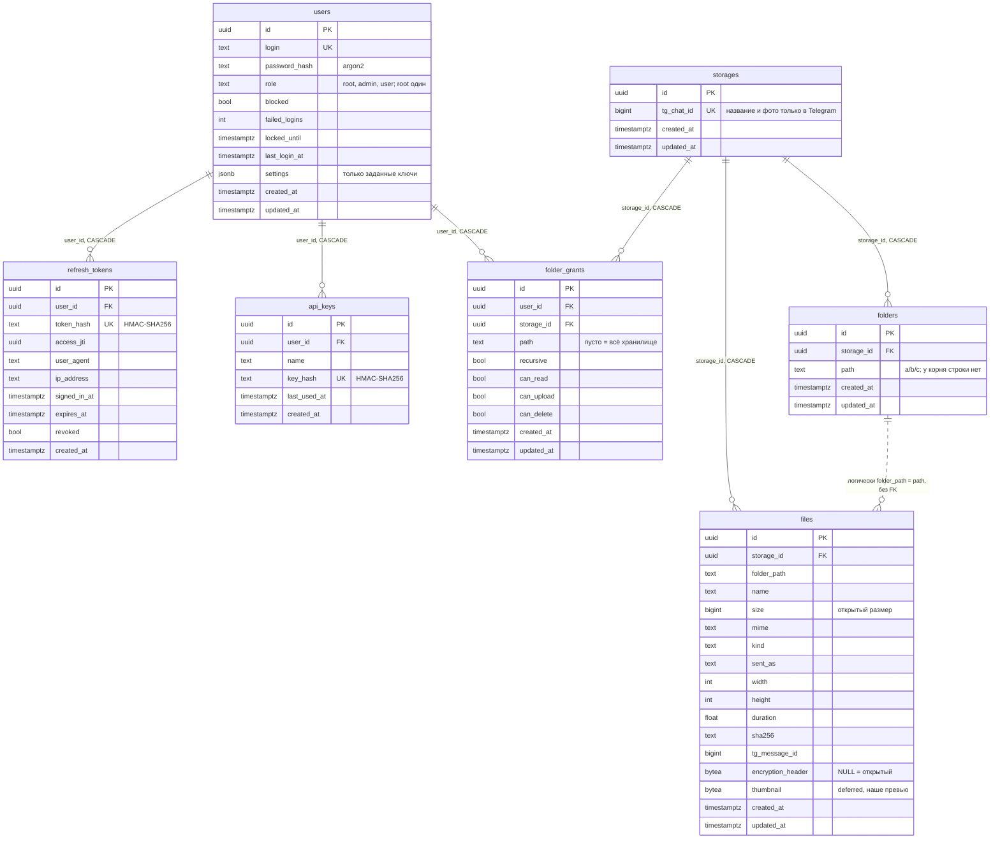

# База данных

PostgreSQL 18, SQLAlchemy 2 async (asyncpg), миграции Alembic в `src/infrastructure/database/migrations/`.
Все первичные ключи — UUID (v7, генерируются в Python).

Модели — `src/infrastructure/database/models/` (класс `*DB`), миксины `id`/`created_at`/`updated_at` — `mixins/`.

`folder_grants.path` и `files.folder_path` — текст, а не ссылки на `folders`: грант может указывать на ещё не
созданную папку и переживает её удаление, а файлы и папки связаны путём (flows/users.md, flows/folders-and-files.md).

| Таблица | Что хранит | Индексы и зачем |
|---|---|---|
| `storages` | `id`, `tg_chat_id`, даты. Название, описание, фото — только в Telegram | `UNIQUE(tg_chat_id)` — канал подключается один раз |
| `folders` | `storage_id`, `path` (`a/b/c`, без корня) | `UNIQUE(storage_id, path)`; `(storage_id, path text_pattern_ops)` — `LIKE 'a/%'` для дочерних папок и рекурсивного удаления; GIN `pg_trgm` на `lower(path)` — поиск папок по имени |
| `users` | `login`, argon2 `password_hash`, `role` (`root`/`admin`/`user`), `blocked`, `failed_logins`, `locked_until`, `last_login_at`, `settings` (JSONB, только заданные пользователем ключи, `'{}'` — всё по умолчанию; flows/settings.md) | `UNIQUE(login)` — вход по логину; частичный `UNIQUE(role) WHERE role = 'root'` — root один |
| `refresh_tokens` | `user_id`, HMAC `token_hash`, `access_jti`, user-agent, IP, `signed_in_at`, `expires_at`, `revoked` | `UNIQUE(token_hash)` — поиск при refresh; `user_id` — сессии пользователя, отзыв всех |
| `api_keys` | `user_id`, `name`, HMAC `key_hash`, `last_used_at` | `UNIQUE(key_hash)` — проверка `X-API-Key`; `user_id` — список ключей |
| `folder_grants` | `user_id`, `storage_id`, `path` (папка без корня, `''` — всё хранилище), `recursive`, `can_read`, `can_upload`, `can_delete` | `UNIQUE(user_id, storage_id, path)` — один грант на папку и гранты пользователя на каждый запрос; `storage_id` — каскадное удаление с хранилищем |
| `files` | путь (`folder_path` + `name`), размер, MIME, тип (`photo/video/audio/animation/document`), `sent_as`, размеры, длительность, `sha256`, `tg_message_id`, `encryption_header` (заголовок шифрования, `NULL` — файл открыт; security.md), `thumbnail` (наше превью зашифрованного файла, зашифрованное его ключом; `NULL` у открытых файлов, у типов без превью, при ошибке генерации и у зашифрованных файлов, загруженных до `0009`, пока их не дозаполнит `POST /api/files/previews/backfill`; колонка `deferred`, листинги её не читают; статистика хранилищ берёт `octet_length(thumbnail)` — для TOAST-значения это размер из указателя, без чтения TOAST, поэтому отдельная колонка размера не нужна) | `UNIQUE(storage_id, folder_path, name)` — один файл на путь; `(storage_id, folder_path text_pattern_ops)` — листинг, размеры папок и удаление поддерева; `UNIQUE(storage_id, tg_message_id)`; `sha256`; поиск (flows/folders-and-files.md, «Поиск»): GIN `pg_trgm` на `lower(name)` — подстрока имени, `name` — сортировка по имени (листинги), `name COLLATE tcloud_ru` / `name COLLATE tcloud_en` — сортировка поиска по имени на языке интерфейса, `kind`, `mime` (и группировка форматов), `size`, `updated_at` — фильтры и сортировки, `created_at` — окно карты активности, частичный `storage_id WHERE encryption_header IS NOT NULL` — фильтр `encrypted`; частичный `(kind, id) WHERE encryption_header IS NOT NULL AND thumbnail IS NULL` — дозаполнение превью; частичный `id WHERE thumbnail IS NOT NULL` — очистка всех превью пачками (`DELETE /api/files/previews`); keyset-индексы листинга папки (`0013`): `(storage_id, folder_path, name COLLATE tcloud_ru|en, id)`, `(storage_id, folder_path, тип COLLATE …, name COLLATE …, id)` (тип — `coalesce(nullif(lower(substring(name, '\.([^.]*)$')), ''), kind)`), `(storage_id, folder_path, size|updated_at|created_at, id)` — `GET /api/folders` по каждой сортировке |

`_`, `%` и `\` экранируются перед `LIKE` (в путях `\` запрещён, им и экранируем; в строке поиска он может быть).
Расширение `pg_trgm` создаёт миграция `0006` (`CREATE EXTENSION IF NOT EXISTS`; в `postgres:18` оно есть и доверенное,
владельцу БД суперпользователь не нужен). `lower()` берётся из локали БД: образ `postgres:18` создаёт кластер с
`en_US.utf8`, кириллица и прочий Unicode приводятся к нижнему регистру; в кластере с локалью `C` поиск по кириллице
станет чувствительным к регистру.
Сортировка имён в поиске — ICU-правила сравнения из миграции `0010` (образ `postgres:18` собран с ICU 76):
`tcloud_ru` (`ru-u-kn-kr-cyrl-latn`: кириллица перед латиницей, `ё` рядом с `е`) и `tcloud_en`
(`en-u-kn-kr-latn-cyrl`: латиница перед кириллицей); `kn` — числа по значению (`b2` перед `b10`). Без регистра на
первом уровне, пробелы и знаки не пропускаются. Индексы `ix_files_name_ru`/`ix_files_name_en` — выражения с `COLLATE`,
отражение SQLAlchemy их не различает, поэтому `migrations/env.py` исключает их из сравнения autogenerate
(`COLLATED_INDEXES`); туда же входят `ix_files_list_name_*` и `ix_files_list_type_*`.
Задачи загрузки в БД не хранятся: очередь — RabbitMQ, статус и прогресс — Redis (см. background-tasks.md).

## Миграции

| Ревизия | Что |
|---|---|
| `0001` | storages, folders, files, tasks |
| `0002` | `tasks.path`, `tasks.batch_id`, индексы для пачек и списков, уникальность активного пути |
| `0003` | удалена таблица `tasks`: состояние загрузок переехало в Redis |
| `0004` | `users`, `refresh_tokens`, `api_keys`, `folder_grants` (flows/users.md) |
| `0005` | `files.encryption_header` для файлов с `encrypt=true` |
| `0006` | `pg_trgm`, индексы поиска по `files` и `folders` |
| `0007` | `files.created_at` для карты активности |
| `0008` | `users.settings` (JSONB) — настройки пользователя по умолчанию |
| `0009` | `files.thumbnail` — зашифрованное превью зашифрованных файлов |
| `0010` | ICU-правила сравнения `tcloud_ru`/`tcloud_en` и индексы `name COLLATE …` для сортировки поиска по языку |
| `0011` | частичный индекс `ix_files_missing_preview` для дозаполнения превью |
| `0012` | частичный индекс `ix_files_preview` для очистки превью |
| `0013` | keyset-индексы `ix_files_list_*` для постраничного листинга папок |

Новая ревизия: `uv run alembic revision --autogenerate -m "..."`. Существующие файлы не правим.
`tests/integration/test_migrations.py` проверяет, что модели совпадают с миграциями и что всё откатывается до `base` и обратно.
