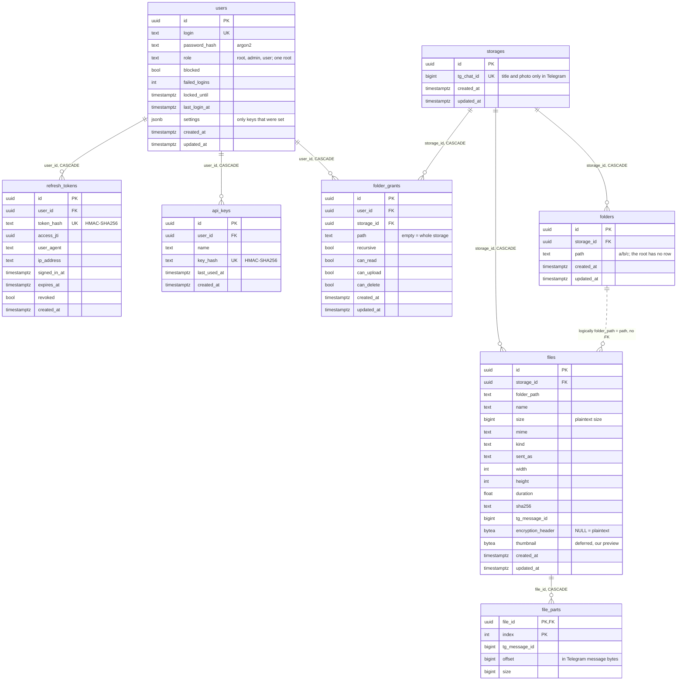

# Database

PostgreSQL 18, SQLAlchemy 2 async (asyncpg), Alembic migrations in `src/infrastructure/database/migrations/`.
All primary keys are UUIDs (v7, generated in Python).

Models are in `src/infrastructure/database/models/` (class `*DB`), the `id`/`created_at`/`updated_at` mixins in `mixins/`.

`folder_grants.path` and `files.folder_path` are text, not references to `folders`: a grant may point to a folder that
does not exist yet and survives its deletion, and files and folders are linked by path (flows/users.md, flows/folders-and-files.md).

| Table | What it stores | Indexes and why |
|---|---|---|
| `storages` | `id`, `tg_chat_id`, dates. Title, description, photo live only in Telegram | `UNIQUE(tg_chat_id)`: a channel is connected once |
| `folders` | `storage_id`, `path` (`a/b/c`, without the root) | `UNIQUE(storage_id, path)`; `(storage_id, path text_pattern_ops)`: `LIKE 'a/%'` for child folders and recursive delete; GIN `pg_trgm` on `lower(path)`: folder search by name |
| `users` | `login`, argon2 `password_hash`, `role` (`root`/`admin`/`user`), `blocked`, `failed_logins`, `locked_until`, `last_login_at`, `settings` (JSONB, only keys the user set, `'{}'` means all defaults; flows/settings.md) | `UNIQUE(login)`: sign-in by login; partial `UNIQUE(role) WHERE role = 'root'`: a single root |
| `refresh_tokens` | `user_id`, HMAC `token_hash`, `access_jti`, user agent, IP, `signed_in_at`, `expires_at`, `revoked` | `UNIQUE(token_hash)`: lookup on refresh; `user_id`: a user's sessions, revoking all of them |
| `api_keys` | `user_id`, `name`, HMAC `key_hash`, `last_used_at` | `UNIQUE(key_hash)`: `X-API-Key` check; `user_id`: key list |
| `folder_grants` | `user_id`, `storage_id`, `path` (folder without the root, `''` is the whole storage), `recursive`, `can_read`, `can_upload`, `can_delete` | `UNIQUE(user_id, storage_id, path)`: one grant per folder, and the user's grants on every request; `storage_id`: cascade delete with the storage |
| `files` | path (`folder_path` + `name`), size, MIME, type (`photo/video/audio/animation/document`), `sent_as`, dimensions, duration, `sha256`, `tg_message_id`, `encryption_header` (encryption header, `NULL` means the file is plaintext; security.md), `thumbnail` (our preview of an encrypted file, encrypted with its key; `NULL` for plaintext files, types without previews, generation errors and encrypted files uploaded before `0009` until `POST /api/files/previews/backfill` fills them; the column is `deferred`, listings do not read it; storage stats use `octet_length(thumbnail)`, which for a TOAST value is the size from the pointer without reading TOAST, so a separate size column is not needed) | `UNIQUE(storage_id, folder_path, name)`: one file per path; `(storage_id, folder_path text_pattern_ops)`: listing, folder sizes and subtree delete; `UNIQUE(storage_id, tg_message_id)`; `sha256`; search (flows/folders-and-files.md, "Search"): GIN `pg_trgm` on `lower(name)` for name substrings, `name` for name sort (listings), `name COLLATE tcloud_ru` / `name COLLATE tcloud_en` for search name sort in the interface language, `kind`, `mime` (and format grouping), `size`, `updated_at` for filters and sorts, `created_at` for the activity map window, partial `storage_id WHERE encryption_header IS NOT NULL` for the `encrypted` filter; partial `(kind, id) WHERE encryption_header IS NOT NULL AND thumbnail IS NULL` for preview backfill; partial `id WHERE thumbnail IS NOT NULL` for clearing all previews in batches (`DELETE /api/files/previews`); folder listing keyset indexes (`0013`): `(storage_id, folder_path, name COLLATE tcloud_ru|en, id)`, `(storage_id, folder_path, type COLLATE …, name COLLATE …, id)` (type is `coalesce(nullif(lower(substring(name, '\.([^.]*)$')), ''), kind)`), `(storage_id, folder_path, size|updated_at|created_at, id)` for `GET /api/folders` by each sort |
| `file_parts` | parts of a file that did not fit into one Telegram message (flows/uploads.md, "Big files in parts"): `index` (0…), `tg_message_id`, `offset` and `size`, the part's place in the stored stream (ciphertext for encrypted files, the file itself for plaintext ones). Rows exist **only** for multi-part files; part 0 is the same `files.tg_message_id`; `files.size`/`sha256` describe the whole plaintext file, stats still count only `files` | `PRIMARY KEY(file_id, index)`: a file's parts in order (download, archive, delete); `ix_file_parts_message (tg_message_id)`: a Telegram message deletion event finds the file by any part (joined on `files.storage_id`; message ids are unique only within a channel, so there is no unique index on `tg_message_id`); `file_id` `ON DELETE CASCADE` |

`_`, `%` and `\` are escaped before `LIKE` (`\` is forbidden in paths, so it is the escape character; a search string may contain it).
The `pg_trgm` extension is created by migration `0006` (`CREATE EXTENSION IF NOT EXISTS`; `postgres:18` ships it as trusted,
so the DB owner does not need superuser). `lower()` follows the DB locale: the `postgres:18` image creates the cluster with
`en_US.utf8`, so Cyrillic and other Unicode are lowercased; in a cluster with the `C` locale Cyrillic search
becomes case-sensitive.
Name sort in search uses the ICU collations from migration `0010` (the `postgres:18` image is built with ICU 76):
`tcloud_ru` (`ru-u-kn-kr-cyrl-latn`: Cyrillic before Latin, `ё` next to `е`) and `tcloud_en`
(`en-u-kn-kr-latn-cyrl`: Latin before Cyrillic); `kn` sorts numbers by value (`b2` before `b10`). Case-insensitive at the
primary level, spaces and punctuation are not skipped. The indexes `ix_files_name_ru`/`ix_files_name_en` are expressions with `COLLATE`,
SQLAlchemy reflection cannot tell them apart, so `migrations/env.py` excludes them from the autogenerate comparison
(`COLLATED_INDEXES`); `ix_files_list_name_*` and `ix_files_list_type_*` are listed there too.
Upload tasks are not stored in the DB: the queue is RabbitMQ, status and progress are in Redis (see background-tasks.md).

## Migrations

| Revision | What |
|---|---|
| `0001` | storages, folders, files, tasks |
| `0002` | `tasks.path`, `tasks.batch_id`, indexes for batches and lists, uniqueness of an active path |
| `0003` | the `tasks` table is dropped: upload state moved to Redis |
| `0004` | `users`, `refresh_tokens`, `api_keys`, `folder_grants` (flows/users.md) |
| `0005` | `files.encryption_header` for files with `encrypt=true` |
| `0006` | `pg_trgm`, search indexes on `files` and `folders` |
| `0007` | `files.created_at` for the activity map |
| `0008` | `users.settings` (JSONB): user defaults |
| `0009` | `files.thumbnail`: encrypted preview of encrypted files |
| `0010` | ICU collations `tcloud_ru`/`tcloud_en` and `name COLLATE …` indexes for language-aware search sort |
| `0011` | partial index `ix_files_missing_preview` for preview backfill |
| `0012` | partial index `ix_files_preview` for clearing previews |
| `0013` | keyset indexes `ix_files_list_*` for paginated folder listing |
| `0014` | data: MIME by extension (`text/plain`, `text/markdown`, …) for documents stored as `application/octet-stream` |
| `0015` | `file_parts` and `ix_file_parts_message`: files bigger than one Telegram message |

New revision: `uv run alembic revision --autogenerate -m "..."`. Existing files are never edited.
`tests/integration/test_migrations.py` checks that the models match the migrations and that everything downgrades to `base` and back.
