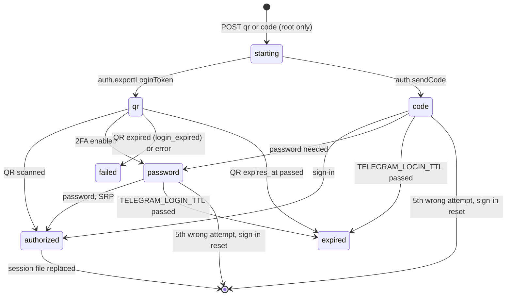
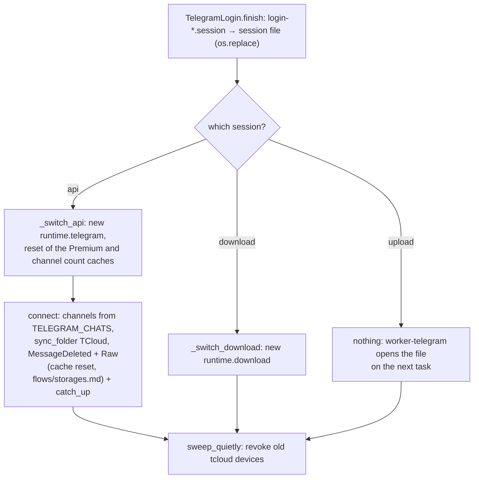

# Telegram sign-in

tcloud works through a user account with three Telethon sessions (in Telegram these are three devices):

| Session | File | Used by | Device in Telegram |
|---|---|---|---|
| `api` | `TELEGRAM_SESSION` | API (`runtime.telegram`, receives updates): channels, storage photos, message deletion, deletion events, Premium and the channel count, the `TCloud` folder, cleanup of old sessions | `api` |
| `upload` | `TELEGRAM_UPLOAD_SESSION` | `worker-telegram` (`WorkerRuntime.telegram`): sending files and reading files for archives | `upload` |
| `download` | `TELEGRAM_DOWNLOAD_SESSION` | API, a separate client (`runtime.download`): file downloads and previews (`/files/{id}/download`, `/thumb`) | `download` |

Each session is signed in separately through the API: the frontend `/telegram` page or Swagger `/docs`, section **Telegram** (Swagger is disabled in prod, deployment.md). All endpoints are root-only (flows/users.md).
A session that would confirm the sign-in of other devices is not kept: such a session could link a foreign device
to the account, so there is none.

## Without sessions

The app starts without sign-in: `/docs` (if enabled), `/api/telegram`, `/api/health` and `/api/account` (`telegram_connected: false`) work, `health.telegram` / `health.telegram_upload` /
`health.telegram_download` are `false`. Everything that goes to Telegram through the API session answers `503 telegram_unauthorized`; uploads without the worker
session are rejected at once with the same code, downloads without the `download` session too. Signing in to `download` swaps the download
client on the fly. After signing in to `api`, the channels from `TELEGRAM_CHATS` are connected and deletion
tracking starts, no restart needed. The worker picks up a new session with the next task.

## Steps

`{session}` is `api`, `upload` or `download`. The current state is `GET /api/telegram`: for each session `authorized` and an unfinished
sign-in `login` (`step`: `qr`, `code`, `password`, `expired`, `failed`; `expires_at`; `error`).

**By QR.** `POST /api/telegram/{session}/qr` returns `{"url": "tg://login?token=…", "expires_at": "…"}` (about 30 s,
`Cache-Control: no-store`). The frontend draws the QR picture from `url` (any QR library, locally in the browser). The link must never
be given to external QR generators: it is a one-time sign-in token for the account. Without a frontend use the code (below) or
`qrencode -t ansiutf8 '<url>'` locally in a terminal. Scan it in the Telegram app: Settings → Devices → Link Desktop Device. Then
`GET /api/telegram`: `authorized: true`, or `step: password` if two-step verification is on. Expired: `step: failed`
with `login_expired`, request a QR again. QR does not use code delivery (`auth.sendCode`), so it usually works even
when Telegram has temporarily stopped sending codes to the number.

**By code.** `POST /api/telegram/{session}/code` `{"phone": "+79991234567"}`: Telegram sends the code to the app
(the "Telegram" service chat), not by SMS. `POST /api/telegram/{session}/sign-in` `{"code": "12345"}`: sign-in or `step: password`.

**Two-step verification.** `POST /api/telegram/{session}/password` `{"password": "..."}`.

The sign-in state is `Login` in `AppRuntime.logins` (`src/application/services/auth.py`, `AuthService`), the sign-in client is
`TelegramLogin` (`src/infrastructure/integrations/telegram/login.py`).

After a successful sign-in (`AuthService._complete`):

An unfinished sign-in lives `TELEGRAM_LOGIN_TTL` (300 s) and there is only one per session: a new `qr`/`code` cancels the previous one.
A wrong code or password can be retried 4 times, on the fifth error the sign-in is reset. Signing in to an already authorized
session gives `409 already_authorized`: run `POST /api/telegram/{session}/logout` first.

| Error | Status | When |
|---|---|---|
| `invalid_phone` / `invalid_code` / `invalid_password` | 400 | Telegram did not accept the number, code or password |
| `login_not_found` | 404 | no sign-in in progress (or it expired) |
| `wrong_login_step` | 409 | a step out of order, for example the password before the code |
| `already_authorized` | 409 | the session is already authorized |
| `flood_wait` | 429 | Telegram asks to wait, `retry_after` in seconds. Repeated code requests extend the ban |
| `telegram_unauthorized` | 503 | the needed session is not authorized or was revoked |

## Sign-out and old sessions

`POST /api/telegram/{session}/logout` terminates the session in Telegram and deletes the file. A session revoked elsewhere (for example in the Telegram
app) is noticed by the worker on the very first request: the task fails with `telegram_unauthorized`, the client is reset,
and after a new sign-in the next task runs on the new session.

After signing in again, the previous `api` / `upload` devices stay in the Telegram device list with working
keys. tcloud revokes them itself: after every sign-in and every `TELEGRAM_SESSION_SWEEP_INTERVAL` (1 h) the API session
keeps the newest device of each kind (always its own current one) and terminates the rest. Telegram allows
a session to terminate others only 24 h after its sign-in (`session_too_fresh`); until then the cleanup waits and retries.
Only devices with a session name (`api`, `upload`, `download`) and the `api_id` from `TELEGRAM_API_ID` count as ours:
other devices of the account (phone, Desktop, foreign apps with the same name) are never touched.

- `GET /api/telegram/sessions`: our own devices of the account (`api`, `upload`, `download` with our `api_id`): `id`, `session`, dates, IP, country, `current`.
- `DELETE /api/telegram/sessions/{id}`: terminate one of them; our own current one gives `409 current_session` (use `logout` for it),
  a non-tcloud device gives `404 session_not_found`.

## Security

- The 2FA password arrives only in the request body, is kept as a `SecretStr`, never logged and never stored.
  Telegram receives not the password but an SRP proof that Telethon computes locally. The phone number is not logged either.
- Sign-in writes to a temp file `login-*.session` and only on success atomically replaces the session file (mode `0600`);
  an abandoned or failed sign-in deletes the file.
- No endpoint accepts a foreign QR token: a stranger's device cannot be linked to the account through the API.
- Any session file gives full access to the account; Telegram offers no way to limit a single session's rights. Protection:
  do not take the `session` volume anywhere, do not open port 8000 to the outside without a reverse proxy with TLS, a long `ROOT_PASSWORD`,
  2FA enabled (a stolen session cannot change it without the current password), check
  Settings → Devices from time to time.
- The sign-in state is held in the API process memory: the API runs as a single uvicorn process.
