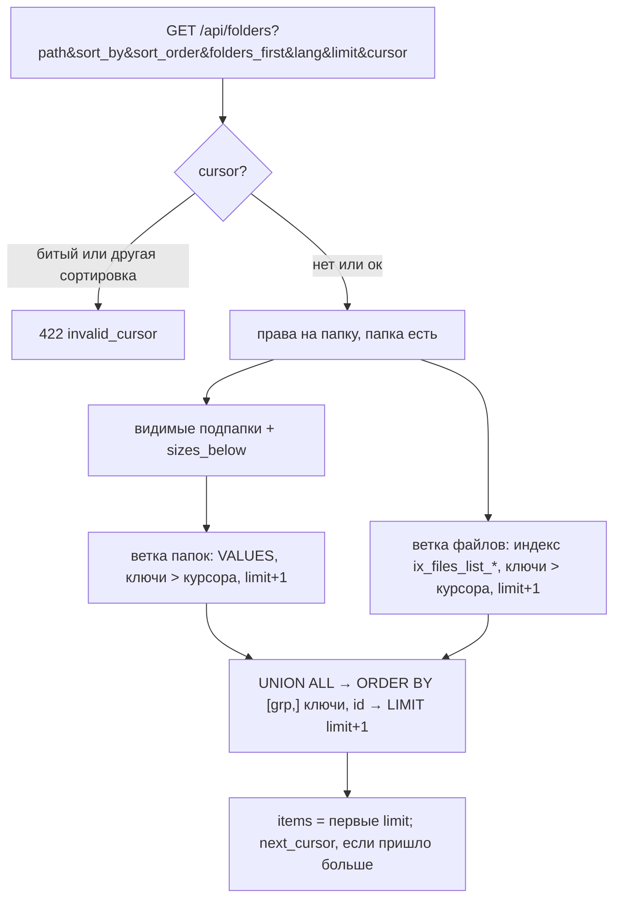
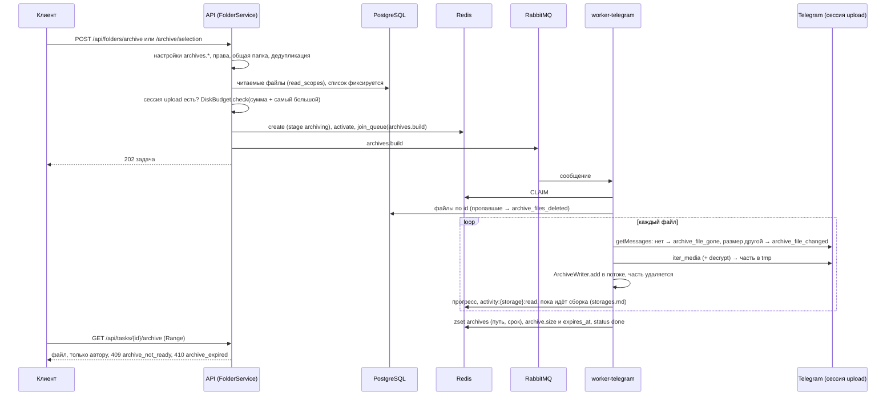
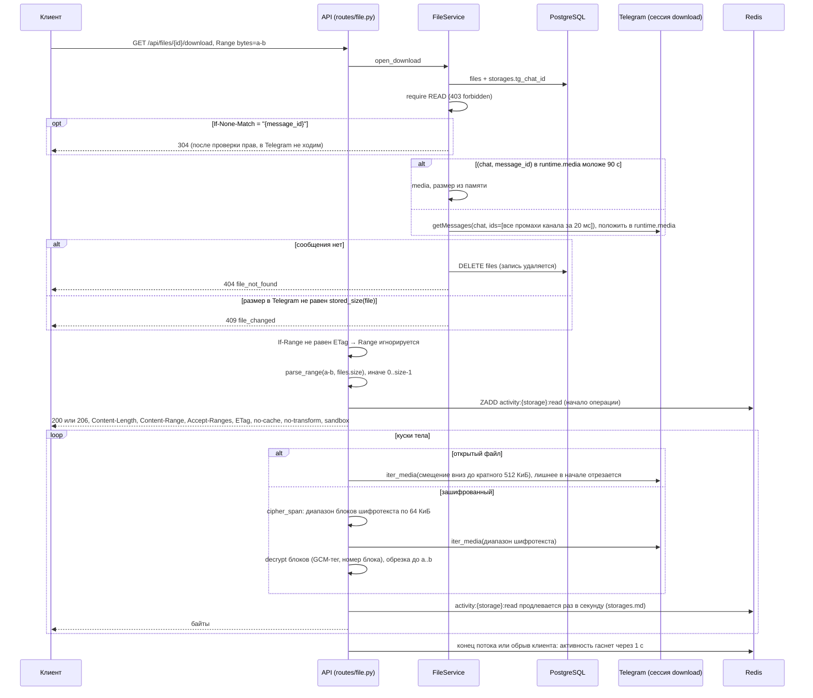

# Папки и файлы

## Пути

`tcloud/{uuid хранилища}/{папки}/{имя}`. Сегменты через `/`; нельзя пустые, `.`, `..`, `\` и управляющие символы;
сегмент ≤ 255 байт, путь ≤ 1024 символов; Unicode приводится к NFC; UUID — только канонический вид, чтобы у файла
был ровно один путь. Корень хранилища — `tcloud/{uuid}`.

## Папки

Папки есть только в БД. Создаются явно (`POST /api/folders`) или автоматически вместе с родителями при загрузке файла;
существующие объединяются. `GET /api/folders?path=` — прямые подпапки и файлы постранично («Листинг папки» ниже).
`DELETE /api/folders?path=` —
рекурсивно: сначала сообщения в Telegram (пачками по 100), потом записи в БД. Корень удалить нельзя.

### Листинг папки: страницы, сортировка, курсор

`GET /api/folders` — одна страница содержимого папки, отсортированная на сервере. Параметры query:

| Параметр | Значения | По умолчанию | Что |
|---|---|---|---|
| `path` | `tcloud/{storage}/…` | — | папка |
| `sort_by` | `name`, `modified` (`updated_at`), `uploaded` (`created_at`), `type`, `size` | `interface.sort_by` пользователя | ключ сортировки |
| `sort_order` | `asc`, `desc` | `interface.sort_order` | направление |
| `folders_first` | `true`, `false` | `interface.folders_first` | сначала все папки, потом файлы; `false` — папки и файлы вперемешку по ключу |
| `lang` | `ru`, `en` | `interface.language`, иначе `en` | правило сравнения имён и типов (`tcloud_ru`/`tcloud_en`, числа по значению: `b2` перед `b10`) |
| `limit` | `1`…`200` | `20` | размер страницы; фронтенд передаёт `interface.page_size` (20/50/100/200), `20` — только запасной вариант, если параметра нет |
| `cursor` | строка из `next_cursor` | — | продолжить с места, где кончилась прошлая страница |

```json
{
  "path": "tcloud/{storage}/trip",
  "size": 12345, "total_files": 3, "total_folders": 1, "direct_files": 1,
  "items": [
    {"type": "folder", "id": "…", "path": "tcloud/{storage}/trip/day 1", "name": "day 1",
     "created_at": "…", "updated_at": "…", "size": 12000, "files": 2},
    {"type": "file", "uuid": "…", "name": "map.png" /* остальное как в GET /api/files/{id} */}
  ],
  "next_cursor": "eyJzIjpb…"
}
```

- `items` — папки (`type: "folder"`) и файлы (`type: "file"`) одной лентой в порядке сортировки; `next_cursor` —
  `null` на последней странице. `total_folders` — сколько подпапок видно (все страницы), `direct_files` — сколько
  файлов прямо в папке (0, если папку видно только как путь к гранту); `total_files` и `size` — как раньше, всё
  поддерево. Вместе `total_folders + direct_files` — длина всей ленты. **Итоги (`size`, `total_files`,
  `total_folders`, `direct_files`) считаются только на первой странице (без `cursor`)**, на следующих они `null` —
  фронтенд берёт их с первой страницы.
- Ключи: `name` — имя; `type` — расширение в нижнем регистре после последней точки, без расширения — `kind` файла
  (так же, как колонка «Тип» фронтенда), у папок — слово `папка`/`folder` по `lang`; потом имя; `size` — размер
  (у папки — поддерева); `modified`/`uploaded` — `updated_at`/`created_at`. Последний ключ всегда `id` (UUIDv7):
  порядок полный и стабильный. Для `size`/`modified`/`uploaded` равные значения упорядочены по `id`, а не по имени.
  `desc` переворачивает весь кортеж, папки при `folders_first` всё равно сверху.
- Курсор — непрозрачная строка (base64url JSON: параметры сортировки, группа папка/файл, ключи и `id` последнего
  элемента). Keyset: следующая страница — строки строго после этого кортежа, поэтому вставки и удаления между
  страницами не дают дублей и пропусков уже показанного (новый файл до курсора просто не попадёт в эту прокрутку,
  после — попадёт). Курсор от другой сортировки, `lang` или битый — `422 invalid_cursor` (начните с первой
  страницы); `limit` вне `1…200` — `422 validation_error`.
- Как считается, по запросам в БД (в Telegram листинг не ходит вовсе: `chat_id` для ссылок — из `storages`, превью —
  отдельные ленивые `/thumb`):
  1. `storages` по id и `folders` — папка есть (по запросу, индексы PK и `UNIQUE(storage_id, path)`);
  2. только если на этой странице могут быть папки (не `folders_first` с курсором уже в файлах): видимые подпапки
     (`get_children` + права);
  3. только на первой странице, или для `sort_by=size` пока в ленте есть папки (их размер — ключ сортировки):
     один агрегат `sizes_below` по поддереву — даёт итоги и размеры всех подпапок;
  4. один keyset-запрос: подпапки как `VALUES`, файлы из `files`; каждая ветка берёт `limit + 1` строк после курсора
     по своему индексу, `UNION ALL`, общая сортировка и `LIMIT limit + 1` (лишняя строка — есть ли `next_cursor`);
  5. если на странице есть папки, а агрегата не было — один `GROUP BY` только по поддеревьям этих папок
     (`folder_path = x OR LIKE 'x/%'` по каждой, индекс `ix_files_folder`);
  6. один `SELECT … WHERE id IN (…)` файлов страницы с `chat_id`.
  Замер (postgres:18, папка из 50 000 файлов и 50 подпапок по 2 000, всего 150 000; `limit=20`, медиана из 15, время
  сервиса без HTTP и входа): до — 6–7 запросов и 36–47 мс на **каждой** странице (агрегат по поддереву ≈ 37 мс,
  `Parallel Seq Scan` 150 000 строк, плюс `count` файлов); после — страница 1: 5 запросов, ≈ 30 мс (тот же агрегат,
  один раз); страницы с подпапками: 5 запросов, ≈ 30 мс (размеры 20 подпапок по 2 000 файлов); глубокие страницы
  (4, 1000, 2500): 4 запроса, ≈ 3,6 мс. Индексы ключей (миграция `0013`): `(storage_id, folder_path, name COLLATE
  tcloud_{ru|en}, id)`, `(storage_id, folder_path, тип COLLATE …, name COLLATE …, id)`, `(storage_id, folder_path,
  size|updated_at|created_at, id)`. На папке из 50 000 файлов (postgres:18, `plan_cache_mode = force_generic_plan`)
  каждая страница — `Index Only Scan` (для `type` — `Index Scan`) с условием по кортежу в `Index Cond`, 21 строка,
  ≈ 0,1–0,2 мс; подпапок в папке обычно мало, их сортировка — в памяти.



### Размеры папок в листинге

- `items[].size` / `items[].files` у папок — сумма размеров и число файлов во всём поддереве подпапки; `size` /
  `total_files` верхнего уровня — то же для самой папки (её файлы плюс все подпапки).
- Размер — открытый (`files.size`): у зашифрованных файлов не размер шифротекста в Telegram.
- Точные числа, один агрегатный запрос на листинг: `GROUP BY` первого сегмента `folder_path` под папкой по индексу
  `(storage_id, folder_path text_pattern_ops)`.
- Считаются только файлы, которые пользователь может читать (те же правила грантов, проверка в SQL): размер
  недоступных файлов не утекает. Подпапка, видимая только потому, что ведёт к гранту, показывает размер лишь
  доступной части; у пустой или полностью недоступной — `0`.

### Скачивание папки архивом

Архив собирается фоновой задачей, затем скачивается готовым файлом:

Не переданные `format` и `priority` (здесь и в архиве выбранного) берутся из настроек пользователя `archives.*`
(flows/settings.md); `zip` и `normal` ниже — их значения по умолчанию.

1. `POST /api/folders/archive?path=&format=&priority=` → `202` с задачей (как у загрузок). Папка со всеми подпапками
   (или всё хранилище, если `path` — корень). В архив попадают только файлы, которые пользователь может читать (как в
   листинге), список фиксируется в момент запроса. Пути внутри — от папки, права `0644`, время — `updated_at` файла.
2. `GET /api/tasks/{id}` — прогресс: стадия `archiving`, `bytes_done/bytes_total` по сумме размеров файлов, место в
   очереди, `archive = {name, format, files, size, expires_at}`. Отмена — `POST /api/tasks/{id}/cancel`, приоритет —
   `POST /api/tasks/{id}/priority`. Повтора (`retry`) нет: собрать архив заново.
3. `GET /api/tasks/{id}/archive` — готовый архив (`Content-Disposition: attachment`, `nosniff`, `Range` для докачки).
   Скачать может только автор задачи (остальным `404`). До готовности — `409 archive_not_ready`, после удаления —
   `410 archive_expired`.

### Архив выбранных файлов и папок

`POST /api/folders/archive/selection` (JSON) → `202` с задачей той же формы, что у архива папки; дальше шаги 2–3 выше
(прогресс в `GET /api/tasks/{id}`, файл — `GET /api/tasks/{id}/archive`). Эндпоинт в роутере папок, потому что это тот
же `FolderService` и та же задача, отличается только список файлов.

```json
{
  "files": ["0190…-uuid файла"],
  "folders": ["tcloud/{storage}/trip/day 1"],
  "format": "zip",
  "name": "Отпуск",
  "priority": "normal"
}
```

| Поле | По умолчанию | Что это |
|---|---|---|
| `files` | `[]` | UUID файлов |
| `folders` | `[]` | полные пути папок; папка берётся со всеми подпапками, корень хранилища — `tcloud/{storage}` |
| `format` | `zip` | `zip`, `7z`, `tar.gz`, `tar.bz2`, `tar.xz` |
| `name` | — | имя архива без расширения, 1–200 символов, без `/`, `\` и управляющих; расширение добавляется само |
| `priority` | `normal` | `low`, `normal`, `high` |

- Всё выбранное должно быть в одном хранилище; хранилище берётся из самих файлов и папок.
- Пути внутри архива — от общей папки выбранного (для папки считается её родитель, для файла — его папка), то есть
  от папки, в которой пользователь выбирал: файл `trip/1.pdf` и папка `trip/day 1` → `1.pdf`, `day 1/a.pdf`,
  `day 1/deep/b.pdf`. `task.path` — эта общая папка.
- Повторы убираются: файл, выбранный отдельно и лежащий в выбранной папке, вложенные или повторённые папки дают каждый
  файл один раз.
- Имя по умолчанию — `{имя общей папки}-{число файлов}-files.{format}` (для корня хранилища — UUID хранилища вместо
  имени), например `trip-3-files.zip`; с `name` — `{name}.{format}`. Итог — в `archive.name` задачи.
- Права: каждый выбранный **файл** должен читаться пользователем, иначе весь запрос `403 forbidden`. Для выбранной
  **папки** — как у архива папки: нужен доступ к ней или путь к выданной папке ниже, а файлы внутри, которые
  пользователь не может читать, молча пропускаются (как в листинге).
- Как и у архива папки, до постановки в очередь проверяются сессия `upload` и место на диске; список файлов фиксируется
  в момент запроса.

| Ошибка | Код | Когда |
|---|---|---|
| `422` | `empty_selection` | `files` и `folders` пустые |
| `422` | `too_many_items` | `len(files) + len(folders)` > `UPLOAD_ARCHIVE_MAX_ITEMS` (1000), в ответе `limit` |
| `422` | `storage_mismatch` | файлы и папки из разных хранилищ |
| `422` | `invalid_path` / `validation_error` | плохой путь папки / плохой UUID, `format`, `name`, `priority` |
| `403` | `forbidden` | нет чтения выбранного файла или папки |
| `404` | `file_not_found` / `folder_not_found` / `storage_not_found` | чего-то из выбранного нет |
| `503` | `telegram_unauthorized` | не выполнен вход сессии `upload` |
| `507` | `insufficient_storage` | не хватит места на диске |

| `format` | Сжатие |
|---|---|
| `zip` (по умолчанию) | deflate, уровень 9; открывается везде |
| `7z` | LZMA2, preset `9e` (py7zr) |
| `tar.gz` | gzip, уровень 9 |
| `tar.bz2` | bzip2, уровень 9 |
| `tar.xz` | xz, preset `9e` — самый плотный и самый медленный |

RAR не поддерживается: его создаёт только проприетарная утилита RARLAB. Фото и видео уже сжаты, поэтому архив из
медиа почти не меньше самих файлов.

Как работает (`services/folder.py`, `services/pipeline.py`, `services/archive.py`, `infrastructure/archive.py`):



- до постановки в очередь проверяются права, папка, вход сессии `upload` и место на диске: `DiskBudget` должен
  вместить сумму размеров плюс самый большой файл, иначе `507 insufficient_storage`;
- собирает `worker-telegram` (очередь `archives.build`, та же сессия Telethon и общая пауза FloodWait, см.
  background-tasks.md): файлы по одному качаются из Telegram во временный файл в `UPLOAD_TMP_DIR` и дописываются в
  архив там же (права `0600`, сжатие — в потоке, не в event loop); каждая часть удаляется сразу после добавления;
- файл, пропавший из Telegram или подменённый там (размер не совпадает), пропускается, причина — в `warnings` задачи;
  файл, удалённый из БД до сборки, тоже (одной строкой с числом таких файлов);
- готовый архив хранится `UPLOAD_ARCHIVE_TTL` (24 ч) и удаляется `TaskSweeper`; при ошибке, отмене или потере задачи
  частичный архив удаляется сразу. Пока архив хранится, он занимает место на диске и уменьшает бюджет для загрузок.

## Файлы

- `GET /api/files/{uuid}` и `GET /api/files/by-path?path=` — все метаданные: размер, MIME, тип, `sent_as`,
  размеры, длительность, `sha256` оригинала, `telegram.chat_id`/`message_id`/`link`/`search`.
- `GET /api/files/{uuid}/download` — поток из Telegram; `Range` (один диапазон) → `206`, видео можно перематывать.
  Документы (`kind = document`, в т. ч. `.json`, `.txt`, `.html`) отдаются как `application/octet-stream` +
  `attachment`, медиа — со своим MIME. `ETag: "{telegram message_id}"` (как у `/thumb`; `replace` даёт новое сообщение,
  значит и новый тег) и `Cache-Control: private, no-cache, no-transform`: браузер каждый раз переспрашивает, и
  `If-None-Match` с тем же тегом → `304` после проверки записи и прав, без запроса к Telegram. `If-Range` с другим
  тегом — `Range` игнорируется и отдаётся весь файл `200` (докачка не склеит разные версии). У скачивания и у
  `GET /api/tasks/{id}/archive` есть `no-transform`:
  прокси не должны сжимать или менять тело, иначе пропадут `Content-Length` и `Range`. nginx этот заголовок не читает,
  поэтому в nginx фронтенда для этих путей gzip выключается отдельным `location` (deployment.md).
  Перед отдачей размер файла в Telegram сверяется с `files.size`: если файл в канале подменили (размер другой), ответ
  `409 file_changed`, ничего не отдаётся. Полный `sha256` при потоковой отдаче не проверяется — он есть в метаданных.
- Зашифрованный файл (`encrypted: true`, flows/uploads.md) расшифровывается на лету; `size`, `Range` и `Content-Length` —
  по открытому файлу, из Telegram запрашиваются только нужные блоки по 64 КиБ. Ключ сервера не открывает файл →
  `409 decryption_failed`. Подменённый или обрезанный блок обрывает поток (статус уже отправлен), в архиве такой файл
  пропускается с предупреждением в задаче.
- `POST /api/files/previews/backfill` — только root, `202 {"status": "queued"}`: фоновая задача строит недостающие превью зашифрованных
  фото, GIF и видео (background-tasks.md, «Дозаполнение превью»); `503 queue_unavailable`, если брокер недоступен;
  `409 previews_disabled`, если root выключил `uploads.previews` (flows/settings.md).
- `DELETE /api/files/previews` — только root (`403 forbidden` остальным), `200 {cleared, bytes}`: стирает все наши
  превью (`files.thumbnail = NULL`; сами файлы, `updated_at` и превью Telegram у открытых файлов не трогаются).
  Идёт пачками по 1000 строк (`FileService.CLEAR_BATCH`, частичный индекс `ix_files_preview`, `FOR UPDATE SKIP LOCKED`),
  каждая пачка — своя транзакция, поэтому таблица не блокируется надолго; `cleared` — сколько превью стёрто, `bytes` —
  их суммарный размер. После очистки `preview_count`/`preview_bytes` в `/api/storages` — `0`, `/thumb` у
  зашифрованных файлов — `404 thumbnail_not_found`; вернуть превью можно `POST /api/files/previews/backfill`.
  Лимит `RATE_LIMIT_PREVIEWS_CLEAR_USER` (3 в час, security.md).
- `GET /api/files/{uuid}/thumb` — маленькое превью (`image/jpeg`). Открытые файлы: превью, которое Telegram сам хранит у
  сообщения: у фото (сжатых и отправленных файлом), у видео (превью делаем при загрузке, flows/uploads.md) и у
  документов, для которых Telegram его сделал. Зашифрованные файлы: наше превью из `files.thumbnail` (фото, GIF, видео;
  делается при загрузке, flows/uploads.md), расшифровывается ключом файла, в Telegram не ходим; ключ сервера не
  открывает → `409 decryption_failed`. Берётся самый большой размер, у которого обе стороны ≤ 320 px (если таких нет — самый маленький);
  размытое встроенное превью (`PhotoStrippedSize`, ~40 px) не отдаётся. Читает сессия `download`, права — как у
  скачивания (cookie или `X-API-Key`, `403 forbidden` без чтения папки). Превью открытых файлов (и «превью нет»)
  кешируются в Redis `thumb:{file_id}:{message_id}` на `REDIS_CACHE_TTL` (180 с) с общим потолком памяти
  `REDIS_THUMB_CACHE_MB` (64 МБ base64, при переполнении выбрасываются самые старые; `0` — кеш выключен, redis.md):
  повторный запрос в течение 3 мин в Telegram не ходит. `replace` меняет `message_id`, поэтому старое превью не
  отдаётся. Ответы:
  - `200` — байты JPEG, заголовки `ETag: "{telegram message_id}"`, `Cache-Control: private, max-age=86400`, `nosniff`;
  - `304` — пришёл `If-None-Match` с тем же `ETag` (в Telegram не ходим);
  - `404 thumbnail_not_found` — у открытого файла нет превью в Telegram; у зашифрованного нет `files.thumbnail`
    (аудио, документ, ошибка генерации или файл загружен до миграции `0009`; последние два дозаполняет
    `POST /api/files/previews/backfill`, background-tasks.md);
  - `404 file_not_found` — нет записи, или сообщения нет в Telegram (запись удаляется, как при скачивании);
    `409 file_changed`, `503 telegram_unauthorized` — как у скачивания.

  `replace` сохраняет UUID файла, но меняет `message_id`, поэтому меняется и `ETag`; браузер держит превью в кэше
  сутки, чтобы увидеть замену раньше, добавьте к URL `?v={updated_at}` из метаданных (сервер параметр игнорирует).
- `DELETE /api/files/{uuid}` — сообщение в Telegram и запись в БД.
- Удалили сообщение руками в Telegram — запись тоже пропадает, см. «Ручные удаления в Telegram» ниже.
- Для сжатого фото (`send_as=media`) `size`, `width`, `height` — того, что хранит Telegram; `sha256` — всегда от оригинала.

### Как идёт скачивание

Роут — `src/api/routes/file.py` (`download_file`), проверки и тело — `services/file.py` (`open_download`, `_media`,
`file_body`, `tracked`), расшифровка — `infrastructure/security/encryption.py` (`cipher_span`, `decrypt`), чтение из
Telegram — `TelegramClient.iter_media` клиентом `runtime.download`.

Сообщение с медиа (`message_media`: `media` и размер) кешируется в памяти процесса API (`runtime.media`,
`cache/media.py` `MediaCache`, LRU до 2000 записей, 90 с), так что повторные скачивания, перемотка (`Range`) и
`/thumb` того же файла не делают `GetMessages` каждый раз; строка `files` и права проверяются на каждом запросе как
раньше. Промахи кеша по одному каналу, пришедшие в течение 20 мс (`MEDIA_WINDOW`; так бывает, когда открывается
листинг и браузер разом просит десятки `/thumb`), склеиваются в один `GetMessages(ids=[…])`
(`MediaCache.load` → `TelegramClient.messages_media`); каждый ждущий получает своё сообщение или
`404 file_not_found`, ошибка Telegram достаётся всем ждущим и не кешируется. Запись удаляется: событием `MessageDeleted` (`forget_deleted`), событием `MessageEdited` (`forget_edited`),
удалением файла или папки через tcloud (до `telegram.delete`); `replace` даёт новое сообщение, поэтому старая запись
не используется. Истёк `file_reference` (`FILE_REFERENCE_EXPIRED`/`INVALID` → `TelegramFileReferenceError`) до
первого отданного байта (`FileService.body`) или при `/thumb` — запись удаляется, сообщение читается заново, попытка
повторяется один раз; в лог пишется INFO `File {id} reference expired, re-reading` (для `/thumb` — `thumbnail reference expired`). Чужую или испорченную ссылку Telegram
отвергает с `FILE_REFERENCE_INVALID` (проверено вживую подменой `file_reference` в `MediaCache`: скачивание фото,
зашифрованного документа и `/thumb` отдали те же байты после одного перечитывания); пустая ссылка — `FILE_REFERENCE_EMPTY`,
это обычная `TelegramError` без повтора.



Статус и заголовки уходят до первого байта тела: подменённый или обрезанный блок шифротекста или ошибка Telegram
(`iter_media` под `translate_errors`: `flood_wait`, `telegram_unavailable`…) обрывают уже начатый поток — соединение
закрывается, клиент получает меньше байт, чем в `Content-Length`, а в логе API остаётся ошибка с исходной причиной.
В архиве та же ошибка валит задачу с кодом ошибки Telegram, а не `internal`.

## Поиск

`GET /api/files/search` — файлы, которые пользователь может читать, по подстроке имени и фильтрам. Все параметры в
query, списки — повтором параметра (`kind=photo&kind=video`).

| Параметр | Что |
|---|---|
| `q` | подстрока имени файла без учёта регистра (Unicode, в т. ч. кириллица), ≤ 255 символов, пробелы по краям срезаются; `%`, `_`, `\` — обычные символы |
| `path` | область: `tcloud/{storage}/{папка}` — папка со всем поддеревом, `tcloud/{storage}` — хранилище, без `path` — все доступные хранилища |
| `kind` | `photo`, `video`, `audio`, `animation`, `document`, несколько через повтор |
| `mime` | точные MIME (`image/jpeg`, `application/pdf`), до 50, без учёта регистра; `photo.JPG` и `photo.jpeg` — оба `image/jpeg` |
| `size_min`, `size_max` | байты открытого размера (`files.size`), включительно |
| `date_from`, `date_to` | ISO 8601, по `updated_at` — время последней загрузки содержимого (`replace` его обновляет), включительно |
| `encrypted` | `true` / `false` |
| `sort` | `relevance` (по умолчанию): сначала точное совпадение имени, потом имена, начинающиеся с `q`, потом остальные, внутри — по имени; без `q` — по имени. `name`, `size`, `date` |
| `order` | `asc` / `desc`; по умолчанию `asc` для `relevance`/`name`, `desc` для `size`/`date` |
| `lang` | `ru` / `en` (по умолчанию `en`) — правила сравнения имён для `name` и для порядка внутри `relevance`: `ru` — кириллица перед латиницей, `en` — латиница перед кириллицей; числа по значению (`b2` перед `b10`), без регистра. Сортирует БД, поэтому порядок сохраняется между страницами; передавайте язык интерфейса |
| `limit`, `offset` | страница: `limit` 1–200 (50), `offset` 0–100000 |

Нужен `q` или хотя бы один фильтр (`kind`, `mime`, `size_*`, `date_*`, `encrypted`); `path` один — не фильтр:
пустой запрос → `422 empty_search`. Неверные значения (длины, `size_min > size_max`, `date_from > date_to`, MIME не
вида `type/subtype`) → `422 validation_error`. `path` не читается и не ведёт к гранту → `403 forbidden`; нет хранилища
или папки → `404 storage_not_found` / `404 folder_not_found`; кривой путь → `422 invalid_path`.

```json
{
  "items": [{ /* как GET /api/files/{id} */ "folder": "tcloud/{storage}/photos/trip", "storage_name": "Фото" }],
  "total": 8, "limit": 50, "offset": 0, "has_more": false,
  "folders": [{"id": "…", "path": "tcloud/{storage}/photos/trip", "name": "trip", "storage_id": "…",
               "storage_name": "Фото", "created_at": "…", "updated_at": "…"}]
}
```

- `items[].path` — полный путь файла, `folder` — путь его папки, `storage_name` — название канала из Telegram
  (`null`, если канал недоступен или Telegram не ответил; поиск при этом не падает).
- `folders` — папки, у которых само имя (последний сегмент) содержит `q`, отдельным списком: до 20, только на первой
  странице (`offset=0`), только если нет фильтров файлов (фильтры к папкам не применимы), в области — строго ниже
  `path`. Порядок — как `relevance`. В `total` не входят. Видны только папки, которые пользователь может читать
  (папки-предки грантов — нет).
- Доступ проверяется в SQL теми же правилами грантов (рекурсивный — папка и ниже, иначе только файлы в ней):
  нечитаемые файлы не попадают ни в `items`, ни в `total`.
- Индексы: GIN `pg_trgm` на `lower(name)` / `lower(folders.path)`, B-tree на фильтрах и сортировках (database.md).

`GET /api/files/search/mimes?path=` — форматы для выпадающего списка: `[{"mime": "image/jpeg", "files": 12}, …]`, по
убыванию числа, до 200, только читаемые файлы области (`path` как у поиска, без него — всё доступное). Ошибки
`path` — те же.

## Карта активности

`GET /api/files/activity?days=365&path=` — сколько файлов и байт загружено по дням (как карта вкладов GitHub):

```json
{"since": "2025-11-19", "until": "2026-11-18", "days": 365, "files": 42, "size": 123456,
 "items": [{"date": "2026-11-18", "files": 2, "size": 1024}]}
```

- День — по `created_at` файла в UTC (`replace` его не меняет: считается первая загрузка), `days` 1–366 (365), окно —
  `days` дней до сегодняшнего включительно. В `items` только дни, где что-то было, по возрастанию даты; пустые дни
  фронт заполняет нулями сам.
- `size` — открытый размер. Только читаемые файлы, `path` и его ошибки — как у поиска.
- Один запрос `GROUP BY date(created_at AT TIME ZONE 'UTC')`, окно отсекается индексом `ix_files_created_at`.

## Ручные удаления в Telegram

Проверять каждый файл не нужно — работают два механизма:

1. **События.** API-сессия Telegram получает обновления (`receive_updates=True`, у воркеров — `False`).
   На старте `prepare` регистрирует обработчик `events.MessageDeleted` и только потом вызывает `catch_up()` —
   иначе догнанные обновления пришли бы без обработчика. Telegram сам присылает id удалённых сообщений канала;
   `FileService.forget_messages` находит хранилище по `tg_chat_id` и удаляет записи по `(storage_id, tg_message_id)`
   (индекс `UNIQUE(storage_id, tg_message_id)`) одним запросом. Чужие чаты и личные сообщения игнорируются.
   Цена — ноль запросов к Telegram, при миллионе файлов тоже.
2. **Лениво при скачивании.** `GET /api/files/{uuid}/download` и `/thumb` открытого файла: сообщения нет → запись
   удаляется, ответ `404 file_not_found`. `/thumb` зашифрованного файла в Telegram не ходит и запись не трогает.

Безопасно для наших собственных удалений: при `replace` событие о старом сообщении приходит, когда запись уже
указывает на новое; при `DELETE` записи уже нет. Папки живут только в БД и остаются, даже если все файлы в них удалены.

Предел: удаления, пока API выключен, догоняются через `catch_up` (состояние обновлений хранится в файле сессии),
но если простой был слишком долгим, Telegram отвечает «разница слишком большая» и часть событий теряется. Такие
записи вычистит скачивание. Периодическая сверка с Telegram отложена: документация не гарантирует, что `count` в
`messages.search`/`getHistory` считается по диапазону id, а полный проход — 10 000 запросов на миллион файлов.
