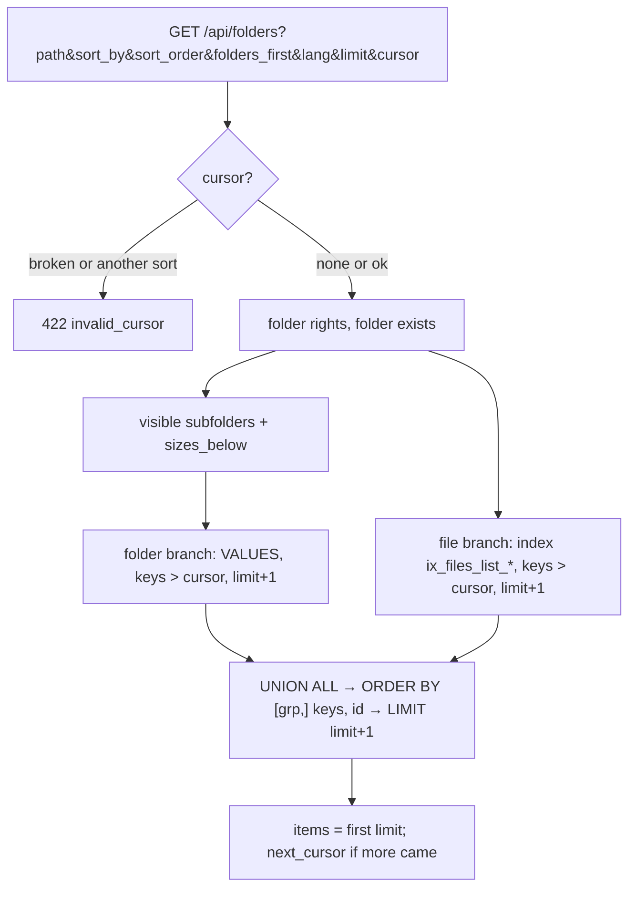
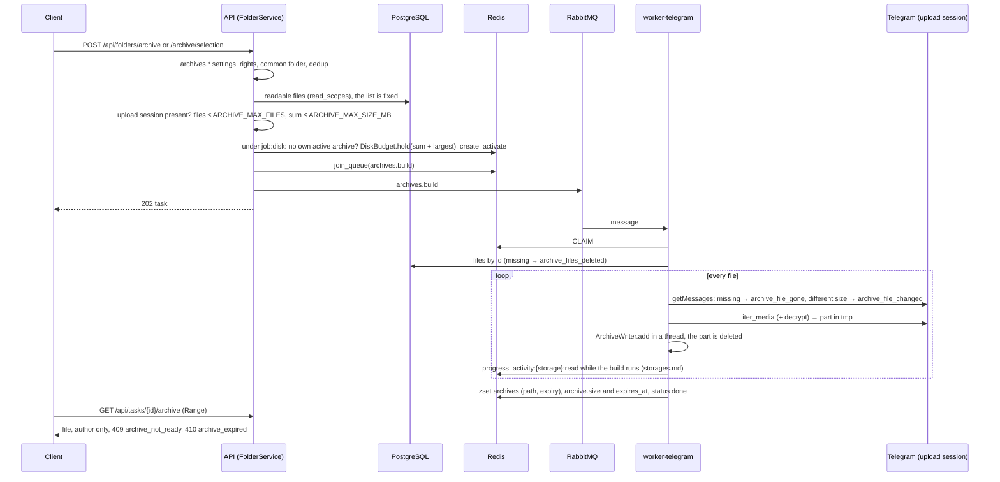
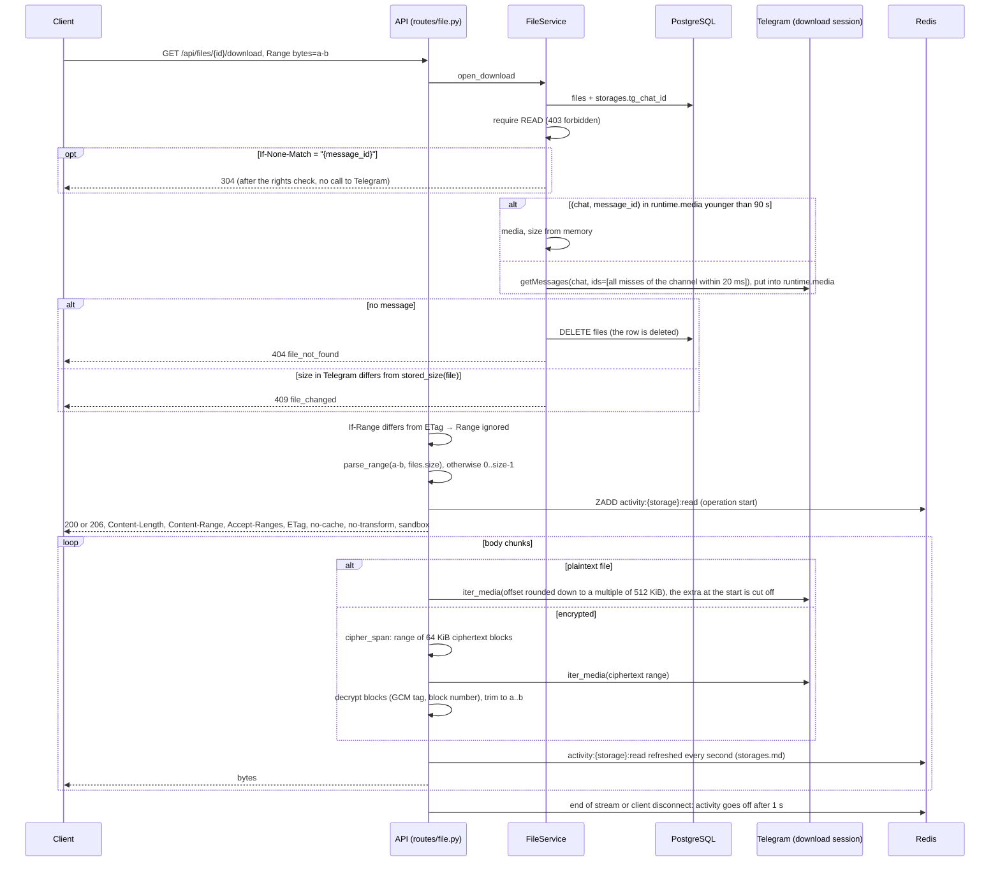

# Folders and files

## Paths

`tcloud/{storage uuid}/{folders}/{name}`. Segments are separated by `/`; empty segments, `.`, `..`, `\` and control characters are not allowed. Bidirectional text control characters (bidi: `U+061C`, `U+200E`, `U+200F`, `U+202A`–`U+202E`, `U+2066`–`U+2069`; for example RLO `U+202E`, used to pass `gpj.exe` off as `.jpg`) are forbidden only in paths that create a new name: an upload target (`POST /api/uploads`, sessions, `from-url`, batch; the whole path, folders included), `POST /api/folders` and a `keep_both` name; lookups of existing paths (listing, `by-path`, delete, archives, rights, queued tasks) accept them, so that old files with such names stay reachable; the other Unicode format characters (`Cf`: ZWJ in emoji sequences, soft hyphen and so on) are allowed;
a segment ≤ 255 bytes, a path ≤ 1024 characters; Unicode is normalized to NFC; a UUID only in canonical form, so that a file
has exactly one path. The storage root is `tcloud/{uuid}`.

## Folders

Folders exist only in the DB. They are created explicitly (`POST /api/folders`) or automatically together with their parents when a file is uploaded;
existing ones are merged. `GET /api/folders?path=` returns the direct subfolders and files page by page ("Folder listing" below).
`DELETE /api/folders?path=` is
recursive: first the messages in Telegram (in batches of 100), then the DB rows. The root cannot be deleted.

### Folder listing: pages, sorting, cursor

`GET /api/folders` is one page of the folder contents, sorted on the server. Query parameters:

| Parameter | Values | Default | What |
|---|---|---|---|
| `path` | `tcloud/{storage}/…` | none | the folder |
| `sort_by` | `name`, `modified` (`updated_at`), `uploaded` (`created_at`), `type`, `size` | the user's `interface.sort_by` | sort key |
| `sort_order` | `asc`, `desc` | `interface.sort_order` | direction |
| `folders_first` | `true`, `false` | `interface.folders_first` | all folders first, then files; `false` mixes folders and files by the key |
| `lang` | `ru`, `en` | `interface.language`, otherwise `en` | collation of names and types (`tcloud_ru`/`tcloud_en`, numbers by value: `b2` before `b10`) |
| `limit` | `1`…`200` | `20` | page size; the frontend sends `interface.page_size` (20/50/100/200), `20` is only a fallback when the parameter is missing |
| `cursor` | a string from `next_cursor` | none | continue where the previous page ended |

```json
{
  "path": "tcloud/{storage}/trip",
  "size": 12345, "total_files": 3, "total_folders": 1, "direct_files": 1,
  "items": [
    {"type": "folder", "id": "…", "path": "tcloud/{storage}/trip/day 1", "name": "day 1",
     "created_at": "…", "updated_at": "…", "size": 12000, "files": 2},
    {"type": "file", "uuid": "…", "name": "map.png" /* the rest as in GET /api/files/{id} */}
  ],
  "next_cursor": "eyJzIjpb…"
}
```

- `items` holds folders (`type: "folder"`) and files (`type: "file"`) in one feed in sort order; `next_cursor` is
  `null` on the last page. `total_folders` is how many subfolders are visible (all pages), `direct_files` how many
  files are directly in the folder (0 if the folder is visible only as a path to a grant); `total_files` and `size` are as before, the whole
  subtree. Together `total_folders + direct_files` is the length of the whole feed. **The totals (`size`, `total_files`,
  `total_folders`, `direct_files`) are computed only on the first page (without `cursor`)**, on the following pages they are `null`;
  the frontend takes them from the first page.
- Keys: `name` is the name; `type` is the lowercased extension after the last dot, without an extension the file's `kind`
  (the same as the frontend "Type" column), for folders the word `папка`/`folder` depending on `lang`; then the name; `size` is the size
  (for a folder, of the subtree); `modified`/`uploaded` are `updated_at`/`created_at`. The last key is always `id` (UUIDv7):
  the order is total and stable. For `size`/`modified`/`uploaded` equal values are ordered by `id`, not by name.
  `desc` reverses the whole tuple, with `folders_first` folders still stay on top.
- The cursor is an opaque string (base64url JSON: sort parameters, the folder/file group, the keys and `id` of the last
  item). Keyset: the next page is the rows strictly after that tuple, so inserts and deletes between
  pages cause no duplicates and no gaps in what was already shown (a new file before the cursor just will not appear in this scroll,
  after it, it will). A cursor from another sort, `lang` or a broken one gives `422 invalid_cursor` (start from the first
  page); `limit` outside `1…200` gives `422 validation_error`.
- How it is computed, in DB queries (the listing never goes to Telegram: `chat_id` for links comes from `storages`, previews are
  separate lazy `/thumb` calls):
  1. `storages` by id and `folders`: the folder exists (per query, the PK and `UNIQUE(storage_id, path)` indexes);
  2. only if this page can contain folders (not `folders_first` with the cursor already in files): the visible subfolders
     (`get_children` + rights);
  3. only on the first page, or for `sort_by=size` while the feed still has folders (their size is the sort key):
     one `sizes_below` aggregate over the subtree, which gives the totals and the sizes of all subfolders;
  4. one keyset query: subfolders as `VALUES`, files from `files`; each branch takes `limit + 1` rows after the cursor
     through its own index, `UNION ALL`, a common sort and `LIMIT limit + 1` (the extra row tells whether there is a `next_cursor`);
  5. if the page has folders and there was no aggregate: one `GROUP BY` over only the subtrees of those folders
     (`folder_path = x OR LIKE 'x/%'` for each, index `ix_files_folder`);
  6. one `SELECT … WHERE id IN (…)` of the page's files with `chat_id`.
  Measurement (postgres:18, a folder of 50,000 files and 50 subfolders of 2,000 each, 150,000 in total; `limit=20`, median of 15, service
  time without HTTP and sign-in): before, 6–7 queries and 36–47 ms on **every** page (the subtree aggregate ≈ 37 ms,
  `Parallel Seq Scan` of 150,000 rows, plus a file `count`); after, page 1: 5 queries, ≈ 30 ms (the same aggregate,
  once); pages with subfolders: 5 queries, ≈ 30 ms (sizes of 20 subfolders of 2,000 files); deep pages
  (4, 1000, 2500): 4 queries, ≈ 3.6 ms. Key indexes (migration `0013`): `(storage_id, folder_path, name COLLATE
  tcloud_{ru|en}, id)`, `(storage_id, folder_path, type COLLATE …, name COLLATE …, id)`, `(storage_id, folder_path,
  size|updated_at|created_at, id)`. On a folder of 50,000 files (postgres:18, `plan_cache_mode = force_generic_plan`)
  every page is an `Index Only Scan` (an `Index Scan` for `type`) with the tuple condition in `Index Cond`, 21 rows,
  ≈ 0.1–0.2 ms; a folder usually has few subfolders, they are sorted in memory.



### Folder sizes in the listing

- `items[].size` / `items[].files` of folders are the total size and file count of the subfolder's whole subtree; the top-level `size` /
  `total_files` are the same for the folder itself (its files plus all subfolders).
- The size is the plaintext one (`files.size`): for encrypted files it is not the ciphertext size in Telegram.
- Exact numbers, one aggregate query per listing: `GROUP BY` the first `folder_path` segment under the folder through the index
  `(storage_id, folder_path text_pattern_ops)`.
- Only files the user can read are counted (the same grant rules, checked in SQL): the size of
  inaccessible files does not leak. A subfolder visible only because it leads to a grant shows the size of just the
  accessible part; an empty or fully inaccessible one shows `0`.

### Downloading a folder as an archive

The archive is built by a background task, then downloaded as a ready file:

`format` and `priority` not given (here and in the selection archive) come from the user's `archives.*` settings
(flows/settings.md); `zip` and `normal` below are their defaults.

1. `POST /api/folders/archive?path=&format=&priority=` → `202` with a task (as for uploads). The folder with all its subfolders
   (or the whole storage if `path` is the root). Only files the user can read go into the archive (as in
   the listing), the list is fixed at request time. Paths inside are relative to the folder, mode `0644`, the time is the file's `updated_at`.
2. `GET /api/tasks/{id}`: progress: stage `archiving`, `bytes_done/bytes_total` over the sum of file sizes, queue
   position, `archive = {name, format, files, size, expires_at}`. Cancel with `POST /api/tasks/{id}/cancel`, priority with
   `POST /api/tasks/{id}/priority`. There is no `retry`: build the archive again.
3. `GET /api/tasks/{id}/archive`: the ready archive (`Content-Disposition: attachment`, `nosniff`, CSP `sandbox`, `Range` for resuming).
   Only the task author can download it (others get `404`). Before it is ready, `409 archive_not_ready`, after deletion,
   `410 archive_expired`.

### Archive of selected files and folders

`POST /api/folders/archive/selection` (JSON) → `202` with a task of the same shape as a folder archive; then steps 2–3 above
(progress in `GET /api/tasks/{id}`, the file at `GET /api/tasks/{id}/archive`). The endpoint is in the folders router because it is the
same `FolderService` and the same task, only the file list differs.

```json
{
  "files": ["0190…-file uuid"],
  "folders": ["tcloud/{storage}/trip/day 1"],
  "format": "zip",
  "name": "Vacation",
  "priority": "normal"
}
```

| Field | Default | What it is |
|---|---|---|
| `files` | `[]` | file UUIDs |
| `folders` | `[]` | full folder paths; a folder is taken with all its subfolders, the storage root is `tcloud/{storage}` |
| `format` | `zip` | `zip`, `7z`, `tar.gz`, `tar.bz2`, `tar.xz` |
| `name` | none | archive name without an extension, 1–200 characters, no `/`, `\` or control characters; the extension is added automatically |
| `priority` | `normal` | `low`, `normal`, `high` |

- Everything selected must be in one storage; the storage is taken from the files and folders themselves.
- Paths inside the archive are relative to the common folder of the selection (for a folder its parent counts, for a file its folder), that is
  to the folder in which the user made the selection: the file `trip/1.pdf` and the folder `trip/day 1` → `1.pdf`, `day 1/a.pdf`,
  `day 1/deep/b.pdf`. `task.path` is that common folder.
- Repeats are removed: a file selected on its own and lying in a selected folder, and nested or repeated folders give each
  file once.
- The default name is `{common folder name}-{file count}-files.{format}` (for the storage root, the storage UUID instead of
  the name), for example `trip-3-files.zip`; with `name` it is `{name}.{format}`. The result is in the task's `archive.name`.
- Rights: every selected **file** must be readable by the user, otherwise the whole request is `403 forbidden`. For a selected
  **folder** it works like a folder archive: access to it or a path to a granted folder below is needed, and files inside that
  the user cannot read are silently skipped (as in the listing).
- As with a folder archive, the `upload` session and disk space are checked before queueing; the file list is fixed
  at request time.

| Error | Code | When |
|---|---|---|
| `422` | `empty_selection` | `files` and `folders` are empty |
| `422` | `too_many_items` | `len(files) + len(folders)` > `UPLOAD_ARCHIVE_MAX_ITEMS` (1000) or files in the archive after expanding folders > `UPLOAD_ARCHIVE_MAX_FILES` (10000), the response has `limit` |
| `413` | `too_large` | the total file size of the archive > `UPLOAD_ARCHIVE_MAX_SIZE_MB` (10240 MiB), the response has `limit` in bytes |
| `409` | `archive_in_progress` | the user already has an unfinished archive task |
| `422` | `storage_mismatch` | files and folders from different storages |
| `422` | `invalid_path` / `validation_error` | a bad folder path / a bad UUID, `format`, `name`, `priority` |
| `403` | `forbidden` | no read access to a selected file or folder |
| `404` | `file_not_found` / `folder_not_found` / `storage_not_found` | something selected does not exist |
| `503` | `telegram_unauthorized` | the `upload` session is not signed in |
| `507` | `insufficient_storage` | not enough disk space |

| `format` | Compression |
|---|---|
| `zip` (default) | deflate, level 6; opens everywhere |
| `7z` | LZMA2, preset `6` (py7zr) |
| `tar.gz` | gzip, level 6 |
| `tar.bz2` | bzip2, level 6 |
| `tar.xz` | xz, preset `6`, the densest and the slowest |

One level for all formats, `archive.LEVEL = 6` (the owner's decision): `9`/`9e` barely shrank the archive but kept
the single `worker-telegram` busy many times longer and ate memory (LZMA `9e` takes hundreds of MiB per thread).

RAR is not supported: only RARLAB's proprietary tool creates it. Photos and videos are already compressed, so an archive of
media is hardly smaller than the files themselves.

How it works (`services/folder.py`, `services/pipeline.py`, `services/archive.py`, `infrastructure/archive.py`):



- before queueing, rights, the folder, the `upload` session sign-in, the archive limits and disk space are checked:
  at most `UPLOAD_ARCHIVE_MAX_FILES` files (10000, `422 too_many_items`), a total size of at most
  `UPLOAD_ARCHIVE_MAX_SIZE_MB` (10240 MiB, `413 too_large`; `0` means no limit for both), and `DiskBudget` must fit
  the total size plus the largest file (`507 insufficient_storage`);
- a user has at most one unfinished archive task at a time (`409 archive_in_progress`): the check of
  the user's own tasks (`user_tasks:{user}`, only the `source` and `status` fields; for old tasks without `source`,
  `params.source`, read only for unfinished ones), the disk reservation and the task creation run under the shared `job:disk` lock, so two
  parallel requests cannot both pass; after `done`/`failed`/`cancelled` the next one can be built;
- `worker-telegram` builds it (queue `archives.build`, the same Telethon session and shared FloodWait pause, see
  background-tasks.md): files are downloaded from Telegram one by one into a temp file in `UPLOAD_TMP_DIR` and appended to the
  archive there (mode `0600`, compression in a thread, not in the event loop); each part is deleted right after it is added;
- a file gone from Telegram or replaced there (the size does not match) is skipped, the reason goes to the task's `warnings`;
  a file deleted from the DB before the build too (one line with the number of such files);
- a ready archive is kept for `UPLOAD_ARCHIVE_TTL` (24 h) and deleted by `TaskSweeper`; on an error, cancel or task loss
  the partial archive is deleted at once. While an archive is kept, it takes disk space and reduces the budget for uploads.

## Files

- `GET /api/files/{uuid}` and `GET /api/files/by-path?path=`: all metadata: size, MIME, type, `sent_as`,
  dimensions, duration, the original's `sha256`, `telegram.chat_id`/`message_id`/`link`/`search`.
- `GET /api/files/{uuid}/download`: a stream from Telegram; `Range` (one range) → `206`, videos can be seeked.
  Documents (`kind = document`, including `.json`, `.txt`, `.html`) are served as `application/octet-stream` +
  `attachment`, media with its own MIME. `ETag: "{telegram message_id}"` (as for `/thumb`; `replace` gives a new message,
  so a new tag too) and `Cache-Control: private, no-cache, no-transform`: the browser revalidates every time, and
  `If-None-Match` with the same tag → `304` after checking the row and rights, without a request to Telegram. `If-Range` with another
  tag: `Range` is ignored and the whole file is sent with `200` (a resume does not glue different versions together). The download and
  `GET /api/tasks/{id}/archive` have `no-transform`:
  proxies must not compress or change the body, otherwise `Content-Length` and `Range` are lost. nginx does not read this header,
  so the frontend nginx turns gzip off for these paths with a separate `location` (deployment.md).
  Before sending, the file size in Telegram is compared with `files.size`: if the file in the channel was replaced (a different size), the answer is
  `409 file_changed` and nothing is sent. The full `sha256` is not checked while streaming; it is in the metadata.
- An encrypted file (`encrypted: true`, flows/uploads.md) is decrypted on the fly; `size`, `Range` and `Content-Length` refer
  to the plaintext file, only the needed 64 KiB blocks are requested from Telegram. The server key does not open the file →
  `409 decryption_failed`. A substituted or truncated block breaks the stream (the status has already been sent), in an archive such a file
  is skipped with a warning in the task.
- `POST /api/files/previews/backfill`: root only, `202 {"status": "queued"}`: a background task builds the missing previews of encrypted
  photos, GIFs and videos (background-tasks.md, "Preview backfill"); `503 queue_unavailable` if the broker is unavailable;
  `409 previews_disabled` if root switched `uploads.previews` off (flows/settings.md).
- `DELETE /api/files/previews`: root only (`403 forbidden` for others), `200 {cleared, bytes}`: erases all our
  previews (`files.thumbnail = NULL`; the files themselves, `updated_at` and Telegram previews of plaintext files are not touched).
  It goes in batches of 1000 rows (`FileService.CLEAR_BATCH`, the partial index `ix_files_preview`, `FOR UPDATE SKIP LOCKED`),
  each batch is its own transaction, so the table is not locked for long; `cleared` is how many previews were erased, `bytes`
  their total size. After the cleanup `preview_count`/`preview_bytes` in `/api/storages` are `0`, `/thumb` of
  encrypted files gives `404 thumbnail_not_found`; previews can be brought back with `POST /api/files/previews/backfill`.
  Limit `RATE_LIMIT_PREVIEWS_CLEAR_USER` (3 per hour, security.md).
- `GET /api/files/{uuid}/thumb`: a small preview (`image/jpeg`). Plaintext files: the preview Telegram itself keeps with
  the message: for photos (compressed and sent as files), for videos (we make the preview at upload, flows/uploads.md) and for
  documents Telegram made one for. Encrypted files: our preview from `files.thumbnail` (photos, GIFs, videos;
  made at upload, flows/uploads.md), decrypted with the file key, no call to Telegram; the server key does not
  open it → `409 decryption_failed`. The largest size with both sides ≤ 320 px is taken (if there is none, the smallest one);
  the blurred inline preview (`PhotoStrippedSize`, ~40 px) is not served. The `download` session reads it, rights are as for
  downloads (cookie or `X-API-Key`, `403 forbidden` without folder read access). Previews of plaintext files (and "no preview")
  are cached in Redis `thumb:{file_id}:{message_id}` for `REDIS_CACHE_TTL` (180 s) with a shared memory cap
  `REDIS_THUMB_CACHE_MB` (64 MB base64, the oldest are dropped on overflow; `0` turns the cache off, redis.md):
  a repeated request within 3 min does not go to Telegram. `replace` changes `message_id`, so the old preview is not
  served. Responses:
  - `200`: JPEG bytes, headers `ETag: "{telegram message_id}"`, `Cache-Control: private, max-age=86400`, `nosniff`;
  - `304`: `If-None-Match` came with the same `ETag` (no call to Telegram);
  - `404 thumbnail_not_found`: a plaintext file has no preview in Telegram; an encrypted one has no `files.thumbnail`
    (audio, a document, a generation error, or the file was uploaded before migration `0009`; the last two are backfilled by
    `POST /api/files/previews/backfill`, background-tasks.md);
  - `404 file_not_found`: no row, or no message in Telegram (the row is deleted, as on download);
    `409 file_changed`, `503 telegram_unauthorized`: as for downloads.

  `replace` keeps the file UUID but changes `message_id`, so the `ETag` changes too; the browser keeps the preview in its cache
  for a day, to see a replacement sooner add `?v={updated_at}` from the metadata to the URL (the server ignores the parameter).
- `DELETE /api/files/{uuid}`: the Telegram message and the DB row.
- A message deleted by hand in Telegram drops the row too, see "Manual deletions in Telegram" below.
- For a compressed photo (`send_as=media`) `size`, `width`, `height` are those of what Telegram stores; `sha256` is always of the original.

### How a download works

The route is `src/api/routes/file.py` (`download_file`), checks and the body are in `services/file.py` (`open_download`, `_media`,
`file_body`, `tracked`), decryption in `infrastructure/security/encryption.py` (`cipher_span`, `decrypt`), reading from
Telegram is `TelegramClient.iter_media` with the `runtime.download` client.

A message with media (`message_media`: `media` and size) is cached in the API process memory (`runtime.media`,
`cache/media.py` `MediaCache`, LRU of up to 2000 entries, 90 s), so repeated downloads, seeking (`Range`) and
`/thumb` of the same file do not call `GetMessages` every time; the `files` row and rights are checked on every request as
before. Cache misses for one channel arriving within 20 ms (`MEDIA_WINDOW`; that happens when a
listing opens and the browser requests dozens of `/thumb` at once) are merged into one `GetMessages(ids=[…])`
(`MediaCache.load` → `TelegramClient.messages_media`); each waiter gets its own message or
`404 file_not_found`, a Telegram error reaches all waiters and is not cached. An entry is deleted by the `MessageDeleted` event (`forget_deleted`), the `MessageEdited` event (`forget_edited`),
and by deleting a file or folder through tcloud (before `telegram.delete`); `replace` gives a new message, so the old entry
is not used. An expired `file_reference` (`FILE_REFERENCE_EXPIRED`/`INVALID` → `TelegramFileReferenceError`) before
the first byte is sent (`FileService.body`) or during `/thumb`: the entry is deleted, the message is read again, and the attempt
is retried once; an INFO line `File {id} reference expired, re-reading` goes to the log (for `/thumb`, `thumbnail reference expired`). Telegram rejects
a foreign or corrupted reference with `FILE_REFERENCE_INVALID` (verified live by substituting `file_reference` in `MediaCache`: downloading a photo,
an encrypted document and `/thumb` returned the same bytes after one re-read); an empty reference is `FILE_REFERENCE_EMPTY`,
an ordinary `TelegramError` without a retry.



The status and headers go out before the first body byte: a substituted or truncated ciphertext block or a Telegram error
(`iter_media` under `translate_errors`: `flood_wait`, `telegram_unavailable`…) breaks an already started stream: the connection
is closed, the client gets fewer bytes than `Content-Length` says, and the API log keeps the error with its original cause.
In an archive the same error fails the task with the Telegram error code, not `internal`.

## Search

`GET /api/files/search`: files the user can read, by name substring and filters. All parameters are in the
query, lists by repeating the parameter (`kind=photo&kind=video`).

| Parameter | What |
|---|---|
| `q` | a case-insensitive file name substring (Unicode, Cyrillic included), ≤ 255 characters, surrounding spaces are trimmed; `%`, `_`, `\` are ordinary characters |
| `path` | the scope: `tcloud/{storage}/{folder}` is the folder with its whole subtree, `tcloud/{storage}` the storage, without `path` all accessible storages |
| `kind` | `photo`, `video`, `audio`, `animation`, `document`, several by repetition |
| `mime` | exact MIME types (`image/jpeg`, `application/pdf`), up to 50, case-insensitive; `photo.JPG` and `photo.jpeg` are both `image/jpeg` |
| `size_min`, `size_max` | bytes of the plaintext size (`files.size`), inclusive |
| `date_from`, `date_to` | ISO 8601, by `updated_at`, the time of the last content upload (`replace` updates it), inclusive; a time without a zone counts as UTC (can be mixed with `Z`/`+03:00`) |
| `encrypted` | `true` / `false` |
| `sort` | `relevance` (default): first an exact name match, then names starting with `q`, then the rest, by name within each; without `q`, by name. `name`, `size`, `date` |
| `order` | `asc` / `desc`; default `asc` for `relevance`/`name`, `desc` for `size`/`date` |
| `lang` | `ru` / `en` (default `en`): the name collation for `name` and for the order within `relevance`: `ru` puts Cyrillic before Latin, `en` Latin before Cyrillic; numbers by value (`b2` before `b10`), case-insensitive. The DB sorts, so the order holds across pages; pass the interface language |
| `limit`, `offset` | the page: `limit` 1–200 (50), `offset` 0–100000 |

`q` or at least one filter (`kind`, `mime`, `size_*`, `date_*`, `encrypted`) is required; `path` alone is not a filter:
an empty query → `422 empty_search`. Invalid values (lengths, `size_min > size_max`, `date_from > date_to`, a MIME not of
the form `type/subtype`) → `422 validation_error`. `path` is not readable and does not lead to a grant → `403 forbidden`; no storage
or folder → `404 storage_not_found` / `404 folder_not_found`; a malformed path → `422 invalid_path`.

```json
{
  "items": [{ /* as GET /api/files/{id} */ "folder": "tcloud/{storage}/photos/trip", "storage_name": "Photos" }],
  "total": 8, "limit": 50, "offset": 0, "has_more": false,
  "folders": [{"id": "…", "path": "tcloud/{storage}/photos/trip", "name": "trip", "storage_id": "…",
               "storage_name": "Photos", "created_at": "…", "updated_at": "…"}]
}
```

- `items[].path` is the full file path, `folder` the path of its folder, `storage_name` the channel title from Telegram
  (`null` if the channel is unavailable or Telegram did not answer; search does not fail because of it).
- `folders` are folders whose own name (the last segment) contains `q`, as a separate list: up to 20, only on the first
  page (`offset=0`), only if there are no file filters (filters do not apply to folders), within the scope strictly below
  `path`. The order is as for `relevance`. They are not counted in `total`. Only folders the user can read are visible
  (grant ancestor folders are not).
- Access is checked in SQL with the same grant rules (recursive: the folder and below, otherwise only the files in it):
  unreadable files get into neither `items` nor `total`.
- Indexes: GIN `pg_trgm` on `lower(name)` / `lower(folders.path)`, B-tree on filters and sorts (database.md).

`GET /api/files/search/mimes?path=`: formats for a dropdown: `[{"mime": "image/jpeg", "files": 12}, …]`, by
descending count, up to 200, only readable files of the scope (`path` as in search, without it everything accessible). The `path`
errors are the same.

## Activity map

`GET /api/files/activity?days=365&path=`: how many files and bytes were uploaded per day (like the GitHub contribution graph):

```json
{"since": "2025-11-19", "until": "2026-11-18", "days": 365, "files": 42, "size": 123456,
 "items": [{"date": "2026-11-18", "files": 2, "size": 1024}]}
```

- The day is the file's `created_at` in UTC (`replace` does not change it: the first upload counts), `days` 1–366 (365), the window is
  `days` days up to and including today. `items` has only days where something happened, by ascending date; the frontend fills
  empty days with zeros itself.
- `size` is the plaintext size. Only readable files, `path` and its errors as in search.
- One query `GROUP BY date(created_at AT TIME ZONE 'UTC')`, the window is cut by the index `ix_files_created_at`.

## Manual deletions in Telegram

There is no need to check every file, two mechanisms work:

1. **Events.** The Telegram API session receives updates (`receive_updates=True`, `False` for workers).
   At startup `prepare` registers the `events.MessageDeleted` handler and only then calls `catch_up()`,
   otherwise the caught-up updates would arrive without a handler. Telegram itself sends the ids of the channel's deleted messages;
   `FileService.forget_messages` finds the storage by `tg_chat_id` and deletes the rows by `(storage_id, tg_message_id)`
   (index `UNIQUE(storage_id, tg_message_id)`) in one query. Foreign chats and private messages are ignored.
   The cost is zero requests to Telegram, with a million files too.
2. **Lazily on download.** `GET /api/files/{uuid}/download` and `/thumb` of a plaintext file: no message → the row
   is deleted, the answer is `404 file_not_found`. `/thumb` of an encrypted file does not go to Telegram and does not touch the row.

It is safe for our own deletions: with `replace` the event about the old message arrives when the row already
points to the new one; with `DELETE` the row is already gone. Folders live only in the DB and stay even if all their files are deleted.

The limit: deletions while the API is off are caught up through `catch_up` (the update state is kept in the session file),
but if the downtime was too long, Telegram answers "difference too long" and some events are lost. Such
rows are cleaned up by downloads. Periodic reconciliation with Telegram is postponed: the documentation does not guarantee that `count` in
`messages.search`/`getHistory` is computed over the id range, and a full pass is 10,000 requests per million files.
