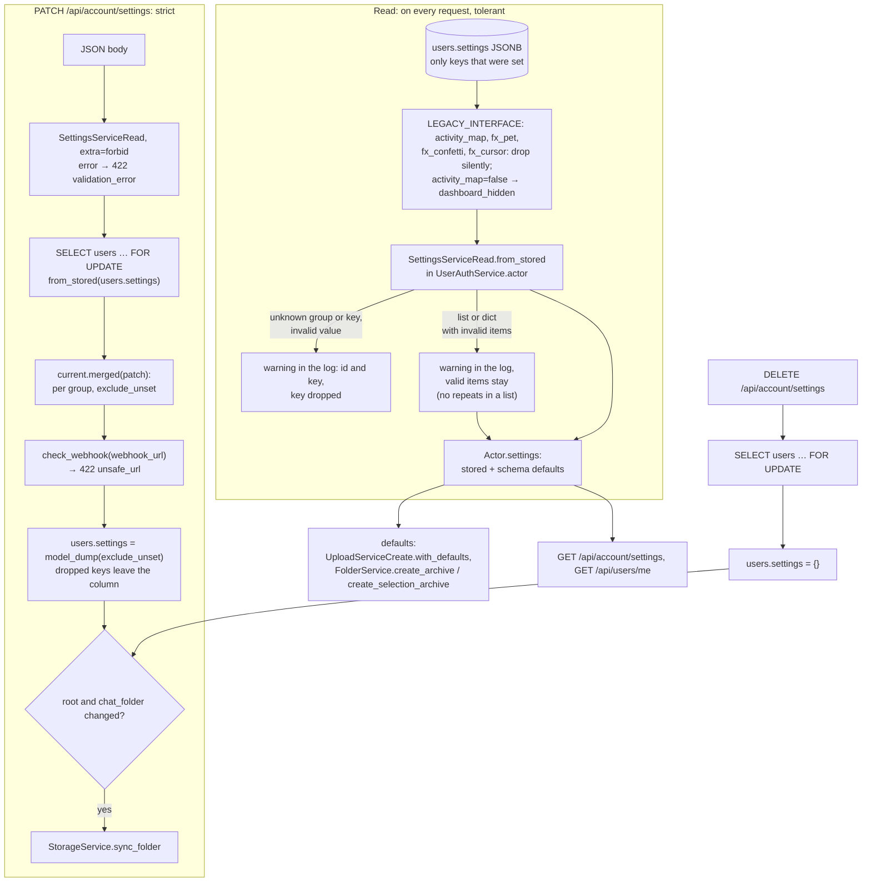

# User settings

The owner's decision: defaults are stored on the server per user, changed by the user themselves and apply
on any device and for uploads through an API key. The server applies the `uploads` and `archives` groups itself, `interface`
is only stored and validated for the frontend, `telegram` applies only for root (the Telegram account is shared).

## Storage

The `users.settings` column (JSONB, `NOT NULL DEFAULT '{}'`, migration `0008`, database.md). A separate 1:1 table is not needed:
settings are read together with the user, and the user is read from the DB on every request anyway (`get_actor`), so
`Actor.settings` comes without an extra query, and a batch of 100 uploads does not make 100 queries. There are no new filters or
sorts, so no indexes either.

The column holds only the keys the user set themselves (`model_dump(exclude_unset=True)`); the rest comes from the
defaults of the `SettingsServiceRead` schema (`src/application/schemas/settings.py`). If a default
changes in code, it reaches everyone who never touched that key. Removing or renaming a key (or a
`Literal` value, for example a theme) needs no migration: stored settings are read tolerantly
(`SettingsServiceRead.from_stored` in `UserAuthService.actor`): unknown groups and keys are dropped, a key with
an invalid value gets the default (for lists, for example `interface.dashboard_layout`, only
invalid and repeated items are dropped, the rest stay in their previous order; for dicts, for example
`interface.file_columns`, only invalid key–value pairs, the rest stay), and every dropped key gives a warning in the log (user id
and key name, no values). Sign-in and `/users/me` do not break. The cleaned settings are written to the column on the next
`PATCH` (`DELETE` writes `{}`). An incoming `PATCH` stays strict: an unknown key or value → `422 validation_error`.

Removed `interface` keys from `LEGACY_INTERFACE` (`schemas/settings.py`: `activity_map`, `fx_pet`, `fx_confetti`,
`fx_cursor`) are dropped silently on read, without a warning. The former `interface.activity_map` is migrated:
a stored `false` adds `"activity_map"` to `dashboard_hidden` (if it is not there), `true` and other values
simply disappear. A `PATCH` with such a key is `422`, like any unknown one. The server neither stores nor
returns achievements.



`PATCH` merges the body not with `Actor.settings` (read at the start of the request, possibly stale) but with the column re-read
under `SELECT … FOR UPDATE` of the user row in the same transaction (`UserRepository.get_for_update`, by primary
key, no index needed). So parallel `PATCH`es with different keys (two tabs, API clients) run one after
another and do not lose each other's changes; `DELETE` takes the same lock. The `chat_folder` comparison for
`sync_folder` also uses the re-read value.

Code: `src/application/schemas/settings.py` (`SettingsServiceRead`, `merged`, `from_stored`),
`src/application/services/settings.py` (`SettingsService`), `src/api/routes/settings.py`.

## Endpoints

Any signed-in user (`access` cookie or `X-API-Key`), only their own settings. Nobody reads other users' settings,
admin and root included. Not signed in: `401 unauthorized`.

| Request | Response |
|---|---|
| `GET /api/account/settings` | `200`, all settings, missing ones filled with defaults |
| `PATCH /api/account/settings` | partial update: only the given keys change; `200`, all settings |
| `DELETE /api/account/settings` | reset to defaults; `200`, all settings |

The same settings come as the `settings` field of `GET /api/users/me` (for free: already in the `Actor`), so the frontend needs
a single request at startup.

`PATCH`: the body has the same groups, any subsets of keys. `{}` changes nothing. `null` is allowed only for the keys that list
it in the tables below (`webhook_url`, `language`); `null` for a group or another key is an error.

```http
PATCH /api/account/settings
Content-Type: application/json

{"uploads": {"priority": "high", "webhook_url": "https://hooks.example.com/tcloud"}, "interface": {"theme": "light"}}
```

Response (`GET`, `PATCH`, `DELETE` share one shape; here all values are defaults except the ones changed above):

```json
{
  "uploads": {
    "encrypt": true,
    "send_as": "file",
    "priority": "high",
    "on_conflict": "error",
    "allow_unscannable": false,
    "webhook_url": "https://hooks.example.com/tcloud",
    "previews": true,
    "max_file_size": 0
  },
  "archives": {"format": "zip", "priority": "normal"},
  "interface": {
    "language": null,
    "theme": "light",
    "folder_view": "list",
    "sort_by": "name",
    "sort_order": "asc",
    "folders_first": true,
    "page_size": 20,
    "animations": true,
    "confirm_delete": true,
    "start_page": "dashboard",
    "tasks_filter": "all",
    "fx_sounds": false,
    "fx_easter_eggs": true,
    "dashboard_layout": [],
    "dashboard_hidden": [],
    "file_columns": {}
  },
  "telegram": {"chat_folder": true}
}
```

## Keys

### `uploads`: uploads (`POST /api/uploads`, `/uploads/from-url`, every item of `/uploads/batch`)

| Key | Values | Default | What |
|---|---|---|---|
| `encrypt` | `true`, `false` | `true` | encrypt files sent as `file` (see below about `media`) |
| `send_as` | `file`, `media` | `file` | how to send to Telegram (uploads.md, `send_as`) |
| `priority` | `low`, `normal`, `high` | `normal` | task priority in the queue |
| `on_conflict` | `error`, `replace`, `keep_both`, `skip` | `error` | what to do if the path is taken (uploads.md, `on_conflict`); `replace` still needs the delete right |
| `allow_unscannable` | `true`, `false` | `false` | accept files ClamAV cannot check fully |
| `webhook_url` | an `http(s)` URL up to 2048 characters or `null` | `null` | task webhook (background-tasks.md, "Webhooks") |
| `previews` | `true`, `false` | `true` | **counts only for root, applies to everyone**: whether to make previews of encrypted photos, GIFs and videos. `false`: the `previewing` step is skipped for all uploads (no new `files.thumbnail` are written), `POST /api/files/previews/backfill` → `409 previews_disabled`, a running backfill stops before its next batch; previews already stored stay (cleanup: `DELETE /api/files/previews`). Everyone sees the effective value in `GET /api/account` → `previews_enabled`. For admin and user the key is just stored |
| `max_file_size` | an integer ≥ 0, bytes | `0` | **counts only for root, applies to everyone**: the largest uploaded file size, `0` means unlimited. Bigger gives `413 too_large` with `limit` (uploads.md, "Big files in parts"); the Telegram message limit no longer restricts the size. For admin and user the key is just stored |

### `archives`: archives (`POST /api/folders/archive`, `/folders/archive/selection`)

| Key | Values | Default |
|---|---|---|
| `format` | `zip`, `7z`, `tar.gz`, `tar.bz2`, `tar.xz` | `zip` |
| `priority` | `low`, `normal`, `high` | `normal` |

### `interface`: only for the frontend, the server only validates the values

| Key | Values | Default | What |
|---|---|---|---|
| `language` | `ru`, `en`, `null` | `null` | language; `null` means take it from the browser |
| `theme` | `dark`, `light`, `system`, `sunset`, `navy`, `lavender`, `clay` | `dark` | theme; `system` follows the OS theme (the frontend picks it); `sunset`, `navy`, `lavender`, `clay` are frontend presets |
| `folder_view` | `list`, `grid` | `list` | folder view |
| `sort_by` | `name`, `modified`, `uploaded`, `type`, `size` | `name` | sort in a folder |
| `sort_order` | `asc`, `desc` | `asc` | sort direction |
| `folders_first` | `true`, `false` | `true` | folders before files |
| `page_size` | `20`, `50`, `100`, `200` | `20` | how many items the frontend asks for per folder listing page (`limit` in `GET /api/folders`, flows/folders-and-files.md); the server does not apply it itself, without `limit` it takes `20` |
| `animations` | `true`, `false` | `true` | interface animations |
| `confirm_delete` | `true`, `false` | `true` | ask before deleting |
| `start_page` | `dashboard`, `storages`, `tasks` | `dashboard` | the page after sign-in |
| `tasks_filter` | `all`, `active_and_failed` | `all` | task list filter |
| `fx_sounds` | `true`, `false` | `false` | sounds |
| `fx_easter_eggs` | `true`, `false` | `true` | easter eggs |
| `dashboard_layout` | a list of dashboard block ids: `summary`, `previews`, `channels`, `storages`, `tasks`, `activity_map`, `system`, `users` (`DashboardBlock` in `schemas/settings.py`), no repeats, no longer than the number of blocks | `[]` | order of the dashboard blocks; `[]` means the default order. In stored settings unknown ids and repeats are dropped one by one (the rest of the order is kept), a `PATCH` with an unknown id is `422` |
| `dashboard_hidden` | a list of dashboard block ids (the same `DashboardBlock`), no repeats, no longer than the number of blocks | `[]` | hidden dashboard blocks; `[]` means all visible. Read and `PATCH` work as for `dashboard_layout` (stored values cleaned one by one, `422` for an unknown id or a repeat) |
| `file_columns` | a dict "column → width in px": columns `name`, `type`, `size`, `modified`, `uploaded` (`FileColumn` in `schemas/settings.py`), width an integer `48`…`2000` | `{}` | widths of the file list columns; a missing column uses the frontend default width. In stored settings unknown columns and invalid widths are dropped one by one, a `PATCH` with an unknown column or a width out of range is `422` |

### `telegram`: the Telegram account, counts only for root

| Key | Values | Default | What |
|---|---|---|---|
| `chat_folder` | `true`, `false` | `true` | keep all storage channels in the `TCloud` chat folder; switching off deletes the folder (the channels stay), switching on creates it again (storages.md, "TCloud folder") |

A `chat_folder` change by root syncs the folder at once; a Telegram error is logged, the setting is saved anyway.
For admin and user the key is just stored.

## Errors

| Code | HTTP | When |
|---|---|---|
| `validation_error` | `422` | unknown group or key, a value not in the list, a wrong type, `null` where not allowed, `webhook_url` longer than 2048; `details` holds the Pydantic errors with a path (`loc`) |
| `unsafe_url` | `422` | `webhook_url` is not `http(s)`, has no host or is an IP literal of a non-public address (`127.0.0.1`, `10.x`, `169.254.169.254`, `[::1]` …) |
| `unauthorized` | `401` | no cookie and no `X-API-Key` |

On an error nothing is saved.

## How settings apply to uploads and archives

An explicit request parameter always wins over a setting. When it is not given, the user's setting is taken (the schema defaults
match the old hard-coded ones, so without settings the behaviour is unchanged). The resolution is in
`UploadServiceCreate.with_defaults` (called first in `UploadService._new_task`) and at the start of
`FolderService.create_archive`/`create_selection_archive`. Settings come from the `Actor`, which is read once per
request, so a batch makes no extra queries either. A task retry (`retry`) takes the parameters from the task itself, not from
the current settings.

`encrypt` stays tri-state:

| Request | Effective `send_as` | Result |
|---|---|---|
| `encrypt` not given | `file` | the `uploads.encrypt` setting |
| `encrypt` not given | `media` (from the request or the setting) | no encryption, silently: a setting is a default, not an explicit request |
| `encrypt=true` | `media` | `422 encrypt_requires_file` |
| `encrypt=true` / `false` | `file` | as given |

`webhook_url` is applied only if the request did not pass `callback_url`. An empty `callback_url=` (or `""` in JSON)
turns the webhook off for that upload. The webhook from settings and the request `callback_url` are checked by the same function
`integrations/web.check_webhook` (the `http(s)` scheme and no non-public IP literals), and at send time like any
outgoing request (security.md, "Outgoing requests"): DNS is checked again, so a name that later starts
pointing into the internal network still does not pass.
