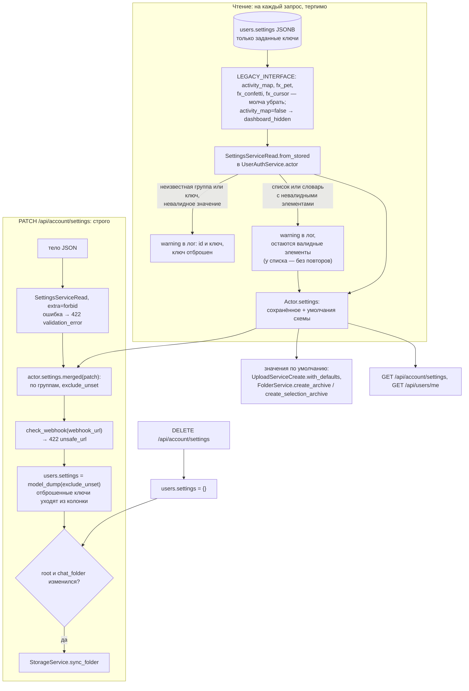

# Настройки пользователя

Решение владельца: настройки по умолчанию хранятся на сервере у каждого пользователя, меняются им самим и действуют
на любом устройстве и для загрузок через API-ключ. Группы `uploads` и `archives` сервер применяет сам, `interface`
только хранит и проверяет для фронтенда, `telegram` действует только у root (аккаунт Telegram общий).

## Хранение

Колонка `users.settings` (JSONB, `NOT NULL DEFAULT '{}'`, миграция `0008`, database.md). Отдельная таблица 1:1 не нужна:
настройки читаются вместе с пользователем, а пользователь и так читается из БД на каждый запрос (`get_actor`), поэтому
`Actor.settings` достаётся без лишнего запроса, и пачка из 100 загрузок не делает 100 запросов. Новых фильтров и
сортировок нет — нет и индексов.

В колонке лежат только ключи, которые пользователь задал сам (`model_dump(exclude_unset=True)`); остальное берётся из
значений по умолчанию схемы `SettingsServiceRead` (`src/application/schemas/settings.py`). Если значение по умолчанию
поменяется в коде, оно дойдёт до всех, кто этот ключ не трогал. Удаление или переименование ключа (или значения
`Literal`, например темы) миграции не требует: сохранённые настройки читаются терпимо
(`SettingsServiceRead.from_stored` в `UserAuthService.actor`) — неизвестные группы и ключи отбрасываются, ключ с
невалидным значением получает значение по умолчанию (у списков, например `interface.dashboard_layout`, отбрасываются
только невалидные и повторные элементы, остальные остаются в прежнем порядке; у словарей, например
`interface.file_columns`, — только невалидные пары ключ–значение, остальные остаются), на каждый отброшенный ключ — предупреждение в лог (id пользователя
и имя ключа, без значений). Вход и `/users/me` не ломаются. Очищенные настройки записываются в колонку при следующем
`PATCH` (`DELETE` пишет `{}`). Входящий `PATCH` остаётся строгим: неизвестный ключ или значение → `422 validation_error`.

Удалённые ключи `interface` из `LEGACY_INTERFACE` (`schemas/settings.py`: `activity_map`, `fx_pet`, `fx_confetti`,
`fx_cursor`) при чтении отбрасываются молча, без предупреждения. Бывший `interface.activity_map` переносится:
сохранённое `false` добавляет `"activity_map"` в `dashboard_hidden` (если его там нет), `true` и прочие значения
просто исчезают. `PATCH` с таким ключом — `422`, как с любым неизвестным. Достижений (achievements) сервер не хранит и
не отдаёт.



Код: `src/application/schemas/settings.py` (`SettingsServiceRead`, `merged`, `from_stored`),
`src/application/services/settings.py` (`SettingsService`), `src/api/routes/settings.py`.

## Эндпоинты

Любой вошедший пользователь (кука `access` или `X-API-Key`), только свои настройки. Чужие настройки не читает никто,
в том числе admin и root. Без входа — `401 unauthorized`.

| Запрос | Ответ |
|---|---|
| `GET /api/account/settings` | `200`, все настройки, недостающие заполнены значениями по умолчанию |
| `PATCH /api/account/settings` | частичное изменение: меняются только переданные ключи; `200`, все настройки |
| `DELETE /api/account/settings` | сброс к значениям по умолчанию; `200`, все настройки |

Те же настройки приходят полем `settings` в `GET /api/users/me` (бесплатно: уже есть в `Actor`), фронтенду хватает
одного запроса при старте.

`PATCH`: тело — те же группы, любые подмножества ключей. `{}` ничего не меняет. `null` допустим только у ключей, где он
есть в таблице ниже (`webhook_url`, `language`); `null` у группы или другого ключа — ошибка.

```http
PATCH /api/account/settings
Content-Type: application/json

{"uploads": {"priority": "high", "webhook_url": "https://hooks.example.com/tcloud"}, "interface": {"theme": "light"}}
```

Ответ (`GET`, `PATCH`, `DELETE` — одна форма; здесь все значения по умолчанию, кроме изменённых выше):

```json
{
  "uploads": {
    "encrypt": true,
    "send_as": "file",
    "priority": "high",
    "on_conflict": "error",
    "allow_unscannable": false,
    "webhook_url": "https://hooks.example.com/tcloud"
  },
  "archives": {"format": "zip", "priority": "normal"},
  "interface": {
    "language": null,
    "theme": "light",
    "folder_view": "list",
    "sort_by": "name",
    "sort_order": "asc",
    "folders_first": true,
    "animations": true,
    "confirm_delete": true,
    "start_page": "dashboard",
    "tasks_filter": "all",
    "fx_sounds": false,
    "fx_easter_eggs": true,
    "dashboard_layout": [],
    "dashboard_hidden": [],
    "file_columns": {}
  },
  "telegram": {"chat_folder": true}
}
```

## Ключи

### `uploads` — загрузки (`POST /api/uploads`, `/uploads/from-url`, каждый элемент `/uploads/batch`)

| Ключ | Значения | По умолчанию | Что |
|---|---|---|---|
| `encrypt` | `true`, `false` | `true` | шифровать файлы, отправляемые как `file` (см. ниже про `media`) |
| `send_as` | `file`, `media` | `file` | как отправлять в Telegram (uploads.md, `send_as`) |
| `priority` | `low`, `normal`, `high` | `normal` | приоритет задачи в очереди |
| `on_conflict` | `error`, `replace`, `keep_both`, `skip` | `error` | что делать, если путь занят (uploads.md, `on_conflict`); `replace` по-прежнему требует права на удаление |
| `allow_unscannable` | `true`, `false` | `false` | принимать файлы, которые ClamAV не может проверить полностью |
| `webhook_url` | `http(s)`-ссылка до 2048 символов или `null` | `null` | вебхук задач (background-tasks.md, «Вебхуки») |

### `archives` — архивы (`POST /api/folders/archive`, `/folders/archive/selection`)

| Ключ | Значения | По умолчанию |
|---|---|---|
| `format` | `zip`, `7z`, `tar.gz`, `tar.bz2`, `tar.xz` | `zip` |
| `priority` | `low`, `normal`, `high` | `normal` |

### `interface` — только для фронтенда, сервер лишь проверяет значения

| Ключ | Значения | По умолчанию | Что |
|---|---|---|---|
| `language` | `ru`, `en`, `null` | `null` | язык; `null` — взять из браузера |
| `theme` | `dark`, `light`, `system`, `sunset`, `navy`, `lavender`, `clay` | `dark` | тема; `system` — следовать теме ОС (выбирает фронтенд); `sunset`, `navy`, `lavender`, `clay` — готовые пресеты фронтенда |
| `folder_view` | `list`, `grid` | `list` | вид папки |
| `sort_by` | `name`, `modified`, `uploaded`, `type`, `size` | `name` | сортировка в папке |
| `sort_order` | `asc`, `desc` | `asc` | направление сортировки |
| `folders_first` | `true`, `false` | `true` | папки перед файлами |
| `animations` | `true`, `false` | `true` | анимации интерфейса |
| `confirm_delete` | `true`, `false` | `true` | спрашивать перед удалением |
| `start_page` | `dashboard`, `storages`, `tasks` | `dashboard` | страница после входа |
| `tasks_filter` | `all`, `active_and_failed` | `all` | фильтр списка задач |
| `fx_sounds` | `true`, `false` | `false` | звуки |
| `fx_easter_eggs` | `true`, `false` | `true` | пасхалки |
| `dashboard_layout` | список id блоков дашборда: `summary`, `previews`, `channels`, `storages`, `tasks`, `activity_map`, `system`, `users` (`DashboardBlock` в `schemas/settings.py`), без повторов, не длиннее числа блоков | `[]` | порядок блоков дашборда; `[]` — порядок по умолчанию. В сохранённых настройках неизвестные id и повторы выбрасываются поштучно (остальной порядок сохраняется), `PATCH` с неизвестным id — `422` |
| `dashboard_hidden` | список id блоков дашборда (тот же `DashboardBlock`), без повторов, не длиннее числа блоков | `[]` | скрытые блоки дашборда; `[]` — видны все. Чтение и `PATCH` — как у `dashboard_layout` (поштучная чистка сохранённого, `422` на неизвестный id или повтор) |
| `file_columns` | словарь «колонка → ширина в px»: колонки `name`, `type`, `size`, `modified`, `uploaded` (`FileColumn` в `schemas/settings.py`), ширина — целое `48`…`2000` | `{}` | ширины колонок списка файлов; отсутствующая колонка — ширина по умолчанию фронтенда. В сохранённых настройках неизвестные колонки и невалидные ширины выбрасываются поштучно, `PATCH` с неизвестной колонкой или шириной вне диапазона — `422` |

### `telegram` — аккаунт Telegram, учитывается только у root

| Ключ | Значения | По умолчанию | Что |
|---|---|---|---|
| `chat_folder` | `true`, `false` | `true` | держать все каналы хранилищ в папке чатов `TCloud`; выключение удаляет папку (каналы остаются), включение создаёт её заново (storages.md, «Папка TCloud») |

Смена `chat_folder` у root сразу синхронизирует папку; ошибка Telegram пишется в лог, настройка всё равно сохраняется.
У admin и user ключ просто хранится.

## Ошибки

| Код | HTTP | Когда |
|---|---|---|
| `validation_error` | `422` | неизвестная группа или ключ, значение не из списка, не тот тип, `null` где нельзя, `webhook_url` длиннее 2048; в `details` — ошибки Pydantic с путём (`loc`) |
| `unsafe_url` | `422` | `webhook_url` не `http(s)`, без хоста или IP-литерал непубличного адреса (`127.0.0.1`, `10.x`, `169.254.169.254`, `[::1]` …) |
| `unauthorized` | `401` | нет куки и `X-API-Key` |

При ошибке ничего не сохраняется.

## Как настройки применяются к загрузкам и архивам

Явный параметр запроса всегда главнее настройки. Не передан — берётся настройка пользователя (значения по умолчанию
схемы совпадают со старыми зашитыми, так что без настроек поведение прежнее). Разрешение — в
`UploadServiceCreate.with_defaults` (вызывается первым в `UploadService._new_task`) и в начале
`FolderService.create_archive`/`create_selection_archive`. Настройки берутся из `Actor`, который читается один раз на
запрос, поэтому пачка тоже не делает лишних запросов. Повтор задачи (`retry`) берёт параметры из самой задачи, а не из
текущих настроек.

`encrypt` остаётся трёхзначным:

| Запрос | Итоговый `send_as` | Итог |
|---|---|---|
| `encrypt` не передан | `file` | настройка `uploads.encrypt` |
| `encrypt` не передан | `media` (из запроса или из настройки) | без шифрования, молча: настройка — это значение по умолчанию, а не явная просьба |
| `encrypt=true` | `media` | `422 encrypt_requires_file` |
| `encrypt=true` / `false` | `file` | как передано |

`webhook_url` подставляется, только если запрос не передал `callback_url`. Пустой `callback_url=` (или `""` в JSON)
выключает вебхук для этой загрузки. Вебхук из настроек и `callback_url` запроса проверяются одной функцией
`integrations/web.check_webhook` (схема `http(s)` и запрет непубличных IP-литералов), а при отправке — как любой
исходящий запрос (security.md, «Исходящие запросы»): DNS проверяется заново, поэтому имя, которое потом станет
указывать во внутреннюю сеть, всё равно не пройдёт.
