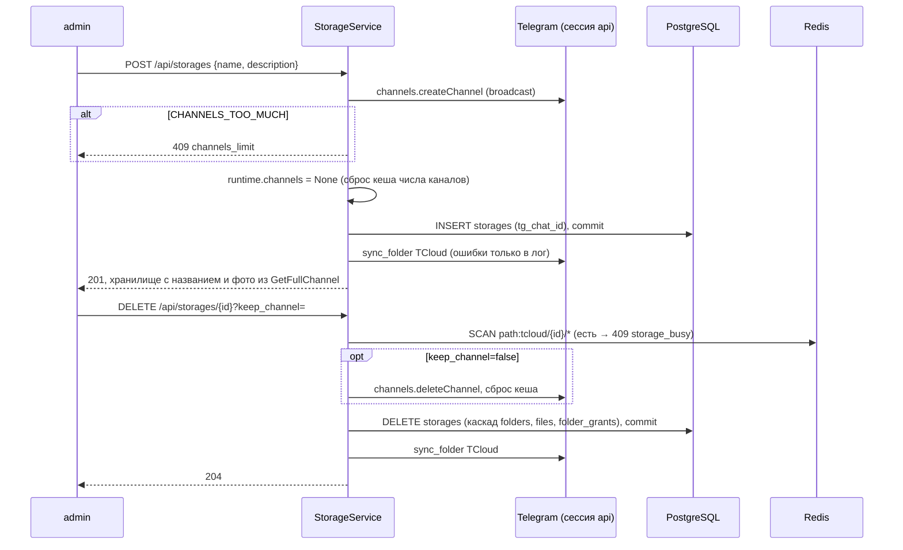
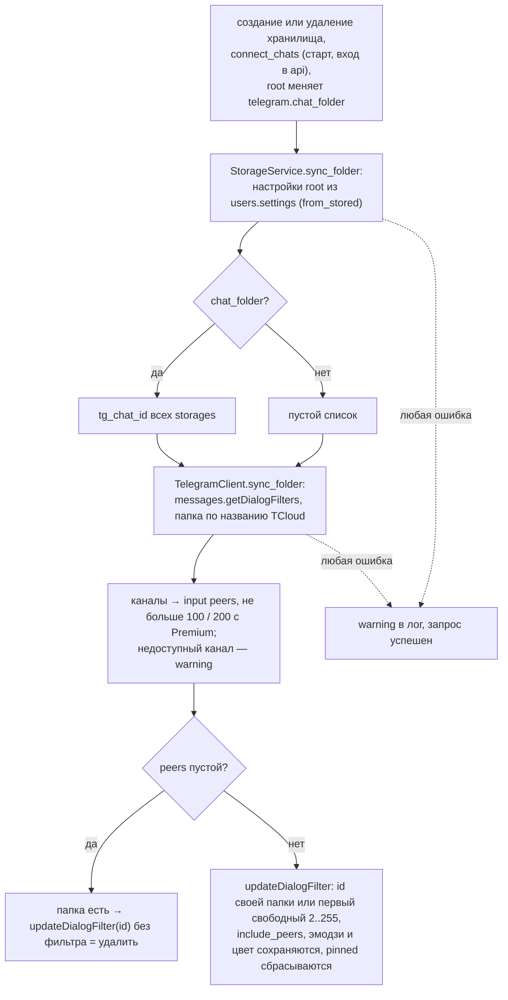
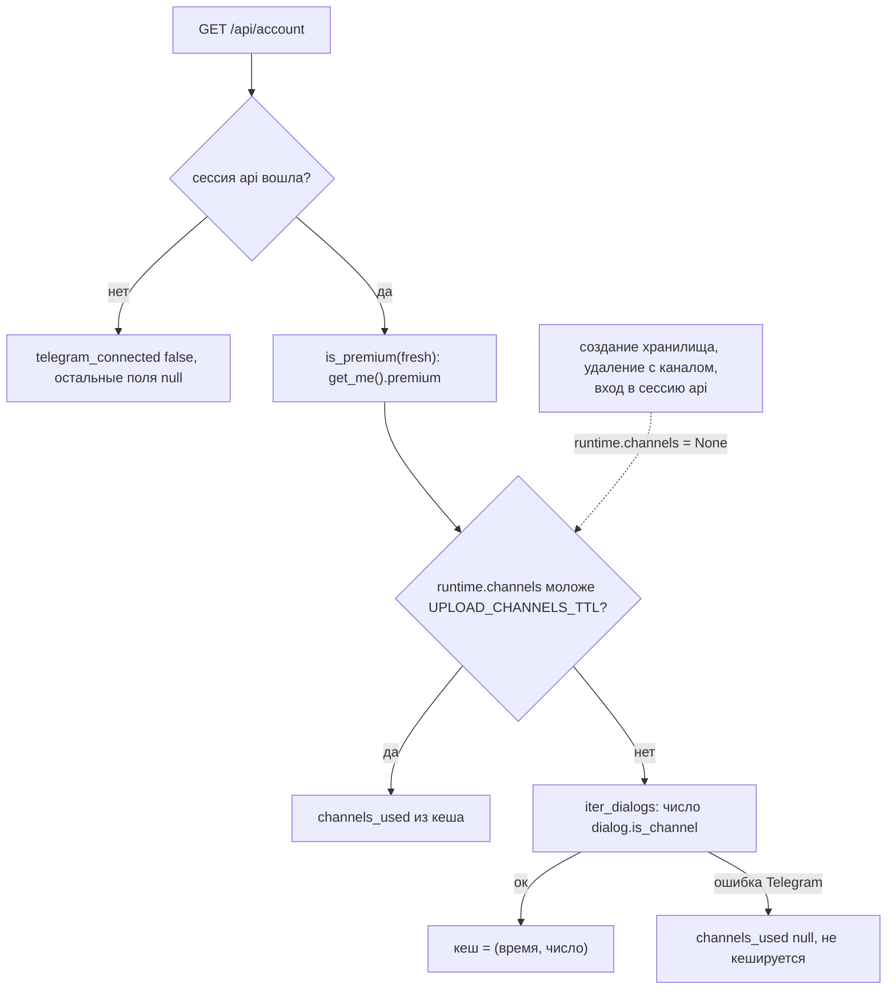

# Хранилища

Хранилище — приватный канал Telegram (broadcast, без username и инвайт-ссылок). В БД — только наш UUID и `tg_chat_id`.

| Действие | Ручка | Что происходит |
|---|---|---|
| Создать | `POST /api/storages` `{name, description?}` | `CreateChannelRequest`, запись в БД, ответ с UUID. Аккаунт уже в 500 (1000 с Premium) каналах и группах → `409 channels_limit` |
| Список | `GET /api/storages` | id из БД + название/описание/фото из Telegram (`GetFullChannel` на канал); недоступный канал → `available: false`; `files` и `total_size` (открытый размер), `preview_count` и `preview_bytes` (файлы с нашим превью в `files.thumbnail` и сумма `octet_length(thumbnail)`) — одним запросом `GROUP BY storage_id` по всем хранилищам, только читаемые пользователем файлы (как у одного хранилища) |
| Одно | `GET /api/storages/{id}` | то же для одного хранилища |
| Изменить | `PATCH /api/storages/{id}` `{name?, description?}` | `EditTitle` / `EditChatAbout`; неизменённые значения Telegram не роняют |
| Удалить | `DELETE /api/storages/{id}?keep_channel=false` | `204`. Записи файлов и папок удаляются из БД (каскад), канал — `DeleteChannelRequest` вместе со всеми сообщениями, безвозвратно. `keep_channel=true` — канал с файлами остаётся в Telegram, отвязывается только БД. Идут загрузки в хранилище — `409 storage_busy` (дождаться или отменить). Канал уже удалён руками — удаление всё равно проходит |
| Фото | `PUT` / `GET` / `DELETE /api/storages/{id}/photo` | PUT — тело-картинка ≤ 10 МБ, проверка типа и ClamAV, не JPEG/PNG → JPEG; GET — поток из Telegram, у нас не хранится |

Код — `src/application/services/storage.py`, вызовы Telegram — `src/infrastructure/integrations/telegram/client.py`.

## Папка TCloud

Все каналы хранилищ (созданные приложением и подключённые из `TELEGRAM_CHATS`) лежат в папке чатов Telegram
(dialog filter) с фиксированным названием `TCloud`. Включено по умолчанию, выключается настройкой
`telegram.chat_folder` (settings.md). Аккаунт Telegram один на всё приложение и принадлежит root, поэтому действует
только настройка root; у остальных пользователей ключ хранится, но ни на что не влияет.

`StorageService.sync_folder` → `TelegramClient.sync_folder`: `messages.getDialogFilters`, папка ищется по названию
(в БД ничего не хранится), `messages.updateDialogFilter` выставляет `include_peers` ровно в текущие каналы хранилищ
(по порядку создания, не больше лимита — 100 / 200 с Premium), эмодзи и цвет папки сохраняются, закрепления
сбрасываются. Новой папке достаётся первый свободный id в 2..255. Каналов нет или настройка выключена — папка удаляется
(каналы остаются). Настройки root читаются терпимо (`SettingsServiceRead.from_stored`), и весь sync, включая чтение
настроек, идёт после commit внутри `try`: любая ошибка — только warning, запрос успешен.

Когда синхронизируется: после создания и удаления хранилища, после подключения из `TELEGRAM_CHATS` (при каждом старте
и входе в API-сессию), когда root меняет `telegram.chat_folder` (`PATCH` или `DELETE /api/account/settings`).
Любая ошибка (лимит папок, флуд, нет сессии) — только warning в лог: запрос всё равно успешен. Папку, изменённую руками
в Telegram, следующая синхронизация перезапишет.

## Сколько каналов ещё можно создать

`GET /api/account` → `{telegram_connected, premium, file_limit, channels_used, channels_limit}`. `channels_used` — сколько каналов и
супергрупп, в которых состоит аккаунт API-сессии: все диалоги из всех папок, включая архив (`iter_dialogs` без `folder`),
у которых сущность — `Channel` (вещательные каналы, супергруппы и гигагруппы, свои и чужие, хранилища tcloud и любые
другие). Не считаются обычные группы (`Chat`), личные чаты, боты, каналы, из которых аккаунт вышел или забанен
(`ChannelForbidden`, их нет среди диалогов). Ровно это Telegram ограничивает `channels_limit_default` /
`channels_limit_premium` и отвечает `CHANNELS_TOO_MUCH` при создании хранилища, поэтому число совпадает с тем, что
видно в приложении Telegram (каналы + супергруппы во всех папках и архиве). `channels_limit` — 500 или 1000 с Premium.
Подсчёт — один проход по диалогам, он медленный, поэтому результат кешируется в памяти API на `UPLOAD_CHANNELS_TTL`
(300 с); создание и удаление хранилища (с каналом) и новый вход в API-сессию сбрасывают кеш, так что изменения tcloud
видны сразу, а вступление в каналы или выход из них в самом Telegram — не позже чем через 300 с. Telegram не ответил (флуд, сеть, сессия отозвана) → `channels_used: null`, остальные поля как обычно, ошибка
не кешируется. Пока root не вошёл в API-сессию, ручка отвечает `200` с `telegram_connected: false` и `null`
во всех полях Telegram (`premium`, `file_limit`, `channels_used`, `channels_limit`); после входа
`telegram_connected: true` и `premium` читается из Telegram.

## Активность чтения и записи (индикаторы)

`GET /api/storages/activity` → `[{storage_id, read, write}]` — по одной записи на каждое хранилище, которое видит
пользователь (как `GET /api/storages`), `true` — с хранилищем работали в последние 5 с (`ACTIVITY_TTL` в
`cache/tasks.py`), независимо от того, кто и с какого устройства. Рассчитано на опрос раз в 2–3 с: один `SELECT`
хранилищ и один `MGET` в Redis, в Telegram не ходит.

| Флаг | Что его ставит |
|---|---|
| `read` | `GET /api/files/{id}/download` — пока идёт поток (метка в начале и не чаще раза в секунду, пока идут куски); сборка архива (`archives.build`) — раз в секунду, пока воркер работает над задачей |
| `write` | отправка в Telegram (`uploads.telegram`) — раз в секунду, пока воркер работает над задачей, включая ожидание FloodWait и замену старого сообщения; `DELETE /api/files/{id}`; `DELETE /api/folders` |

Превью (`/thumb`), листинги и метаданные чтением не считаются. Метка — ключ `tcloud:activity:{storage_id}:{read|write}`
с `EX 5`, ставится `SET`; без записей ключ сам пропадает.

## Подключение из `.env`

`TELEGRAM_CHATS=-1001234567890,-1009876543210` — только id существующих каналов. При старте каждый id, которого ещё нет
в БД, проверяется (канал, без username, мы владелец или админ с правами публиковать, удалять и менять информацию)
и подключается. Не прошёл проверку — ошибка в лог, остальные подключаются. Повторный старт ничего не дублирует. Удалённое через API хранилище, чей id остался в `TELEGRAM_CHATS`, при следующем
старте подключится снова (если канал оставлен `keep_channel=true`) — уберите id из `.env`.
