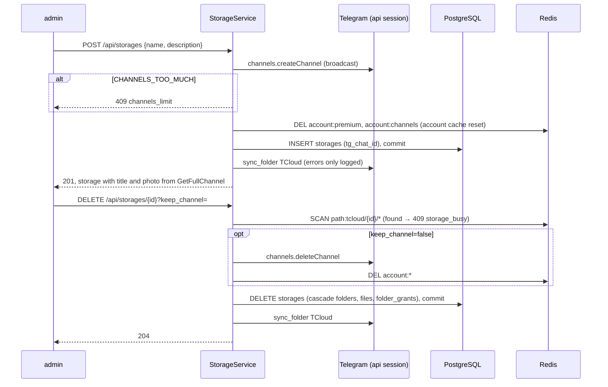
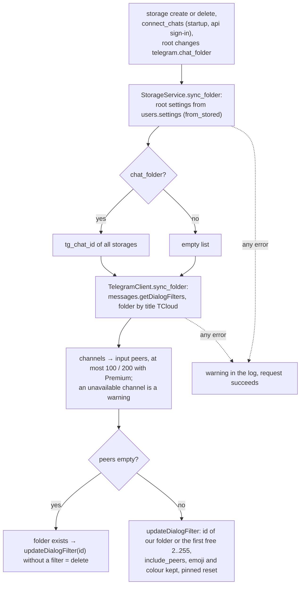
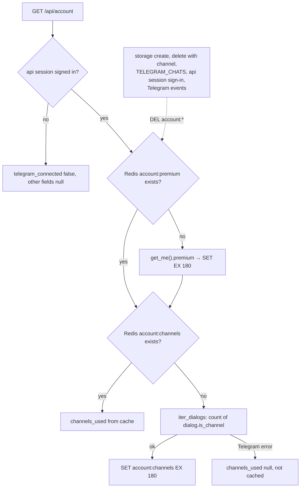
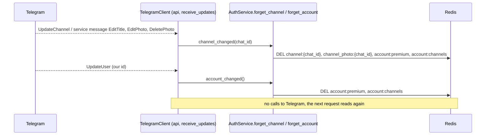
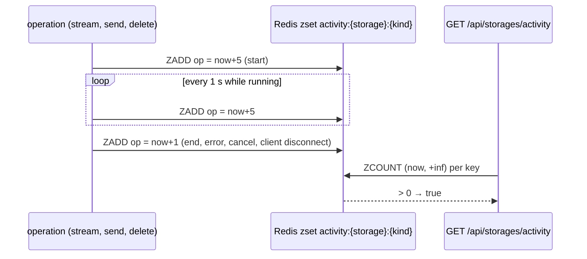

# Storages

A storage is a private Telegram channel (broadcast, no username and no invite links). The DB holds only our UUID and `tg_chat_id`.

| Action | Endpoint | What happens |
|---|---|---|
| Create | `POST /api/storages` `{name, description?}` | `CreateChannelRequest`, a DB row, a response with the UUID. The account is already in 500 (1000 with Premium) channels and groups → `409 channels_limit`; at most `RATE_LIMIT_STORAGE_CREATE_USER` (5 per hour) per user → `429 rate_limited` |
| List | `GET /api/storages` | ids from the DB + title/description/photo from Telegram (`GetFullChannel` per channel, cached in Redis for 10 min, see below); an unavailable channel → `available: false`; `files` and `total_size` (plaintext size), `preview_count` and `preview_bytes` (files with our preview in `files.thumbnail` and the sum of `octet_length(thumbnail)`) in one `GROUP BY storage_id` query over all storages, only files the user can read (as for a single storage) |
| One | `GET /api/storages/{id}` | the same for one storage |
| Update | `PATCH /api/storages/{id}` `{name?, description?}` | `EditTitle` / `EditChatAbout`; unchanged values do not make Telegram fail |
| Delete | `DELETE /api/storages/{id}?keep_channel=false` | `204`. File and folder rows are deleted from the DB (cascade), the channel by `DeleteChannelRequest` together with all its messages, irreversibly. `keep_channel=true`: the channel with its files stays in Telegram, only the DB is detached. Uploads to the storage are running → `409 storage_busy` (wait or cancel them). The channel was already deleted by hand: the delete still goes through |
| Photo | `PUT` / `GET` / `DELETE /api/storages/{id}/photo` | PUT: an image body ≤ 10 MB, type check and ClamAV, non-JPEG/PNG → JPEG; GET: bytes from Telegram, cached in Redis `channel_photo:{chat_id}` for `REDIS_CACHE_TTL` (180 s, base64; "no photo" is cached too), `ETag` is a hash of the bytes, `Cache-Control: private, no-cache`, `If-None-Match` → `304`; `PUT`/`DELETE`/`PATCH` and storage deletion delete the key |

Code: `src/application/services/storage.py`, Telegram calls: `src/infrastructure/integrations/telegram/client.py`.

## TCloud folder

All storage channels (created by the app and connected from `TELEGRAM_CHATS`) live in a Telegram chat folder
(dialog filter) with the fixed title `TCloud`. On by default, switched off with the
`telegram.chat_folder` setting (settings.md). There is one Telegram account for the whole app and it belongs to root, so only
root's setting applies; for other users the key is stored but has no effect.

`StorageService.sync_folder` → `TelegramClient.sync_folder`: `messages.getDialogFilters`, the folder is found by title
(nothing is stored in the DB), `messages.updateDialogFilter` sets `include_peers` to exactly the current storage channels
(in creation order, up to the limit of 100 / 200 with Premium), the folder emoji and colour are kept, pins
are reset. A new folder gets the first free id in 2..255. No channels or the setting is off: the folder is deleted
(the channels stay). Root's settings are read tolerantly (`SettingsServiceRead.from_stored`), and the whole sync, including reading
the settings, runs after the commit inside a `try`: any error is only a warning, the request succeeds.

When it syncs: after a storage is created or deleted, after connecting from `TELEGRAM_CHATS` (on every startup
and API session sign-in), when root changes `telegram.chat_folder` (`PATCH` or `DELETE /api/account/settings`).
Any error (folder limit, flood, no session) is only a warning in the log: the request succeeds anyway. A folder changed by hand
in Telegram is overwritten by the next sync.

## How many channels can still be created

`GET /api/account` → `{telegram_connected, premium, file_limit, channels_used, channels_limit, previews_enabled}`.
`file_limit` is the size of one Telegram message (2000/4000 MiB), that is the size of a **part** of a big file; the file size
is no longer limited by it (flows/uploads.md, "Big files in parts").
`previews_enabled` is root's `uploads.previews` setting (flows/settings.md), always present, independent of Telegram; the frontend
hides the dashboard "Previews" block by it. `channels_used` is how many channels and
supergroups the API session account is in: all dialogs from all folders, including the archive (`iter_dialogs` without `folder`),
whose entity is a `Channel` (broadcast channels, supergroups and gigagroups, own and foreign, tcloud storages and any
others). Not counted: basic groups (`Chat`), private chats, bots, channels the account left or was banned from
(`ChannelForbidden`, they are not among the dialogs). Exactly this is what Telegram limits with `channels_limit_default` /
`channels_limit_premium` and answers `CHANNELS_TOO_MUCH` to when a storage is created, so the number matches what
the Telegram app shows (channels + supergroups in all folders and the archive). `channels_limit` is 500, or 1000 with Premium.
Counting is one pass over the dialogs and it is slow, so `channels_used` and `premium` are cached in Redis
(`tcloud:account:channels`, `tcloud:account:premium`, TTL `REDIS_CACHE_TTL`, 180 s; the same `premium` gives the part size of
a big file in `worker-telegram`). Creating and deleting a storage (with its channel), connecting a channel from `TELEGRAM_CHATS` and a new sign-in to the
API session delete both keys, so tcloud's own changes show at once; changes in Telegram itself (joining channels,
leaving, Premium) reset the cache through Telegram events (section "Telegram events"), and the TTL is a safety net if an event
was lost. Telegram did not answer (flood, network, session revoked) → `channels_used: null`, the other fields as usual, the error
is not cached. Until root signs in to the API session, the endpoint answers `200` with `telegram_connected: false` and `null`
in all Telegram fields (`premium`, `file_limit`, `channels_used`, `channels_limit`); after sign-in
`telegram_connected: true` and `premium` is read from Telegram.

## Channel info cache

The title, description and "has a photo" of each channel (`StorageService.channel_infos`) come from Redis
`tcloud:channel:{chat_id}` (JSON, TTL `REDIS_CACHE_TTL`, 180 s); only channels without an entry go to Telegram
(`GetFullChannel`, which used to take up to 10 s), one `GetFullChannel` per channel (title and photo come from its `chats`, there is no separate
`GetChannels`), up to 5 channels in parallel (`CHANNELS_PARALLEL`), and the answer goes into the cache at once. So `GET /api/storages`, `GET /api/storages/{id}` and search (storage
names in the results) do not wait for Telegram on every request. Our own changes show at once: `PATCH`, `PUT`/`DELETE …/photo`
and storage deletion delete the key (together with the avatar `channel_photo:{chat_id}`). A rename by hand in Telegram or a channel deleted there shows within
3 min. Telegram unavailable (network, flood, session): a warning in the log, cached channels are returned as they are, the rest as
`available: false` (the whole list used to answer `503`).

## Telegram events

The caches above (`channel:*`, `channel_photo:*`, `account:*`) live 180 s, but changes made in Telegram itself show
almost at once: the API session client (the only one with `receive_updates=True`) registers a raw handler (`events.Raw`)
through `TelegramClient.watch` together with `MessageDeleted` in `AuthService.connect`, and only then calls `catch_up()`.
The handler never goes to Telegram (no `GetFullChannel`), it only deletes Redis keys; fresh data is read on
the next request.

| Telegram update | When it arrives | What is deleted |
|---|---|---|
| `UpdateChannel` | the channel's info or our membership changed: rename, photo, channel deleted, we left or were kicked; joining any channel | `channel:{chat_id}`, `channel_photo:{chat_id}`, `account:*` (`channels_used`) |
| `UpdateNewChannelMessage` with a service `MessageActionChatEditTitle` / `EditPhoto` / `DeletePhoto` | a new channel title or photo | the same |
| `UpdateUser` with our account id (`me.id`, remembered in `start`) | the account info changed, Premium included | `account:*` |

The handlers live on the Telethon client object, so they survive reconnects (`ensure_connected` calls the same
`connect()`, which restarts the update loop; Telethon catches up on what was missed with `getDifference` from the state in
the session file). A new sign-in to the API session creates a new client, and `connect()` registers the handlers on it. A Redis
error in a handler is only logged. Events lost entirely (a long downtime, a failure) are covered by the 180 s TTL.

A channel description changed in Telegram itself sends no update (neither `UpdateChannel` nor a service
message; verified live): the new description shows only after `channel:{chat_id}` expires, within
180 s. A description change through tcloud (`PATCH`) shows at once.

## Read and write activity (indicators)

`GET /api/storages/activity` → `[{storage_id, read, write}]`, one entry for every storage the
user sees (like `GET /api/storages`), `true` means a read or write operation is running on the storage **right now**, or it
finished less than 1 s ago (`ACTIVITY_TAIL`, so short operations get to blink), no matter who runs it and
from which device. Designed for polling every 1–3 s: one `SELECT` of storages and one `ZCOUNT` pipeline in Redis, no
calls to Telegram.

| Flag | What sets it |
|---|---|
| `read` | `GET /api/files/{id}/download` while the stream runs, until the last byte or a client disconnect (`services/file.tracked`); an archive build (`archives.build`) and preview backfill while the worker reads |
| `write` | sending to Telegram (`uploads.telegram`) while the worker works on the task, including the FloodWait wait and replacing the old message; `DELETE /api/files/{id}` and `DELETE /api/folders` while the deletion in Telegram runs |

Previews (`/thumb`), listings and metadata do not count as reads. Every operation is `TaskStore.active(storage, kind)`
(an async context): the operation's `uuid` member in the zset `tcloud:activity:{storage_id}:{read|write}` with an "alive until" score
(unix time). At the start and every second while the operation runs, score = now + 5 s (`ACTIVITY_TTL`); on leaving the
context (success, error, task cancel and client disconnect: Starlette cancels the response, the body generator closes
and leaves the context; the exit write is under `asyncio.shield`) score = now + 1 s (`ACTIVITY_TAIL`). The flag is whether
there is a member with score > now (`ZCOUNT`), so several parallel operations count independently and the end of one does not
turn off another. If a process dies mid-operation, its member simply goes stale within ≤ 5 s. Expired members are cleaned
on every write, the whole key lives 5 s from the last write.

## Connecting from `.env`

`TELEGRAM_CHATS=-1001234567890,-1009876543210`: only ids of existing channels. At startup every id not yet
in the DB is checked (a channel, no username, we are the owner or an admin with rights to post, delete and change info)
and connected. One that fails the check is an error in the log, the rest are connected. A repeated start duplicates nothing. A storage deleted through the API whose id is still in `TELEGRAM_CHATS` is connected again on the next
start (if the channel was kept with `keep_channel=true`): remove the id from `.env`.
