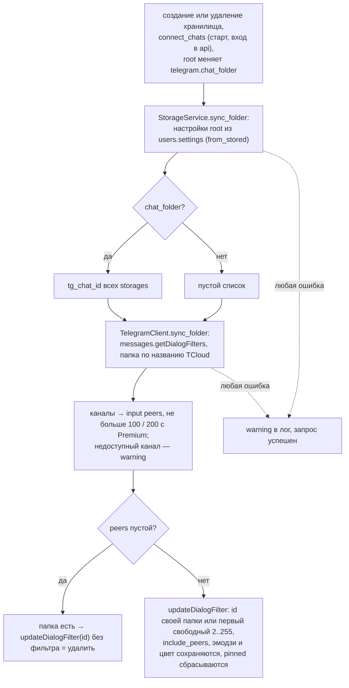
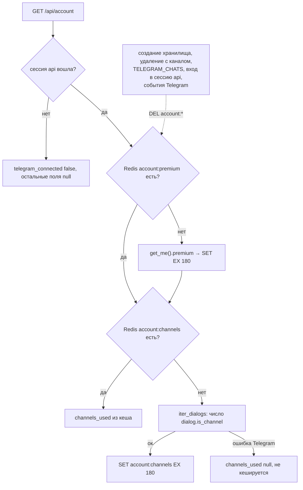
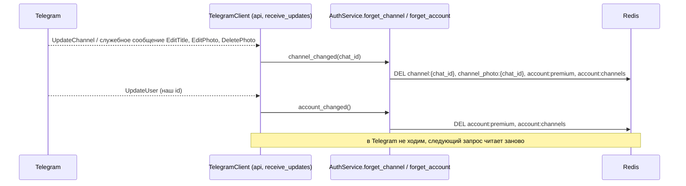
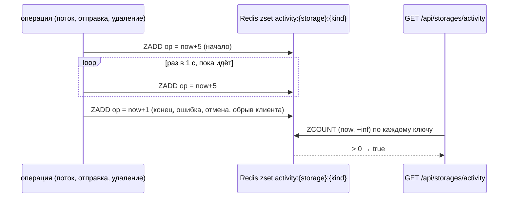

# Хранилища

Хранилище — приватный канал Telegram (broadcast, без username и инвайт-ссылок). В БД — только наш UUID и `tg_chat_id`.

| Действие | Ручка | Что происходит |
|---|---|---|
| Создать | `POST /api/storages` `{name, description?}` | `CreateChannelRequest`, запись в БД, ответ с UUID. Аккаунт уже в 500 (1000 с Premium) каналах и группах → `409 channels_limit` |
| Список | `GET /api/storages` | id из БД + название/описание/фото из Telegram (`GetFullChannel` на канал, кеш в Redis 10 мин, см. ниже); недоступный канал → `available: false`; `files` и `total_size` (открытый размер), `preview_count` и `preview_bytes` (файлы с нашим превью в `files.thumbnail` и сумма `octet_length(thumbnail)`) — одним запросом `GROUP BY storage_id` по всем хранилищам, только читаемые пользователем файлы (как у одного хранилища) |
| Одно | `GET /api/storages/{id}` | то же для одного хранилища |
| Изменить | `PATCH /api/storages/{id}` `{name?, description?}` | `EditTitle` / `EditChatAbout`; неизменённые значения Telegram не роняют |
| Удалить | `DELETE /api/storages/{id}?keep_channel=false` | `204`. Записи файлов и папок удаляются из БД (каскад), канал — `DeleteChannelRequest` вместе со всеми сообщениями, безвозвратно. `keep_channel=true` — канал с файлами остаётся в Telegram, отвязывается только БД. Идут загрузки в хранилище — `409 storage_busy` (дождаться или отменить). Канал уже удалён руками — удаление всё равно проходит |
| Фото | `PUT` / `GET` / `DELETE /api/storages/{id}/photo` | PUT — тело-картинка ≤ 10 МБ, проверка типа и ClamAV, не JPEG/PNG → JPEG; GET — байты из Telegram, кешируются в Redis `channel_photo:{chat_id}` на `REDIS_CACHE_TTL` (180 с, base64; «нет фото» тоже кешируется), `ETag` — хеш байтов, `Cache-Control: private, no-cache`, `If-None-Match` → `304`; `PUT`/`DELETE`/`PATCH` и удаление хранилища удаляют ключ |

Код — `src/application/services/storage.py`, вызовы Telegram — `src/infrastructure/integrations/telegram/client.py`.

## Папка TCloud

Все каналы хранилищ (созданные приложением и подключённые из `TELEGRAM_CHATS`) лежат в папке чатов Telegram
(dialog filter) с фиксированным названием `TCloud`. Включено по умолчанию, выключается настройкой
`telegram.chat_folder` (settings.md). Аккаунт Telegram один на всё приложение и принадлежит root, поэтому действует
только настройка root; у остальных пользователей ключ хранится, но ни на что не влияет.

`StorageService.sync_folder` → `TelegramClient.sync_folder`: `messages.getDialogFilters`, папка ищется по названию
(в БД ничего не хранится), `messages.updateDialogFilter` выставляет `include_peers` ровно в текущие каналы хранилищ
(по порядку создания, не больше лимита — 100 / 200 с Premium), эмодзи и цвет папки сохраняются, закрепления
сбрасываются. Новой папке достаётся первый свободный id в 2..255. Каналов нет или настройка выключена — папка удаляется
(каналы остаются). Настройки root читаются терпимо (`SettingsServiceRead.from_stored`), и весь sync, включая чтение
настроек, идёт после commit внутри `try`: любая ошибка — только warning, запрос успешен.

Когда синхронизируется: после создания и удаления хранилища, после подключения из `TELEGRAM_CHATS` (при каждом старте
и входе в API-сессию), когда root меняет `telegram.chat_folder` (`PATCH` или `DELETE /api/account/settings`).
Любая ошибка (лимит папок, флуд, нет сессии) — только warning в лог: запрос всё равно успешен. Папку, изменённую руками
в Telegram, следующая синхронизация перезапишет.

## Сколько каналов ещё можно создать

`GET /api/account` → `{telegram_connected, premium, file_limit, channels_used, channels_limit, previews_enabled}`.
`file_limit` — размер одного сообщения Telegram (2000/4000 МиБ), то есть размер **части** большого файла; размер файла
им больше не ограничен (flows/uploads.md, «Большие файлы частями»).
`previews_enabled` — настройка root `uploads.previews` (flows/settings.md), всегда есть, не зависит от Telegram; фронтенд
прячет по ней блок «Превью» дашборда. `channels_used` — сколько каналов и
супергрупп, в которых состоит аккаунт API-сессии: все диалоги из всех папок, включая архив (`iter_dialogs` без `folder`),
у которых сущность — `Channel` (вещательные каналы, супергруппы и гигагруппы, свои и чужие, хранилища tcloud и любые
другие). Не считаются обычные группы (`Chat`), личные чаты, боты, каналы, из которых аккаунт вышел или забанен
(`ChannelForbidden`, их нет среди диалогов). Ровно это Telegram ограничивает `channels_limit_default` /
`channels_limit_premium` и отвечает `CHANNELS_TOO_MUCH` при создании хранилища, поэтому число совпадает с тем, что
видно в приложении Telegram (каналы + супергруппы во всех папках и архиве). `channels_limit` — 500 или 1000 с Premium.
Подсчёт — один проход по диалогам, он медленный, поэтому `channels_used` и `premium` кешируются в Redis
(`tcloud:account:channels`, `tcloud:account:premium`, TTL `REDIS_CACHE_TTL`, 180 с; тот же `premium` даёт размер части
большого файла в `worker-telegram`). Создание и удаление хранилища (с каналом), подключение канала из `TELEGRAM_CHATS` и новый вход в
API-сессию удаляют оба ключа, так что изменения tcloud видны сразу; изменения в самом Telegram (вступление в каналы,
выход, Premium) сбрасывают кеш через события Telegram (раздел «События Telegram»), а TTL — страховка, если событие
потерялось. Telegram не ответил (флуд, сеть, сессия отозвана) → `channels_used: null`, остальные поля как обычно, ошибка
не кешируется. Пока root не вошёл в API-сессию, ручка отвечает `200` с `telegram_connected: false` и `null`
во всех полях Telegram (`premium`, `file_limit`, `channels_used`, `channels_limit`); после входа
`telegram_connected: true` и `premium` читается из Telegram.

## Кеш сведений о каналах

Название, описание и «есть фото» каждого канала (`StorageService.channel_infos`) берутся из Redis
`tcloud:channel:{chat_id}` (JSON, TTL `REDIS_CACHE_TTL`, 180 с); в Telegram (`GetFullChannel`, бывало до 10 с) идут только
каналы без записи — одним `GetFullChannel` на канал (название и фото берутся из его `chats`, отдельного
`GetChannels` нет), до 5 каналов параллельно (`CHANNELS_PARALLEL`), — и ответ сразу кладётся в кеш. Так `GET /api/storages`, `GET /api/storages/{id}` и поиск (имена
хранилищ в результатах) не ждут Telegram на каждом запросе. Свои изменения видны сразу: `PATCH`, `PUT`/`DELETE …/photo`
и удаление хранилища удаляют ключ (вместе с аватаркой `channel_photo:{chat_id}`). Переименование руками в Telegram или удаление канала там видно не позже чем через
3 мин. Telegram недоступен (сеть, флуд, сессия) — warning в лог, закешированные каналы отдаются как есть, остальные —
`available: false` (раньше весь список отвечал `503`).

## События Telegram

Кеши выше (`channel:*`, `channel_photo:*`, `account:*`) живут 180 с, но изменения, сделанные в самом Telegram, видны
почти сразу: клиент API-сессии (единственный с `receive_updates=True`) в `AuthService.connect` регистрирует через
`TelegramClient.watch` вместе с `MessageDeleted` сырой обработчик (`events.Raw`) и только потом вызывает `catch_up()`.
Обработчик в Telegram не ходит (никаких `GetFullChannel`), только удаляет ключи Redis; свежие данные читаются при
следующем запросе.

| Обновление Telegram | Когда приходит | Что удаляется |
|---|---|---|
| `UpdateChannel` | у канала поменялись сведения или наше членство: переименование, фото, канал удалён, мы вышли или нас выгнали; вступление в любой канал | `channel:{chat_id}`, `channel_photo:{chat_id}`, `account:*` (`channels_used`) |
| `UpdateNewChannelMessage` со служебным `MessageActionChatEditTitle` / `EditPhoto` / `DeletePhoto` | новое название или фото канала | то же |
| `UpdateUser` с id нашего аккаунта (`me.id`, запомнен в `start`) | изменились сведения об аккаунте, в том числе Premium | `account:*` |

Обработчики живут на объекте Telethon-клиента, поэтому переживают переподключения (`ensure_connected` вызывает тот же
`connect()`, который заново запускает цикл обновлений; пропущенное Telethon догоняет `getDifference` по состоянию из
файла сессии). Новый вход в API-сессию создаёт новый клиент, и `connect()` регистрирует обработчики на нём. Ошибка
Redis в обработчике только пишется в лог. События, потерянные совсем (долгий простой, сбой), покрывает TTL 180 с.

Описание канала, изменённое в самом Telegram, обновления не присылает (ни `UpdateChannel`, ни служебного
сообщения; проверено вживую): новое описание видно только после истечения `channel:{chat_id}`, не позже чем через
180 с. Изменение описания через tcloud (`PATCH`) видно сразу.

## Активность чтения и записи (индикаторы)

`GET /api/storages/activity` → `[{storage_id, read, write}]` — по одной записи на каждое хранилище, которое видит
пользователь (как `GET /api/storages`), `true` — с хранилищем **сейчас** идёт операция чтения или записи, или она
закончилась меньше 1 с назад (`ACTIVITY_TAIL`, чтобы короткие операции успели мигнуть), независимо от того, кто и
с какого устройства. Рассчитано на опрос раз в 1–3 с: один `SELECT` хранилищ и один конвейер `ZCOUNT` в Redis, в
Telegram не ходит.

| Флаг | Что его ставит |
|---|---|
| `read` | `GET /api/files/{id}/download` — пока идёт поток, до последнего байта или обрыва клиентом (`services/file.tracked`); сборка архива (`archives.build`) и дозаполнение превью — пока воркер читает |
| `write` | отправка в Telegram (`uploads.telegram`) — пока воркер работает над задачей, включая ожидание FloodWait и замену старого сообщения; `DELETE /api/files/{id}` и `DELETE /api/folders` — пока идёт удаление в Telegram |

Превью (`/thumb`), листинги и метаданные чтением не считаются. Каждая операция — `TaskStore.active(storage, kind)`
(асинхронный контекст): член `uuid` операции в zset `tcloud:activity:{storage_id}:{read|write}` со score «живо до»
(unix-время). В начале и раз в секунду, пока операция идёт, score = сейчас + 5 с (`ACTIVITY_TTL`); на выходе из
контекста — при успехе, ошибке, отмене задачи и обрыве клиента (Starlette отменяет отдачу, генератор тела закрывается
и выходит из контекста; запись на выходе под `asyncio.shield`) — score = сейчас + 1 с (`ACTIVITY_TAIL`). Флаг — есть
ли член со score > сейчас (`ZCOUNT`), так что несколько параллельных операций считаются независимо, а конец одной не
гасит другую. Упал процесс посреди операции — его член просто устаревает через ≤ 5 с. Просроченные члены чистятся
при каждой записи, весь ключ живёт 5 с с последней записи.

## Подключение из `.env`

`TELEGRAM_CHATS=-1001234567890,-1009876543210` — только id существующих каналов. При старте каждый id, которого ещё нет
в БД, проверяется (канал, без username, мы владелец или админ с правами публиковать, удалять и менять информацию)
и подключается. Не прошёл проверку — ошибка в лог, остальные подключаются. Повторный старт ничего не дублирует. Удалённое через API хранилище, чей id остался в `TELEGRAM_CHATS`, при следующем
старте подключится снова (если канал оставлен `keep_channel=true`) — уберите id из `.env`.
