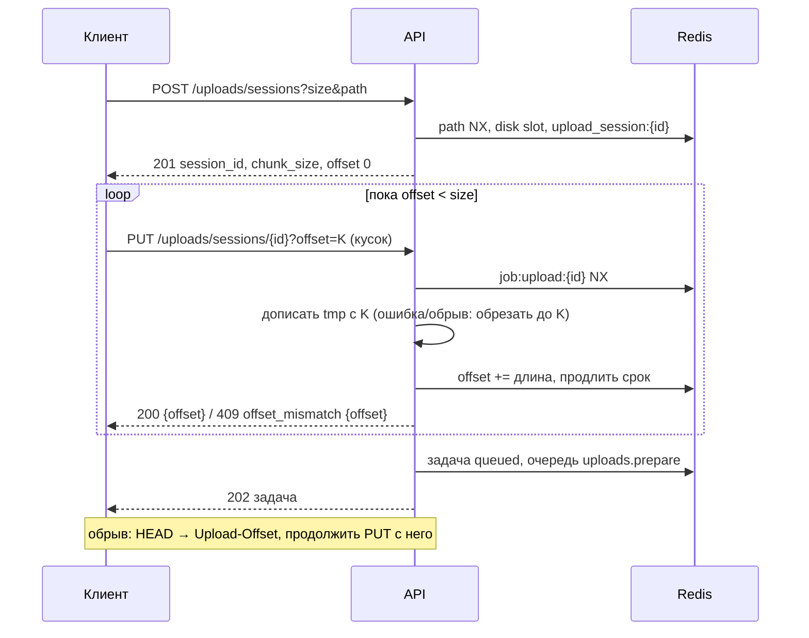

# Загрузки

## С устройства — одним запросом

`POST /api/uploads?path=...&send_as=...&on_conflict=...&priority=...&allow_unscannable=...&encrypt=...&callback_url=...`, тело — сам файл.
Размер берётся из `Content-Length` (без него `411 length_required`). Все проверки идут до чтения тела: путь, расширение,
лимит сервера `uploads.max_file_size`, место на диске, число активных задач, конфликт, занятость пути. Затем тело пишется во временный файл,
и задача встаёт в очередь. Ответ `202` с задачей `queued`. Весь путь по очередям и воркерам со схемами —
background-tasks.md («Путь загрузки целиком», «Статусы и стадии»).

Не переданные `send_as`, `on_conflict`, `priority`, `allow_unscannable`, `encrypt` и `callback_url` берутся из
настроек пользователя (`uploads.*`, flows/settings.md); значения «по умолчанию» ниже — это значения настроек по
умолчанию. Явный параметр всегда главнее. Пустой `callback_url=` выключает вебхук из настроек для одной загрузки.
Тело больше заявленного → `413`, меньше → `400 size_mismatch`; в обоих случаях задача не создаётся.
Клиент оборвал загрузку посреди тела (отмена в браузере) — Starlette поднимает `ClientDisconnect`: недописанный файл
удаляется, путь освобождается, задача не создаётся, в лог — строка `INFO` без трассировки (обработчик в
`api/exception/handlers.py`, ответ `400 client_disconnected` уже никто не читает).

## С устройства — частями (с докачкой)

Для больших файлов и нестабильной сети: файл уходит кусками, обрыв связи стоит максимум одного куска. Обычный
`POST /api/uploads` работает как прежде. Код — `UploadService.create_session` / `put_chunk` / `abort_session`.

| Запрос | Ответ |
|---|---|
| `POST /api/uploads/sessions?size=N&path=...` + те же `send_as`, `on_conflict`, `priority`, `allow_unscannable`, `encrypt`, `callback_url` (умолчания из настроек) | `201 {session_id, path, size, offset: 0, chunk_size, expires_at}`; для `on_conflict=skip` и существующего файла — `200` с готовой задачей (`status: done`, предупреждение `skipped_exists`), сессии нет |
| `PUT /api/uploads/sessions/{id}?offset=K`, тело — кусок, `Content-Length` обязателен | не последний кусок — `200` с тем же объектом сессии (новый `offset`); последний — `202` с задачей `queued` (та же форма, что у `POST /api/uploads`) |
| `GET /api/uploads/sessions/{id}` | `200` объект сессии |
| `HEAD /api/uploads/sessions/{id}` | `200`, заголовок `Upload-Offset` (открыт для CORS) |
| `DELETE /api/uploads/sessions/{id}` | `204`: принятая часть удалена, путь и слот освобождены |

- **Создание** делает все проверки `POST /api/uploads` сразу, по `size`: путь, права, вебхук, сессия Telegram,
  `uploads.max_file_size` (`413 too_large`), место на диске (×2 при шифровании), `UPLOAD_MAX_ACTIVE_TASKS`, конфликт
  (`409 conflict` с `suggested_name`; `keep_both` сразу выбирает свободное имя — оно в `path` ответа; `skip` — см.
  таблицу), занятость пути (`409 upload_in_progress`). Затем путь блокируется (`path:{path}`, как у идущей загрузки),
  берётся слот `UPLOAD_MAX_FILES_ON_DISK` (`429 too_many_tasks`) и создаётся пустой временный файл. `session_id` — это
  будущий id задачи. `size` ≥ 1.
- **Кусок**: `offset` должен равняться принятому, иначе `409 offset_mismatch` с `{offset}` — текущим смещением, с него и
  продолжать. Кусок не больше `chunk_size` (`UPLOAD_CHUNK_SIZE`, 64 МиБ) и не больше остатка файла, иначе
  `413 chunk_too_large` с `{limit}` — сколько можно прислать; размер куска внутри этого предела любой (рекомендуется
  ровно `chunk_size`). Тело короче `Content-Length` → `400 size_mismatch`, длиннее → `413 too_large`, без заголовка →
  `411 length_required`. При любой ошибке и при обрыве посреди куска файл обрезается до принятого смещения — битых
  данных не остаётся, кусок просто шлётся заново. Последний кусок ставит задачу в очередь тем же кодом, что и
  `POST /api/uploads` после приёма тела (`UploadService._queue_device`); сессия удаляется, дальше — обычная задача.
- **Параллельно** куски одной сессии не принимаются: на время приёма куска берётся Redis-блокировка
  `job:upload:{id}` (120 с, продлевается каждые 30 с, снимается в конце, в том числе при обрыве); второй `PUT` или
  `DELETE` в это время — `409 upload_session_busy` с `retry_after`. Смещение перечитывается уже под блокировкой.
- **Срок**: сессия живёт `UPLOAD_SESSION_TTL` (24 ч) с последнего принятого куска (`expires_at`), каждый кусок
  продлевает её, блокировку пути (`UPLOAD_LOCK_TTL`) и слот диска. Держите `UPLOAD_SESSION_TTL` ≤ `UPLOAD_LOCK_TTL`.
  Просроченная сессия сразу отвечает `404`, а `TaskSweeper.clean_tmp` удаляет её файл, ключи и освобождает путь
  (background-tasks.md, «Сбои»).
- **Доступ**: сессия видна только создателю; другим (и admin, и root) — `404 upload_session_not_found`, как и
  несуществующей или истёкшей. Права на папку проверяются при создании.
- **Лимиты**: `POST` и `PUT` считаются в `UPLOAD_USER` (300 / 60 с), остальные — общее `API_USER`. Пока сессия не
  завершена, задачи нет: она не входит в `UPLOAD_MAX_ACTIVE_TASKS` и не видна в `/api/tasks` — так же, как тело
  обычной загрузки во время приёма. Слот `UPLOAD_MAX_FILES_ON_DISK` сессия держит с создания до конца задачи или отмены.
  Место на диске проверяется при создании и резервируется (остаток файла) на время приёма каждого куска.
- **Прокси**: тело одного запроса — не больше `chunk_size`, поэтому `client_max_body_size` прокси должен быть ≥ 64 МиБ
  (deployment.md).

### Для фронтенда

- Новые ручки: `POST /api/uploads/sessions`, `PUT|GET|HEAD|DELETE /api/uploads/sessions/{session_id}`.
- Объект сессии `UploadSession`: `{session_id: uuid, path: string, size: number, offset: number, chunk_size: number,
  expires_at: string (ISO)}`. `PUT` и `POST` могут вернуть вместо него `Task` (`202` / `200`): есть поле `id` и нет
  `session_id` — загрузка закончилась, дальше опрашивать `/api/tasks/{id}`.
- Ошибки: `404 upload_session_not_found`, `409 offset_mismatch` (`offset`), `409 upload_session_busy` (`retry_after`),
  `413 chunk_too_large` (`limit`); плюс прежние `411 length_required`, `400 size_mismatch`, `413 too_large`,
  `409 conflict`, `409 upload_in_progress`, `429 too_many_tasks`, `507 insufficient_storage`.
- Заголовок `Upload-Offset` (ответ `HEAD`) открыт в `APP_EXPOSED_HEADERS`.
- Отмена до конца — `DELETE`; после `202` — обычная отмена задачи.

## По ссылке

`POST /api/uploads/from-url {url, path, send_as, on_conflict, priority, allow_unscannable, encrypt, callback_url}`: имя файла берётся из `path`,
а не из ссылки. Скачивает worker-download с теми же проверками и лимитами.

## Пачкой

`POST /api/uploads/batch {items: [...]}`: до 100 загрузок по ссылкам (поля как у `from-url`). В ответе `batch_id`
и по каждому пункту `task` или `error`. Общий прогресс: `GET /api/tasks?batch_id=`. Файлы с устройства загружаются
параллельными `POST /api/uploads` (или сессиями частями, выше), очередь и лимиты одни и те же.

## `priority`

`low`, `normal` (по умолчанию), `high`. Задачи `high` берутся из очереди раньше, см. background-tasks.md.

## Управление задачей

| Запрос | Что |
|---|---|
| `POST /api/tasks/{id}/cancel` | отмена на любом шаге: из очереди — сразу, во время работы — не позже ~1 с, итог `cancelled`, временные файлы и неподтверждённое сообщение в Telegram удаляются; `409 task_finished` для завершённых (background-tasks.md, «Отмена») |
| `POST /api/tasks/{id}/priority {"priority": "high"}` | новый приоритет задачи, которая ждёт в очереди; иначе `409 task_not_queued` |
| `POST /api/tasks/{id}/retry` | повтор упавшей или отменённой загрузки по ссылке; с устройства — `409 task_not_retryable` |

## Типы файлов

Медиа (`kind`: `photo`, `video`, `audio`, `animation`) и всё остальное (`kind = document`, MIME по содержимому; если
содержимое не узнано (`filetype` не знает текст) — по расширению из встроенной таблицы Python `mimetypes`
(`MimeTypes(filenames=())`, не зависит от `/etc/mime.types`): `.txt` → `text/plain`, `.md` → `text/markdown`, `.csv`,
`.json` …; `image/*`, `audio/*`, `video/*` по имени не присваиваются; иначе `application/octet-stream`). MIME документа —
только метаданные (поиск, фильтры): отдаются документы всегда как `application/octet-stream` + `attachment`. Миграция
`0014` один раз проставила такие типы старым документам с `application/octet-stream` по расширению. Принимаются любые типы, в том числе исполняемые; не-медиа отдаётся только на скачивание (security.md «Скачивание»).
Все проверки — в security.md.

## `allow_unscannable`

`false` по умолчанию: зашифрованные архивы и PDF, Office с макросами и файлы, на которых ClamAV упёрся в лимит, —
`unscannable`. `true` — такие файлы принимаются, в задаче предупреждение. Вирусы отклоняются в любом случае.

## `encrypt`

По умолчанию включено (решение владельца): параметр не передан и `send_as=file` (тоже по умолчанию) — файл шифруется
ключом сервера `APP_ENCRYPTION_KEY` перед отправкой в Telegram (security.md, «Шифрование файлов»). Параметр не передан и
`send_as=media` — шифрование молча выключается, Telegram должен видеть настоящее медиа. Явный `encrypt=true` с
`send_as=media` → `422 encrypt_requires_file`; явный `encrypt=false` — файл уходит открытым. Одинаково для
`POST /api/uploads`, `/uploads/from-url` и каждого элемента `/uploads/batch`. Не переданный `encrypt` берётся из
настройки `uploads.encrypt`, но с итоговым `send_as=media` (из запроса или из настройки) всё равно молча выключается. Шифрование нужно, а ключ не
задан → `503 encryption_unavailable` (в том числе для загрузки по умолчанию: передайте `encrypt=false` или задайте ключ).
Превью зашифрованных фото, GIF и видео делаем сами на стадии `scanning`, пока файл ещё открыт: Pillow (видео — кадр
ffmpeg, как для открытых видео), JPEG ≤ 320 px, качество снижается до ≤ 20 КБ, ориентация по EXIF. Превью шифруется
DEK файла и ложится в `files.thumbnail`; `/thumb` его расшифровывает. Ошибка генерации не валит загрузку: предупреждение
в лог, `thumbnail = NULL`, `/thumb` → `404`. У аудио и документов превью нет. Root выключил `uploads.previews`
(flows/settings.md) — шаг `previewing` пропускается у всех, `thumbnail = NULL`. Файлы, зашифрованные до миграции `0009`
(и с ошибкой генерации), дозаполняет фоновая задача root `POST /api/files/previews/backfill` (background-tasks.md,
«Дозаполнение превью»). Проверки типа и ClamAV идут по открытому файлу, как обычно. В Telegram уходит
документ `{uuid}.bin` без превью и атрибутов, в БД — настоящие имя, MIME, тип, размер и `sha256` открытого файла.
Шифротекст больше открытого файла (≈16 байт на 64 КиБ + 71 байт заголовка): файл, у которого он не влезает в одно
сообщение, уходит частями (ниже). На стадии `scanning` на диске одновременно лежат открытый файл и шифротекст
(поэтому проверка места в API требует ×2 размера при шифровании); открытый удаляется сразу после передачи в очередь
`uploads.telegram`.

## Большие файлы частями

Ограничения размера файла:

- **`uploads.max_file_size`** — настройка root (flows/settings.md), байты, `0` (по умолчанию) — без ограничения. Больше
  неё — `413 too_large` с `limit` в ответе (`POST /api/uploads` — до чтения тела по `Content-Length`; по ссылке — по
  `Content-Length` ответа или во время скачивания). Лимит аккаунта Telegram больше **не** ограничивает размер файла.
- **Место на диске** — `507 insufficient_storage` (`UPLOAD_MIN_FREE_DISK_MB`); при шифровании API проверяет 2× размер.
  Из свободного места вычитается ещё не принятое живыми сессиями частями: `size − offset`, у шифруемых ещё `+ size`
  под шифротекст (`TaskStore.session_bytes`: сессии с `expires_at` в будущем); это видят `POST /api/uploads`,
  создание сессии (сама себя она ещё не считает), загрузка по ссылке и архивы. После последнего куска, `DELETE` или
  истечения сессия резерв больше не держит.

Файл, который не влезает в одно сообщение (`GET /api/account` → `file_limit`: 2000 МиБ, с Premium 4000 МиБ; для
зашифрованного считается размер шифротекста), `worker-telegram` при отправке режет на части по `file_limit` и шлёт
**по очереди** документами:

| | Имя части в Telegram | Где режется |
|---|---|---|
| зашифрованный | `{uuid}.part{N}.bin` | по границам блоков шифра (security.md, «Шифрование файлов»): часть 0 — заголовок + блоки |
| открытый | `{name}.part{N}` | каждые `file_limit` байт |

- Конвейер до отправки не меняется: файл целиком на диске, ClamAV по всему файлу (упёрся в лимиты ClamAV —
  обычный `unscannable`), нужно ≈ 2× размера файла на диске при шифровании.
- Части всегда документы. `send_as=media` → отправлено файлом, `sent_as = file`, предупреждение `too_big_sent_as_file`
  (`params.parts` — число частей). Превью: у зашифрованных — наше (`files.thumbnail`, как обычно); у открытых видео
  кадр-превью уходит миниатюрой части 0, `/thumb` читает его из Telegram.
- Прогресс шага `sending` (`bytes_done/bytes_total`, `step_progress`) — по всему файлу.
- В БД одна строка `files` (`tg_message_id` — часть 0, `size`/`sha256` — всего открытого файла) и строки `file_parts`
  (database.md). Файлы, которые влезли в одно сообщение, хранятся как раньше, без строк `file_parts`.
- Скачивание (`Range`, `If-Range`, `ETag` = id сообщения части 0, `304`) и архивы читают части по `offset`, нужный
  диапазон собирается через границы частей; заголовки ответа те же. Пропала любая часть — как пропажа сообщения
  обычного файла: запись удаляется (`404`, в архиве `archive_file_gone`), остальные части удаляются из канала;
  другой размер части — `409 file_changed` / `archive_file_changed`.
- Удаление файла, папки, `replace` удаляют все части; удаление в Telegram сообщения **любой** части удаляет файл.
  Переименование и перенос Telegram не трогают.
- Повторная доставка после падения продолжает с первой неотправленной части, отмена и ошибка удаляют уже
  отправленные (background-tasks.md, «Без дублей в Telegram»).

## `send_as`

| Значение | Фото | Видео | Аудио | GIF | Документ |
|---|---|---|---|---|---|
| `file` (по умолчанию) | документ, оригинал | документ | документ | документ | документ |
| `media` | сжатое фото; не влезло в лимиты → документ с предупреждением; webp/heic/gif → JPEG | оригинал с атрибутами, превью и плеером | плеер, длительность, теги | анимация | документ с предупреждением |

## `on_conflict`

| Значение | Если путь занят файлом |
|---|---|
| `error` (по умолчанию) | `409 conflict` с `suggested_name` — свободное имя для `keep_both` |
| `replace` | новое сообщение, UUID сохраняется, `updated_at` обновляется, старое сообщение удаляется |
| `keep_both` | свободное имя с номером через дефис: `a-2.jpg`, `a-3.jpg`, без расширения `README-2`; резервируется сразу при создании задачи |
| `skip` | задача сразу `done` со ссылкой на существующий файл, тело не читается |

Если в этот путь уже идёт другая загрузка — `409 upload_in_progress` при любом режиме.

Диалог «файл уже есть» на фронтенде: загрузить с `error`; на `409 conflict` показать выбор «Заменить» (повтор с
`replace`, нужны права на удаление), «Оставить оба» (повтор с `keep_both`, имя из `suggested_name` — то, что получится,
если никто не займёт его раньше) и «Отмена» (ничего не отправлять). `skip` — то же, что «Отмена», но без вопроса.

## Прогресс

`GET /api/tasks/{id}`: `status` (`queued/running/done/failed/cancelled`), `stage`, `step`, `step_progress`, `priority`, `bytes_done`/`bytes_total`,
`progress`, `speed`, `eta`, `queue_position` (номер в очереди, 1 — следующая), `waiting` (очередь, FloodWait, повтор),
`cancel_requested`, `error`, `warnings`, `warning_details`, `file`.
Задача хранится 7 дней (`UPLOAD_TASK_TTL`). Вебхук описан в background-tasks.md.

Опрос многих задач одним запросом: `GET /api/tasks?ids={id}&ids={id}…` — до 100 id (больше → `422 validation_error`),
повторы схлопываются; ответ как у пачки — `{items, summary}`, в `items` только существующие задачи, которые вы видите
(свои; admin и root — любые), в порядке `ids`; чужие и пропавшие молча отсутствуют. Ровно один из `ids` / `batch_id`,
иначе `422`. Один `HGETALL` на id в одном pipeline Redis и один запрос в БД за файлами.

`GET /api/tasks/counts` → `{total, by_status: {"done": 12, "failed": 1, …}}` — ваши задачи (загрузки и архивы,
созданные вами, у admin тоже только свои) за `UPLOAD_TASK_TTL`; статусы без задач в `by_status` не попадают. Индекс —
sorted set `user_tasks:{user_id}` в Redis, подсчёт — один `HGET status` на задачу в pipeline.

### Шаги

`step` — что задача делает сейчас (или на чём остановилась, если завершена). `step_progress` — доля 0..1 у шагов с
«да», пока задача `running`; `bytes_done`/`bytes_total`/`progress`/`speed`/`eta` в это время тоже про текущий шаг.

| `step` | Стадия | Что | `step_progress` |
|---|---|---|---|
| `queued_for_download` | `downloading` | ждёт `worker-download` (по ссылке) | нет |
| `downloading` | `downloading` | скачивание по ссылке (и ожидание слота `disk_slots`) | да, если сервер прислал размер |
| `queued_for_prepare` | `scanning` | ждёт `worker-prepare` | нет |
| `analyzing` | `scanning` | определение типа, ffprobe/Pillow, SHA-256 | да |
| `scanning` | `scanning` | проверка ClamAV (и паузы `retry`) | да |
| `converting` | `scanning` | фото не jpeg/png → jpeg для `media`, кадр-превью видео | нет |
| `encrypting` | `scanning` | AES-256-GCM | да |
| `previewing` | `scanning` | своё превью зашифрованного фото/GIF/видео | нет |
| `queued_for_telegram` | `uploading_tg` | ждёт `worker-telegram` | нет |
| `sending` | `uploading_tg` | отправка в Telegram (и пауза `flood_wait`) | да |
| `finishing` | `uploading_tg` | запись в БД | нет |
| `queued_for_archive` | `archiving` | архив ждёт `worker-telegram` | нет |
| `archiving` | `archiving` | сборка архива | да |

Шага `receiving` нет: тело `POST /api/uploads` принимается до создания задачи (ответ приходит, когда файл уже на
сервере), прогресс приёма видит сам клиент. `null` — у задач `done` с `on_conflict=skip` и у задач, созданных до
появления поля.

### Коды ожидания и предупреждений

Тексты (`waiting.reason`, `warnings`, `error.message`) — английские и для людей; фронтенд переводит по кодам.
Коды стабильны, новые могут добавляться — неизвестный код показывайте текстом `message`.

`waiting = {reason, code, params, seconds}` (`seconds` — сколько ещё ждать, если известно):

| `code` | `params` | Когда |
|---|---|---|
| `queue` | `queue`: `uploads.download` / `uploads.prepare` / `uploads.telegram` / `archives.build` | ждёт воркера в очереди (`reason` = `queue:{queue}`), номер — `queue_position` |
| `disk_slots` | — | ждёт места на диске сервера (`UPLOAD_MAX_FILES_ON_DISK`) |
| `retry` | — | сеть Telegram или ClamAV недоступна, повтор через `seconds` |
| `flood_wait` | — | Telegram попросил паузу (FloodWait), вся выгрузка ждёт `seconds` |

`warnings` — список английских строк (как раньше), `warning_details` — те же предупреждения по порядку как
`{code, params, message}`:

| `code` | `params` | Текст |
|---|---|---|
| `skipped_exists` | — | `on_conflict=skip`, файл уже был, загрузка пропущена |
| `unscannable_accepted` | `reason` — сигнатура ClamAV (`Heuristics.Encrypted.Zip`, …) | антивирус не проверил файл целиком, принят из-за `allow_unscannable` |
| `not_media_sent_as_file` | — | просили `send_as=media`, но это не медиа — отправлен файлом |
| `photo_too_big_sent_as_file` | — | фото не влезает в лимиты фото Telegram (10 МБ, стороны) — отправлено файлом |
| `video_may_show_as_file` | `mime` | видео не mp4: Telegram может показать его файлом, а не плеером |
| `too_big_sent_as_file` | `parts` — число частей | просили `send_as=media`, но файл больше одного сообщения Telegram — отправлен файлом частями |
| `archive_file_gone` | `name` — путь внутри архива | файла уже нет в Telegram, в архив не попал |
| `archive_file_changed` | `name` | файл в Telegram изменился (другой размер), в архив не попал |
| `archive_file_undecryptable` | `name` | зашифрованный файл не расшифровался, в архив не попал |
| `archive_files_deleted` | `count` | столько выбранных файлов удалили до сборки архива |
| `other` | — | задачи, созданные до появления кодов: только `message` |

Коды ошибок задач (`error.code`) — те же, что у ошибок API (`docs/flows/*`, `src/api/exception/errors.py`).
