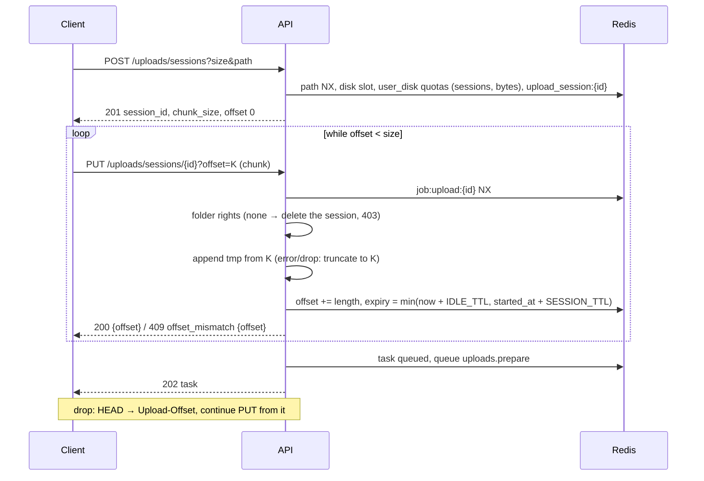

# Uploads

## From a device in one request

`POST /api/uploads?path=...&send_as=...&on_conflict=...&priority=...&allow_unscannable=...&encrypt=...&callback_url=...`, the body is the file itself.
The size comes from `Content-Length` (without it, `411 length_required`). All checks run before the body is read: path, extension,
the server limit `uploads.max_file_size`, disk space, the number of active tasks, conflicts, whether the path is taken. Then the body is written to a temp file,
and the task is queued. The answer is `202` with a `queued` task. The whole path through queues and workers with diagrams is in
background-tasks.md ("The whole upload path", "Statuses and stages").

`send_as`, `on_conflict`, `priority`, `allow_unscannable`, `encrypt` and `callback_url` not given come from the
user's settings (`uploads.*`, flows/settings.md); the "default" values below are the defaults of those
settings. An explicit parameter always wins. An empty `callback_url=` turns off the settings webhook for one upload.
A body bigger than declared → `413`, smaller → `400 size_mismatch`; in both cases no task is created.
If the client drops the upload in the middle of the body (a cancel in the browser), Starlette raises `ClientDisconnect`: the partial file
is deleted, the path is released, no task is created, the log gets an `INFO` line without a traceback (the handler is in
`api/exception/handlers.py`, nobody reads the `400 client_disconnected` answer any more).

## From a device in chunks (resumable)

For big files and unstable networks: the file goes in chunks, a dropped connection costs at most one chunk. A plain
`POST /api/uploads` works as before. Code: `UploadService.create_session` / `put_chunk` / `abort_session`.

| Request | Response |
|---|---|
| `POST /api/uploads/sessions?size=N&path=...` + the same `send_as`, `on_conflict`, `priority`, `allow_unscannable`, `encrypt`, `callback_url` (defaults from settings) | `201 {session_id, path, size, offset: 0, chunk_size, expires_at}`; for `on_conflict=skip` and an existing file, `200` with a finished task (`status: done`, warning `skipped_exists`), no session |
| `PUT /api/uploads/sessions/{id}?offset=K`, the body is a chunk, `Content-Length` is required | not the last chunk: `200` with the same session object (a new `offset`); the last one: `202` with a `queued` task (the same shape as `POST /api/uploads`) |
| `GET /api/uploads/sessions/{id}` | `200` session object |
| `HEAD /api/uploads/sessions/{id}` | `200`, header `Upload-Offset` (exposed for CORS) |
| `DELETE /api/uploads/sessions/{id}` | `204`: the received part is deleted, the path and the slot are released (the owner or someone who manages them) |
| `GET /api/uploads/sessions?user_id=` | `200 [UploadSession]`: open sessions, one's own or (admin/root) of a user one manages |

- **Creation** runs all `POST /api/uploads` checks at once, by `size`: path, rights, webhook, Telegram session,
  `uploads.max_file_size` (`413 too_large`), disk space (×2 with encryption), `UPLOAD_MAX_ACTIVE_TASKS`, conflict
  (`409 conflict` with `suggested_name`; `keep_both` picks a free name right away, it is in the response `path`; `skip`, see
  the table), whether the path is taken (`409 upload_in_progress`). Then the path is locked (`path:{path}`, as for a running upload),
  an `UPLOAD_MAX_FILES_ON_DISK` slot is taken (`429 too_many_tasks`) and an empty temp file is created. `session_id` is
  the future task id. `size` ≥ 1.
- **Rights on every chunk**: every `PUT` checks again the right to upload into the folder (and to delete with `replace`) against the
  current grants: if the grant was revoked, `403 forbidden`, and the session is deleted at once (file, path, slot, quota are released).
- **Chunk**: `offset` must equal what was received, otherwise `409 offset_mismatch` with `{offset}`, the current offset to
  continue from. A chunk is at most `chunk_size` (`UPLOAD_CHUNK_SIZE`, 64 MiB) and at most the remainder of the file, otherwise
  `413 chunk_too_large` with `{limit}`, how much may be sent; within that bound any chunk size works (exactly
  `chunk_size` is recommended). A body shorter than `Content-Length` → `400 size_mismatch`, longer → `413 too_large`, without the header →
  `411 length_required`. On any error and on a drop in the middle of a chunk the file is truncated back to the received offset: no
  broken data stays, the chunk is simply sent again. The last chunk queues the task with the same code as
  `POST /api/uploads` after receiving the body (`UploadService._queue_device`); the session is deleted, from then on it is an ordinary task.
- **In parallel**, chunks of one session are not accepted: while a chunk is received, a Redis lock
  `job:upload:{id}` is taken (120 s, renewed every 30 s, released at the end, a drop included); a second `PUT` or
  `DELETE` at that time gets `409 upload_session_busy` with `retry_after`. The offset is re-read under the lock.
- **Lifetime**: a session without new chunks lives `UPLOAD_SESSION_IDLE_TTL` (1 h) from the last received chunk (or from creation),
  but no longer than `UPLOAD_SESSION_TTL` (24 h) from creation (`started_at`): `expires_at = min(last chunk + IDLE,
  started_at + TTL)`. Every chunk extends it, the path lock (`UPLOAD_LOCK_TTL`) and the disk slot. So an abandoned session
  holds space and the path for at most an hour. Keep `UPLOAD_SESSION_TTL` ≤ `UPLOAD_LOCK_TTL`.
  An expired session answers `404` at once, and `TaskSweeper.clean_tmp` deletes its file and keys and releases the path
  (background-tasks.md, "Failures").
- **Access**: `GET`/`HEAD`/`PUT` of a session only for its creator; others (admin and root too) get `404 upload_session_not_found`,
  like a nonexistent or expired one. `DELETE` and the list `GET /api/uploads/sessions?user_id=` are also available to whoever
  manages the owner (like `UserService.get_manageable`): root for anyone, admin for users with the `user` role; someone else's session for someone
  else is also `404`. Without `user_id` the list shows one's own open sessions. Folder rights are checked at creation.
- **Blocking and deleting a user** (`PATCH /api/users/{id}` with `blocked: true`, `DELETE /api/users/{id}`)
  cancel all their sessions: the file is deleted, the path, slot and reservation are released (`temp.cancel_user_sessions`), and all their
  unfinished tasks (`temp.cancel_user_tasks`, flows/users.md). A session
  whose chunk is being received at that moment (`job:upload:{id}` is taken) is skipped and expires after
  `UPLOAD_SESSION_IDLE_TTL`.
- **User quotas** (except root; `0` means no limit): at most `UPLOAD_USER_MAX_SESSIONS` (10) open sessions
  (`429 too_many_upload_sessions` with `limit`) and at most `UPLOAD_USER_DISK_QUOTA_MB` (51200 MiB) of temp files on the
  server (`507 temp_quota_exceeded` with `limit` and `used` in bytes). Used (`TaskStore.user_disk`) = the full size of
  live sessions (×2 with encryption) + for each of the user's tasks the larger of its `disk:usage` entry (the task's full
  size in `tmp`: body ×2 with encryption, an archive) and its remainder in `disk:reserved`. The `disk:usage` entry appears under
  `job:disk` together with the check, before the body is received, so parallel `POST /api/uploads` see each other, and
  is kept until `release` (done, error, cancel, lost), so files already on disk while queued for Telegram
  count too. The last chunk of a session moves its size into the task's `disk:usage`; a URL without `size` counts, while downloading,
  as the bytes already written (or `Content-Length` if that is larger; ×2 with encryption): the worker updates
  its `disk:usage` once per second (`UploadPipeline._download`, `USAGE_INTERVAL`), and after the download with the full size. Archives (`POST /api/folders/archive*`)
  are checked the same way (an estimate of `sum + the largest file`), a ready archive counts with its size
  (`archive:{id}`) until `UPLOAD_ARCHIVE_TTL` expires. `disk:usage` is not part of the global disk check (that one has only
  the not yet written bytes of `disk:reserved`), there is no double counting.
  It is checked when a session is created, on `POST /api/uploads` (the body size), on a URL upload with `size` (and its
  retry) and when an archive is queued; a URL without `size` (and its retry) is rejected only if the user is already at
  or over the quota (used ≥ quota), its size becomes known as it downloads.
- **Limits**: `POST` and `PUT` count towards `UPLOAD_USER` (300 / 60 s), the rest towards the shared `API_USER`. Until the session is
  finished there is no task: it does not count towards `UPLOAD_MAX_ACTIVE_TASKS` and is not visible in `/api/tasks`, the same as the body
  of an ordinary upload while it is received. The session holds the `UPLOAD_MAX_FILES_ON_DISK` slot from creation until the task ends or is cancelled.
  Disk space is checked at creation (the reservation is the session itself in Redis) and before every chunk (the chunk length;
  the session excludes its own remainder from `session_bytes`, other sessions and the `disk:reserved` ledger are subtracted).
- **Proxy**: the body of one request is at most `chunk_size`, so the proxy `client_max_body_size` must be ≥ 64 MiB
  (deployment.md).

### For the frontend

- New endpoints: `POST /api/uploads/sessions`, `GET /api/uploads/sessions?user_id=` (list, `UploadSession[]`),
  `PUT|GET|HEAD|DELETE /api/uploads/sessions/{session_id}`.
- The session object `UploadSession`: `{session_id: uuid, user_id: uuid, path: string, size: number, offset: number,
  chunk_size: number, expires_at: string (ISO)}`. `PUT` and `POST` may return a `Task` instead (`202` / `200`): it has an `id` field and no
  `session_id`, the upload is finished, poll `/api/tasks/{id}` from then on.
- Errors: `404 upload_session_not_found`, `403 forbidden` on `PUT` (rights revoked, the session is deleted; starting again makes no
  sense without a new grant), `409 offset_mismatch` (`offset`), `409 upload_session_busy` (`retry_after`),
  `413 chunk_too_large` (`limit`), `429 too_many_upload_sessions` (`limit`), `507 temp_quota_exceeded` (`limit`,
  `used`; also on `POST /api/uploads` and URLs with `size`); plus the existing `411 length_required`, `400 size_mismatch`, `413 too_large`,
  `409 conflict`, `409 upload_in_progress`, `429 too_many_tasks`, `507 insufficient_storage`.
- The `Upload-Offset` header (the `HEAD` response) is exposed in `APP_EXPOSED_HEADERS`.
- Cancel before the end with `DELETE`; after `202`, with an ordinary task cancel.
- `POST /api/uploads/from-url` and the items of `POST /api/uploads/batch` accept an optional `size: number` (bytes,
  ≥ 1, section "From a URL"): early `413 too_large` / `507 insufficient_storage`, `bytes_total` is known at once;
  a mismatch with the real size makes the task `failed` with `size_mismatch` (or `too_large` if the body is longer).

## From a URL

`POST /api/uploads/from-url {url, path, size?, send_as, on_conflict, priority, allow_unscannable, encrypt, callback_url}`: the file name comes from `path`,
not from the URL. worker-download downloads it with the same checks and limits.

The optional `size` (bytes, ≥ 1) is the declared file size. With it the same checks as for a device upload run at
creation: bigger than `uploads.max_file_size` → `413 too_large`, not enough disk (`2 × size` with encryption) →
`507 insufficient_storage`; a reservation of `size` (`2 × size`) goes into the disk ledger right when queued under `job:disk`,
and the task's `bytes_total` equals `size` from the very start. In the worker `size` is a ceiling: a `Content-Length` other than `size`,
or a body shorter than `size` → the task is `failed` with `size_mismatch`; a body longer than `size` (the server sent no length) →
`too_large` (`limit` = `size`), as for `POST /api/uploads`. A retry (`POST /api/tasks/{id}/retry`) keeps `size`
and reserves again. Without `size` the behaviour is as before: the size is learned from `Content-Length` while downloading.

## In a batch

`POST /api/uploads/batch {items: [...]}`: up to 100 URL uploads (fields as in `from-url`, `size` included;
`413`/`507` by `size` come in the `error` of their item, an invalid `size` < 1 is `422` for the whole request). The response has `batch_id`
and for each item a `task` or an `error`. Overall progress: `GET /api/tasks?batch_id=`. Device files are uploaded with
parallel `POST /api/uploads` (or chunked sessions, above), the queue and limits are the same.

## `priority`

`low`, `normal` (default), `high`. `high` tasks are taken from the queue earlier, see background-tasks.md.

`high` is available only to admin and root. For the `user` role it is silently lowered to `normal` (`upload.task_priority`): in
an upload, a session, a URL, a batch, archives and in `POST /api/tasks/{id}/priority`; there is no error, the task response says
`priority: "normal"`. A user's `uploads.priority`/`archives.priority` setting of `high` is saved but
acts as `normal`.

## Telegram send quota

All uploads go through one Telegram account, so every user except root has a quota on tasks
that will send a file to Telegram: `RATE_LIMIT_TELEGRAM_SEND_MINUTE_USER` (30 / 60 s) and
`RATE_LIMIT_TELEGRAM_SEND_DAY_USER` (2000 / 86400 s), a sliding window like the other rules (security.md). Both rules
are checked without recording when a task is created, before the path lock (`POST /api/uploads`, `POST /api/uploads/sessions`,
`/uploads/from-url`, every item of `/uploads/batch` and `POST /api/tasks/{id}/retry`), and the send is recorded in both windows
only when the task is queued (`UploadService._check_send` / `_record_send`; for a session, after the last
chunk). Rejected attempts (another rule exceeded, `upload_in_progress`, quota, disk, a size mismatch) do not spend the
quota; parallel requests between the check and the record can exceed the limit slightly. A `skip` of an existing file does not count, archives
neither (they do not write to Telegram). Exceeding it gives `429 send_quota_exceeded` with `retry_after`, `limit`, `window` and the
`Retry-After` header; in a batch, in the `error` of its item. Admin counts too, root does not. Switch it off together with the
other limits: `RATE_LIMIT_ENABLED=false`.

## Task control

| Request | What |
|---|---|
| `POST /api/tasks/{id}/cancel` | cancel at any step: from the queue at once, while running within ~1 s, the result is `cancelled`, temp files and an unconfirmed Telegram message are deleted; `409 task_finished` for finished ones (background-tasks.md, "Cancel") |
| `POST /api/tasks/{id}/priority {"priority": "high"}` | a new priority for a task waiting in a queue; otherwise `409 task_not_queued` |
| `POST /api/tasks/{id}/retry` | retry of a failed or cancelled URL upload; for a device upload `409 task_not_retryable` |

## File types

Media (`kind`: `photo`, `video`, `audio`, `animation`) and everything else (`kind = document`, MIME by content; if
the content is not recognized (`filetype` does not know text), by extension from Python's built-in `mimetypes` table
(`MimeTypes(filenames=())`, independent of `/etc/mime.types`): `.txt` → `text/plain`, `.md` → `text/markdown`, `.csv`,
`.json` …; `image/*`, `audio/*`, `video/*` are never assigned by name; otherwise `application/octet-stream`). A document's MIME is
only metadata (search, filters): documents are always served as `application/octet-stream` + `attachment`. Migration
`0014` once set such types on old documents stored as `application/octet-stream`, by extension. Any types are accepted, executables included; non-media is served only as a download (security.md "Downloads").
All checks are in security.md.

## `allow_unscannable`

`false` by default: encrypted archives and PDFs, Office with macros and files on which ClamAV hit a content
limit (a nested file over the limit, unpacking over `MaxScanSize`, the file count, nesting, time) are
`unscannable`. `true`: such files are accepted, with the warning `unscannable_accepted` in the task. Viruses are rejected in
any case.

A file bigger than `CLAMAV_MAX_FILE_SIZE` (2147483645 bytes, the ClamAV ceiling, 2 GiB − 3 bytes) is not sent to ClamAV:
it is accepted **always**, regardless of `allow_unscannable`, with the warning `too_big_to_scan`
(`params.limit` is the limit in bytes; the owner's decision). The magic bytes type check, the media decoder check and SHA-256 over the whole
file remain. A file exactly at the limit is checked as usual.

## `encrypt`

On by default (the owner's decision): the parameter not given and `send_as=file` (also the default) means the file is encrypted
with the server key `APP_ENCRYPTION_KEY` before it is sent to Telegram (security.md, "File encryption"). The parameter not given and
`send_as=media` means encryption is silently off, since Telegram must see real media. An explicit `encrypt=true` with
`send_as=media` → `422 encrypt_requires_file`; an explicit `encrypt=false` sends the file as plaintext. The same for
`POST /api/uploads`, `/uploads/from-url` and every item of `/uploads/batch`. An `encrypt` not given comes from the
`uploads.encrypt` setting, but with an effective `send_as=media` (from the request or the setting) it is still silently off. If encryption is needed and the key is not
set → `503 encryption_unavailable` (including a default upload: pass `encrypt=false` or set the key).
Previews of encrypted photos, GIFs and videos are made by us at the `scanning` stage while the file is still plaintext: Pillow (video: an ffmpeg
frame, as for plaintext videos), JPEG ≤ 320 px, quality lowered to ≤ 20 KB, orientation from EXIF. The preview is encrypted with the
file DEK and goes into `files.thumbnail`; `/thumb` decrypts it. A generation error does not fail the upload: a warning
in the log, `thumbnail = NULL`, `/thumb` → `404`. Audio and documents have no preview. If root switched `uploads.previews` off
(flows/settings.md), the `previewing` step is skipped for everyone, `thumbnail = NULL`. Files encrypted before migration `0009`
(and those with a generation error) are backfilled by root's background task `POST /api/files/previews/backfill` (background-tasks.md,
"Preview backfill"). The type checks and ClamAV run on the plaintext file as usual. Telegram receives
a document `{uuid}.bin` without a preview or attributes, the DB keeps the real name, MIME, type, size and `sha256` of the plaintext file.
The ciphertext is bigger than the plaintext file (≈16 bytes per 64 KiB + a 71-byte header): a file whose ciphertext does not fit into one
message goes in parts (below). At the `scanning` stage the plaintext file and the ciphertext are on disk at the same time
(that is why the API disk check needs ×2 the size with encryption); the plaintext one is deleted right after the handoff to the
`uploads.telegram` queue.

## Big files in parts

File size limits:

- **`uploads.max_file_size`**: root's setting (flows/settings.md), bytes, `0` (default) means unlimited. Above
  it, `413 too_large` with `limit` in the response (`POST /api/uploads`: before reading the body, by `Content-Length`; from a URL: by the
  response `Content-Length` or while downloading). The Telegram account limit **no longer** restricts the file size.
- **Disk space**: `507 insufficient_storage` (`UPLOAD_MIN_FREE_DISK_MB`); with encryption 2× the size is needed
  (plaintext file + ciphertext). All checks go through one `DiskBudget` (`check`/`hold`/`reserve`) and subtract from the
  free space of `shutil.disk_usage` the **expected but not yet written bytes** of all processes (API and workers):
  - live chunked sessions (`TaskStore.session_bytes`, sessions with `expires_at` in the future): `size − offset`, for encrypted ones
    `+ size` more for the ciphertext;
  - the shared reservation ledger in Redis (`disk:reserved`: owner → bytes, `disk:reserved:exp`: owner → expiry;
    `TaskStore.reserve_disk`/`drop_disk`/`reserved_bytes`, Lua `RESERVED` sums the live entries and erases
    expired ones on the spot). The owner is the task id (the file id for previews); a session has no entry of its own while it is a session, so
    there is no double counting.

  A reservation is what **will still be** written: `max(expected − written, 0)`. What is already written is seen by
  `disk_usage` itself, so a growing reservation (`Reservation.update(written, total)`) shrinks as writing goes on. The holder
  writes its remainder once per second (`SYNC_INTERVAL`) with a short expiry `RESERVATION_TTL` (30 s) and re-reads the sum
  of the others, no more often, so Redis is not hammered on every block. Between writes the others see the remainder with a lag of ≤ 1 s, that is
  with a margin (what is already written counts twice for at most a second). The check excludes its own reservation (`exclude` =
  owner), so a repeated `reserve` by the same owner (a redelivery) does not count the bytes twice and simply
  overwrites the entry.

  The lifecycle of a task's entry:

  | Stage | Ledger entry |
  |---|---|
  | `POST /api/uploads` (under `job:disk`) | `size` (encryption: `2 × size`) − received; after the body, `size` for the future ciphertext or deletion |
  | chunked session | no entry (the session counts); before every chunk, `check(length, exclude=session)`; after the last chunk of an encrypted one, `size` |
  | a URL with a known size (`upload_url` with `size`, under `job:disk`) | `size` (encryption: `2 × size`) right when queued and on retry; without `size` the reservation appears when the worker learns `Content-Length` |
  | download in `worker-download` | the declared `size`, otherwise `total` (encryption: `× 2`) − downloaded, grows as the size becomes known; after it, the file size for the ciphertext or deletion |
  | encryption in `worker-prepare` | `cipher_size(plain)` − encrypted; after it, deletion (the ciphertext is already on disk, the plaintext is deleted after the handoff to `uploads.telegram`) |
  | archive (queued under `job:disk`, then `worker-telegram`) | `sum + max` of sizes right when queued; the worker turns it into a live reservation and shrinks it with progress; after the build, deletion |
  | preview (`PreviewBackfill`) | `file.size` − downloaded, the owner is the file id |

  An entry "between stages" (in a queue) is kept with the expiry `UPLOAD_LOCK_TTL` (24 h), a live one for 30 s with renewal every
  second. Release: `TaskStore.deactivate` (called by `release`) erases the entry, so it is removed by `done`,
  `failed`, `cancelled` (a cancel of a queued task included), `TaskSweeper` (lost tasks, tasks without a hash after
  `UPLOAD_TASK_TTL`, expired sessions). A dead holder stops renewing its entry, and it drops out of the sum within
  ≤ 30 s; a redelivery reserves again under the same owner.
- **The check and reservation race.** The check and the reservation write in the API (`save_session`, the `reserve` of the `POST /api/uploads` body,
  the `hold` of a URL with a size and of an archive) run under the short Redis lock `job:disk` (`TaskStore.disk_lock`: `SET NX PX`
  5 s, a waiter polls every 20 ms for up to 10 s, then checks without the lock with a warning in the log; only the
  owner releases it, on errors too). Inside the lock there is only the check and the write, the body is not read. So of two simultaneous
  requests that do not fit together exactly one passes and the second gets `507`, even if they arrived at different uvicorn processes:
  the reservation lives in Redis, not in process memory. The early check in `_new_task` stays without the lock (a quick refusal before
  touching the DB). Workers reserve without the lock: their check sees the ledger, but two workers can pass the
  check at the same time in the window between reading the sum and writing.

A file that does not fit into one message (`GET /api/account` → `file_limit`: 2000 MiB, 4000 MiB with Premium; for
an encrypted file the ciphertext size counts) is cut by `worker-telegram` into parts of `file_limit` at send time and sent
**one after another** as documents:

| | Part name in Telegram | Where it is cut |
|---|---|---|
| encrypted | `{uuid}.part{N}.bin` | at cipher block boundaries (security.md, "File encryption"): part 0 is the header + blocks |
| plaintext | `{name}.part{N}` | every `file_limit` bytes |

- The pipeline before sending does not change: the whole file is on disk, ClamAV scans the whole file (above `CLAMAV_MAX_FILE_SIZE`
  without the antivirus, with `too_big_to_scan`, see `allow_unscannable`; other ClamAV limits hit give an ordinary `unscannable`), ≈ 2× the file size of disk is needed with encryption.
- Parts are always documents. `send_as=media` → sent as a file, `sent_as = file`, the warning `too_big_sent_as_file`
  (`params.parts` is the number of parts). Previews: encrypted files have ours (`files.thumbnail`, as usual); for plaintext videos
  the frame preview goes as the thumbnail of part 0, `/thumb` reads it from Telegram.
- The progress of the `sending` step (`bytes_done/bytes_total`, `step_progress`) is over the whole file.
- A worker killed after Telegram accepted a part but before the task write: on the retry the part is found in the channel by
  the caption `#tc{uuid}`, the name and the size and is adopted without sending it again; extra messages are deleted, on cancel and
  error too (background-tasks.md "No duplicates in Telegram").
- The DB has one `files` row (`tg_message_id` is part 0, `size`/`sha256` describe the whole plaintext file) and `file_parts` rows
  (database.md). Files that fit into one message are stored as before, without `file_parts` rows.
- Downloads (`Range`, `If-Range`, `ETag` = message id of part 0, `304`) and archives read the parts by `offset`, the needed
  range is assembled across part boundaries; the response headers are the same. Any part gone works like a gone message of
  an ordinary file: the row is deleted (`404`, `archive_file_gone` in an archive), the other parts are deleted from the channel;
  only `WHERE id AND tg_message_id = the one read` is deleted, so if the file was replaced meanwhile (`replace`), the new
  row and its parts stay;
  a different part size gives `409 file_changed` / `archive_file_changed`.
- Deleting a file or a folder and `replace` delete all parts; deleting the message of **any** part in Telegram deletes the file.
  Renaming and moving do not touch Telegram.
- A redelivery after a crash continues from the first unsent part, cancel and error delete the ones already
  sent (background-tasks.md, "No duplicates in Telegram").

## `send_as`

| Value | Photo | Video | Audio | GIF | Document |
|---|---|---|---|---|---|
| `file` (default) | document, original | document | document | document | document |
| `media` | compressed photo; does not fit the limits → document with a warning; webp/heic/gif → JPEG | original with attributes, preview and player | player, duration, tags | animation | document with a warning |

## `on_conflict`

| Value | If the path is taken by a file |
|---|---|
| `error` (default) | `409 conflict` with `suggested_name`, a free name for `keep_both` |
| `replace` | a new message, the UUID is kept, `updated_at` is updated, the old message is deleted; if the file was deleted while the upload ran, the `UPDATE` finds no row and it is created again with the same UUID (parts included) |
| `keep_both` | a free name with a number after a hyphen: `a-2.jpg`, `a-3.jpg`, without an extension `README-2`; reserved right when the task is created |
| `skip` | the task is `done` at once with a link to the existing file, the body is not read |

If another upload to this path is already running, `409 upload_in_progress` in any mode.

Without read access to the folder (an upload-only grant, `can_read: false`) metadata of other files is not given out: `409 conflict`
comes without `suggested_name`, and `skip` ends with `done` and `skipped_exists`, but `file: null` (both in the response and in the
webhook). Read access is checked when the task is created and kept in `params.readable`; the same flag decides whether
a task skipped by the worker, because the file appeared after queueing, gets a `file`.

The "file already exists" dialog on the frontend: upload with `error`; on `409 conflict` offer "Replace" (retry with
`replace`, needs delete rights), "Keep both" (retry with `keep_both`, the name from `suggested_name` is what you will get
unless someone takes it first) and "Cancel" (send nothing). `skip` is the same as "Cancel", but without asking.

## Progress

`GET /api/tasks/{id}`: `status` (`queued/running/done/failed/cancelled`), `stage`, `step`, `step_progress`, `priority`, `bytes_done`/`bytes_total`,
`progress`, `speed`, `eta`, `queue_position` (position in the queue, 1 is next), `waiting` (queue, FloodWait, retry),
`cancel_requested`, `error`, `warnings`, `warning_details`, `file`, `source`, `retryable`.
A task is kept for 7 days (`UPLOAD_TASK_TTL`). The webhook is described in background-tasks.md.

For the frontend: `source` is where the task came from: `device` (`POST /api/uploads` and chunked upload), `url` (from a URL, a batch),
`archive` (an archive build); the task field `source` in Redis is a copy of `params.source`; for tasks created before this field
it comes from `params.source` (`TaskService.render_many` reads `params` only for such tasks), `null` if that is missing
too. `retryable: boolean` is `true` only for `source = url` in status `failed` or `cancelled`: show
"Retry" (`POST /api/tasks/{id}/retry`) only when it is set; folder rights are still checked on retry.

Polling many tasks in one request: `GET /api/tasks?ids={id}&ids={id}…`, up to 100 ids (more → `422 validation_error`),
repeats are collapsed; the response is as for a batch, `{items, summary}`, `items` holds only existing tasks you can see
(your own; admin and root, any), in `ids` order; other people's and missing ones are silently absent. Exactly one of `ids` / `batch_id`,
otherwise `422`. One `HGETALL` per id in one Redis pipeline and one DB query for the files.

`GET /api/tasks/counts` → `{total, by_status: {"done": 12, "failed": 1, …}}`: your tasks (uploads and archives
you created, for admin too only their own) over `UPLOAD_TASK_TTL`; statuses without tasks are not in `by_status`. The index is
the sorted set `user_tasks:{user_id}` in Redis, the count is one `HGET status` per task in a pipeline.

### Steps

`step` is what the task is doing now (or where it stopped, if finished). `step_progress` is a share of 0..1 for steps marked
"yes" while the task is `running`; `bytes_done`/`bytes_total`/`progress`/`speed`/`eta` then also refer to the current step.

| `step` | Stage | What | `step_progress` |
|---|---|---|---|
| `queued_for_download` | `downloading` | waiting for `worker-download` (URL) | no |
| `downloading` | `downloading` | URL download (and waiting for a `disk_slots` slot) | yes, if the server sent the size |
| `queued_for_prepare` | `scanning` | waiting for `worker-prepare` | no |
| `analyzing` | `scanning` | type detection, ffprobe/Pillow, SHA-256 | yes |
| `scanning` | `scanning` | ClamAV check (and `retry` pauses) | yes |
| `converting` | `scanning` | photo not jpeg/png → jpeg for `media`, video frame preview | no |
| `encrypting` | `scanning` | AES-256-GCM | yes |
| `previewing` | `scanning` | our own preview of an encrypted photo/GIF/video | no |
| `queued_for_telegram` | `uploading_tg` | waiting for `worker-telegram` | no |
| `sending` | `uploading_tg` | sending to Telegram (and the `flood_wait` pause) | yes |
| `finishing` | `uploading_tg` | DB write | no |
| `queued_for_archive` | `archiving` | the archive waits for `worker-telegram` | no |
| `archiving` | `archiving` | archive build | yes |

There is no `receiving` step: the body of `POST /api/uploads` is received before the task is created (the response comes when the file is already on the
server), the client sees the receive progress itself. `null` for `done` tasks with `on_conflict=skip` and for tasks created before
the field appeared.

### Waiting and warning codes

The texts (`waiting.reason`, `warnings`, `error.message`) are in English and meant for people; the frontend translates by code.
The codes are stable, new ones may be added; show an unknown code as its `message` text.

`waiting = {reason, code, params, seconds}` (`seconds` is how much longer to wait, if known):

| `code` | `params` | When |
|---|---|---|
| `queue` | `queue`: `uploads.download` / `uploads.prepare` / `uploads.telegram` / `archives.build` | waiting for a worker in the queue (`reason` = `queue:{queue}`), the position is `queue_position` |
| `disk_slots` | none | waiting for disk space on the server (`UPLOAD_MAX_FILES_ON_DISK`) |
| `retry` | none | the Telegram or ClamAV network is unavailable, retry in `seconds` |
| `flood_wait` | none | Telegram asked for a pause (FloodWait), all uploads wait `seconds` |

`warnings` is a list of English strings (as before), `warning_details` the same warnings in order as
`{code, params, message}`:

| `code` | `params` | Meaning |
|---|---|---|
| `skipped_exists` | none | `on_conflict=skip`, the file already existed, the upload was skipped |
| `unscannable_accepted` | `reason`: the ClamAV signature (`Heuristics.Encrypted.Zip`, …) | the antivirus did not check the whole file, accepted because of `allow_unscannable` |
| `too_big_to_scan` | `limit`: the antivirus limit in bytes | the file is bigger than the ClamAV limit, not checked by the antivirus; always accepted, without `allow_unscannable` |
| `not_media_sent_as_file` | none | `send_as=media` was asked, but it is not media: sent as a file |
| `photo_too_big_sent_as_file` | none | the photo does not fit the Telegram photo limits (10 MB, sides): sent as a file |
| `video_may_show_as_file` | `mime` | the video is not mp4: Telegram may show it as a file instead of a player |
| `too_big_sent_as_file` | `parts`: the number of parts | `send_as=media` was asked, but the file is bigger than one Telegram message: sent as a file in parts |
| `archive_file_gone` | `name`: the path inside the archive | the file is no longer in Telegram, it did not go into the archive |
| `archive_file_changed` | `name` | the file in Telegram changed (a different size), it did not go into the archive |
| `archive_file_undecryptable` | `name` | an encrypted file could not be decrypted, it did not go into the archive |
| `archive_files_deleted` | `count` | that many selected files were deleted before the archive was built |
| `other` | none | tasks created before the codes appeared: only `message` |

Task error codes (`error.code`) are the same as API error codes (`docs/flows/*`, `src/api/exception/errors.py`).
