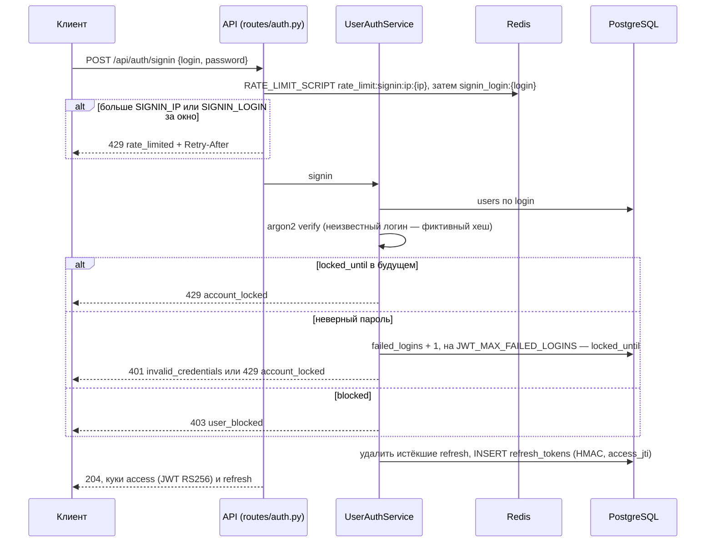
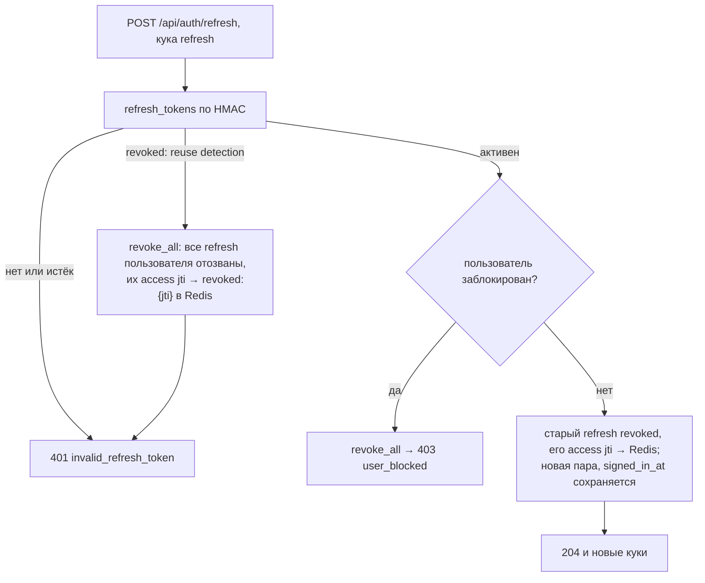
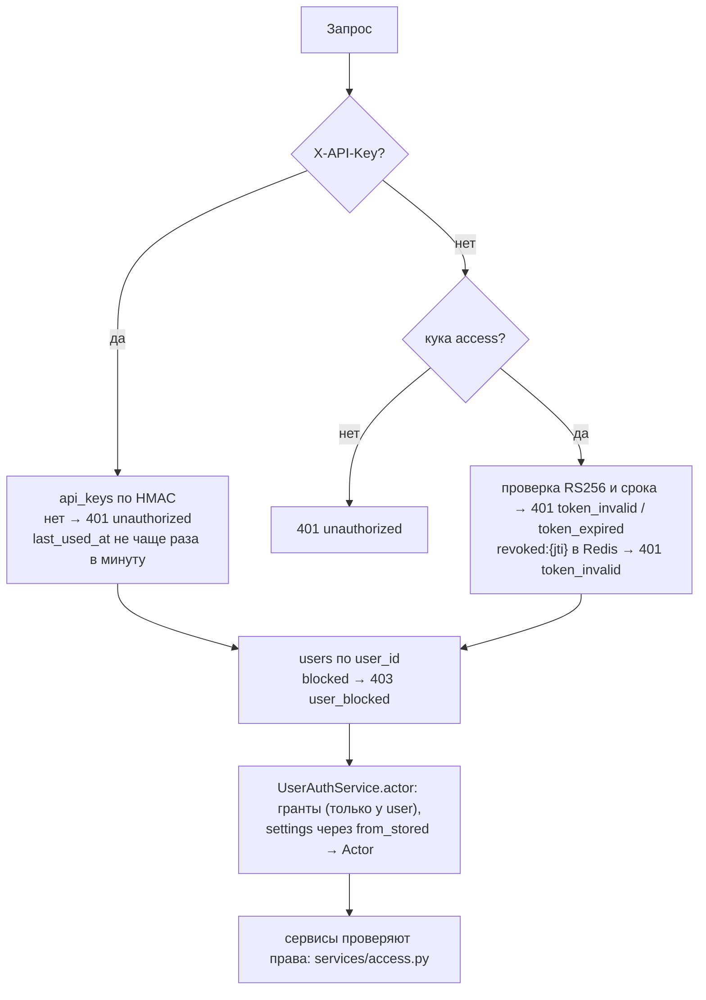

# Пользователи, роли и доступ к папкам

Все запросы к `/api` идут от пользователя. Самостоятельной регистрации нет: пользователей создают root и admin.
Пользователь входит по логину и паролю, почты нет.

## Роли

| Роль | Кто | Что может |
|---|---|---|
| `root` | один, задаётся `ROOT_LOGIN` / `ROOT_PASSWORD` в `.env` | всё: вход в Telegram (`/api/telegram`), создание и удаление admin, всё, что может admin |
| `admin` | создаёт root | хранилища (создание, удаление, название, фото), все папки, файлы и задачи, пользователи с ролью `user`: создание, блокировка, сброс пароля, гранты, API-ключи; свои API-ключи |
| `user` | создают root и admin | только папки из своих грантов и только свои задачи загрузки |

Admin не может создать, изменить или удалить другого admin и не может трогать root. Root через API не меняется и
не удаляется: при каждом старте API строка root в `users` создаётся или обновляется по `.env`. Если `ROOT_PASSWORD`
изменился, хеш обновляется и все сессии root завершаются. Если `ROOT_LOGIN` уже занят другим пользователем, API не
стартует (`user_exists`). Свою учётную запись (роль, блокировку, удаление) через `/api/users` менять нельзя, свой
пароль меняют через `POST /api/auth/password`. Пароль root меняется только в `.env`.

## Вход: JWT в HttpOnly-куках

Схема как в nextgate-backend.

- `POST /api/auth/signin` `{"login", "password"}` → `204` и две куки: `access` (JWT RS256, 15 минут, `JWT_ACCESS_TOKEN_EXPIRATION_MINUTES`)
  и `refresh` (случайная строка, 30 дней, `JWT_REFRESH_TOKEN_EXPIRATION_DAYS`). Обе `HttpOnly`, `SameSite=lax`,
  `Secure` (по умолчанию включён: `JWT_SECURE=false` нужен для http без TLS, например в Safari или в скриптах).
- `POST /api/auth/refresh` меняет пару: старый refresh отзывается, его access попадает в blacklist. Если приходит уже
  отозванный refresh (его украли и использовали), отзываются **все** сессии пользователя (reuse detection).
- `POST /api/auth/logout` отзывает текущую сессию, `POST /api/auth/logout/all` отзывает все.
- `GET /api/auth/sessions` показывает активные сессии (user-agent, IP, даты, `is_current`), `DELETE /api/auth/sessions/{id}` завершает одну из них.
- `POST /api/auth/password` `{"current_password", "new_password"}` меняет пароль, завершает остальные сессии и выдаёт новые куки.
- `GET /api/users/me` показывает текущего пользователя, его гранты и настройки (`settings`, flows/settings.md).
- Свои настройки по умолчанию (загрузки, архивы, интерфейс) пользователь меняет сам: `GET/PATCH/DELETE /api/account/settings`.

Вход, refresh и проверка запроса — `src/application/services/user_auth.py` (`UserAuthService`), куки —
`src/api/routes/auth.py`, зависимость `get_actor` — `src/api/dependencies/auth.py`, токены и хеши —
`src/infrastructure/security/` (`jwt.py`, `hashing.py`).





Каждый запрос к `/api` (кроме `signin`, `refresh`, `logout` и публичного `/health`) проходит `get_actor`:



JWT несёт `sub`, `user_id`, `role`, `jti`, `iat`, `exp`, `token_type`. Права берутся не из токена: на каждый запрос
пользователь и гранты читаются из БД, поэтому блокировка, смена роли и изменение грантов действуют сразу.
Отозванные access-токены хранятся в Redis (`{REDIS_PREFIX}:revoked:{jti}`) до конца их срока, в refresh-таблице лежит
только HMAC-SHA256 от `APP_SECRET_KEY`.

После `JWT_MAX_FAILED_LOGINS` (5) неверных паролей подряд вход блокируется на `JWT_LOCK_MINUTES` (15):
`429 account_locked` с `retry_after`. Для неизвестного логина тоже проверяется фиктивный argon2-хеш, чтобы по времени
ответа нельзя было угадать логины.

Кроме блокировки аккаунта вход ограничен в роуте скользящим окном в Redis: по IP — `RATE_LIMIT_SIGNIN_IP` (20 за
60 с, подбор паролей сразу по многим логинам) и по логину — `RATE_LIMIT_SIGNIN_LOGIN` (10 за 900 с, с любых адресов),
иначе `429 rate_limited`. Если Redis недоступен, вход не блокируется (fail open, блокировка аккаунта продолжает
работать). Подробно — security.md, «Rate limiting». У всех ответов с `retry_after` в теле есть и заголовок `Retry-After`.

Ключи RS256 лежат в `certs/jwt-private.pem` и `certs/jwt-public.pem` (`JWT_PRIVATE_KEY_PATH`, `JWT_PUBLIC_KEY_PATH`).
`make env` создаёт их через openssl, compose монтирует `./certs` read-only в `/certs`. Если сменить ключи, все access-токены
станут недействительны, refresh продолжат работать.

## API-ключи

Для скриптов: заголовок `X-API-Key: tc_...` вместо кук, права у ключа те же, что у его владельца. Если переданы и ключ,
и кука, используется ключ.

- `POST /api/users/{id}/api-keys` `{"name"}` → `201`, сам ключ есть **только** в этом ответе (`key`), в БД хранится HMAC.
- `GET /api/users/{id}/api-keys` показывает список без ключей, с `last_used_at` (обновляется не чаще раза в минуту).
- `DELETE /api/users/{id}/api-keys/{key_id}` отзывает ключ.

Ключи выдают root и admin: себе и тем, кем они управляют. Ключ заблокированного пользователя отвечает `403 user_blocked`.

## Управление пользователями

| Запрос | Что |
|---|---|
| `GET /api/users`, `GET /api/users/{id}` | список и карточка (admin) |
| `POST /api/users` `{"login", "password", "role": "user"\|"admin"}` | создание; `admin` создаёт только root |
| `PATCH /api/users/{id}` `{"role"?, "blocked"?, "password"?}` | смена роли, блокировка, сброс пароля: каждое из них завершает все сессии пользователя |
| `DELETE /api/users/{id}` | удаление вместе с сессиями, ключами и грантами |

Логин содержит 3–64 символа `A-Z a-z 0-9 _ . -`, пароль от 8 до 256 символов, хеш argon2.

## Гранты на папки

Грант даёт пользователю доступ к одной папке хранилища:

```json
PUT /api/users/{id}/grants
{"path": "tcloud/<storage>/photos", "recursive": true, "can_read": true, "can_upload": false, "can_delete": false}
```

- `recursive: true` (глобальный грант) действует на папку и всё, что в ней. `false` (конкретный) — только на файлы прямо в этой
  папке, без подпапок.
- Грант на корень хранилища (`tcloud/<storage>`) с `recursive: true` открывает всё хранилище.
- Права независимы: `can_read` даёт листинг, метаданные и скачивание, `can_upload` — загрузку и создание папок,
  `can_delete` — удаление файлов и папок. Загрузка с `on_conflict=replace` требует и `can_upload`, и `can_delete`.
  Удалить папку целиком можно только с рекурсивным грантом `can_delete`, ведь удаляется всё поддерево.
- Права нескольких грантов складываются. На одну папку бывает один грант: повторный `PUT` с тем же `path` заменяет его.
- `GET /api/users/{id}/grants` показывает гранты, `DELETE /api/users/{id}/grants/{grant_id}` отзывает. Изменения действуют со следующего запроса.
- Папки в гранте может ещё не быть. Гранты не удаляются вместе с папкой (если папку создать заново, доступ вернётся),
  удаляются вместе с хранилищем или пользователем.

Что видит `user`:

- `GET /api/storages` показывает только хранилища, где у него есть гранты. Создавать, менять и удалять хранилища может только admin.
  В `GET /api/storages/{id}` поля `files`, `total_size`, `preview_count` и `preview_bytes` считаются только по файлам, которые он может читать
  (каждый файл один раз, даже если гранты пересекаются).
- В листинге папки видны подпапки, доступные ему или ведущие к его грантам. Так из корня хранилища можно дойти до
  `photos/2026`, не видя соседних папок. Файлы видны только там, где есть `can_read`.
- Задачи загрузки (`/api/tasks/...`) видны только свои: чужие отвечают `404 task_not_found`. `user_id` хранится в
  задаче в Redis. Повтор (`retry`) заново проверяет гранты. Admin и root видят все задачи.

Нет доступа → `403 forbidden`. Нет входа → `401 unauthorized` / `token_invalid` / `token_expired`.

Проверки — в `src/application/services/access.py` (`allowed`, `leads_to_grant`, `require`), их вызывают сервисы хранилищ,
папок, файлов, загрузок и задач. Пользователь запроса — `Actor` (`get_actor` в `src/api/dependencies/auth.py`).
