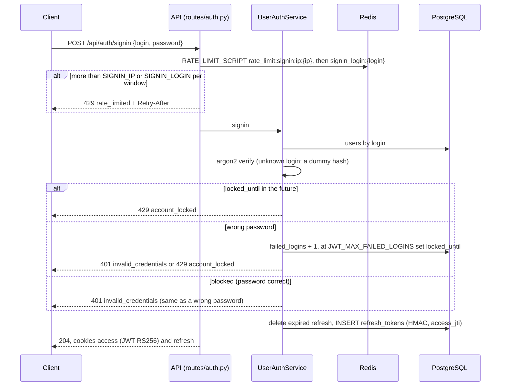
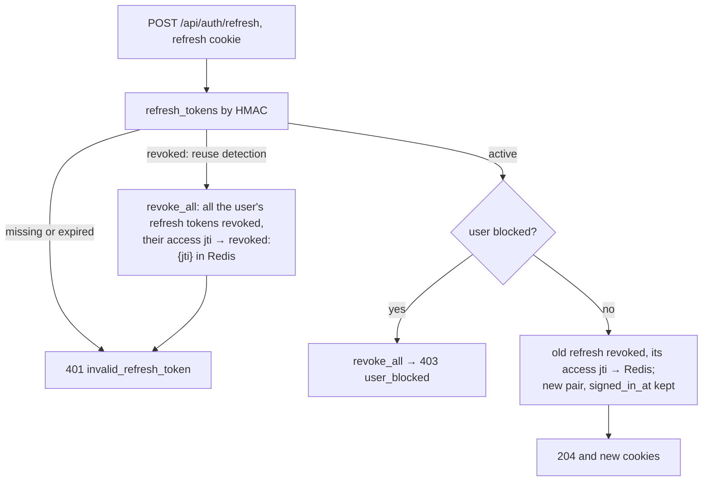
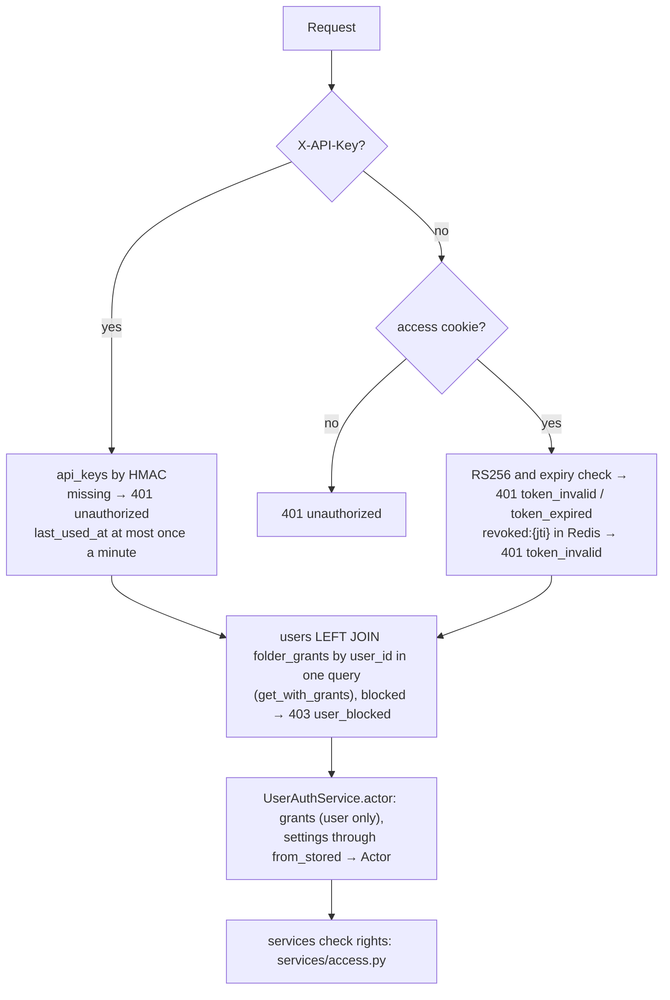

# Users, roles and folder access

Every request to `/api` comes from a user. There is no self sign-up: users are created by root and admin.
A user signs in with a login and a password, there is no email.

## Roles

| Role | Who | What they can do |
|---|---|---|
| `root` | a single one, set by `ROOT_LOGIN` / `ROOT_PASSWORD` in `.env` | everything: Telegram sign-in (`/api/telegram`), creating and deleting admins, everything an admin can do |
| `admin` | created by root | storages (create, delete, title, photo), all folders, files and tasks, users with the `user` role: create, block, reset password, grants, API keys; their own API keys |
| `user` | created by root and admin | only the folders of their grants and only their own upload tasks |

An admin cannot create, change or delete another admin and cannot touch root. Root is not changed or deleted through the API:
on every API start the root row in `users` is created or updated from `.env`. If `ROOT_PASSWORD`
changed, the hash is updated and all root sessions are terminated. If `ROOT_LOGIN` is already taken by another user, the API does not
start (`user_exists`). One's own account (role, blocking, deletion) cannot be changed through `/api/users`, one's own
password is changed through `POST /api/auth/password`. Root's password is changed only in `.env`.

## Sign-in: JWT in HttpOnly cookies

The scheme is the same as in nextgate-backend.

- `POST /api/auth/signin` `{"login", "password"}` → `204` and two cookies: `access` (JWT RS256, 15 minutes, `JWT_ACCESS_TOKEN_EXPIRATION_MINUTES`)
  and `refresh` (a random string, 30 days, `JWT_REFRESH_TOKEN_EXPIRATION_DAYS`). Both are `HttpOnly`, `SameSite=lax`,
  `Secure` (on by default: `JWT_SECURE=false` is needed for http without TLS, for example in Safari or in scripts).
  `login` is 1–64 characters, `password` 1–256, otherwise `422` even before the per-login limit: a huge login never becomes
  a Redis key `rate_limit:signin_login:…`.
- A blocked user gets the same `401 invalid_credentials` at sign-in as for a wrong password
  (the password is still checked with argon2, the response time is the same): the answer does not reveal that the password is right and
  the account is blocked. `403 user_blocked` stays for already issued cookies, refresh and API keys.
- `POST /api/auth/refresh` swaps the pair: the old refresh is revoked, its access goes to the blacklist. If an already
  revoked refresh arrives (it was stolen and used), **all** the user's sessions are revoked (reuse detection).
- `POST /api/auth/logout` revokes the current session, `POST /api/auth/logout/all` revokes all of them.
- `GET /api/auth/sessions` shows the active sessions (user agent, IP, dates, `is_current`), `DELETE /api/auth/sessions/{id}` terminates one of them.
- `POST /api/auth/password` `{"current_password", "new_password"}` changes the password, terminates the other sessions, deletes
  all the user's API keys and issues new cookies.
- `GET /api/users/me` shows the current user, their grants and settings (`settings`, flows/settings.md).
- Users change their own defaults (uploads, archives, interface) themselves: `GET/PATCH/DELETE /api/account/settings`.

Sign-in, refresh and request checks are in `src/application/services/user_auth.py` (`UserAuthService`), cookies in
`src/api/routes/auth.py`, the `get_actor` dependency in `src/api/dependencies/auth.py`, tokens and hashes in
`src/infrastructure/security/` (`jwt.py`, `hashing.py`).





Every request to `/api` (except `signin`, `refresh`, `logout` and the public `/health`) goes through `get_actor`:



The JWT carries `sub`, `user_id`, `role`, `jti`, `iat`, `exp`, `token_type`. Rights are not taken from the token: on every request
the user and grants are read from the DB (one `SELECT users LEFT JOIN folder_grants`, `UserRepository.get_with_grants`,
by `UNIQUE(user_id, storage_id, path)`), so blocking, role changes and grant changes take effect at once.
Revoked access tokens are kept in Redis (`{REDIS_PREFIX}:revoked:{jti}`) until they expire, the refresh table holds
only HMAC-SHA256 with `APP_SECRET_KEY`.

After `JWT_MAX_FAILED_LOGINS` (5) wrong passwords in a row, sign-in is locked for `JWT_LOCK_MINUTES` (15):
`429 account_locked` with `retry_after`. For an unknown login a dummy argon2 hash is checked too, so logins cannot be guessed
from the response time.

On top of the account lockout, sign-in is limited in the route with a sliding window in Redis: per IP with `RATE_LIMIT_SIGNIN_IP` (20 per
60 s, guessing passwords across many logins) and per login with `RATE_LIMIT_SIGNIN_LOGIN` (10 per 900 s, from any address),
otherwise `429 rate_limited`. If Redis is down, sign-in is not blocked (fail open, the account lockout keeps
working). Details in security.md, "Rate limiting". Every response with `retry_after` in the body also has the `Retry-After` header.

The RS256 keys are in `certs/jwt-private.pem` and `certs/jwt-public.pem` (`JWT_PRIVATE_KEY_PATH`, `JWT_PUBLIC_KEY_PATH`).
`make env` creates them with openssl, compose mounts `./certs` read-only into `/certs`. Changing the keys invalidates all access tokens,
refresh tokens keep working.

## API keys

For scripts: the header `X-API-Key: tc_...` instead of cookies, the key has the same rights as its owner. If both a key
and a cookie are sent, the key is used.

- `POST /api/users/{id}/api-keys` `{"name"}` → `201`, the key itself is **only** in this response (`key`), the DB stores an HMAC.
- `GET /api/users/{id}/api-keys` shows the list without keys, with `last_used_at` (updated at most once a minute).
- `DELETE /api/users/{id}/api-keys/{key_id}` revokes a key.

Keys are issued by root and admin: to themselves and to the users they manage. A blocked user's key answers `403 user_blocked`.
A password or role change through `PATCH /api/users/{id}` and changing one's own password through `POST /api/auth/password` delete all
the user's API keys (`UserAuthService.revoke_keys`): a key issued under the old rights or leaked together with the old
password stops working, keys are issued again. Blocking does not delete keys (they answer `403 user_blocked` and
work again after unblocking).

## User management

| Request | What |
|---|---|
| `GET /api/users`, `GET /api/users/{id}` | list and detail (admin) |
| `POST /api/users` `{"login", "password", "role": "user"\|"admin"}` | create; only root creates `admin` |
| `PATCH /api/users/{id}` `{"role"?, "blocked"?, "password"?}` | role change, blocking, password reset: each of them terminates all the user's sessions; a role or password change also deletes the API keys |
| `DELETE /api/users/{id}` | delete together with sessions, keys and grants |

Blocking (`blocked: true`) and deletion also cancel the user's open chunked uploads: the files are deleted, the path and
the disk reservation are released (flows/uploads.md, "From a device in chunks"). All their unfinished tasks are cancelled the same way
(`temp.cancel_user_tasks` over `user_tasks:{user}`, the same `CANCEL` as `POST /api/tasks/{id}/cancel`): a task in
a queue becomes `cancelled` at once with its path, files and quota released, a running one is stopped by the worker at the next check.
The cancel runs after the commit and for each session and task separately: an error in one goes to the log (loguru) and does not
affect the others, the request succeeds anyway. A task with `callback_url` moved to `cancelled` gets a final webhook, as with `POST /api/tasks/{id}/cancel`
(`temp.cancel_task` → `webhook.notify`).

A login has 3–64 characters `A-Z a-z 0-9 _ . -`, a password 8 to 256 characters, the hash is argon2.

## Folder grants

A grant gives a user access to one folder of a storage:

```json
PUT /api/users/{id}/grants
{"path": "tcloud/<storage>/photos", "recursive": true, "can_read": true, "can_upload": false, "can_delete": false}
```

- `recursive: true` (a global grant) applies to the folder and everything in it. `false` (a specific one) applies only to the files directly in that
  folder, without subfolders.
- A grant on the storage root (`tcloud/<storage>`) with `recursive: true` opens the whole storage.
- The rights are independent: `can_read` gives listing, metadata and download, `can_upload` gives uploads and folder creation,
  `can_delete` gives deleting files and folders. An upload with `on_conflict=replace` needs both `can_upload` and `can_delete`.
  A whole folder can be deleted only with a recursive `can_delete` grant, since the whole subtree is deleted.
- The rights of several grants add up. A folder has at most one grant: a repeated `PUT` with the same `path` replaces it.
- `GET /api/users/{id}/grants` shows the grants, `DELETE /api/users/{id}/grants/{grant_id}` revokes one. Changes apply from the next request.
- The folder of a grant may not exist yet. Grants are not deleted with the folder (if the folder is created again, access comes back),
  they are deleted with the storage or the user.

What a `user` sees:

- `GET /api/storages` shows only the storages where they have grants. Only an admin can create, change and delete storages.
  In `GET /api/storages/{id}` the fields `files`, `total_size`, `preview_count` and `preview_bytes` count only the files they can read
  (each file once, even if grants overlap).
- A folder listing shows the subfolders available to them or leading to their grants. So from the storage root they can reach
  `photos/2026` without seeing the neighbouring folders. Files are visible only where there is `can_read`.
- Upload tasks (`/api/tasks/...`) show only their own: other people's answer `404 task_not_found`. `user_id` is stored in
  the task in Redis. A retry (`retry`) checks the grants again. Admin and root see all tasks.

No access → `403 forbidden`. Not signed in → `401 unauthorized` / `token_invalid` / `token_expired`.

The checks are in `src/application/services/access.py` (`allowed`, `leads_to_grant`, `require`), called by the services of storages,
folders, files, uploads and tasks. The request user is an `Actor` (`get_actor` in `src/api/dependencies/auth.py`).
