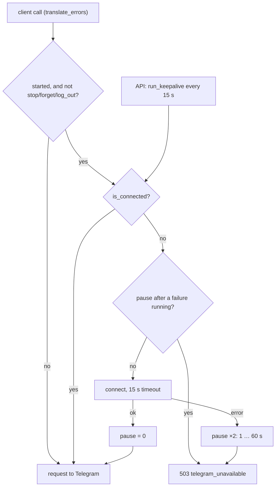

# Integrations

## Telegram (Telethon)

A user account, not a bot: a bot cannot create channels and has no Premium.
Three sessions of one account in the `session` volume: `TELEGRAM_SESSION` (API: channels, deletes, events),
`TELEGRAM_UPLOAD_SESSION` (worker-telegram: uploads) and `TELEGRAM_DOWNLOAD_SESSION` (API: serving files). One
SQLite session file cannot be opened from two processes, that gives locks and a risk of `AUTH_KEY_DUPLICATED`; downloads
have their own session so that their traffic and FloodWait do not affect channel management. Each one is signed in separately through
`/api/telegram` (root only; in Telegram these are three devices, `api`, `upload`, `download`; flows/auth.md).
Only the API session receives updates, for the events about deleted messages (flows/folders-and-files.md).

| Limit | Value | How we handle it |
|---|---|---|
| File in one message | 2 GB, 4 GB with Premium (4000/8000 chunks of 512 KB) | a bigger file goes as several part messages (flows/uploads.md, "Big files in parts"); Premium is cached in Redis for `REDIS_CACHE_TTL` (180 s) |
| Photo as a photo | 10 MB, sum of sides ≤ 10000, ratio ≤ 1:20 | does not fit → sent as a document with a warning |
| Photo as a photo: format | JPEG/PNG only | webp/heic/gif are converted to JPEG (Telegram compresses anyway) |
| Caption | 1024 characters | the caption holds only `#tc<hex>`; one word without hyphens, so Telegram search finds it whole |
| Video preview | JPEG ≤ 200 KB, ≤ 320 px | ffmpeg, quality is lowered until it fits |
| Preview of encrypted files | JPEG ≤ 20 KB, ≤ 320 px | made by us (Pillow, a video frame via ffmpeg), never sent to Telegram, stored encrypted in `files.thumbnail` |
| Preview on read (`/thumb`) | Telegram sizes, ≤ 320 px (`THUMB_SIDE`) | one `messages.getMessages` + download of a small size with the `download` session; inline sizes (`PhotoCachedSize`) without a request |
| Channel title / description | 128 / 255 | request validation |
| Channels and supergroups per account | 500 / 1000 with Premium (`CHANNELS_MAX*`) | Telegram `CHANNELS_TOO_MUCH` on storage create → `409 channels_limit` with `limit`; all channels and groups of the account count, not only storages, so we do not check in advance; the current number is `GET /api/account` `channels_used` (cached in Redis for `REDIS_CACHE_TTL`) |
| "TCloud" chat folder | 100 chats / 200 with Premium (`FOLDER_PEERS_MAX*`); folder ids 2..255; folders per account 10 / 30 with Premium | extra channels do not go into the folder (a warning in the log); a new folder takes the first free id; the folder limit, flood and other sync errors are only logged (storages.md, "TCloud folder") |
| Message deletion | 100 per request | in batches |
| FloodWait | none | ≤ 60 s Telethon waits by itself; longer pauses all uploads (see background-tasks.md) |

- Videos are not re-encoded: Telegram does not recompress video uploaded through the API. Dimensions, duration and rotation come
  from ffprobe and go into `DocumentAttributeVideo`; without them the aspect ratio "drifts". The player works reliably
  with MP4; other containers may show up as a file, and the response carries a warning.
- Chunks of files > 10 MB are sent in parallel (`TELEGRAM_UPLOAD_WORKERS`, `SaveBigFilePart`): Telethon sends them one by one
  and is bound by network latency. Plus `cryptg` for fast AES.
- Downloads: the offset of a request to Telegram must be a multiple of 512 KB, extra bytes at the start are cut off; that is how `Range` works.
- A compressed photo (`send_as=media`) is stored in Telegram in several sizes (`PhotoSize`/`PhotoSizeProgressive`, plus the inline `PhotoStrippedSize`/`PhotoCachedSize`), and the last one in the list is not always the heaviest. Telethon reports the heaviest size in `message.file.size`, while `iter_download` downloads the last one by default, which made `Content-Length` disagree with the body. Now the size at send time, the `file_changed` check, the download, `Range` and archives all use the same size, the heaviest `PhotoSize`/`PhotoSizeProgressive` (`client.photo_size`, `download_location`). Old rows already hold exactly that in `files.size`, no migration is needed.
- A channel is addressed through `get_input_entity` (`TelegramClient._peer`): id and `access_hash` come from the session cache without
  a request to Telegram. `get_entity` in Telethon 1.45 always calls `channels.GetChannels`, so the full entity
  (`_entity`) is needed only where its fields are read: rights in `check_channel` and the photo in `photo`. If the channel's `access_hash`
  is not in the session yet, the dialog list is loaded once.
- Reconnect. Telethon tries to restore a dropped connection by itself (`auto_reconnect`, 5 attempts), after
  which the client stays disconnected forever; that is how the API and worker-telegram used to sit at `503 telegram_unavailable` until
  a restart. Now every client call (`translate_errors`) first runs `TelegramClient.ensure_connected`: a client
  that was started (`start`) and not stopped (`stop`, `forget`, `log_out`) but is disconnected reconnects
  (`connect`, 15 s timeout) under a lock, so parallel requests do not pile up connections. Failure → `503
  telegram_unavailable` and an exponential pause of 1, 2, 4 … 60 s (`RECONNECT_MIN`/`RECONNECT_MAX`), during which calls
  answer `telegram_unavailable` at once without a new attempt; success resets the pause. Every process works this way: the API
  (sessions `api` and `download`) and the workers (session `upload`). In addition, the API calls `ensure_connected` on the `api` and `download`
  clients every 15 s (`AuthService.run_keepalive`), so that deletion events and health checks
  come back even without user requests.

- Telethon exceptions are translated into `TelegramFloodWaitError`, `TelegramUnavailableError`, `TelegramUnauthorizedError`
  (401: the session is not signed in or was revoked), sign-in errors (`invalid_code`, `invalid_password`, `invalid_phone`,
  `password_needed`, `session_too_fresh`) and `TelegramError` for the rest.
- Sign-in (`TelegramLogin`): QR (`auth.exportLoginToken`, waits for `UpdateLoginToken`, so the login client receives updates)
  or a code (`auth.sendCode` / `auth.signIn`), 2FA through SRP. Old sessions: `account.getAuthorizations` /
  `account.resetAuthorization`, which Telegram allows only for sessions older than 24 h.

## ClamAV

The `clamav/clamav:*-debian` container (alpine tags are built for amd64 only). `docker/clamd.conf` raises the limits
to the ClamAV ceiling (by default clamd cuts at 100 MB) and enables strict checks, see security.md:
`MaxFileSize 2147483645` (libclamav does not scan files above 2 GiB − 3 bytes and clamps a bigger `MaxFileSize`
to that value by itself), `StreamMaxLength`/`MaxScanSize 4000M` (the clamd maximum, < 4 GB; `MaxScanSize` is how many bytes in total
are unpacked from an archive), `MaxScanTime` 30 min, `ReadTimeout`/`CommandReadTimeout` 15 min (socket idle).
`CLAMAV_MAX_FILE_SIZE` equals `MaxFileSize` (`test_scan_limit_mirrors_clamd_config`): bigger files are not sent
to ClamAV at all (otherwise the answer would be `Heuristics.Limits.Exceeded.MaxFileSize`). `CLAMAV_TIMEOUT` (1860 s) is how long
the client waits for an answer after the stream, longer than `MaxScanTime`, so that clamd answers with a limit rather than a dropped connection.
The first start downloads the databases for a few minutes.

`clamd` answers fall into two classes:

| Answer | Code | Meaning |
|---|---|---|
| `Heuristics.Encrypted.*` | `unscannable` | an encrypted archive, PDF or document: no way to look inside |
| `Heuristics.Limits.Exceeded.*` | `unscannable` | a limit was hit (nested file size, `MaxScanSize`, file count, nesting, time), not everything was checked; it is a property of the content (zip bomb, deep nesting), so it goes under `allow_unscannable` |
| none (file bigger than `CLAMAV_MAX_FILE_SIZE`, not sent to clamd) | none | accepted with the warning `too_big_to_scan` regardless of `allow_unscannable` |
| `Heuristics.OLE2.ContainsMacros*` | `unscannable` | Office with macros |
| any other `FOUND` (signatures, `PUA.*`, `Heuristics.Broken.*`, phishing) | `infected` | always rejected |

`HeuristicScanPrecedence no`: heuristics are reported only at the end, and a matched signature wins. So
`allow_unscannable` does not let through a virus lying next to an encrypted archive: checked on `clamav 1.5.4`,
a zip with EICAR and an encrypted zip inside gives `Eicar-Test-Signature`, not `Heuristics.Encrypted.Zip`.
There is no `AllMatchScan` option in `clamd.conf` (it is a `clamscan` flag).

## Outgoing HTTP

`src/infrastructure/integrations/web` is httpx with address checks (see security.md), used for URL uploads and webhooks.
