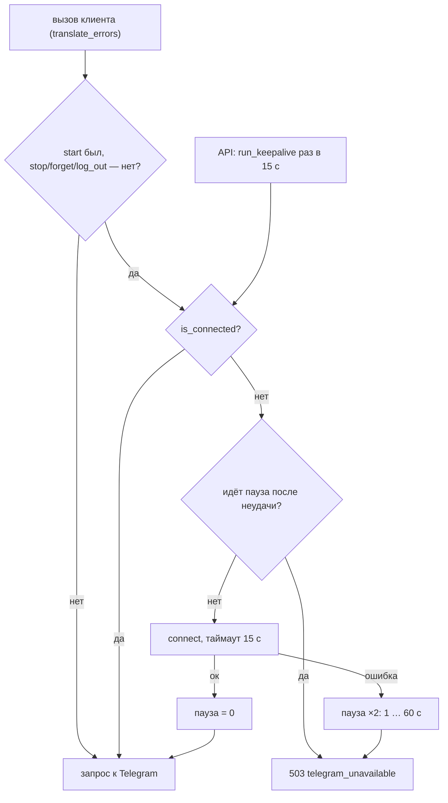

# Интеграции

## Telegram (Telethon)

Пользовательский аккаунт, а не бот: бот не может создавать каналы и не имеет Premium.
Три сессии одного аккаунта в volume `session`: `TELEGRAM_SESSION` (API: каналы, удаление, события),
`TELEGRAM_UPLOAD_SESSION` (worker-telegram: выгрузка) и `TELEGRAM_DOWNLOAD_SESSION` (API: отдача файлов). Один
SQLite-файл сессии нельзя открывать из двух процессов — будут блокировки и риск `AUTH_KEY_DUPLICATED`; скачивания
вынесены в свою сессию, чтобы их трафик и FloodWait не задевали управление каналами. В каждую входят отдельно через
`/api/telegram` (только root; в Telegram это три устройства, `api`, `upload`, `download`; flows/auth.md).
Обновления получает только API-сессия — ради событий об удалённых сообщениях (flows/folders-and-files.md).

| Лимит | Значение | Как учитываем |
|---|---|---|
| Файл | 2 ГБ, с Premium 4 ГБ (4000/8000 кусков по 512 КБ) | проверка до загрузки и во время приёма; Premium кешируется в Redis на `REDIS_CACHE_TTL` (180 с) |
| Фото как фото | 10 МБ, сумма сторон ≤ 10000, соотношение ≤ 1:20 | не влезло → отправляем документом с предупреждением |
| Фото как фото — формат | только JPEG/PNG | webp/heic/gif переводим в JPEG (Telegram всё равно сожмёт) |
| Подпись | 1024 символа | в подписи только `#tc<hex>`; одно слово без дефисов — поиск Telegram находит его целиком |
| Превью видео | JPEG ≤ 200 КБ, ≤ 320 px | ffmpeg, качество снижается, пока не влезет |
| Превью зашифрованных файлов | JPEG ≤ 20 КБ, ≤ 320 px | делаем сами (Pillow, кадр видео — ffmpeg), в Telegram не уходит, лежит зашифрованным в `files.thumbnail` |
| Превью при чтении (`/thumb`) | размеры Telegram, ≤ 320 px (`THUMB_SIDE`) | один `messages.getMessages` + скачивание маленького размера сессией `download`; встроенные размеры (`PhotoCachedSize`) без запроса |
| Название / описание канала | 128 / 255 | валидация запроса |
| Каналов и супергрупп на аккаунт | 500 / 1000 с Premium (`CHANNELS_MAX*`) | Telegram `CHANNELS_TOO_MUCH` при создании хранилища → `409 channels_limit` с `limit`; считаются все каналы и группы аккаунта, не только хранилища, поэтому заранее не проверяем; текущее число — `GET /api/account` `channels_used` (кеш в Redis на `REDIS_CACHE_TTL`) |
| Папка чатов «TCloud» | 100 чатов / 200 с Premium (`FOLDER_PEERS_MAX*`); id папок 2..255; папок на аккаунт 10 / 30 с Premium | лишние каналы в папку не попадают (warning в лог); новая папка — первый свободный id; лимит папок, флуд и прочие ошибки синхронизации только пишутся в лог (storages.md, «Папка TCloud») |
| Удаление сообщений | 100 за запрос | пачками |
| FloodWait | — | ≤ 60 с Telethon пережидает сам; дольше — пауза всей выгрузки (см. background-tasks.md) |

- Видео не перекодируем: Telegram не пережимает видео, загруженное через API. Размеры, длительность и поворот берём
  из ffprobe и передаём в `DocumentAttributeVideo` — без них соотношение сторон «плывёт». Плеер надёжно работает
  с MP4; другие контейнеры могут показаться файлом — в ответе будет предупреждение.
- Куски файлов > 10 МБ отправляются параллельно (`TELEGRAM_UPLOAD_WORKERS`, `SaveBigFilePart`): Telethon шлёт их по одному
  и упирается в задержку сети. Плюс `cryptg` для быстрого AES.
- Скачивание: смещение запроса к Telegram должно быть кратно 512 КБ, лишние байты в начале отрезаем — так работает `Range`.
- Сжатое фото (`send_as=media`) хранится в Telegram в нескольких размерах (`PhotoSize`/`PhotoSizeProgressive`, плюс встроенные `PhotoStrippedSize`/`PhotoCachedSize`), и последний в списке не всегда самый тяжёлый. Telethon в `message.file.size` отдаёт самый тяжёлый размер, а `iter_download` по умолчанию качает последний — из-за этого `Content-Length` не совпадал с телом. Теперь размер при отправке, проверка `file_changed`, скачивание, `Range` и архивы берут один и тот же размер — самый тяжёлый `PhotoSize`/`PhotoSizeProgressive` (`client.photo_size`, `download_location`). У старых записей в `files.size` уже лежит именно он, миграция не нужна.
- Если `access_hash` канала ещё нет в сессии, список диалогов загружается один раз.
- Переподключение. Telethon сам пробует восстановить оборванное соединение (`auto_reconnect`, 5 попыток), после
  чего клиент остаётся отключённым навсегда — так API и worker-telegram стояли с `503 telegram_unavailable` до
  перезапуска. Теперь каждый вызов клиента (`translate_errors`) сначала делает `TelegramClient.ensure_connected`: клиент,
  который был запущен (`start`) и не остановлен (`stop`, `forget`, `log_out`), но отключён, переподключается
  (`connect`, таймаут 15 с) под замком, чтобы параллельные запросы не плодили подключения. Неудача → `503
  telegram_unavailable` и экспоненциальная пауза 1, 2, 4 … 60 с (`RECONNECT_MIN`/`RECONNECT_MAX`), в которую вызовы
  сразу отвечают `telegram_unavailable` без новой попытки; успех сбрасывает паузу. Так работают все процессы: API
  (сессии `api` и `download`) и воркеры (сессия `upload`). Дополнительно API раз в 15 с (`AuthService.run_keepalive`)
  вызывает `ensure_connected` у клиентов `api` и `download`, чтобы события об удалениях и проверки здоровья
  вернулись и без запросов пользователей.

- Исключения Telethon переводятся в `TelegramFloodWaitError`, `TelegramUnavailableError`, `TelegramUnauthorizedError`
  (401: сессия не вошла или отозвана), ошибки входа (`invalid_code`, `invalid_password`, `invalid_phone`,
  `password_needed`, `session_too_fresh`) и `TelegramError` для остального.
- Вход (`TelegramLogin`): QR (`auth.exportLoginToken`, ждёт `UpdateLoginToken`, поэтому клиент входа получает обновления)
  или код (`auth.sendCode` / `auth.signIn`), 2FA через SRP. Старые сессии: `account.getAuthorizations` /
  `account.resetAuthorization`, который Telegram разрешает только сессиям старше 24 ч.

## ClamAV

Контейнер `clamav/clamav:*-debian` (alpine-теги собраны только под amd64). `docker/clamd.conf` поднимает лимиты
потока до 4000 МБ (по умолчанию clamd режет на 100 МБ) и включает строгие проверки, см. security.md.
Первый старт качает базы несколько минут.

Ответы `clamd` делятся на два класса:

| Ответ | Код | Что значит |
|---|---|---|
| `Heuristics.Encrypted.*` | `unscannable` | зашифрованный архив, PDF или документ: внутрь не заглянуть |
| `Heuristics.Limits.Exceeded.*` | `unscannable` | упёрлись в лимит (размер, число файлов, вложенность, время) — проверено не всё |
| `Heuristics.OLE2.ContainsMacros*` | `unscannable` | Office с макросами |
| любой другой `FOUND` (сигнатуры, `PUA.*`, `Heuristics.Broken.*`, фишинг) | `infected` | отклоняется всегда |

`HeuristicScanPrecedence no`: эвристика сообщается только в конце, а найденная сигнатура важнее. Поэтому
`allow_unscannable` не пропустит вирус, лежащий рядом с зашифрованным архивом: проверено на `clamav 1.5.4` —
zip с EICAR и зашифрованным zip внутри даёт `Eicar-Test-Signature`, а не `Heuristics.Encrypted.Zip`.
Опции `AllMatchScan` в `clamd.conf` нет (это флаг `clamscan`).

## Исходящий HTTP

`src/infrastructure/integrations/web` — httpx с проверкой адресов (см. security.md), используется для загрузки по ссылке и вебхуков.
