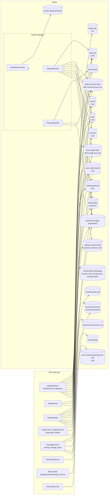

# Redis: карта ключей

Redis хранит всё быстрое и временное: задачи загрузок и архивов (таблицы задач в PostgreSQL нет), блокировки путей,
индексы очередей, heartbeat воркеров, метки активности хранилищ, отозванные access-токены и счётчик входов, а также
короткие (`REDIS_CACHE_TTL`, 180 с) кеши сведений из Telegram: каналы, аккаунт, аватарки каналов и превью открытых
файлов (у превью общий потолок `REDIS_THUMB_CACHE_MB`). Сами файлы в Redis не попадают. Все ключи начинаются с `REDIS_PREFIX` (`tcloud`), значения полей задачи — JSON.

Код: `src/infrastructure/cache/tasks.py` (`TaskStore`, Lua `CLAIM`/`REQUEUE`/`CANCEL`/`DISK_SLOT`/`UNLOCK`/`RENEW`),
`cache/tokens.py` (`TokenBlacklist`), `cache/limits.py` (`RateLimitStore`), `background/heartbeat.py` (`Heartbeat`).
Клиент создаёт `cache/factory.py` (`create_redis`, `create_sync_redis` для потока heartbeat).
Lua-скрипты регистрируются один раз (`register_script`, `TaskStore._run`, `RateLimitStore`) и вызываются по SHA
(`EVALSHA`): тело скрипта не уходит в Redis с каждым вызовом; после перезапуска Redis (`NOSCRIPT`) redis-py сам
загружает его заново.

## Ключи

| Ключ | Тип | Что | Кто пишет / читает | TTL |
|---|---|---|---|---|
| `tcloud:task:{id}` | hash | задача: каждое поле — JSON, пишется отдельно (`HSET` по полям), прогресс не затирает статус | `TaskStore.create/update/get/get_many`; API и воркеры | `UPLOAD_TASK_TTL` (7 дней), продлевается на каждом `update` |
| `tcloud:batch:{id}` | list | id задач пачки по порядку (`GET /api/tasks?batch_id=`) | `TaskStore.create`, `batch` | `UPLOAD_TASK_TTL` |
| `tcloud:user_tasks:{user_id}` | zset | id задач пользователя, score — время создания; `GET /api/tasks/counts` чистит старше TTL и пропавшие | `TaskStore.create`, `statuses`, `user_disk` (какие записи `disk:reserved` — этого пользователя: ссылка без `size`, пока скачивается) | `UPLOAD_TASK_TTL` с последней задачи |
| `tcloud:path:{path}` | string | блокировка пути, значение — id задачи; `SET NX`, снимает только владелец (Lua `UNLOCK`); `SCAN path:tcloud/{storage}/*` — «в хранилище идут загрузки» (`409 storage_busy`) | `lock_path`, `unlock_path`, `path_locked`, `storage_busy`, `renew` (heartbeat и `TaskSweeper` продлевают, Lua `RENEW_TASK`) | `UPLOAD_LOCK_TTL` (24 ч, страховка) |
| `tcloud:active` | zset | активные задачи, score — время старта; основа `TaskSweeper` и лимита `UPLOAD_MAX_ACTIVE_TASKS` | `activate`, `deactivate`, `active_ids`, `count_active`, `renew` (score = now) | — (записи старше `UPLOAD_LOCK_TTL` выбрасывает `count_active`, `renew` держит живые) |
| `tcloud:disk` | zset | задачи, чей файл сейчас в `tmp` (`UPLOAD_MAX_FILES_ON_DISK`), score — время захвата; проверка и захват — Lua `DISK_SLOT` | `take_disk_slot`, `release`, `renew` (score = now) | — (зависшие старше `UPLOAD_LOCK_TTL` выбрасываются) |
| `tcloud:waiting:{queue}` | zset | задачи, ждущие в очереди; score `(10 − уровень) × 10¹³ + мкс` — порядок RabbitMQ; ранг = `queue_position` | `join_queue`, `CLAIM` (выход), `leave_queues`, `positions` | — |
| `tcloud:archives` | zset | путь готового архива в `tmp` → срок (`UPLOAD_ARCHIVE_TTL`); `TaskSweeper.clean_tmp` не трогает до срока и удаляет после | `keep_archive`, `archives`, `forget_archive` | — |
| `tcloud:worker:{queue}:{host}` | string | heartbeat воркера, значение — JSON `{"at": unix-время удара, "telegram": true/false/null}` (`telegram` — ping клиента Telegram воркера, `null` — клиента ещё нет; `health.workers`, `health.details.{queue}.last_seen_s`, `health.telegram_upload`) | `Heartbeat` раз в `UPLOAD_HEARTBEAT_INTERVAL`; `TaskStore.workers` | 3 × `UPLOAD_HEARTBEAT_INTERVAL` |
| `tcloud:workers` | zset | реестр ключей heartbeat: член — `tcloud:worker:{queue}:{host}`, score — unix-время, когда ключ истечёт; `TaskStore.workers` удаляет просроченные (`ZREMRANGEBYSCORE`) и читает живые `MGET`, без `SCAN` по Redis; остановка воркера удаляет свои члены | `Heartbeat` (`ZADD` с каждым ударом); `TaskStore.workers` | — (чистится при чтении) |
| `tcloud:activity:{storage_id}:{read\|write}` | zset | «с хранилищем сейчас работают» для `GET /api/storages/activity` (flows/storages.md): член — id операции, score — unix-время «живо до» (идёт: сейчас + 5 с, продлевается раз в секунду; закончилась: сейчас + 1 с) | `TaskStore.active` (контекст операции); `activity` — `ZCOUNT (now, +inf)` конвейером | 5 с с последней записи (`ACTIVITY_TTL`, `PEXPIRE`) |
| `tcloud:channel:{chat_id}` | string | JSON `{title, about, has_photo}` канала хранилища из `GetFullChannel` (flows/storages.md, «Кеш сведений о каналах») | `TaskStore.channel_infos`, `keep_channel_infos`, `forget_channel` (`PATCH`, фото, удаление хранилища); `StorageService.channel_infos` | `REDIS_CACHE_TTL` (180 с) |
| `tcloud:channel_photo:{chat_id}` | string | JSON-строка base64 с байтами аватарки канала (`""` — фото нет) для `GET /api/storages/{id}/photo` | `TaskStore.cached`/`keep`; `StorageService.get_photo`; `forget_channel` удаляет вместе с `channel:{chat_id}` (наши изменения и события Telegram, flows/storages.md) | `REDIS_CACHE_TTL` (180 с) |
| `tcloud:thumb:{file_id}:{message_id}` | string | base64 превью открытого файла из Telegram для `GET /api/files/{id}/thumb` (`""` — превью нет) | `TaskStore.thumb`, `keep_thumb` (Lua `KEEP_THUMB`); `FileService.get_thumbnail` | `REDIS_CACHE_TTL` (180 с) |
| `tcloud:thumbs`, `tcloud:thumbs:size`, `tcloud:thumbs:bytes` | zset, hash, string | учёт потолка кеша превью: zset ключ `thumb:…` → время записи, hash ключ → длина base64, сумма длин. `KEEP_THUMB` атомарно выкидывает записи старше TTL (их ключи уже истекли), прежнюю копию того же ключа и самые старые, пока новая не влезет в `REDIS_THUMB_CACHE_MB` (64 МБ); запись больше потолка не кешируется, `0` выключает кеш | `TaskStore.keep_thumb` | — (чистятся при каждой записи) |
| `tcloud:account:premium`, `tcloud:account:channels` | string | JSON: Premium API-аккаунта (`true`/`false`, от него размер части большого файла) и `channels_used` (flows/storages.md, «Сколько каналов ещё можно создать») | `TaskStore.cached`/`keep`; `AccountService.is_premium`, `channels_used`, `UploadPipeline._spans` (worker-telegram, только для файлов > 2000 МиБ); `forget_account` — создание/удаление хранилища, `TELEGRAM_CHATS`, вход в API-сессию, события Telegram | `REDIS_CACHE_TTL` (180 с) |
| `tcloud:disk:reserved` | hash | журнал резервов места: владелец (id задачи, у превью — id файла) → байты, которые ещё будут записаны в `tmp` (flows/uploads.md, «Место на диске») | `TaskStore.reserve_disk` (`DiskBudget.reserve`/`hold`/`park`, держатель — раз в секунду), `drop_disk` (`Reservation.release`, `deactivate`), `reserved_bytes` (Lua `RESERVED`: сумма живых без `exclude`, просроченные стирает) | — (срок записи — в `disk:reserved:exp`) |
| `tcloud:disk:reserved:exp` | zset | владелец → срок записи (unix): живой держатель — now + 30 с (`RESERVATION_TTL`), продлевается раз в секунду; запись между этапами — now + `UPLOAD_LOCK_TTL` | те же | — |
| `tcloud:disk:usage` | hash | квота пользователя: владелец (id задачи, у готового архива `archive:{id}`) → `{user_id}:{байты}` — сколько задача занимает или займёт в `tmp` целиком (тело ×2 при шифровании, архив — оценка, потом размер готового); в отличие от `disk:reserved` не уменьшается по мере записи, поэтому в общую проверку места не входит | `TaskStore.use_disk` (`POST /api/uploads` и `from-url` с `size` под `job:disk`, последний кусок сессии, архив при постановке и готовый, воркер по ссылке без `size` раз в секунду во время скачивания и после него), `deactivate` (каждый `release`) стирает, `user_disk` (Lua `USAGE`: записи пользователя, просроченные стирает) | — (срок — в `disk:usage:exp`) |
| `tcloud:disk:usage:exp` | zset | владелец → срок записи (unix): задача — now + `UPLOAD_LOCK_TTL` (продлевается heartbeat'ом и `TaskSweeper`), готовый архив — его `expires_at` | те же | — |
| `tcloud:job:{name}` | string | одна фоновая задача на имя (`job:previews` — дозаполнение превью; `job:upload:{session_id}` — приём куска сессии, `TaskStore.holding`, flows/uploads.md «частями»; `job:disk` — проверка места + запись резерва, `TaskStore.disk_lock`, TTL 5 с без продления, значение — случайный владелец), значение — id задачи Celery; `SET NX`, свой ключ продлевается (Lua `RENEW`), снимает только владелец (Lua `UNLOCK`) | `TaskStore.hold_job`, `release_job`; `PreviewBackfill` | 120 с (`JOB_TTL`), продлевается каждые 30 с |
| `tcloud:upload_session:{id}` | string | JSON сессии загрузки частями: `task` (будущая задача целиком, с `params.file`), `offset` (принято байт), `started_at` (unix, создание), `expires_at` (unix, `min(последний кусок + UPLOAD_SESSION_IDLE_TTL, started_at + UPLOAD_SESSION_TTL)`) | `TaskStore.save_session` (создание и каждый кусок; заодно продлевает `path:{path}` на `UPLOAD_LOCK_TTL` и score в `disk`), `get_session`, `session_bytes`, `user_disk` (квота пользователя), `drop_session` (последний кусок, `DELETE`, уборка, блокировка и удаление пользователя) | 2 × `UPLOAD_SESSION_TTL` (страховка; срок — `expires_at`) |
| `tcloud:upload_sessions` | zset | id сессий → `expires_at`; `TaskSweeper.clean_tmp` не трогает файлы живых и удаляет просроченные | `save_session`, `sessions`, `session_bytes` (сумма резерва живых сессий для проверки диска), `drop_session` | — |
| `tcloud:revoked:{jti}` | string | отозванный access-токен (logout, refresh, смена пароля) | `TokenBlacklist.revoke/revoked` | `JWT_ACCESS_TOKEN_EXPIRATION_MINUTES` |
| `tcloud:rate_limit:{scope}:ip:{ip}`, `tcloud:rate_limit:{scope}:user:{user_id}`, `tcloud:rate_limit:signin_login:{login}` | zset | скользящее окно: время Redis (мс) каждого принятого запроса, Lua `RATE_LIMIT_SCRIPT`; правила и scope — security.md, «Rate limiting» (в том числе квоты отправок `telegram_send_minute`/`telegram_send_day`); Redis недоступен — запрос пропускается (fail open) | `RateLimitStore.hit` (из `api/dependencies/rate_limit.py` и `UploadService._check_send` с `record=False` — только проверка, `_record_send` — запись) | окно правила (`PEXPIRE` на каждом обращении) |

## Поля задачи (`task:{id}`)

| Поле | Что |
|---|---|
| `id`, `batch_id`, `user_id`, `path`, `created_at`, `updated_at` | идентичность и владелец |
| `source` | `device` / `url` / `archive` (копия `params.source` на верхнем уровне, чтобы `TaskService` не читал `params`); у старых задач нет |
| `status`, `stage`, `priority`, `priority_level`, `generation` | состояние (background-tasks.md, «Статусы и стадии») |
| `step` | шаг внутри стадии (`TaskStep`, flows/uploads.md «Шаги»); пишется при смене, `step_progress` считается при чтении |
| `bytes_done`, `bytes_total`, `stage_started` | прогресс; `speed`/`eta` считаются при чтении (`TaskService.render`) |
| `waiting` | `{"reason": "queue:{queue}" \| "disk_slots" \| "retry" \| "flood_wait", "until"?}`; код для API — часть `reason` до `:` |
| `params` | параметры загрузки (`source`, `send_as`, `on_conflict`, `encrypt`, `callback_url`, `url`, `limit` — `uploads.max_file_size` или 2⁶³−1, `file`) или архива (`storage_id`, `folder`, `format`, `file_ids`, `file`) |
| `archive` | `{name, format, files, path, size, expires_at}` у архивов |
| `error`, `warnings`, `file_id` | итог |
| `claimed` | очередь, в которой задачу захватил воркер (`CLAIM`) |
| `cancel` | флаг отмены во время работы |
| `prepared` | результат проверки: `send_path`, `thumb`, `media`, `sha256`, `as_file`, `warnings`, у шифрования `encryption_header`, `plain_size`, `thumbnail` (base64 превью до ~27 КБ; после записи в `files` вместе с `committed` заменяется на `null`) |
| `sending` | отправка в Telegram началась: `{file_id, chat_id, after, spans}`; `after` — id последнего сообщения канала перед первой частью, по нему повтор находит отправленные, но не записанные в `sent` сообщения (background-tasks.md «Без дублей в Telegram»); сбрасывается при `fail` и `retry` |
| `sent`, `committed` | отправлено в Telegram (`{file_id, chat_id, message}`, у файла из частей ещё `parts` и `spans`) / записано в `files` — защита от дублей при повторной доставке |
| `stale` | `replace`: id старых сообщений заменяемого файла, пишутся до коммита и удаляются из Telegram после него (повторная доставка после коммита удаляет их ещё раз); сбрасывается при `retry` |
| `beat_at` | heartbeat задачи для `TaskSweeper` и `CLAIM` (повторная доставка ждёт, пока он свежий) |

Чтение полей: `GET /api/tasks/{id}`, `GET /api/tasks?ids=`, пачки и вебхуки (`TaskService.get`/`get_many`) читают
только поля для ответа (`VIEW_FIELDS` в `services/task.py`, `HMGET` конвейером) — без `prepared`, `params`, `sent`;
тик прогресса воркера (`UploadPipeline._save_progress`) читает только `cancel` и `params` (нужен `callback_url`).
Целиком (`HGETALL`) задачу читают только воркер на своих шагах, отмена и `TaskSweeper`.

Через `UPLOAD_TASK_TTL` задача пропадает, `GET /api/tasks/{id}` отвечает `404`; сам файл остаётся в `files`.
