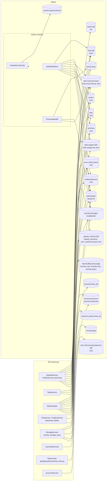

# Redis: key map

Redis holds everything fast and temporary: upload and archive tasks (there is no tasks table in PostgreSQL), path locks,
queue indexes, worker heartbeats, storage activity markers, revoked access tokens and the sign-in counter, plus
short-lived (`REDIS_CACHE_TTL`, 180 s) caches of Telegram data: channels, the account, channel avatars and previews of plaintext
files (previews share the cap `REDIS_THUMB_CACHE_MB`). Files themselves never go into Redis. All keys start with `REDIS_PREFIX` (`tcloud`), task field values are JSON.

Code: `src/infrastructure/cache/tasks.py` (`TaskStore`, Lua `CLAIM`/`REQUEUE`/`CANCEL`/`DISK_SLOT`/`UNLOCK`/`RENEW`),
`cache/tokens.py` (`TokenBlacklist`), `cache/limits.py` (`RateLimitStore`), `background/heartbeat.py` (`Heartbeat`).
The client is created by `cache/factory.py` (`create_redis`, `create_sync_redis` for the heartbeat thread).
Lua scripts are registered once (`register_script`, `TaskStore._run`, `RateLimitStore`) and called by SHA
(`EVALSHA`): the script body is not sent to Redis on every call; after a Redis restart (`NOSCRIPT`) redis-py
loads it again by itself.

## Keys

| Key | Type | What | Who writes / reads | TTL |
|---|---|---|---|---|
| `tcloud:task:{id}` | hash | a task: every field is JSON, written separately (`HSET` per field), progress never overwrites the status | `TaskStore.create/update/get/get_many`; API and workers | `UPLOAD_TASK_TTL` (7 days), extended on every `update` |
| `tcloud:batch:{id}` | list | ids of a batch's tasks in order (`GET /api/tasks?batch_id=`) | `TaskStore.create`, `batch` | `UPLOAD_TASK_TTL` |
| `tcloud:user_tasks:{user_id}` | zset | a user's task ids, score is the creation time; `GET /api/tasks/counts` drops ones older than the TTL and missing ones | `TaskStore.create`, `statuses`, `FolderService._archive_running` (whether the user already has an archive running), `user_disk` (which `disk:reserved` entries belong to the user: a URL without `size` while downloading) | `UPLOAD_TASK_TTL` from the last task |
| `tcloud:path:{path}` | string | path lock, the value is the task id; `SET NX`, only the owner releases it (Lua `UNLOCK`); `SCAN path:tcloud/{storage}/*` means "uploads are running in the storage" (`409 storage_busy`) | `lock_path`, `unlock_path`, `path_locked`, `storage_busy`, `renew` (heartbeat and `TaskSweeper` extend it, Lua `RENEW_TASK`) | `UPLOAD_LOCK_TTL` (24 h, safety net) |
| `tcloud:active` | zset | active tasks, score is the start time; the basis of `TaskSweeper` and of the `UPLOAD_MAX_ACTIVE_TASKS` limit | `activate`, `deactivate`, `active_ids`, `count_active`, `renew` (score = now) | none (`count_active` drops entries older than `UPLOAD_LOCK_TTL`, `renew` keeps live ones) |
| `tcloud:disk` | zset | tasks whose file is currently in `tmp` (`UPLOAD_MAX_FILES_ON_DISK`), score is the acquire time; check and acquire are Lua `DISK_SLOT` | `take_disk_slot`, `release`, `renew` (score = now) | none (stuck entries older than `UPLOAD_LOCK_TTL` are dropped) |
| `tcloud:waiting:{queue}` | zset | tasks waiting in a queue; score `(10 − level) × 10¹³ + µs` follows the RabbitMQ order; the rank is `queue_position` | `join_queue`, `CLAIM` (leave), `leave_queues`, `positions` | none |
| `tcloud:archives` | zset | path of a ready archive in `tmp` → expiry (`UPLOAD_ARCHIVE_TTL`); `TaskSweeper.clean_tmp` leaves it until then and deletes it after | `keep_archive`, `archives`, `forget_archive` | none |
| `tcloud:worker:{queue}:{host}` | string | worker heartbeat, the value is JSON `{"at": unix time of the beat, "telegram": true/false/null}` (`telegram` is a ping of the worker's Telegram client, `null` means no client yet; `health.workers`, `health.details.{queue}.last_seen_s`, `health.telegram_upload`) | `Heartbeat` every `UPLOAD_HEARTBEAT_INTERVAL`; `TaskStore.workers` | 3 × `UPLOAD_HEARTBEAT_INTERVAL` |
| `tcloud:workers` | zset | registry of heartbeat keys: the member is `tcloud:worker:{queue}:{host}`, the score is the unix time the key expires; `TaskStore.workers` removes expired ones (`ZREMRANGEBYSCORE`) and reads live ones with `MGET`, no `SCAN` over Redis; a stopping worker removes its members | `Heartbeat` (`ZADD` on every beat); `TaskStore.workers` | none (cleaned on read) |
| `tcloud:activity:{storage_id}:{read\|write}` | zset | "the storage is being worked on" for `GET /api/storages/activity` (flows/storages.md): the member is an operation id, the score is the unix time it is "alive until" (running: now + 5 s, refreshed every second; finished: now + 1 s) | `TaskStore.active` (operation context); `activity` is a pipelined `ZCOUNT (now, +inf)` | 5 s from the last write (`ACTIVITY_TTL`, `PEXPIRE`) |
| `tcloud:channel:{chat_id}` | string | JSON `{title, about, has_photo}` of a storage channel from `GetFullChannel` (flows/storages.md, "Channel info cache") | `TaskStore.channel_infos`, `keep_channel_infos`, `forget_channel` (`PATCH`, photo, storage delete); `StorageService.channel_infos` | `REDIS_CACHE_TTL` (180 s) |
| `tcloud:channel_photo:{chat_id}` | string | JSON string with base64 bytes of the channel avatar (`""` means no photo) for `GET /api/storages/{id}/photo` | `TaskStore.cached`/`keep`; `StorageService.get_photo`; `forget_channel` deletes it together with `channel:{chat_id}` (our changes and Telegram events, flows/storages.md) | `REDIS_CACHE_TTL` (180 s) |
| `tcloud:thumb:{file_id}:{message_id}` | string | base64 preview of a plaintext file from Telegram for `GET /api/files/{id}/thumb` (`""` means no preview) | `TaskStore.thumb`, `keep_thumb` (Lua `KEEP_THUMB`); `FileService.get_thumbnail` | `REDIS_CACHE_TTL` (180 s) |
| `tcloud:thumbs`, `tcloud:thumbs:size`, `tcloud:thumbs:bytes` | zset, hash, string | accounting of the preview cache cap: zset key `thumb:…` → write time, hash key → base64 length, the sum of lengths. `KEEP_THUMB` atomically drops entries older than the TTL (their keys have already expired), the previous copy of the same key and the oldest ones until the new one fits into `REDIS_THUMB_CACHE_MB` (64 MB); an entry bigger than the cap is not cached, `0` disables the cache | `TaskStore.keep_thumb` | none (cleaned on every write) |
| `tcloud:account:premium`, `tcloud:account:channels` | string | JSON: Premium of the API account (`true`/`false`, it sets the part size of big files) and `channels_used` (flows/storages.md, "How many channels can still be created") | `TaskStore.cached`/`keep`; `AccountService.is_premium`, `channels_used`, `UploadPipeline._spans` (worker-telegram, only for files > 2000 MiB); `forget_account` on storage create/delete, `TELEGRAM_CHATS`, API session sign-in, Telegram events | `REDIS_CACHE_TTL` (180 s) |
| `tcloud:disk:reserved` | hash | disk reservation ledger: owner (task id, file id for previews) → bytes still to be written to `tmp` (flows/uploads.md, "Disk space") | `TaskStore.reserve_disk` (`DiskBudget.reserve`/`hold`/`park`, the holder once per second), `drop_disk` (`Reservation.release`, `deactivate`), `reserved_bytes` (Lua `RESERVED`: sum of live ones except `exclude`, erases expired ones) | none (the entry's expiry is in `disk:reserved:exp`) |
| `tcloud:disk:reserved:exp` | zset | owner → entry expiry (unix): a live holder is now + 30 s (`RESERVATION_TTL`), refreshed every second; an entry between stages is now + `UPLOAD_LOCK_TTL` | the same | none |
| `tcloud:disk:usage` | hash | user quota: owner (task id, `archive:{id}` for a ready archive) → `{user_id}:{bytes}`, how much the task takes or will take in `tmp` in total (body ×2 when encrypted, an archive is an estimate, then the size of the ready one); unlike `disk:reserved` it does not shrink as bytes are written, so it is not part of the global disk check | `TaskStore.use_disk` (`POST /api/uploads` and `from-url` with `size` under `job:disk`, the last session chunk, an archive when queued and when ready, the worker for a URL without `size` once per second while downloading and after), `deactivate` (every `release`) erases it, `user_disk` (Lua `USAGE`: the user's entries, erases expired ones) | none (the expiry is in `disk:usage:exp`) |
| `tcloud:disk:usage:exp` | zset | owner → entry expiry (unix): a task is now + `UPLOAD_LOCK_TTL` (extended by the heartbeat and `TaskSweeper`), a ready archive is its `expires_at` | the same | none |
| `tcloud:job:{name}` | string | one background job per name (`job:previews` for preview backfill; `job:upload:{session_id}` for receiving a session chunk, `TaskStore.holding`, flows/uploads.md "From a device in chunks"; `job:disk` for the disk check + reservation write, `TaskStore.disk_lock`, TTL 5 s without renewal, the value is a random owner), the value is the Celery task id; `SET NX`, the own key is renewed (Lua `RENEW`), only the owner releases it (Lua `UNLOCK`) | `TaskStore.hold_job`, `release_job`; `PreviewBackfill` | 120 s (`JOB_TTL`), renewed every 30 s |
| `tcloud:upload_session:{id}` | string | JSON of a chunked upload session: `task` (the whole future task, with `params.file`), `offset` (bytes received), `started_at` (unix, creation), `expires_at` (unix, `min(last chunk + UPLOAD_SESSION_IDLE_TTL, started_at + UPLOAD_SESSION_TTL)`) | `TaskStore.save_session` (creation and every chunk; it also extends `path:{path}` by `UPLOAD_LOCK_TTL` and the score in `disk`), `get_session`, `session_bytes`, `user_sessions` (user quota, list, cancel), `drop_session` (last chunk, `DELETE`, cleanup, blocking and deleting a user) | 2 × `UPLOAD_SESSION_TTL` (safety net; the real expiry is `expires_at`) |
| `tcloud:upload_sessions` | zset | session ids → `expires_at`; `TaskSweeper.clean_tmp` keeps the files of live ones and deletes expired ones | `save_session`, `sessions`, `session_bytes` (reserved bytes of live sessions for the disk check), `drop_session` | none |
| `tcloud:user_sessions:{user_id}` | zset | a user's session ids → `expires_at`: an index so that the quota, the list and cancel on blocking read only that user's sessions instead of all | `save_session` (adds and extends the key), `user_sessions` (first erases expired ones by score, then `ZRANGE` + `MGET` of its own; skips missing sessions), `drop_session` (with `user_id`: last chunk, `DELETE`, cleanup, blocking and deleting); read by `user_disk` (under `job:disk`), `GET /api/uploads/sessions`, `temp.cancel_user_sessions` | 2 × `UPLOAD_SESSION_TTL` from the last write |
| `tcloud:revoked:{jti}` | string | a revoked access token (logout, refresh, password change) | `TokenBlacklist.revoke/revoked` | `JWT_ACCESS_TOKEN_EXPIRATION_MINUTES` |
| `tcloud:rate_limit:{scope}:ip:{ip}`, `tcloud:rate_limit:{scope}:user:{user_id}`, `tcloud:rate_limit:signin_login:{login}` | zset | sliding window: Redis time (ms) of every accepted request, Lua `RATE_LIMIT_SCRIPT`; rules and scopes in security.md, "Rate limiting" (including the send quotas `telegram_send_minute`/`telegram_send_day`); when Redis is down the request passes (fail open) | `RateLimitStore.hit` (from `api/dependencies/rate_limit.py` and `UploadService._check_send` with `record=False` for a check only, `_record_send` for the write) | the rule's window (`PEXPIRE` on every access) |

## Task fields (`task:{id}`)

| Field | What |
|---|---|
| `id`, `batch_id`, `user_id`, `path`, `created_at`, `updated_at` | identity and owner |
| `source` | `device` / `url` / `archive` (a top-level copy of `params.source`, so that `TaskService` does not read `params`); old tasks lack it |
| `status`, `stage`, `priority`, `priority_level`, `generation` | state (background-tasks.md, "Statuses and stages") |
| `step` | step within a stage (`TaskStep`, flows/uploads.md "Steps"); written on change, `step_progress` is computed on read |
| `bytes_done`, `bytes_total`, `stage_started` | progress; `speed`/`eta` are computed on read (`TaskService.render`) |
| `waiting` | `{"reason": "queue:{queue}" \| "disk_slots" \| "retry" \| "flood_wait", "until"?}`; the API code is the part of `reason` before `:` |
| `params` | upload parameters (`source`, `send_as`, `on_conflict`, `encrypt`, `callback_url`, `url`, `limit` = `uploads.max_file_size` or 2⁶³−1, `file`) or archive parameters (`storage_id`, `folder`, `format`, `file_ids`, `file`) |
| `archive` | `{name, format, files, path, size, expires_at}` for archives |
| `error`, `warnings`, `file_id` | the outcome |
| `claimed` | the queue in which a worker claimed the task (`CLAIM`) |
| `cancel` | cancel flag while running |
| `prepared` | result of the checks: `send_path`, `thumb`, `media`, `sha256`, `as_file`, `warnings`, for encryption `encryption_header`, `plain_size`, `thumbnail` (base64 preview up to ~27 KB; replaced with `null` together with `committed` after the `files` write) |
| `sending` | sending to Telegram has started: `{file_id, chat_id, after, spans}`; `after` is the id of the channel's last message before the first part, a redelivery uses it to find messages that were sent but not recorded in `sent` (background-tasks.md "No duplicates in Telegram"); reset on `fail` and `retry` |
| `sent`, `committed` | sent to Telegram (`{file_id, chat_id, message}`, plus `parts` and `spans` for a multi-part file) / written to `files`: protection against duplicates on redelivery |
| `stale` | `replace`: ids of the old messages of the replaced file, written before the commit and deleted from Telegram after it (a redelivery after the commit deletes them again); reset on `retry` |
| `beat_at` | task heartbeat for `TaskSweeper` and `CLAIM` (a redelivery waits while it is fresh) |

Reading fields: `GET /api/tasks/{id}`, `GET /api/tasks?ids=`, batches and webhooks (`TaskService.get`/`get_many`) read
only the fields needed for the response (`VIEW_FIELDS` in `services/task.py`, pipelined `HMGET`), without `prepared`, `params`, `sent`;
the worker progress tick (`UploadPipeline._save_progress`) reads only `cancel` and `params` (it needs `callback_url`).
The whole task (`HGETALL`) is read only by the worker in its own steps, by cancel and by `TaskSweeper`.

After `UPLOAD_TASK_TTL` the task disappears and `GET /api/tasks/{id}` answers `404`; the file itself stays in `files`.
