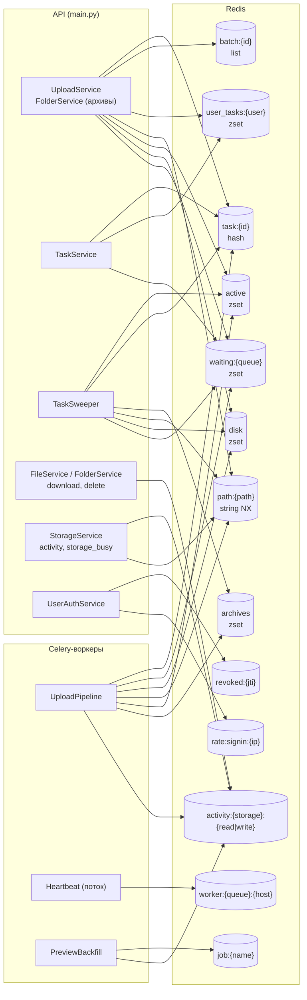

# Redis: карта ключей

Redis хранит всё быстрое и временное: задачи загрузок и архивов (таблицы задач в PostgreSQL нет), блокировки путей,
индексы очередей, heartbeat воркеров, метки активности хранилищ, отозванные access-токены и счётчик входов. Файлы в
Redis не попадают. Все ключи начинаются с `REDIS_PREFIX` (`tcloud`), значения полей задачи — JSON.

Код: `src/infrastructure/cache/tasks.py` (`TaskStore`, Lua `CLAIM`/`REQUEUE`/`CANCEL`/`DISK_SLOT`/`UNLOCK`/`RENEW`),
`cache/tokens.py` (`TokenBlacklist`), `cache/limits.py` (`RateLimiter`), `background/heartbeat.py` (`Heartbeat`).
Клиент создаёт `cache/factory.py` (`create_redis`, `create_sync_redis` для потока heartbeat).

## Ключи

| Ключ | Тип | Что | Кто пишет / читает | TTL |
|---|---|---|---|---|
| `tcloud:task:{id}` | hash | задача: каждое поле — JSON, пишется отдельно (`HSET` по полям), прогресс не затирает статус | `TaskStore.create/update/get/get_many`; API и воркеры | `UPLOAD_TASK_TTL` (7 дней), продлевается на каждом `update` |
| `tcloud:batch:{id}` | list | id задач пачки по порядку (`GET /api/tasks?batch_id=`) | `TaskStore.create`, `batch` | `UPLOAD_TASK_TTL` |
| `tcloud:user_tasks:{user_id}` | zset | id задач пользователя, score — время создания; `GET /api/tasks/counts` чистит старше TTL и пропавшие | `TaskStore.create`, `statuses` | `UPLOAD_TASK_TTL` с последней задачи |
| `tcloud:path:{path}` | string | блокировка пути, значение — id задачи; `SET NX`, снимает только владелец (Lua `UNLOCK`); `SCAN path:tcloud/{storage}/*` — «в хранилище идут загрузки» (`409 storage_busy`) | `lock_path`, `unlock_path`, `path_locked`, `storage_busy` | `UPLOAD_LOCK_TTL` (24 ч, страховка) |
| `tcloud:active` | zset | активные задачи, score — время старта; основа `TaskSweeper` и лимита `UPLOAD_MAX_ACTIVE_TASKS` | `activate`, `deactivate`, `active_ids`, `count_active` | — (записи старше `UPLOAD_LOCK_TTL` выбрасывает `count_active`) |
| `tcloud:disk` | zset | задачи, чей файл сейчас в `tmp` (`UPLOAD_MAX_FILES_ON_DISK`), score — время захвата; проверка и захват — Lua `DISK_SLOT` | `take_disk_slot`, `release` | — (зависшие старше `UPLOAD_LOCK_TTL` выбрасываются) |
| `tcloud:waiting:{queue}` | zset | задачи, ждущие в очереди; score `(10 − уровень) × 10¹³ + мкс` — порядок RabbitMQ; ранг = `queue_position` | `join_queue`, `CLAIM` (выход), `leave_queues`, `positions` | — |
| `tcloud:archives` | zset | путь готового архива в `tmp` → срок (`UPLOAD_ARCHIVE_TTL`); `TaskSweeper.clean_tmp` не трогает до срока и удаляет после | `keep_archive`, `archives`, `forget_archive` | — |
| `tcloud:worker:{queue}:{host}` | string | heartbeat воркера (`health.workers`) | `Heartbeat` раз в `UPLOAD_HEARTBEAT_INTERVAL`; `TaskStore.workers` | 3 × `UPLOAD_HEARTBEAT_INTERVAL` |
| `tcloud:activity:{storage_id}:{read\|write}` | string | «с хранилищем сейчас работают» для `GET /api/storages/activity` (flows/storages.md) | `mark_activity`; `activity` — один `MGET` | 5 с (`ACTIVITY_TTL`) |
| `tcloud:job:{name}` | string | одна фоновая задача на имя (`job:previews` — дозаполнение превью), значение — id задачи Celery; `SET NX`, свой ключ продлевается (Lua `RENEW`), снимает только владелец (Lua `UNLOCK`) | `TaskStore.hold_job`, `release_job`; `PreviewBackfill` | 120 с (`JOB_TTL`), продлевается каждые 30 с |
| `tcloud:revoked:{jti}` | string | отозванный access-токен (logout, refresh, смена пароля) | `TokenBlacklist.revoke/revoked` | `JWT_ACCESS_TOKEN_EXPIRATION_MINUTES` |
| `tcloud:rate:signin:{ip}` | string | счётчик входов с IP, фиксированное окно; Redis недоступен — вход пропускается (fail open) | `RateLimiter.hit` | `JWT_SIGNIN_IP_WINDOW` (ставится `EXPIRE NX`) |

## Поля задачи (`task:{id}`)

| Поле | Что |
|---|---|
| `id`, `batch_id`, `user_id`, `path`, `created_at`, `updated_at` | идентичность и владелец |
| `status`, `stage`, `priority`, `priority_level`, `generation` | состояние (background-tasks.md, «Статусы и стадии») |
| `bytes_done`, `bytes_total`, `stage_started` | прогресс; `speed`/`eta` считаются при чтении (`TaskService.render`) |
| `waiting` | `{"reason": "queue:{queue}" \| "disk_slots" \| "retry" \| "flood_wait", "until"?}`; код для API — часть `reason` до `:` |
| `params` | параметры загрузки (`source`, `send_as`, `on_conflict`, `encrypt`, `callback_url`, `url`, `limit`, `file`) или архива (`storage_id`, `folder`, `format`, `file_ids`, `file`) |
| `archive` | `{name, format, files, path, size, expires_at}` у архивов |
| `error`, `warnings`, `file_id` | итог |
| `claimed` | очередь, в которой задачу захватил воркер (`CLAIM`) |
| `cancel` | флаг отмены во время работы |
| `prepared` | результат проверки: `send_path`, `thumb`, `media`, `sha256`, `as_file`, `warnings`, у шифрования `encryption_header`, `plain_size`, `thumbnail` |
| `sent`, `committed` | отправлено в Telegram / записано в `files` — защита от дублей при повторной доставке |
| `beat_at` | heartbeat задачи для `TaskSweeper` |

Через `UPLOAD_TASK_TTL` задача пропадает, `GET /api/tasks/{id}` отвечает `404`; сам файл остаётся в `files`.
